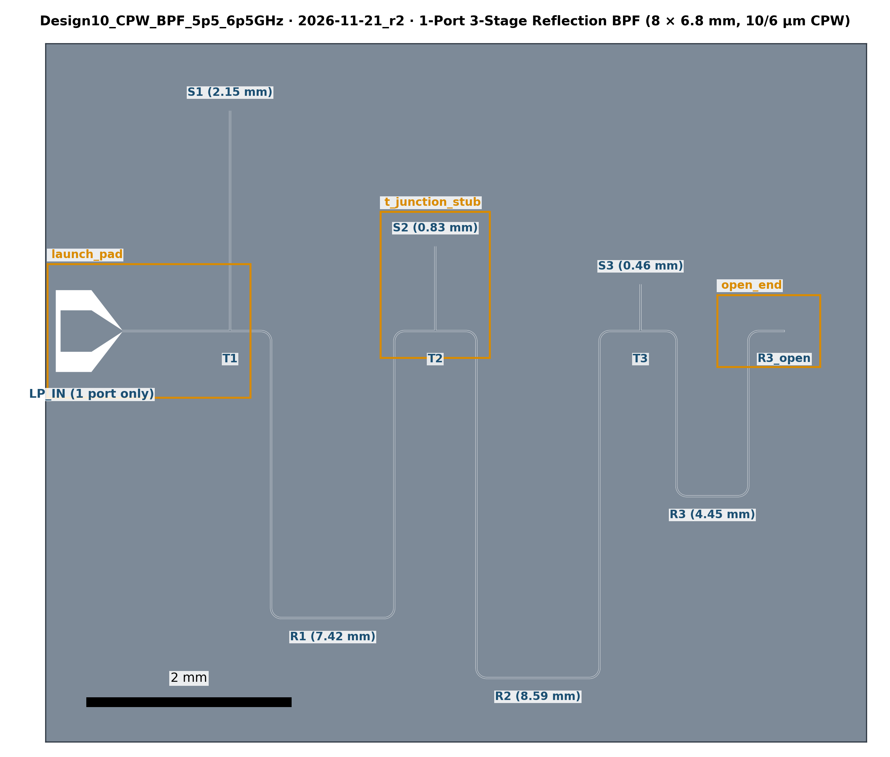

# Design10_CPW_BPF_5p5_6p5GHz: Single-Port (1-Port) 3-Stage 5.5–6.5 GHz Reflection CPW Bandpass Filter (>40 dB Attenuation in 2–4 GHz)

**Figures:** [fig/](fig/README.md) holds the whole chip ([`chip.png`](fig/chip.png)) and part close-ups, rendered from the current GDS by `code/general/plot_design_figs.py`.

## 1. Design purpose and current status

Pure passive **single-port (1-port) 3-stage reflection CPW bandpass filter** (no qubit, no 1-pole Purcell resonator, **only one physical port `LP_IN`**) targeting **$5.5\text{–}6.5\text{ GHz}$ flat 3-stage passband** and **$> 40\text{ dB}$ attenuation across $2\text{–}4\text{ GHz}$**, built with **100% uniform $10/6\text{ }\mu\text{m}$ CPW** ($W = 10\text{ }\mu\text{m}$, $S = 6\text{ }\mu\text{m}$, $R = 99\text{ }\mu\text{m}$ fillets) on an **$8.0 \times 6.8\text{ mm}$** silicon chip:

1. **Single physical port (`LP_IN`):** Left-edge standard `BondPad` at $(-3.50, +0.60)\text{ mm}$ (`orientation = 0°`). No second launch pad.
2. **3-stage singly-terminated reflection BPF (100% 10/6 µm CPW):**
   - 3 completely **straight** short-circuited $10/6\text{ }\mu\text{m}$ CPW inductive coupling stubs (`S1 = 2.1473 mm`, `S2 = 0.8264 mm`, `S3 = 0.4576 mm`, zero bends).
   - 3 wide U-loop resonator sections below $y = +0.60\text{ mm}$: `R1 = 7.4199 mm` ($\sim \lambda/2$), `R2 = 8.5865 mm` ($\sim \lambda/2$), and `R3 = 4.4458 mm` ($\sim \lambda/4$) terminating in `R3_open` (`OpenToGround` at $x = +3.20\text{ mm}$). Because `R3` is $\lambda/4$ open-ended, the filter is **100% mode-free below $5.5\text{ GHz}$**.
   - **Zero interdigital capacitors, zero narrow coupling gaps, zero vias.**
3. **Phase-velocity calibration:** Uses $v_{\text{ph,eff}} = 1.1716 \times 10^8\text{ m/s}$ calibrated from `Design9`'s HFSS Driven run (`20261121_105143_hfss_driven_s21_49164b56`).

- **Status:** `simulated_pending_confirmation` (Stage 2 HFSS Driven complete), geometry revision `2026-11-21_r2` ([`design.json`](design.json)).
- **EM simulation status:** **Completed in HFSS DrivenModal (`2.0–7.5 GHz` Fast sweep, 3 passes user override, `10 µm` mesh, 40 PEC wirebonds, `451,272` tets, Pass 3 `Max Mag. Delta S = 0.033366`).**
- **GDS status:** **No GDS file generated yet.**

## 2. Layout, HFSS figures, and data exports

- **Layout builder:** [`layout/build.py`](layout/build.py)
- **Layout figures (no GDS):** [`fig/README.md`](fig/README.md) · [`fig/chip.png`](fig/chip.png) · [`fig/launch_pad.png`](fig/launch_pad.png) · [`fig/t_junction_stub.png`](fig/t_junction_stub.png) · [`fig/open_end.png`](fig/open_end.png)
- **HFSS Driven scripts:** [`simulation/resonator/hfss_s21.py`](simulation/resonator/hfss_s21.py) · [`simulation/resonator/export_hfss_1port.py`](simulation/resonator/export_hfss_1port.py)
- **Pure HFSS Driven figure (no analytic overlay):** [`notes/fig/hfss_1port_s21_s11.png`](notes/fig/hfss_1port_s21_s11.png)
- **Adopted HFSS data exports (ideal-open $\Gamma_2 = +1$ re-analysis of `20261121_162252_hfss_driven_1port_3stage_9d5ee50f`):**
  - Full `2.0–7.5 GHz` CSV (2201 pts, ideal-open `S11` mag/phase/$\tau_g$ + internal `|V_open/V_inc|`): [`results/resonator/20261121_210808_reanalysis_hfss_1port_s11_vopen_c8ba26ca/summaries/hfss_1port_2_7p5GHz.csv`](results/resonator/20261121_210808_reanalysis_hfss_1port_s11_vopen_c8ba26ca/summaries/hfss_1port_2_7p5GHz.csv)
  - Ideal-open 1-port Touchstone `.s1p` (`S11` = Circulator + VNA `S21`): [`results/resonator/20261121_210808_reanalysis_hfss_1port_s11_vopen_c8ba26ca/summaries/hfss_1port_s11.s1p`](results/resonator/20261121_210808_reanalysis_hfss_1port_s11_vopen_c8ba26ca/summaries/hfss_1port_s11.s1p)
  - Immutable raw HFSS 50 Ω S-parameters & convergence: [`results/resonator/20261121_162252_hfss_driven_1port_3stage_9d5ee50f/raw/S_params_raw50.csv`](results/resonator/20261121_162252_hfss_driven_1port_3stage_9d5ee50f/raw/S_params_raw50.csv) · [`raw/hfss_convergence.csv`](results/resonator/20261121_162252_hfss_driven_1port_3stage_9d5ee50f/raw/hfss_convergence.csv)

## 3. Parameter summary and HFSS Driven results

| Parameter | Target / Input | Pre-EM analytic | **HFSS Driven result (3 passes, ideal open)** | Unit | Status |
|---|---|---|---|---|---|
| Physical ports | 1 (`LP_IN` only) | 1 (`LP_IN`, `R3_open`) | **1 (`LP_IN`, ideal open at `R3_open`)** | — | verified |
| Circulator+VNA `\|S21\| = \|S11\|` | Lossless 1-port | $0.000$ | **$0.000$** (flat; passband shown in phase & $\tau_g$) | $\text{dB}$ | verified |
| Internal `\|V_open/V_inc\|` ($-3\text{ dB}$) | $5.5\text{–}6.5$ | $5.43\text{–}6.61$ | **$5.360\text{–}6.558$** ($f_0 = 5.959$) | $\text{GHz}$ | **PASS** |
| In-band $5.5\text{–}6.5\text{ GHz}$ min | Flat 3-stage | $-0.51$ | **$-1.798$** | $\text{dB}$ | verified |
| Stopband $2\text{–}4\text{ GHz}$ max | $\le -40.0$ ($>40\text{ dB}$) | $-44.04$ | **$-43.65$** (`@2G: -67.17`, `@3G: -57.18`, `@4G: -43.65`) | $\text{dB}$ | **PASS** |
| Reflection group delay $\tau_g(S_{11})$ | 3-stage flat in-band | $1.2\text{–}2.6$ / $0.05$ (`@3G`) | **median $1.333$** (`5.5–6.5G`) / **$0.0594$** (`@3G`) | $\text{ns}$ | verified |
| Straight shorted stubs `S1, S2, S3` | 10/6 µm CPW | $2.1473,\ 0.8264,\ 0.4576$ | Same (`2026-11-21_r2`) | $\text{mm}$ | input / derived |
| Resonator U-loops `R1, R2, R3` | 10/6 µm CPW | $7.4199,\ 8.5865,\ 4.4458$ | Same (`2026-11-21_r2`) | $\text{mm}$ | input / derived |

## 4. Limitations and solver notes

- **Pass-count override:** Ran `max_passes = 3` (user-requested override of repo default 4 passes) after explicit `10 µm` mesh on all 10 signal objects (`451,272` tets). Pass 3 reached `Max Mag. Delta S = 0.033366` (slightly above the `0.02` default stopping target); a 4+ pass convergence check has not been run.
- **No GDS exported yet:** Stage 3 fab export awaits user confirmation.

[Geometry inputs](parameters/geometry.json) · [Quantum inputs](parameters/quantum.json) · [Solver settings](parameters/solver.json) · [Provenance](parameters/provenance.json)
