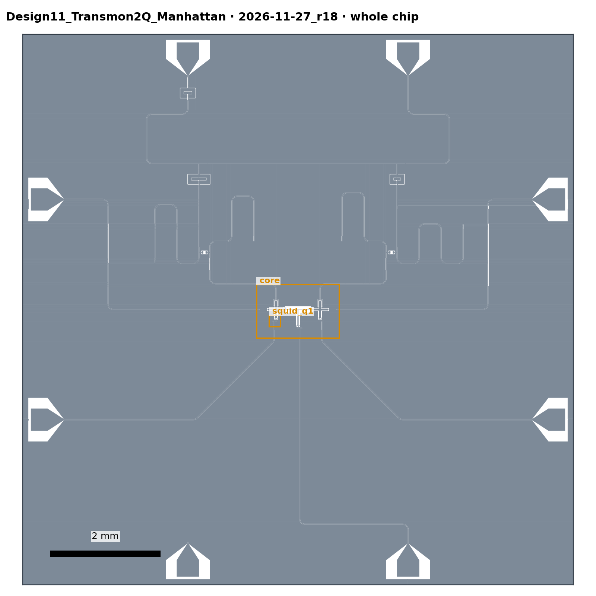
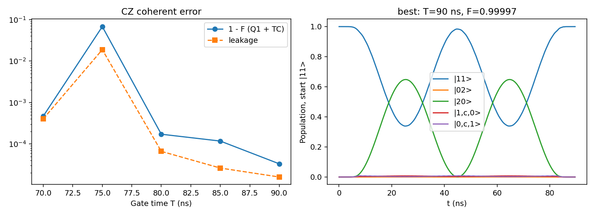
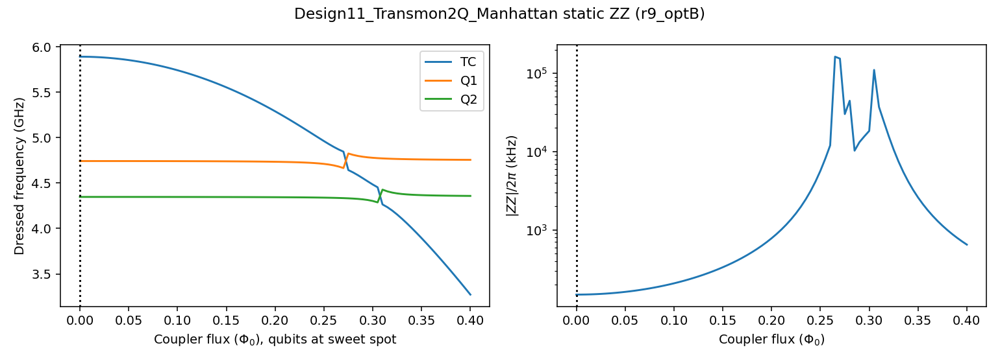
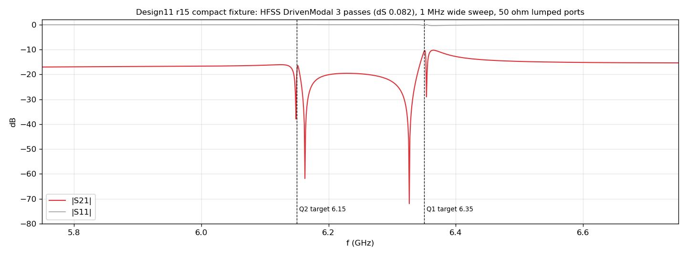
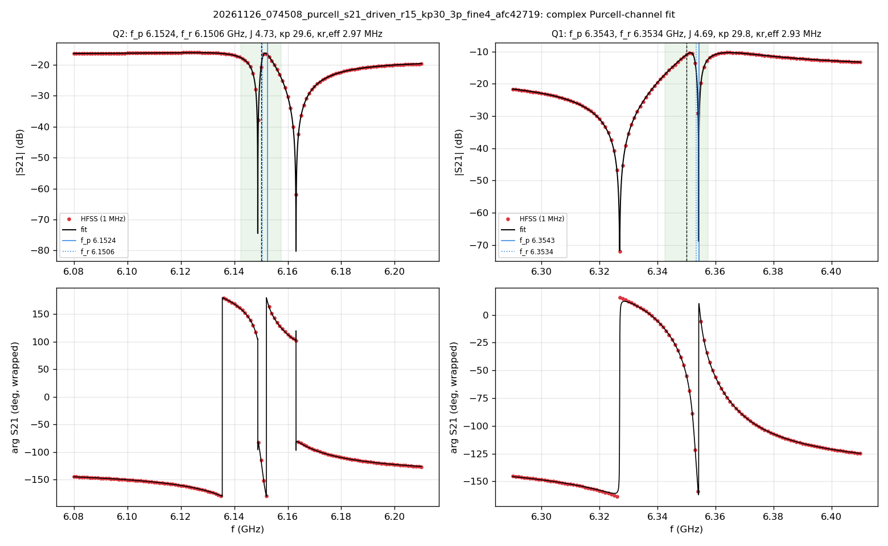

# Design11_Transmon2Q_Manhattan

Two flux-tunable transmons (`Q1`, `Q2`) coupled through a flux-tunable transmon coupler (`TC`) with **Manhattan-style Josephson junctions** (no Dolan contact hooks), paired with two `< 6.5 GHz` `PurcellReadout` channels retargeted to **readout option B (`κ_r = |2χ| = 3.0 MHz`, `κ_p = 30 MHz`)** at fixed qubit `E_C`, on a 10 × 10 mm 8-port wafer die (4 mm symmetric launch ports, `±2.0 mm` on all four sides).

> **Design ID:** `IPRT2Q00` (user, 2026-11-26). It is the per-chip label text and goes onto the mask at Stage 3 (fab GDS); it is not in the sim GDS. No component name is a prefix of it (`skill/gds_export.md` §3). Wafer die IDs (`D00`, `D01`, …) are assigned separately at wafer assembly.
>
> **Status (2026-11-28):** Layout is **`r20`** (`T` flux lines `T_FLUX_OPTIONS: fbl_length = 100 µm, fbl_x = 30 µm, fbl_sep = 10.5 µm`, compact `36 × 30 µm` SQUID loops `jj_gap = 36 µm, squid_spacing = 36 µm, squid_bar_height = 6 µm`, `Q1 / Q2 cross_length = 150.4 / 150.5 µm`, 2 × 4-probe `ManhattanTestJunction` coupons `tj_m1`, `tj_m2` at `(±1.50, −3.10) mm`, and etched `1400 µm` `SquidFlowerLogo` at `(0, +3.90) mm`, synced with the Design12 `r7` core; `r17` 200 µm-hammer PurcellReadout channels unchanged).
> - **Core & flux validation (shared with Design12 `r5`–`r7`):** Q3D (`4` passes, user `< 5` pass cap) gives `E_C = 220.2 / 220.2 / 205.1 MHz`, `g_n = 66.4 / 66.4 / 3.4 MHz`; HFSS `M` (`4` passes + `6 µm` seed) gives `|M| = 0.774 / 0.804 / 0.753 pH` (`I_Φ0 = 2.67 / 2.57 / 2.74 mA`, `L_fl ≈ 81 pH`, `L_geo = 62.4 pH`); CZ coherent `F = 0.999963` at `90 ns` (`ZZ_idle = −122.3 kHz`).
> - **Readout (`r17`–`r20`, 2026-11-28):** 200 µm-hammer channels verified in 4-pass driven S21 (`κ_p = 30.9 / 30.0 MHz`, `J = 5.26 / 4.27 MHz`), 3-pass full eigenmode (`5e03bacb`), and 6-pass fast single-channel eigenmode (`773b81a3` / `719c96a8`, < 27 min/channel): Q1 `f_p / f_r = 6.3868 / 6.3858 GHz` (`f_r − f_p = −1.0 MHz`), Q2 `f_p / f_r = 6.1784 / 6.1821 GHz` (`f_r − f_p = +3.7 MHz`), `J = 5.16 / 5.04 MHz` (pass 5→6 still moving +5–10 MHz; pass counts are execution settings, not convergence evidence; see [notes/readout_frequency_method_comparison.md](notes/readout_frequency_method_comparison.md)). `design.json` adopted runs remain unchanged pending user confirmation.
> - **Stage 3 (NCKU):** single-die fab GDS `gds/Design11_2026-11-27_r20_fab.gds` (die ID `IPRT2Q00`, 8/8 junction sites empty including `tj_m1`/`tj_m2`, `1400 µm` `SquidFlowerLogo`, no markers) exported for NCKU wafer delivery under `Fabrication output/20261127/`.

---

## 0. Accepted Simulation Summary (`r15`, user-accepted 2026-11-26)

These are the simulated qubit, CZ and readout values of the accepted revision, together with the coherence times that were **assumed** (no `T_1` / `T_2` has been measured or simulated for this chip). The core Q3D and the CZ simulation use the `r9` core, which `r10`–`r15` did not change (only the readout channels were modified).

**Qubits and couplers** (Q3D `results/qubit/20261125_215712_q3d_core_r9_optB_e3d7e352`, §7.1):

| | `E_C` | `g_qr` | Idle `f_01` (dressed) | `α` |
|---|---:|---:|---:|---:|
| **Q1** | `220.2 MHz` | `118.8 MHz` | `4.7423 GHz` | `-243.8 MHz` |
| **Q2** | `220.5 MHz` | `128.2 MHz` | `4.3474 GHz` | `-249.1 MHz` |
| **TC** | `198.5 MHz` | — | `5.8910 GHz` | — |

- **Couplings:** `g_n` (Q1–TC / Q2–TC / Q1–Q2) = `64.6 / 64.5 / 3.3 MHz`, against targets of `68 / 68 / 7.2 MHz`.
- **Idle ZZ:** `-149.6 kHz` at `Φ = 0`.

**CZ gate** (`scqubits` exact charge basis, `results/qubit/20261125_220541_cz_verify_r9_optB_289426f4`, §7.2):
- **Scheme:** `Q1 + TC` flux pulse (`|11⟩ ↔ |20⟩`), 8 ns cosine ramp.
- **Simulation is coherent only:** no `T_1`, `T_2` or flux noise in the time evolution.

| Gate time | Conditional phase | Leakage | Coherent `F` | `T_1`-limited `F`, `T_1 = 50 µs` | `T_1`-limited `F`, `T_1 = 100 µs` |
|---:|---:|---:|---:|---:|---:|
| **`90 ns`** (operating point) | `179.97°` | `1.6e-5` | **`0.999967`** | `0.9985` | `0.9992` |
| `85 ns` | — | — | `0.999883` | `0.9985` | `0.9992` |

The `T_1`-limited columns are an **estimate**, not a simulation. They add the amplitude-damping error of two qubits during the gate, `ε_T1 ≈ (4/5) T_gate / T_1`, to the coherent error. This is the average-gate-fidelity of independent amplitude damping on both qubits in the computational subspace (`d = 4`). It ignores pure dephasing (`T_φ`), decay of the `|2⟩` / coupler population during the pulse, and flux noise, so the real error is larger.

**Readout** (HFSS `r15` complex fit, §4 "HFSS readout spectrum", and `results/qubit/20261126_021946_readout_optB_chi_40572e5f`):

| | `f_r` / `f_p` | `κ_p` / `J` / `κ_r,eff` | `2χ` | `n_crit` | Purcell `T_1` (Sete / Lorentzian) |
|---|---:|---:|---:|---:|---:|
| **Q1** | `6.3534 / 6.3543 GHz` | `29.8 / 4.69 / 2.93 MHz` | `-3.05 MHz` | `45.8` | `1.39 ms` / `0.11 s` |
| **Q2** | `6.1506 / 6.1524 GHz` | `29.6 / 4.73 / 2.97 MHz` | `-3.04 MHz` | `49.6` | `1.79 ms` / `0.15 s` |

Single-shot assignment fidelity (model: homodyne, ring-up included, `ε_T1 = τ / 4T_1`, optimised over `τ`):

| Assumed `T_1` | Drive `n̄` | Efficiency `η` | Q1 `F_ro` (`τ`) | Q2 `F_ro` (`τ`) |
|---:|---:|---:|---:|---:|
| **`50 µs`** | `10% n_crit` (`4.6` / `5.0`) | `0.25` | **`99.64%`** (`636 ns`) | **`99.66%`** (`606 ns`) |
| **`100 µs`** | `20% n_crit` (`9.2` / `9.9`) | `0.50` | **`99.92%`** (`314 ns`) | **`99.92%`** (`304 ns`) |

**Coherence assumptions used above:**

| Quantity | Assumed / derived value | Where it is used |
|---|---|---|
| Qubit `T_1` (assumption) | `50 µs` (conservative) and `100 µs` (optimistic) | Readout `ε_T1 = τ / 4T_1`, CZ `T_1`-limited estimate |
| Qubit `T_2`, `T_φ`, flux noise | not included | CZ simulation is coherent only |
| Purcell `T_1` (derived) | `1.39 / 1.79 ms` (Sete band-pass bound), requirement `≥ 1 ms` | Readout-induced decay limit; not the assumed qubit `T_1` |
| Measurement efficiency `η` (assumption) | `0.25` / `0.50` | Readout SNR |
| Readout-mode thermal photons `n_th` (unknown) | scanned `1e-4 … 1e-2` (`T_eff` 30–80 mK) | Photon shot-noise dephasing (below) |

**Photon shot-noise dephasing (from 2χ / κ)** (`simulation/qubit/photon_shot_noise.py`, run `results/qubit/20261126_200640_photon_shot_noise_b856b4ed`, scqenv):

Thermal photons in the readout resonator dephase the qubit. With the full dispersive shift 2χ and resonator linewidth κ (n_th ≪ 1):

`Γ_φ = n_th · κ · (2χ/κ)² / [1 + (2χ/κ)²]`. At `|2χ| = κ` this gives `Γ_φ = n_th κ / 2`.

The common form `Γ_φ ≈ (2χ)² n_th / κ` holds only for `2χ ≪ κ`; here it would overestimate by 2×. The script uses the full Clerk–Utami expression; at `n_th ≤ 1e-2` it differs from the form above by < 1 %.

| | `2χ` | `κ_r` | `2χ/κ` | factor `(2χ/κ)²/[1+(2χ/κ)²]` | `Γ_φ / n_th` | `T_φ` |
|---|---:|---:|---:|---:|---:|---:|
| **Q1** | `-3.054 MHz` | `3.0 MHz` | `1.02` | `0.51` | `9.6e6 s⁻¹` | **`0.104 µs / n_th`** |
| **Q2** | `-3.044 MHz` | `3.0 MHz` | `1.01` | `0.51` | `9.6e6 s⁻¹` | **`0.105 µs / n_th`** |

`κ_r` is the design target; the `r15` fit gave `2.93 / 2.97 MHz`, and `r17` is not simulated. The table below gives `T2` from `1/T2 = 1/(2T1) + Γ_φ`, with photon shot noise only:

| `T_eff` (readout mode) | `n_th` (Q1 / Q2) | `T_φ` (Q1 / Q2) | `T2` at `T1 = 50 µs` | `T2` at `T1 = 100 µs` |
|---:|---:|---:|---:|---:|
| 30 mK | `3.9e-5 / 5.3e-5` | `2.7 / 2.0 ms` | `96 / 95 µs` | `186 / 182 µs` |
| 40 mK | `4.9e-4 / 6.3e-4` | `212 / 168 µs` | `68 / 63 µs` | `103 / 91 µs` |
| 50 mK | `2.3e-3 / 2.7e-3` | `46 / 38 µs` | `32 / 28 µs` | `38 / 32 µs` |
| 60 mK | `6.3e-3 / 7.4e-3` | `17 / 14 µs` | `14 / 13 µs` | `15 / 13 µs` |
| 70 mK | `1.3e-2 / 1.5e-2` | `8 / 7 µs` | `8 / 7 µs` | `8 / 7 µs` |

- **Requirement:** reaching `T2 ≈ 2T1` needs `n_th ≲ 1e-4` (`T_eff ≲ 35 mK`).
- **Typical setups:** a typical `n_th ≈ 1e-3 … 5e-3` (`T_eff` 45–60 mK) limits `T2` to about 20–70 µs.
- **Cost of option B:** `κ_r = |2χ| = 3 MHz` gives fast readout but a larger `Γ_φ ≈ n_th κ / 2`. With `κ = |2χ| = 1 MHz`, `T_φ` would be about 3× longer at the same `n_th`, with about 3× longer readout.
- **Wiring:** keep `n_th ≲ 5e-4` with enough attenuation and IR / low-pass filtering on the readout input. The Purcell filter passes the resonator band and does not filter these photons.
- **Not included:** flux noise (sweet-spot operation, first order zero), TLS and charge noise, so the real `T2` will be shorter.

---

## 1. Manhattan Junction Modeling Rule (Critical for Q3D `E_C`)

Uses the shared repository Manhattan components (`pattern design/transmon/xmon_manhattan.py` and `claw_coupler_manhattan.py` with `manhattan_leads.py` tapered + 45°-bent rounded-tip leads, compatible with `TransmonJunctionManhattan` via `manhattan_sites()`). Base-metal Manhattan leads are included directly in Layer 1 during Q3D extraction, and all 90° corners carry `R = 5 µm` rounding (`layout/components/round_corners.py`).

---

## 2. Qubit & Coupler Target Parameters

All frequencies and energies are `E/h`. `E_J` / `L_J` are user/quantum-model design inputs (not independently extracted by HFSS/Q3D).

| Element | Bare / Dressed Idle `f_01` | Target `E_C` | Target `C_Σ` | Dressed `α` | SQUID (`d`) | Target `E_JΣ` | Branch `E_J1 / E_J2` (GHz) | Target `L_J` (nH) |
|---|---|---|---|---|---|---|---|---|
| **Q1** | `4.750` / **`4.739 GHz`** | `220 MHz` | `88.05 fF` | `-243.4 MHz` | Asymmetric `d = 1/3` (2:1) | `14.10 GHz` | `9.40` / `4.70` | `17.39` / `34.79` |
| **Q2** | `4.350` / **`4.342 GHz`** | `220 MHz` | `88.05 fF` | `-248.4 MHz` | Asymmetric `d = 1/3` (2:1) | `11.93 GHz` | `7.95` / `3.98` | `20.55` / `41.11` |
| **TC** | `5.900` / **`5.915 GHz`** | `200 MHz` | `96.85 fF` | — | Symmetric `d = 0` (1:1) | `23.31 GHz` | `11.66` / `11.66` | `7.01` (total `L_J`) |

### Coupling Targets (Q3D Extraction Targets, ±3% accepted tolerance)

| Coupling | Charge-unit `g_n` (`g_n n_i n_j`) | Exchange `g_ex` (`g_ex σ⁺σ⁻`) | Role |
|---|---:|---:|---|
| **Q1 – TC** | **`68.0 MHz`** | `111.7 MHz` | Tunable coupler mediation |
| **Q2 – TC** | **`68.0 MHz`** | `107.2 MHz` | Tunable coupler mediation |
| **Q1 – Q2** | **`7.2 MHz`** | `9.77 MHz` | Cancels coupler-mediated ZZ at idle |

---

## 3. Target CZ Gate Performance (`scqubits` Exact Charge Basis)

- **Scheme:** `Q1 + TC` flux pulse (`|11⟩ ↔ |20⟩`), 8 ns cosine ramp + flat-top (`dt = 0.05 ns`, `Q = 4`, `TC = 5`, `ncut = 15`, coherent only — no T1/T2 or flux noise).
- **Idle point:** All three SQUIDs at their sweet spots (`Φ_Q1 = Φ_Q2 = Φ_TC = 0`, zero first-order flux noise), static **`ZZ_idle = -22.6 kHz`**.
- **Optimal gate:** **`T = 75 ns`**, `f_1,gate = 4.562 GHz`, `f_c,gate = 5.031 GHz` (469 MHz above `f_1,gate`, not hitting coupler bound), conditional phase **`180.00°`**, leakage **`5.45 × 10⁻⁵`**, **coherent average gate fidelity `F = 0.99994` (`99.994%`)**.
- **Plateau:** `T = 70–80 ns` remains smoothly above **`F = 99.98%`** (`70 ns: 0.99980`, `75 ns: 0.99994`, `80 ns: 0.99985`).
- **±10% timing sensitivity (fixed 75 ns amplitude):** `-10% (67.5 ns)` → `F = 0.9656, leak = 3.33%`; `+10% (82.5 ns)` → `F = 0.9665, leak = 3.25%`.

---

## 4. Purcell Filter + Readout Resonator (`10/6 µm` CPW, option B, `< 6.5 GHz`)

**Option B (user-selected 2026-11-25, `E_C` fixed):** `κ_r = |2χ| = 3.0 MHz` (`|2χ| / κ_r = 1`), `κ_p = 30 MHz` (user, 2026-11-26; was `20 MHz` until `r9`), `J = √(κ_r κ_p) / 2 = 4.743 MHz`, `f_p = f_r`. With `κ_p = 30 MHz` the f_r–f_p mismatch that costs 20 % of `κ_r` is `±7.5 MHz` (`±5.0 MHz` at `κ_p = 20 MHz`), and the Sete Purcell `T_1` drops to `1.39 / 1.79 ms`. Compared with option 1 (`r8`, `κ_r ≈ 1 MHz`) it halves the optimal measurement time and widens the f_r–f_p mismatch that costs 20 % of `κ_r` from about `±2.7 MHz` to `±5.0 MHz`.

Targets and realised values (`|2χ|`, `n_crit`, Purcell `T_1` from `simulation/qubit/readout_optB_chi.py --kappa-p 30`, run `results/qubit/20261126_021946_readout_optB_chi_40572e5f`, on the `r9` core Q3D `g_qr`; the `κ_p = 20 MHz` run `20261125_220517_readout_optB_chi_37e83927` gave `T_1,P` `0.25 s / 2.09 ms` and `0.34 s / 2.69 ms`):

| Channel | `f_r = f_p` | Target `g_qr` | `r9` Q3D `g_qr` | `r9` `2χ` | `\|2χ\| / κ_r` | `n_crit` | `T_1,P` Lorentzian tail / Sete 2015 |
|---|---:|---:|---:|---:|---:|---:|---:|
| **Q1** | `6.35 GHz` | `118.0 MHz` | **`118.8 MHz`** | **`-3.054 MHz`** | **`1.018`** | `45.8` | `0.11 s` / `1.39 ms` |
| **Q2** | `6.15 GHz` | `127.9 MHz` | **`128.2 MHz`** | **`-3.044 MHz`** | **`1.015`** | `49.6` | `0.15 s` / `1.79 ms` |

`2χ` is from exact `scqubits` transmon + oscillator diagonalisation. The earlier option 1 table quoted `2χ = -1.04 / -0.73 MHz`, but the same method gives `-1.38 / -1.01 MHz` for those `g_qr`, so its source model is unknown. The Sete band-pass bound is the conservative Purcell estimate; both are above the `1 ms` requirement.

### Channel geometry (`layout/build.py` `PURCELL_CHANNELS`, `r17`, unchanged through `r20`)

| Channel | `L_filter` | `L_res` | Hammer head (`head_width` × `head_height`) | `head_gap` | `C_p` plate | Resonator tap (incl. open extension) |
|---|---:|---:|---:|---:|---:|---:|
| **Q1** | `4.1577 mm` | `4.4060 mm` | `20 × 40 µm` | `45.2 µm` | `267.0 µm` | `1.935 mm` |
| **Q2** | `4.5024 mm` | `4.5370 mm` | `20 × 40 µm` | `44.6 µm` | `123.0 µm` | `1.935 mm` |

Hammer line spacing: **200 µm centre to centre**. The filter line and feed tee are at x = ±1.80 mm, the resonator line at ±1.60 mm.

**Source:** `results/resonator/20261126_155318_q3d_length_solve_11ac23ec` (`simulation/resonator/q3d_length_solve.py`). It uses only Q3D inputs:
- **Line constants:** straight 10/6 CPW, `results/resonator/20261126_133418_q3d_cpw_line_cpw106_a7600d2d` (4 passes, 10 µm). C' = 157.4 fF/mm and ε_eff = 6.365, against the analytic 163.5 fF/mm and 6.225. The analytic ε_eff alone put every line about 70 MHz low.
- **Loads:** full-fixture in-situ Q3D, `results/resonator/20261126_143615_q3d_channel_insitu_r16_full_6f7f7bec` (feed, C_in, both channels with short ends opened, both qubits, no wire bonds). It gives the in-situ C_j, the end loads and C_qr. The model check against HFSS is `20261126_144132_q3d_model_check_fa91743e`.
- **Targets:** f_p = f_r = 6.35 / 6.15 GHz and J = 4.74 MHz, which needs in-situ C_j = 0.861 fF.
- **`head_gap`:** the in-situ C_j is scaled with the shape of the existing 200 µm / 40 µm coupon C_j(gap) curve. No new coupon runs.
- **C_p plates:** kept from `r16`, where driven κ_p was 28.6 / 30.6 MHz.

**Expected residuals (not applied):** at `r16` the Q3D model differed from eigenmode pass 2 (approximate) by f_p −29 / +11 MHz and f_r −15 / +10 MHz (Q1 / Q2). The driven S21 f_r was not converged; Q2 read 6.090 GHz in driven against about 6.16 GHz in eigenmode (see `skill/em_simulation.md` §4).

**Method comparison (`r17`, 2026-11-28):** [notes/readout_frequency_method_comparison.md](notes/readout_frequency_method_comparison.md) compares the Q3D model, HFSS eigenmode (full 3-pass and fast 6-pass single-channel) and driven S21.
- **Fast single-channel eigenmode (6 passes, local 10 µm mesh, pass-by-pass):**
  - Q1 (`20261128_173735_hfss_eigen_r17_q1_fast2_773b81a3`, 26.82 min, 474,877 elements): `f_p / f_r` = **6.3868 / 6.3858 GHz** (+36.8 / +35.8 MHz vs 6.35 GHz target, `f_r − f_p = −1.0 MHz`), `J = 5.16 MHz`, `κ_p = 23.7 MHz`; pass 5 → 6 movement +7.7 / +10.2 MHz.
  - Q2 (`20261128_180600_hfss_eigen_r17_q2_fast_719c96a8`, 23.88 min, 444,278 elements): `f_p / f_r` = **6.1784 / 6.1821 GHz** (+28.4 / +32.1 MHz vs 6.15 GHz target, `f_r − f_p = +3.7 MHz`), `J = 5.04 MHz`, `κ_p = 11.9 MHz` (single-channel omits `C_in`; use driven S21 for `κ_p`); pass 5 → 6 movement +5.2 / +7.4 MHz.
  - Both channels are well aligned in detuning (`|f_r − f_p| ≤ 3.7 MHz` vs `±7.5 MHz` tolerance) and sit ~28–37 MHz above target; proposed shorted-arm trims (+24.1 / +24.9 µm on Q1, +20.8 / +23.7 µm on Q2) are recorded in the comparison note and await user confirmation. Pass counts are execution settings, not convergence evidence.
- **Full-chip eigenmode (3 passes, user override of the 6-pass default):** max ΔF 3.11 %, not converged. Run `20261128_164443_eigen_from_sd_r17_pass3_5e03bacb` gives `f_p` / `f_r` = 6.3844 / 6.3650 GHz for Q1 and 6.1560 / 6.1649 GHz for Q2, with J = 4.90 / 5.09 MHz and κ_p = 31.1 / 30.3 MHz (resonator modes still moving 18–33 MHz/pass).
- **Driven S21 (4 passes, ΔS 0.061):** run `20261128_132341_fit_s21_r17_4p_b889cde1` gives `κ_p = 30.9 / 30.0 MHz` and `J = 5.26 / 4.27 MHz`. Its Q2 `f_r` (6.0736 GHz) is 91 MHz below eigenmode, the known driven artifact.

**History:** `r15` (400 µm hammer) is `4.1142 / 4.3490 mm`, gap `34.3 µm` (Q1) and `4.4246 / 4.4604 mm`, `34.2 µm` (Q2). `r16` (200 µm, `r15` offsets carried over) is `4.1828 / 4.4104 mm`, `38.9 µm` and `4.4984 / 4.5209 mm`, `38.8 µm`. All revisions are listed in `build.py` comments.

### HFSS readout spectrum (`r15`, accepted 2026-11-26)

Compact fixture:
- **Rendered:** the feedline with `C_in` and the tees, `C_p` + `PurcellReadout`, `res_open`, and `Q1` / `Q2` with lumped `L_j` (`flux_as_ground`). No launch pads, control lines or TC.
- **Ports and bonds:** 50 Ω lumped ports at the `feed_cin` and `feed_out` starts. Wire bonds every 350 µm, plus PEC straps.
- **Solver:** HFSS DrivenModal, basis 1, 3 passes (final `ΔS = 0.082`), 10 µm global mesh plus a 4 µm local mesh on the hammer tees, readout claws and crosses.
- **Sweep:** one wide Fast sweep from 5.75 to 6.75 GHz in 1 MHz steps.
- **Runs:** S21 run `results/resonator/20261126_074508_purcell_s21_driven_r15_kp30_3p_fine4_afc42719`. Complex fit `results/resonator/20261126_081341_fit_s21_r15_kp30_3p_fine4_9b88474c` (`simulation/resonator/fit_s21_purcell.py`: hanger filter with Fano phase plus J-coupled resonator on a linear complex background).

| Channel | `f_p` (filter) | `f_r` (resonator) | `f_r − f_p` | `J` | `κ_p` | `κ_r,eff` | Fit residual |
|---|---:|---:|---:|---:|---:|---:|---:|
| Target | `6.35 / 6.15 GHz` | `= f_p` | `±7.5 MHz` | `4.74 MHz` | `30 MHz` | `3.0 MHz` | — |
| **Q1** | `6.3543 GHz` (`+4.3 MHz`) | `6.3534 GHz` (`+3.4 MHz`) | **`−0.9 MHz`** | `4.69 MHz` | `29.8 MHz` | **`2.93 MHz`** | `0.18 %` |
| **Q2** | `6.1524 GHz` (`+2.4 MHz`) | `6.1506 GHz` (`+0.6 MHz`) | **`−1.8 MHz`** | `4.73 MHz` | `29.6 MHz` | **`2.97 MHz`** | `0.45 %` |

There are no other modes in 5.75–6.75 GHz. The off-resonance `|S21| ≈ −15 dB` comes from the series input capacitor `C_in`, as intended. The `|2χ|`, Purcell `T_1` and readout-fidelity values above use the same `κ_p = 30 MHz` / `κ_r = 3 MHz` targets that the fit confirms.

Limitations:
- **3 passes only.** Resonator frequencies scatter by up to about 8–15 MHz between near-identical geometries at 3 passes (§7.4), so `f_r − f_p` is known only to that level.
- **κ_r sensitivity.** A residual `±7.5 MHz` mismatch costs about 20 % of `κ_r`.

The `r8` filter lengths (`4.1878 / 4.3384 mm`) were about `0.10 mm` short relative to the Q3D loads, and `r8` `J` assumed a `1.30 mm` resonator tap while the drawn tap is `1.735 mm`. Both are consistent with the `+110–127 MHz` filter offsets in the 2-pass HFSS screen (§7.4).

### Single-Shot Dispersive Readout Assignment Fidelity (model, `r9` realised `χ`)

Homodyne, optimal phase, ring-up included, `ε_T1 = τ / 4T_1`, optimised over `τ`.

| Channel | Drive `n̄` | `η` | Qubit `T_1` | Optimal `τ_meas` | **`F_ro`** (option 1 `r8`, same settings) |
|---|---:|---:|---:|---:|---:|
| **Q1** | `4.6` (`10% n_crit`) | `0.25` | `50 µs` | `636 ns` | **`99.64%`** (`99.43%`, `1049 ns`) |
| **Q1** | `9.2` (`20% n_crit`) | `0.50` | `100 µs` | `314 ns` | **`99.92%`** (`99.83%`, `634 ns`) |
| **Q2** | `5.0` (`10% n_crit`) | `0.25` | `50 µs` | `606 ns` | **`99.66%`** (`99.34%`, `1232 ns`) |
| **Q2** | `9.9` (`20% n_crit`) | `0.50` | `100 µs` | `304 ns` | **`99.92%`** (`99.79%`, `788 ns`) |

---

## 5. Junction Targets for Fabrication (`fab_junction_targets`, `r18` NCKU)

All energies are `E/h` (GHz); `R_n` via Ambegaokar–Baratoff (Δ = 180 µeV).

| Device | Type | Target `E_J1 / h` (GHz) | Target `E_J2 / h` (GHz) | `E_JΣ / h` (GHz) | Target `L_J1 / L_J2` (nH) | `R_n1 / R_n2` (kΩ) | Style |
|---|---|---:|---:|---:|---:|---:|---|
| **Q1** | Asymmetric 2:1 SQUID Transmon | **9.40** | **4.70** | 14.10 | 17.39 / 34.79 | 14.94 / 29.89 | Manhattan (no hooks) |
| **Q2** | Asymmetric 2:1 SQUID Transmon | **7.95** | **3.98** | 11.93 | 20.55 / 41.11 | 17.66 / 35.32 | Manhattan (no hooks) |
| **TC** | Symmetric 1:1 SQUID Coupler | **11.65** | **11.65** | 23.30 | 14.03 / 14.03 (parallel 7.01) | 12.05 / 12.05 | Manhattan (no hooks) |

- **NCKU Manhattan junction-site centres (`r18`, `squid_spacing = 36.0 µm`, orientation `0°`, µm):**
  - `Q1`: centre `(-400.000, -168.400)` → `jj1 = (-418.000, -168.400)`, `jj2 = (-382.000, -168.400)`
  - `TC`: centre `(-0.050, -303.000)` → `jj1 = (-18.050, -303.000)`, `jj2 = (+17.950, -303.000)`
  - `Q2`: centre `(+400.000, -168.500)` → `jj1 = (+382.000, -168.500)`, `jj2 = (+418.000, -168.500)`

---

## 6. Port Assignment (8-port Symmetric 4 mm Pitch, `wafer_pcb_ports`)

- `P8 (-2.0, +4.5 mm)` → `P7 (+2.0, +4.5 mm)`: Readout / Purcell feedline (`C_in` on `P8`)
- `P1 (-4.5, +2.0 mm)` / `P6 (+4.5, +2.0 mm)`: `Q1` / `Q2` XY drive lines
- `P2 (-4.5, -2.0 mm)` / `P5 (+4.5, -2.0 mm)`: `Q1` / `Q2` flux lines
- `P4 (+2.0, -4.5 mm)`: `TC` flux line (`P3` grounded spare)

---

## 7. Stage 2 Validation Results

### 7.1 Core Q3D Capacitance Extraction (`r9`, option B claw)
- **Run:** `results/qubit/20261125_215712_q3d_core_r9_optB_e3d7e352` (`Ansys Q3D`, 8 passes / 0.5 %, `silicon_eps11p45`, `flux_as_ground=True`).
- **Geometry (`layout/build.py` r9):** `QX = 0.40 mm`; `cross_length = 143.4 / 143.5 µm` (Q1 / Q2), `cross_width = 28 µm`, `cross_gap = 14 µm`; readout claw `claw_sep = 18 µm`, `claw_gap = 6 µm` (no ground strip), `claw_length = 100 / 114 µm`; TC unchanged (`claw_sep = 12.5 µm`, bar `488.1 µm` between the inner arm tips); official tapered + 45° Manhattan leads, `R = 5 µm` corners.
- **Sizing sweeps:** `results/qubit/*_q3d_core_optB_sweepA`–`E`. Removing the 3 µm strip roughly doubles `C_qr` (`5.41 → 10.0 fF` at the `r8` claw length). `sweepD_90af5227` failed to open the AEDT project (stale lock); `sweepD_952f514e` is the valid rerun.

| Quantity | Target | Q3D `r9` | Deviation |
|---|---:|---:|---:|
| `E_C (Q1)` | `220.0 MHz` | **`220.21 MHz`** (`87.96 fF`) | `+0.10%` |
| `E_C (Q2)` | `220.0 MHz` | **`220.47 MHz`** (`87.86 fF`) | `+0.21%` |
| `E_C (TC)` | `200.0 MHz` | **`198.51 MHz`** (`97.58 fF`) | `-0.75%` |
| `g_n (Q1–TC)` | `68.0 MHz` | **`64.59 MHz`** | `-5.0%` (as `r8`) |
| `g_n (Q2–TC)` | `68.0 MHz` | **`64.51 MHz`** | `-5.1%` (as `r8`) |
| `g_n (Q1–Q2)` | `7.2 MHz` | **`3.29 MHz`** | grounded-coupler capacitance limit (as `r8`) |
| `C_qr (Q1)` | `8.02 fF` | **`8.058 fF`** | `+0.5%` |
| `C_qr (Q2)` | `9.37 fF` | **`9.377 fF`** | `+0.1%` |
| `g_qr (Q1 / Q2)` | `118.0 / 127.9 MHz` | **`118.77 / 128.21 MHz`** | `+0.7% / +0.2%` |
| Claw end load (Kron, islands floating) | — | `41.75 / 45.14 fF` | `r8`: `59.44 / 59.50 fF` |

### 7.2 `scqubits` CZ Verification on the `r9` Q3D Matrix
- **Run:** `results/qubit/20261125_220541_cz_verify_r9_optB_289426f4` (exact charge basis, coherent only).
- **Idle (`Φ = 0`):** `f_Q1 = 4.7423 GHz`, `f_Q2 = 4.3474 GHz`, `f_TC = 5.8910 GHz`, `α = -243.8 / -249.1 MHz`, `ZZ_idle = -149.6 kHz`.
- **CZ (`Q1 + TC`, 8 ns cosine ramp):** `T = 90 ns` **`F = 0.999967`**, leakage `1.59e-5`, `φ = 179.97°`; `85 ns` `F = 0.999883`; `80 ns` `F = 0.999828`; `70 ns` `F = 0.999531`. At `75 ns` the pulse search did not reach a CZ (`φ = 146.3°`, leakage `1.9e-2`), so the operating point stays at `85–90 ns`, as in `r8`.

### 7.3 Readout channel solve and coupons (`r9`–`r15`)
- `optB_channel_solve_d09c9372`: geometry adopted in `build.py` (§4). `optB_channel_solve_c9fb5dce`: no-reference re-solve (not adopted, §4).
- `q3d_coupons_optB_sweep_64f55e33`: hammer `C_j` (mutual) `0.981 / 0.624 / 0.426 / 0.249 fF` at `head_gap = 30 / 45 / 60 / 86 µm`; `C_p` mutual `38.03 / 45.12 fF` at plate `140 / 180 µm` (AEDT crashed at `220 µm`). All 8 passes, last-pass change `~2%` (`C_j`) / `<1%` (`C_p`), not at the `0.3%` target.
- `r9` coupon verification (`q3d_coupons_r9_optB_verify_0154d3fc`, `verify2_41532da4`, `verify3_1f2ce3e9`): failed. The first two failed because of a `.` in the AEDT object name (fixed in `q3d_readout_coupons.py`). The third completed only `head_gap = 38.5 µm` (`C_j` mutual `0.754 fF`) before an AEDT `Analyze` error.
- `q3d_coupons_kp30_c6da9f1d` (2026-11-26): `C_j` mutual `0.899 / 0.816 / 0.742 fF` at `head_gap = 33 / 36 / 39 µm`; `C_p` mutual `48.76 / 52.44 / 55.76 fF` at plate `200 / 220 / 240 µm`. Convergence unknown. `optB_channel_solve.py --coupons` now merges several coupon runs (comma-separated, same coupon lead required).
- `q3d_coupons_cp_r13_9a35735e` (2026-11-26): `C_p` mutual `32.88 / 35.44 / 58.41 / 61.92 / 65.50 fF` at plate `110 / 125 / 255 / 275 / 295 µm` (8 passes, last change about 1.2 %).
- Full-feed `κ_p` model (circuit only): `κ_p = 20 MHz` at plate `168.5 / 160 µm` (`r9`), `30 MHz` at `218.3 / 209.6 µm` (`r10`–`r12`). Robustness corners give about `±20%` (tees not at a standing-wave minimum).

### 7.4 HFSS

**`κ_p = 30 MHz` iteration (3 passes, 2026-11-26).** Fixture and mesh are as in the `r9` screening below: one wide Fast sweep from 5.75 to 6.75 GHz in 1 MHz steps, no fine sweep. Bare `f_p` / `f_r` are taken from the two `S21` zeros of each channel, `(z − f_p)(z − f_r) = J²`, using the design `J`. The narrow resonator zero/pole pair spans only 1–2 sweep points, so it was read point by point; the automatic dip pairing misses it.

| Run (geometry, anchor) | `ΔS` | Q1 `f_p` / `f_r` (GHz) | Q1 `f_r − f_p` | Q2 `f_p` / `f_r` (GHz) | Q2 `f_r − f_p` |
|---|---:|---:|---:|---:|---:|
| `20261125_233154_..._r9_3p_fine4_d03f7f05` (`r9`, `κ_p` 20 MHz) | `0.090` | `6.3334 / 6.3201` | `−13.3 MHz` | `6.1290 / 6.0808` | `−48.2 MHz` |
| `20261126_022009_..._r10_kp30_3p_fine4_16b3b1dd` (`r10`, `r9` anchor) | `0.037` | `6.3440 / 6.3532` | `+9.2 MHz` | `6.1517 / 6.1843` | `+32.6 MHz` |
| `20261126_025352_..._r11_kp30_3p_fine4_f60ce91e` (`r11`, `r10` anchor) | `0.097` | `6.3483 / 6.3571` | `+8.8 MHz` | `6.1524 / 6.1418` | `−10.6 MHz` |
| `20261126_032500_..._r12_kp30_3p_fine4_07fb6f2f` (`r12`, `r11` anchor) | `0.061` | `6.3547 / 6.3603` | `+5.6 MHz` | `6.1467 / 6.1335` | `−13.2 MHz` |

After removing the length dependence (`−1.45 MHz/µm`), the filter lines repeat to within 3–5 MHz across `r10`–`r12`. The resonator lines drift 18–22 MHz, although their lengths changed by only 2–26 µm. The 3-pass adaptive mesh, and the re-meandered resonator routing with its wire bonds, change with each geometry. 3-pass S21 therefore cannot resolve the `±7.5 MHz` tolerance. A converged setting (≥ 4 passes, `ΔS < 0.02`, or a finer local mesh on the resonator meanders) is needed before more length trims.

**Per-channel `C_p` retarget and resonator trim (`r13`–`r15`, 3 passes, complex fit):**

| Run (geometry) | `ΔS` | Q1 `f_p` / `f_r` (GHz) | Q1 `J` / `κ_p` / `κ_r,eff` (MHz) | Q2 `f_p` / `f_r` (GHz) | Q2 `J` / `κ_p` / `κ_r,eff` (MHz) |
|---|---:|---:|---:|---:|---:|
| `20261126_064111_..._r13_..._5cb28dc5` (`C_p` plates `259 / 129 µm`) | `0.084` | `6.3457 / 6.3268` | `4.76 / 28.5 / 1.16` | `6.1599 / 6.1578` | `4.76 / 31.9 / 2.79` |
| `20261126_071322_..._r14_..._aa324a36` (plates `267 / 123 µm`) | `0.076` | `6.3496 / 6.3648` | `4.89 / 29.7 / 1.58` | `6.1506 / 6.1581` | `4.81 / 29.8 / 2.48` |
| **`20261126_074508_..._r15_..._afc42719`** (`L_res` trim only) | `0.082` | **`6.3543 / 6.3534`** | **`4.69 / 29.8 / 2.93`** | **`6.1524 / 6.1506`** | **`4.73 / 29.6 / 2.97`** |

- **Fit runs:** `20261126_071122_fit_s21_r13_..._30189ea9`, `20261126_074256_fit_s21_r14_..._705e5a1f` and `20261126_081341_fit_s21_r15_..._9b88474c` (residual 0.2–0.5 %).
- **Fitter fix:** the fitter now also seeds `f_r` at the narrowest feature. The first `r14` fit missed the Q1 resonator 43 MHz from the filter dip, and that fit run was replaced.
- **`r15` meets all channel targets.** The resonator lines still scatter by up to about 8–15 MHz between geometries at 3 passes (`r13` → `r14`: Q1 `f_r` moved `+38 MHz` for `−16.7 µm`, against about `+24 MHz` expected). The `r15` match is therefore within that noise, and a converged run is still pending.

**Complex fit** (`simulation/resonator/fit_s21_purcell.py`, re-analysis runs `20261126_0632*_fit_s21_*`). The model is a hanger filter (`κ_p`, Fano phase φ for the `C_in` standing wave) plus a resonator coupled through `J`, on a linear complex background. Fitted on the raw complex `S21`, it reaches a 0.3 % residual:

| Run | Q1 `f_p` / `f_r` (GHz) | Q1 `J` / `κ_p` / `κ_r,eff` (MHz) | Q2 `f_p` / `f_r` (GHz) | Q2 `J` / `κ_p` / `κ_r,eff` (MHz) |
|---|---:|---:|---:|---:|
| `r10` | `6.3642 / 6.3532` | `4.77 / 22.4 / 2.08` | `6.1337 / 6.1844` | `4.99 / 60.3 / 0.43` |
| `r11` | `6.3682 / 6.3564` | `4.76 / 22.3 / 1.92` | `6.1341 / 6.1419` | `4.84 / 60.4 / 1.46` |
| `r12` | `6.3751 / 6.3600` | `4.79 / 22.9 / 1.46` | `6.1284 / 6.1339` | `4.80 / 59.8 / 1.49` |

- **`J` on target:** `J` matches the design value (`4.74 MHz`).
- **`κ_p` off target:** `κ_p` is stable across runs but off target: `×0.75` on Q1 and `×2.0` on Q2. The full-feed model mis-predicts the standing-wave factor at each tee.
- **Zero-based `f_p` biased:** the Fano phase moves the filter zero away from the filter pole, so the zero-based `f_p` in the table above is biased (most on Q1, where the pole sits 11–15 MHz above `f_r`).
- **`r12` κ_r below target:** `κ_r,eff = 1.46 / 1.49 MHz` against the `3.0 MHz` target.
- **Next iteration:** retarget `C_p` per channel from the fitted `κ_p`, and the lengths from the fitted poles.
- **`r9` Q2 fit failed** (residual 7.8 %), consistent with the bad `r9` Q2 resonator anchor.

**`r9` 3-pass eigenmode:** `results/resonator/20261126_001246_hfss_eigen_r9_3p_fine4_8d1d410a` is not usable. Only 2 of 3 passes completed in 115 min, the last `ΔF` was 4.0 %, the modes were still moving about 40 MHz per pass, and one spurious port mode had `Q ≈ 0.7`. Run `20261125_224824_..._r9_3p_fine4_7af31805` was interrupted and has no data.

**`r9` screening (2 passes):** `results/resonator/20261125_222119_purcell_s21_driven_r9_2p_fine4_cf851cf4`. Compact fixture: feedline with `C_in`, tees, `C_p`, both `PurcellReadout`, `res_open`, and `Q1`/`Q2` with lumped `L_j`; no launch pads, control lines or TC. 10 µm global length mesh plus a **4 µm local mesh on the hammer tees, readout claws (qubit fork) and crosses**; 2 passes, final `ΔS = 0.214` (r8 at 2 passes: `1.90`); one wide Fast sweep (1 MHz step).

| Channel | Target | `|S21|` dips | Pole fit `f_p` / `f_r` / `J` / `κ_p` | Reading |
|---|---:|---:|---:|---|
| **Q1** | `6.35 GHz` | `6.317`, `6.326 GHz` | `6.336` / `6.321 GHz` / `5.9 MHz` / `18.5 MHz` | pair resolved, `f_p ≈ f_r`, about `-25 to -30 MHz` low; `J` above the `3.87 MHz` target |
| **Q2** | `6.15 GHz` | `6.099` (shallow, narrow), `6.124 GHz` (deep, wide skirt) | `6.105` / `6.100 GHz` / `15.0 MHz` / `49.8 MHz` (zeros give `J² < 0`) | filter-like dip near `6.124`, resonator-like feature near `6.099`: `f_r - f_p ≈ -25 MHz`; the Q2 pole fit is not physical |

Not converged (2 passes) and the 1 MHz grid only samples each ~MHz-wide feature at a few points, so `J`, `κ_p` and the dip assignment are screening values. If the offsets hold at higher pass count, the trim slopes (`-1.28` to `-1.38 MHz/µm`) give about `-21 µm` on both Q1 lines, `-20 µm` on the Q2 filter and `-40 µm` on the Q2 resonator. The `r9` lengths (reference-coupon solve) are much closer than the no-reference solve, which would move them `+55 µm` in the wrong direction.

**Historical (`r8` geometry, not valid for `r9`):**
- `results/resonator/20261125_204002_purcell_s21_driven_r8_compact_2p_3835d889`: compact fixture, 2 passes, `ΔS = 1.90`. It shows only one dip per channel (`6.2597`, `6.4775 GHz`, filter-like widths `28 / 21 MHz`); the resonator dips were not resolved and the pole fit (`J = 107 MHz`) is unphysical. Screening only.
- `20261125_210536_hfss_eigen_r8_compact_2p_e43523a5`: interrupted, no data. `20261125_190055_hfss_eig3_meshlink_s21_r8_opt1_4f24961a`: never ran.
- Driven S21 runs now use one wide Fast sweep (1 MHz step) and no fine sweep (`skill/em_simulation.md`).

### 7.5 Remaining unvalidated items
Remaining work:
- Converged HFSS eigenmode on the `r17`–`r20` channels (6-pass fast single-channel runs still move 5–10 MHz at pass 5 → 6; pass counts are execution settings, not convergence evidence) and optional shorted-arm length trim if absolute frequencies are retargeted to 6.35 / 6.15 GHz.
- Converged hammer `C_j` / `C_p` coupons (Q3D last-pass change about 1–2 %).
- Dedicated Design11 `r20` core Q3D / `M` / CZ rerun (currently validated via the identical shared Design12 `r5`–`r7` core with a 4-pass user cap).

**GDS / figures:**
- **Layout (`r20`, current):** `gds/Design11_2026-11-27_r20_sim.gds` and Stage 3 NCKU fab GDS `gds/Design11_2026-11-27_r20_fab.gds` (`IPRT2Q00`, 8/8 junction sites empty including `tj_m1`/`tj_m2`, `1400 µm` `SquidFlowerLogo`, exported by `layout/export_fab.py` for NCKU wafer delivery `Fabrication output/20261127/`), with `fig/chip.png`, `fig/core.png`, `fig/squid_q1.png`, `fig/test_junction.png`, and `fig/logo.png`.
- **GDS check (`r17`):** `results/general/20261126_155539_gds_check_a52cc656` passed (2 µm Design11 width override: 0 violations; keepouts and etch-survival probes pass).
- **Simulation figures (`r15`):** `fig/readout_s21_r15.png` and `fig/readout_s21_fit_r15.png`. CZ figures (`r9` core): `fig/cz_vs_time_r9core.png` and `fig/zz_vs_flux_r9core.png`.
- **Historical:** `gds/Design11_2026-11-25_r9_sim.gds`, `gds/Design11_2026-11-26_r15_sim.gds`, and `gds/Design11_2026-11-26_r17_sim.gds` are kept locally. Earlier layout figures are in the ignored `fig/previous/`.