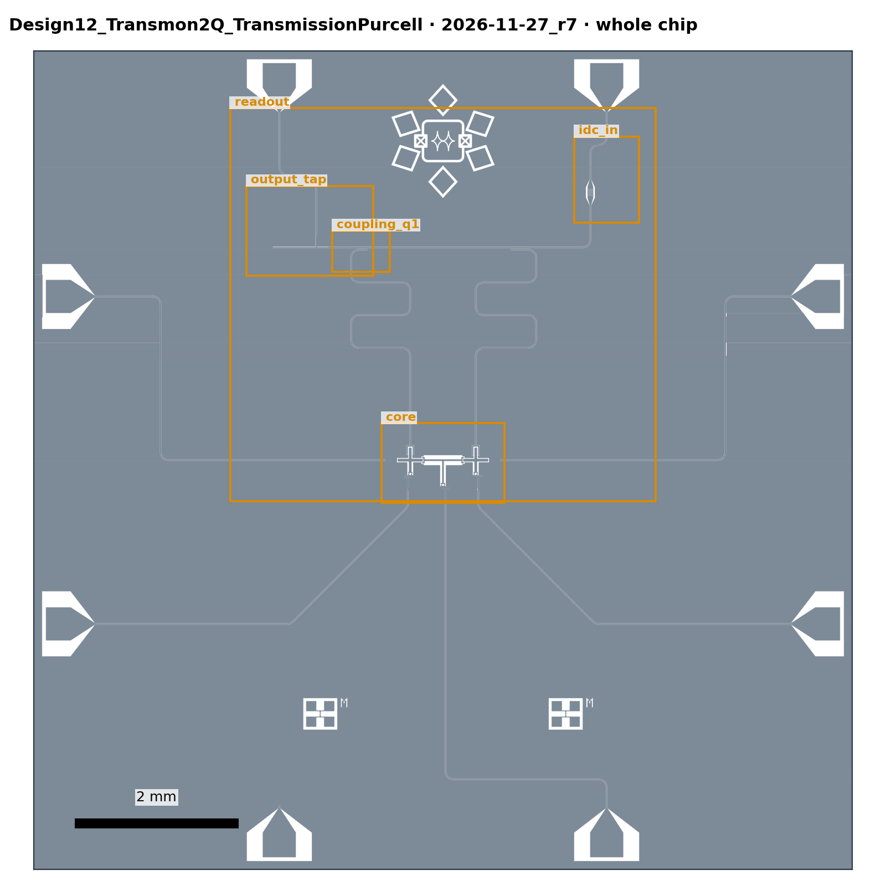
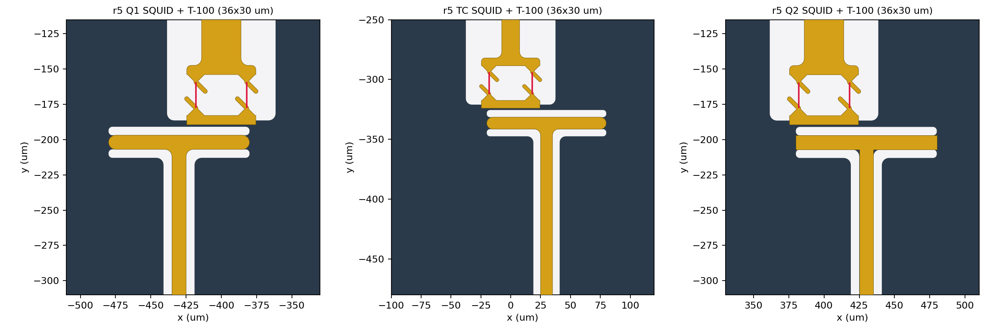

# Design12_Transmon2Q_TransmissionPurcell (chip ID `prt2q00`)

Two flux-tunable Manhattan-junction Xmons (`Q1`, `Q2`) coupled through a grounded flux-tunable transmon coupler (`TC`). The core is the same as [Design11_Transmon2Q_Manhattan](../Design11_Transmon2Q_Manhattan/README.md) `r9`. Design11 gives each qubit its own `PurcellReadout` channel; Design12 replaces them with **one shared transmission-type λ/4 Purcell filter**. The chip is a 10 × 10 mm 8-port wafer die with 4 mm symmetric launch ports.

> **Status (2026-11-27):** geometry **`r7` selected and confirmed by the user** (`r5` core: `T` flux lines `fbl_length = 100 µm, fbl_x = 30 µm, fbl_sep = 10.5 µm`, compact `36 × 30 µm` SQUID loops `jj_gap = 36 µm, squid_spacing = 36 µm, squid_bar_height = 6 µm`, `Q1 / Q2 cross_length = 150.4 / 150.5 µm` restoring `E_C = 220 MHz`, 2 × 4-probe `ManhattanTestJunction` coupons `tj_m1`, `tj_m2` at `(±1.50, −3.10) mm`, and etched `1400 µm` `SquidFlowerLogo` at `(0, +3.90) mm`), with the current qubit `E_J` kept.
> - **Stage 3 (NCKU):** single-die fab GDS `gds/Design12_Transmon2Q_TransmissionPurcell_2026-11-27_r7_fab.gds` (die ID `prt2q00`) and NCKU wafer delivery + report PDF under `Fabrication output/20261127_r3/`. All 8 junction sites per die (6 SQUID + 2 test JJs) are left empty for NCKU, with no alignment markers (§7).
> - **Core & flux validation (`r5`–`r7`):** Core Q3D (`4` passes, user `< 5` pass cap) gives `E_C = 220.2 / 220.2 / 205.1 MHz`; HFSS `M` (`4` passes + `6 µm` seed, 156k elements) gives `|M| = 0.774 / 0.804 / 0.753 pH` (`I_Φ0 = 2.67 / 2.57 / 2.74 mA`, `L_fl ≈ 81 pH`, `L_geo = 62.4 pH << L_J`); CZ coherent `F = 0.999963` at `90 ns` (`ZZ_idle = −122.3 kHz`).
> - **Readout (`r4`, carried over):** PF / RR geometry is unchanged from `r4`; readout HFSS (`3`-pass driven S21 + `4`-pass cropped eigenmode) was not rerun on `r5`–`r7` (`needs_revalidation`).





---

## 1. Readout topology

```text
P7 -> IDC_in (weak, open end) -> PF bus (y = 2.60 mm) -> T (PF_tap) -> 0.53 mm short arm -> ground
                                    |  coupling sections           |
                                  RR_Q1, RR_Q2 (lambda/4)           +-> T stub -> feed_out -> P8 (output)
```

- **Shared filter `PF`:** a λ/4 line, open at `IDC_in` and shorted at `PF_short`.
  - The design (model) value is **`f_PF = 6.5 GHz`**.
  - HFSS puts it at **6.24 GHz** (model / HFSS ≈ 0.96), between the two resonators.
- **Asymmetric ports:**
  - **Input (`P7`):** a weak hexagon-tapered interdigital capacitor (Design8 style) at the open end.
  - **Output (`P8`):** a galvanic tap (`TapJunction`) 530 µm from the short.
  - **Result:** HFSS gives `κ_in / κ_out ≈ 20 / 331 MHz`, so the output collects about 94 % of the readout signal. A symmetric two-IDC λ/2 filter would collect 50 %.
- **Readout resonators `RR_Q1` / `RR_Q2`:**
  - λ/4 lines, each shorted at the tip of a straight coupling section that runs parallel to the filter bus. A 6 µm ground strip separates the two CPW gaps (Design8 style).
  - Each line then makes a 3-bar meander (400 µm pitch) and drops into the north readout claw of its qubit.
  - `RR_Q1` couples about 1.0–1.2 mm from the filter short and `RR_Q2` about 2.9–3.2 mm from it.
- **Ports:** `P7` is the readout input and `P8` the readout output. `P1` / `P6` are the `Q1` / `Q2` XY lines, `P2` / `P5` the `Q1` / `Q2` flux lines, `P4` the `TC` flux line, and `P3` a grounded spare (as in Design11).

## 2. Adopted geometry (`r4`, [`layout/build.py`](layout/build.py))

| Element | Value | Basis |
|---|---:|---|
| `PF` length / tap from short | `4.3008 mm` / `530 µm` | design `f_PF = 6.5 GHz`, `κ_out` model target 285 MHz, no HFSS anchor |
| `IDC_in` | `N = 6`, 6 / 6 µm, overlap `75 µm` (`C_in ≈ 21 fF`, model) | Design8 Q3D scaled |
| `RR_Q1` length / coupling section | `4.4316 mm` / `106 µm` | anchored on the `r3` S21 (model 6.3838 → HFSS 6.3249 GHz); `κ_r` rescaled from the `r3` J |
| `RR_Q2` length / coupling section | `4.5856 mm` / `216 µm` | anchored on `r3` (6.3058 → 6.2762 GHz) |
| Core (Q1 / Q2 / TC, claws, control lines) | Design11 `r9`, unchanged | Design11 Q3D `20261125_215712_q3d_core_r9_optB_e3d7e352` |

`build_design(variant='fab')` differs from `'sim'` only by `jj_metal=False`. The Manhattan Xmons and coupler have no Dolan contact hooks.

## 3. Readout results (`r4`)

| Quantity | Target | Eigenmode, 4 pass, cropped | Driven S21 fit, 3 pass | Used |
|---|---:|---:|---:|---:|
| `f_PF` | ~6.24 | `6.2393 GHz` | `6.2402 GHz` | 6.240 GHz |
| `κ_PF` (`κ_in` / `κ_out`) | ~300 | 697 MHz (eigenmode κ ≈ 2× driven, as expected) | `351 MHz (20.2 / 331)` | 351 MHz (driven) |
| `f_r` Q1 | 6.35 | 6.3881 GHz mode → **≈ 6.385 bare** | 6.4012 GHz | 6.385 GHz (eigenmode) |
| `f_r` Q2 | 6.15 | 6.1509 GHz mode → **≈ 6.155 bare** | 6.0719 GHz | 6.155 GHz (eigenmode) |
| `J` Q1 / Q2 | — | — | `21.1 / 18.9 MHz` | driven |
| `κ_r,eff` Q1 / Q2 | 3.0 | — | 2.76 / 2.13 MHz at the driven `f_r` | **3.01 / 3.30 MHz** |

- **Bare frequencies:** the eigenmode resonator modes are corrected for the filter push `J²/δ` (about 3–4 MHz).
- **Used `κ_r,eff`:** recomputed from the driven `J` and `κ_PF` at the eigenmode detunings (+145 / −85 MHz).
- **Eigenmode vs driven `f_r`:** eigenmode ΔF reached 0.22 % at pass 4 (about ±15 MHz). The 3-pass driven `f_r` scattered by up to 80 MHz between revisions (`skill/em_simulation.md` §4).

**Runs:**
- Eigenmode: `results/resonator/20261126_193420_eigen_extract_r4_4p_crop_156b4e08`, which reads the saved solution of `20261126_191628_purcell_eigen_r4_4p_crop_fd067d53`.
- Driven S21: `results/resonator/20261126_183350_purcell_s21_driven_r4_3p_d21f9aad`.

## 4. Qubit, junction (`fab_junction_targets`), and flux-line parameters (`r5`, current `E_J` kept)

All energies are `E/h`. `E_J1 / E_J2` (`L_J1 / L_J2`) are user-confirmed fabrication design inputs, not HFSS results. Branch values use `E_J [GHz] = 163.46 / L_J [nH]`.

| Device | SQUID | **`E_J1` (GHz)** | **`E_J2` (GHz)** | `E_JΣ` (GHz) | `L_J1` / `L_J2` (nH) | `R_n1` / `R_n2` (kΩ) | Model area 1 / 2 (µm²) | `E_C` (`r5` Q3D 4p) |
|---|---|---:|---:|---:|---:|---:|---:|---:|
| **Q1** | asymmetric 2:1 (`d = 1/3`) | **9.40** | **4.70** | 14.10 | 17.39 / 34.79 | 14.94 / 29.89 | 0.0418 / 0.0209 | **220.2 MHz** |
| **Q2** | asymmetric 2:1 (`d = 1/3`) | **7.95** | **3.98** | 11.93 | 20.55 / 41.11 | 17.66 / 35.32 | 0.0354 / 0.0177 | **220.2 MHz** |
| **TC** | symmetric 1:1 (`d = 0`) | **11.65** | **11.65** | 23.30 | 14.03 / 14.03 (parallel 7.01) | 12.05 / 12.05 | 0.0519 / 0.0519 | **205.1 MHz** |

- **`R_n`:** Ambegaokar–Baratoff with Δ = 180 µeV (`code/qubit/jj_resistance_model.py`).
- **Area:** `RA = 625 Ω·µm²` (model assumption; NCKU uses its own `R_n` ↔ area calibration).
- **NCKU Manhattan junction-site centres (`r7`, `squid_spacing = 36.0 µm`, orientation `0°`, µm):**
  - `Q1`: centre `(-400.000, -168.400)` → `jj1 = (-418.000, -168.400)`, `jj2 = (-382.000, -168.400)`
  - `TC`: centre `(-0.050, -303.000)` → `jj1 = (-18.050, -303.000)`, `jj2 = (+17.950, -303.000)`
  - `Q2`: centre `(+400.000, -168.500)` → `jj1 = (+382.000, -168.500)`, `jj2 = (+418.000, -168.500)`
  - `tj_m1` / `tj_m2` (2 × 4-probe `ManhattanTestJunction`, single JJ): `(-1500.000, -3100.000)` and `(+1500.000, -3100.000)`
- **Flux-line mutual inductance (`r5`, `T_FLUX_OPTIONS` `fbl_length = 100 µm, fbl_x = 30 µm`, run `results/flux/20261126_233103_hfss_mutual_r5_T100_p4_50645521`, 4p + 6 µm seed):**
  - `|M| = 0.774 (Q1) / 0.804 (TC) / 0.753 (Q2) pH` (`I_Φ0 = 2.67 / 2.57 / 2.74 mA`, `I_CZ = 0.310 / 0.576 mA`, `L_fl ≈ 81 pH`, `L_geo = 62.4 pH`).
  - Crosstalk: `Q1←TC +2.05%`, `TC←Q1 +0.37%`, `TC←Q2 +0.82%`, `Q1←Q2 −1.54%`, `Q2←Q1 −1.62%`, `Q2←TC −8.52%`.

Readout at the current `E_J` (`r5` core Q3D `20261126_230716_q3d_core_r5_tune1_p4_cf078d58`, run `results/qubit/20261126_230902_readout_ej_opt_r5_7460146e`, `current_EJ`):

| | `f01` bare / dressed | `g_qr` | `2χ` | `\|2χ\| / κ_r` | `n_crit` | Purcell `T_1` (Sete, shared filter) |
|---|---:|---:|---:|---:|---:|---:|
| **Q1** | 4.7527 / 4.7427 GHz | 118.5 MHz | −2.94 MHz | 0.98 | 47.4 | 114 µs |
| **Q2** | 4.3520 / 4.3451 GHz | 125.0 MHz | −2.87 MHz | 0.87 | 51.6 | 157 µs |

The Purcell `T_1` column is from the CZ run below (dressed `f01`). The readout run, which uses bare `f01`, gives 110 / 146 µs.

## 5. Best-`E_J` study (not adopted)

The question was which `E_J` makes `|2χ| = κ_r` at the decided `r4` resonators. The run is `results/qubit/20261126_200519_readout_ej_opt_r4_67ad6c99`, method `scqubits` dressed, with branch ratio kept.

| | Current `E_JΣ` | Best `E_JΣ` (branches) | Change |
|---|---:|---:|---|
| Q1 | 14.10 GHz | 14.13 GHz (9.42 / 4.71) | +0.2 %, already optimal |
| Q2 | 11.93 GHz | 12.34 GHz (8.23 / 4.11) | +3.4 %, `f01` +78 MHz |

At the best `E_J` (CZ run `results/qubit/20261126_200553_cz_verify_r4_bestEJ_84a5dcee`), Q2 gains about 8 % measurement rate (`|2χ|/κ` 0.92 → 1.0). It also loses:
- **Idle ZZ:** doubles, −150 → **−324 kHz**.
- **Purcell `T_1` (Q2):** falls to 128 µs.

**Decision (user, 2026-11-26): keep the current `E_J`.**

## 6. CZ gate and coherence estimates (current `E_J`)

CZ run: `results/qubit/20261126_202352_cz_verify_r4_currentEJ_46535d65` (`scqubits`, coherent; Q1 + TC flux pulse, 8 ns ramp).
- **Idle point:** `f_Q1 / f_Q2 / f_TC = 4.7423 / 4.3474 / 5.8910 GHz`, idle ZZ −149.6 kHz. These are identical to Design11 `r9`, since the core is the same.
- **Coherent CZ:** **`F = 0.999967` at 90 ns** (leakage 1.6e-5); 0.999883 at 85 ns.

| Intrinsic `T_1` | Total `T_1` Q1 / Q2 (with Purcell 114 / 148 µs) | `T_1`-limited CZ `F` at 90 ns |
|---:|---:|---:|
| 50 µs | 34.7 / 37.4 µs | 0.9980 |
| 100 µs | 53.2 / 59.7 µs | 0.9987 |
| ∞ (Purcell only) | 113.6 / 148.4 µs | 0.9994 |

The `T_1`-limited column is an estimate: `ε = (2/5) T (1/T_1,Q1 + 1/T_1,Q2)`. It leaves out `T_φ`, decay of `|2⟩` and the coupler, and flux noise.

**Thermal-photon (shot-noise) dephasing** at the current `E_J` uses the Clerk–Utami exact formula, `Γ_φ ≈ n_th κ (2χ)² / (κ² + (2χ)²)`:

| `n_th` | 1e-4 | 5e-4 | 1e-3 | 2e-3 | 5e-3 | 1e-2 |
|---|---:|---:|---:|---:|---:|---:|
| Q1 `T_φ` (µs) | 1065 | 213 | 106 | 53 | 21 | 11 |
| Q2 `T_φ` (µs) | 1049 | 210 | 105 | 53 | 21 | 10 |

At 6.2 GHz, `n_th = 5e-4 / 2e-3 / 6e-3` corresponds to `T_eff ≈ 40 / 50 / 60 mK`. Keeping `T_φ ≥ 100 µs` needs `n_th ≲ 1e-3` on the readout line.

## 7. Stage 3 fab GDS (NCKU single die + 4-inch wafer `20261127_r3`)

**User choices (2026-11-27, `r7`):**
- **Format:** single 10 mm die + 4-inch NCKU wafer delivery under `Fabrication output/20261127_r3/` (`26 × Design11 r20` + `26 × Design12 r7`).
- **E-beam site:** NCKU, so no alignment markers.
- **Junctions:** all 8 sites/die (6 SQUID + 2 test JJs) left empty (no drawn e-beam layers); NCKU draws the Manhattan junctions.
- **Test junctions:** `2 × ManhattanTestJunction` (`tj_m1`, `tj_m2`) at `(±1.50, −3.10) mm`.
- **Logo:** etched `1400 µm` `SquidFlowerLogo` at `(0, +3.90) mm` (`35 µm` main / `18 µm` sparkle strokes).
- **Die ID:** `prt2q00`.

| File | Role |
|---|---|
| `gds/Design12_Transmon2Q_TransmissionPurcell_2026-11-27_r7_fab.gds` | fab mask: `jj_metal=False`, R = 5 µm `round_mask`, die ID etched upper-left (50 µm inset, 150 µm), 5 × 5 µm / 40 µm cheese grid with launch clearance |
| `gds/Design12_Transmon2Q_TransmissionPurcell_2026-11-27_r7_sim.gds` | matching simulation reference (layer 1 + lumped junction sheets on 50/0) |

GDS files are local only (not on GitHub). Earlier superseded GDS files were removed per user request (2026-11-27).

**Export checks** (run `results/general/20261126_202905_gds_export_r4_ncku_a2ca885f`, completed 2026-11-26):

| Check | Result |
|---|---|
| Units / outline | µm, 10 × 10 mm (−5000 … 5000 µm) for both files; fab mask on layer `1/0` only |
| Junction sites | all 6 sites (Q1 / Q2 / TC SQUID branches) are empty in the fab mask |
| Etch survival | 11 / 11 CPW routes (PF, RR_Q1 / RR_Q2, feed in / out, short arm, 2 XY, 3 flux) keep their signal metal and both gaps, in sim and fab |
| Keep-outs | ≥ 100 µm from the NTHU and TSRI marker sites (site-portable; NCKU itself has no markers) |
| Die ID `prt2q00` | etched at x −4950 … −4283 µm, y 4800 … 4950 µm; its window held no other etch |
| Cheese | 46 226 holes, 5 µm / 40 µm pitch, 497.5 µm edge margin, launch clearance profile |
| Metal width (rounded mask before cheese) | 18 flagged regions at both 4 µm and 2 µm, **none in the circuit**: 4 at the exact die corners (convex corner of the die frame) and 14 vertex pinch points between diagonal pixels of the etched `prt2q00` label (the die-ID label is exempt, `skill/qcomponents.md`) |

SHA256 (first 12): fab `1ccf2c2f4802`, sim `1aa887edcad5`.

## 8. Limitations and open items

- **Mesh convergence:**
  - The readout frequencies rest on one 4-pass cropped eigenmode (ΔF 0.22 %, about ±15 MHz).
  - J and κ come from 3-pass driven runs (final ΔS 0.19). These are not converged.
  - Q1 sits about +35 MHz above its 6.35 GHz target. The user selected `r4` as is.
- **Purcell `T_1`:** 114 / 148 µs is well below Design11's 1 ms requirement. This is the accepted cost of the shared broad filter.
- **No Q3D coupons for Design12:** `C_in`, the coupling sections and the claw loads use model or scaled values; HFSS checked the outcome.
- **No air bridges or straps** at the output T, the short arm or the coupling sections.
- **Eigenmode tooling:** the COM call that waits on `Analyze` can fail while HFSS keeps solving. [`simulation/resonator/eigen_extract.py`](simulation/resonator/eigen_extract.py) reads the saved solution in that case. A permanent fix in the shared `run_eigen` is pending.
- **Release:** `release_confirmation` in `design.json` is pending, and nothing is committed.

## 9. Reproduction (repository root)

Layout, EM and fab use `qmetal` (`C:\Users\QEL\miniforge-pypy3\envs\qmetal\python.exe`). Quantum analysis uses `scqenv`.

Build the layout and print the length report:

```powershell
python -X utf8 -B Design12_Transmon2Q_TransmissionPurcell/layout/build.py
```

Write the NCKU sim + fab GDS pair and its checks:

```powershell
python -X utf8 -B Design12_Transmon2Q_TransmissionPurcell/layout/export_fab.py
```

Render the figures:

```powershell
python -X utf8 -B code/layout/plot_design_figs.py Design12_Transmon2Q_TransmissionPurcell
```

Run the driven S21 (3 passes):

```powershell
python -X utf8 -B Design12_Transmon2Q_TransmissionPurcell/simulation/resonator/hfss_purcell_s21.py --passes 3 --tag r4_3p
```

Run the cropped eigenmode (4 passes, 3 modes):

```powershell
python -X utf8 -B Design12_Transmon2Q_TransmissionPurcell/simulation/resonator/hfss_purcell_eigen.py --passes 4 --modes 3 --min-freq 5.9 --crop=-2.6,2.5,-0.6,4.6 --tag r4_4p_crop
```

Run the best-`E_J` and shot-noise analysis (`scqenv`):

```powershell
python -X utf8 -B Design12_Transmon2Q_TransmissionPurcell/simulation/qubit/readout_ej_opt.py --inputs Design12_Transmon2Q_TransmissionPurcell/simulation/qubit/inputs/readout_ej_opt_r4.json
```

History (`r1`–`r4`, the topology choice and the misread 6.5 GHz target in `r2`) is in [notes/README.md](notes/README.md).
