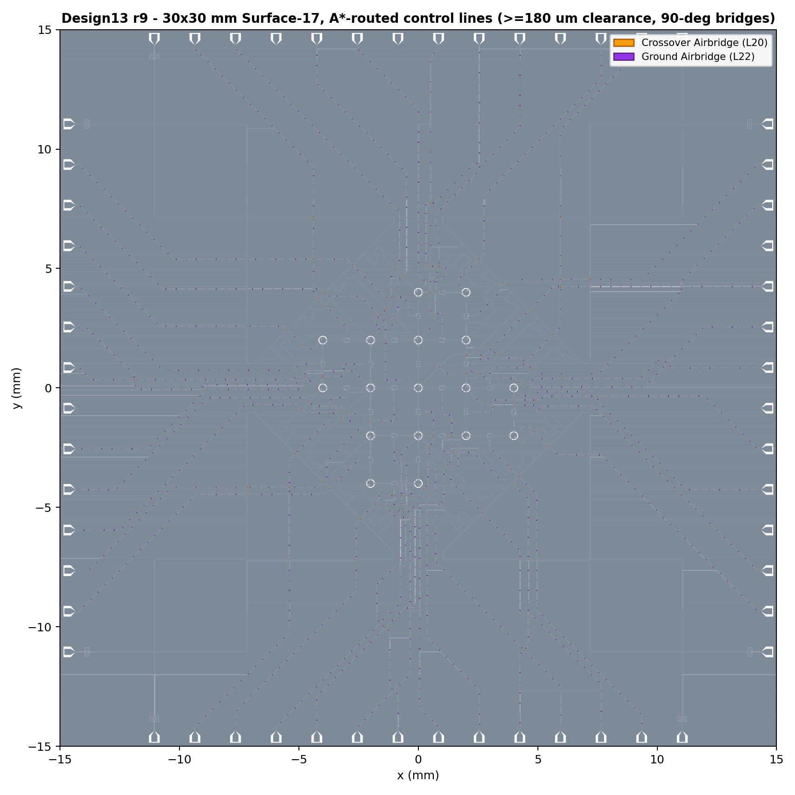
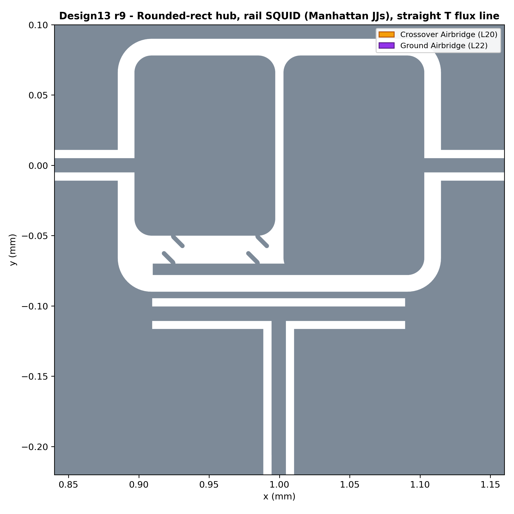
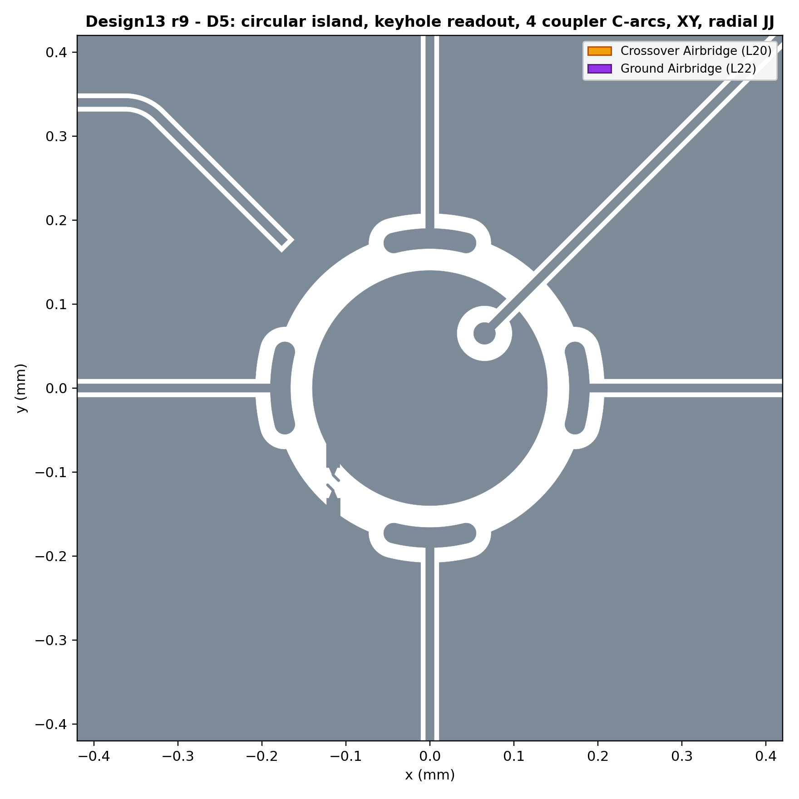
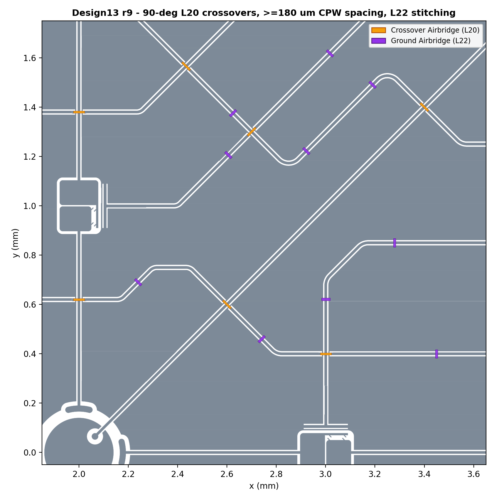
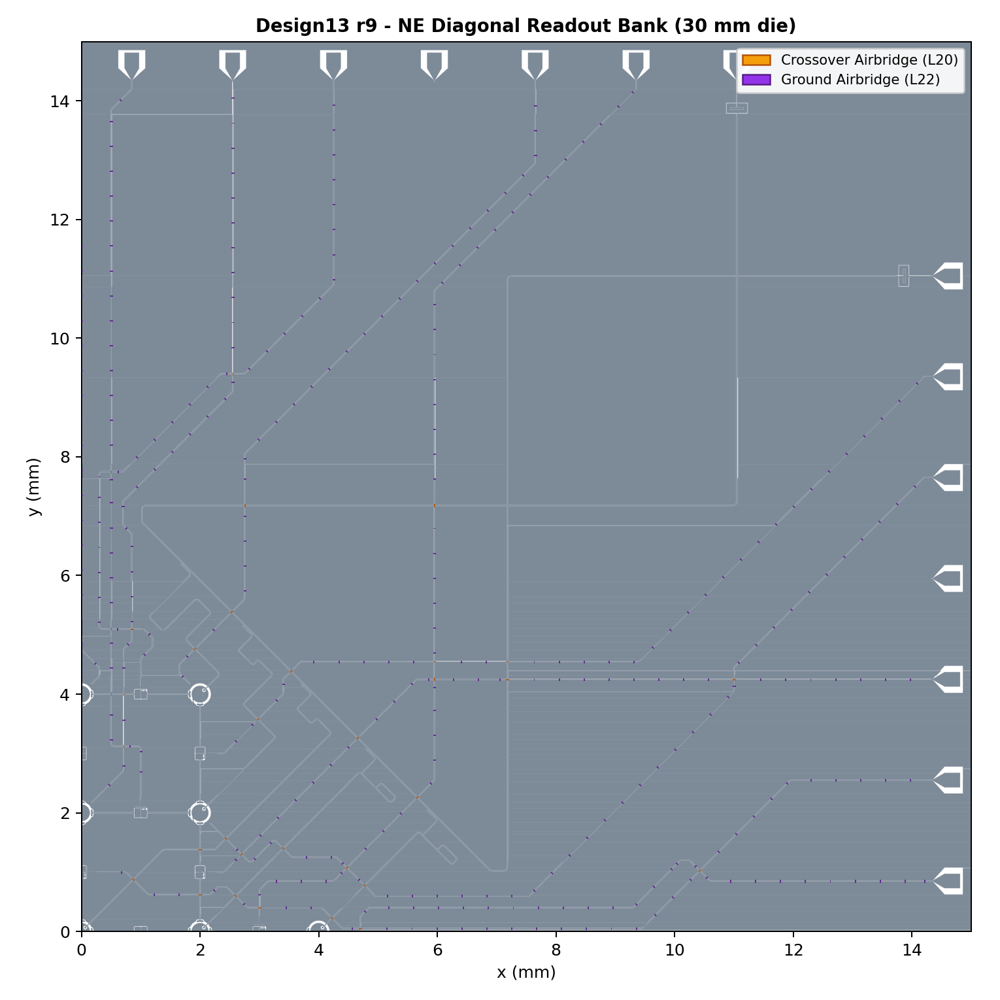
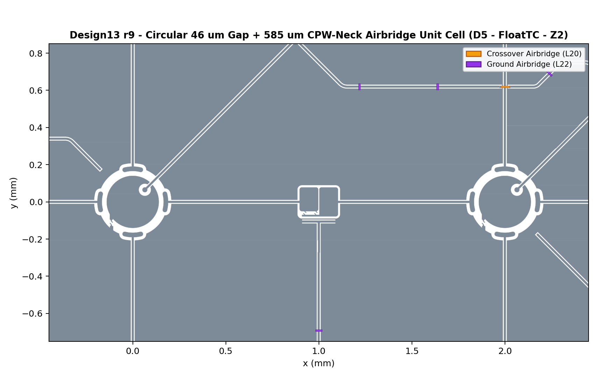
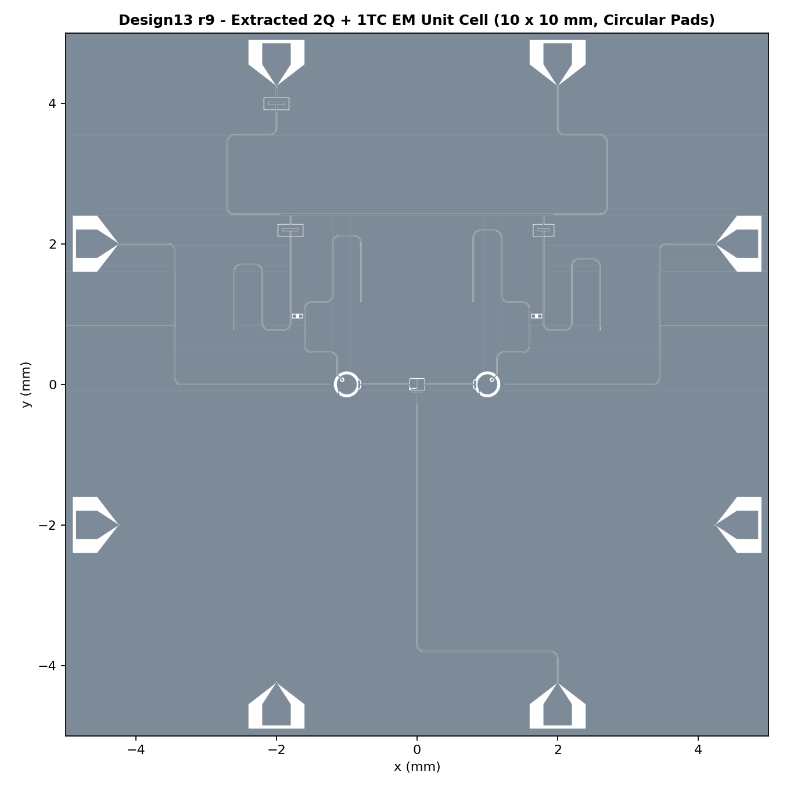

# Design13_ScalableFloatingCoupler2Q

Rotated distance-3 surface code (**Surface-17**) layout on a `30 × 30 mm` die:
- **qubits:** 17 fixed-frequency circular transmons (9 data `D1–D9`, 4 X-ancillas, 4 Z-ancillas);
- **couplers:** 24 floating tunable couplers on a `2.0 mm` square lattice;
- **readout:** 4 diagonal Purcell-filtered readout banks;
- **control lines:** 41, routed with planar `90°` airbridge crossovers (no flip-chip);
- **EM unit cell:** an extracted `10 × 10 mm` `2Q + 1TC` cell for Stage 2 EM.

> **Status (2026-11-28): Stage 1 layout `r9` — awaiting user review.** Small-model Q3D / HFSS checks were run for the qubit / coupler / flux-line geometry. No full-chip EM simulation and no Stage 3 fab GDS have been produced. Revision history: [notes/revision_history.md](notes/revision_history.md).















---

## 1. Architecture (`r9`)

| Element | Geometry | Why |
|---|---|---|
| **Qubit** ([`scalable_pad_qubit.py`](layout/components/scalable_pad_qubit.py)) | `280 µm` circular island, `46 µm` concentric pocket gap; **keyhole readout** (pad r `13 µm` in a `20 µm`-gap keyhole of the island, 45° radial stem); one **vertical Manhattan JJ** at a free diagonal corner (pattern rotated 180° on north corners) | Low surface participation (no corners); the island wraps the readout pad, giving a large C_qr in a small footprint and shielding it from the coupler arcs |
| **Coupler** ([`floating_tunable_coupler.py`](layout/components/floating_tunable_coupler.py)) | **C-shaped arcs** concentric with both qubits (`26 µm` gap, `24 µm` wide, `28°`); 10/6 µm CPW necks; **rounded-rectangle hub** `230 × 180 µm` with islands A/B separated by a `6 µm` gap; **rail SQUID**: island B's `8 µm` rail runs under island A's flat bottom edge, and two Manhattan JJs bridge them (loop `60 × 20 µm`) | Large differential capacitance (Ec ≈ 199 MHz); a horizontal loop parallel to the flux line |
| **Flux line** | **Straight T** under the hub's flat edge, placed automatically: the left arm covers the whole loop, the right arm runs under island B, both ends shorted | Own M ≈ 0.73 pH with quadrupole-like far field (crosstalk ≤ 0.2 %) |
| **JJ orientation** | Manhattan fingers strictly along x / y. Qubit JJs 0/180°; coupler SQUID JJs follow the coupler orientation (0/90/180/270°) | Fab rule (Manhattan two-angle evaporation). 90° is allowed on one chip without extra test coupons (user, 2026-11-28); 45° is never allowed |
| **Readout** | 4 diagonal shared-bus λ/2 Purcell filters (`u_purcell = 5.60 mm`) + 17 λ/4 DRC-B7 meandered resonators (`6.85–7.17 GHz`); no airbridges on any resonator / Purcell line | Preserves resonator Q_i |
| **Control routing** | 17 XY + 24 flux lines routed by the clearance-aware octilinear A* router ([`code/general/octilinear_router.py`](../code/general/octilinear_router.py), [`skill/airbridge.md`](../skill/airbridge.md) §4a) to monotonically sorted perimeter pads | `≥ 180 µm` CPW clearance by construction, crossings only at `90°` with `35 µm`-arch bridges, ground stitching on every line |

---

## 2. Small-model Stage 2 checks (single runs, see notes)

| Quantity | Value | Target | Source |
|---|---|---|---|
| Ec qubit / coupler | `193 / 199 MHz` | `190–200 / 180–200` | Q3D (8 passes), [`simulation/qubit/q3d_ro_coupler_crosstalk.py`](simulation/qubit/q3d_ro_coupler_crosstalk.py) |
| g_qc | `80 MHz` | `70–85` | Q3D |
| g_qr / 2χ / n_crit | `157 MHz / 1.38 MHz / 65` | `— / ~1.5 / > 60` | Q3D (pad-level estimate) |
| Readout ↔ coupler parasitic `g_cr / g_qr` | `1.7 %` | small | Q3D |
| Flux-line own M / I_Φ0 | `0.735 / 0.729 pH`, `2.8 mA` | `0.7–1.0 pH` | HFSS DrivenModal (12 passes), [`simulation/flux/hfss_mutual_flux.py`](simulation/flux/hfss_mutual_flux.py) |
| Coupler-to-coupler flux crosstalk (1.41 mm) | `0.20 % / 0.03 %` | `≤ 1 %` | HFSS |

Details, all compared variants and run IDs: [notes/coupler_rect_rail_manhattan_2026-11-28.md](notes/coupler_rect_rail_manhattan_2026-11-28.md). The HFSS run ended at ΔS `4.1e-4`, above the `2e-4` target; a 15-pass confirmation is pending.

---

## 3. Stage 1 layout and DRC (`r9`, `surface17`)

- **Entry point:** [`layout/build.py`](layout/build.py) (`build_design(variant='sim', mode='surface17' | 'unit_cell')`). Die-size constants: `DIE_MM`, `PAD_SPAN_MM`, `U_PURCELL_MM`, `PF_XC_MM`.
- **GDS (local only, rebuilt by `build.py`):** `gds/Design13_2026-11-27_r9_surface17_sim.gds`, `gds/Design13_2026-11-27_r9_unitcell_sim.gds`.
- **Hard DRC** (assertions in `build.py`):
  - layer-1 route-to-component collisions: **0**; acute bends: **0**; unbridged CPW crossings: **0**;
  - crossover bridges: **119**, all `≥ 85°`, L20 `≤ 45 µm` (`35 µm` arch);
  - CPW centerline clearance between distinct nets: **`≥ 180 µm`**; consecutive crossovers `< 500 µm` apart along a line: **0**;
  - ground stitching: **1301** `L22` bridges, largest unstitched control run `420 µm` (gate `550 µm`);
  - airbridges on Purcell filters / readout resonators: **0**.
- **Readout resonator lengths (λ/4 target vs drawn):**

| Qubit | `f_r` (GHz) | `L` target (mm) | `L` drawn (mm) | Δ (mm) |
|---|---:|---:|---:|---:|
| D1, D9, Z4 | 7.05 | 4.238 | 4.238 | 0.000 |
| D2, D4, D8 | 6.95 | 4.299 | 4.299 | 0.000 |
| X3, X4, D3, D7 | 6.85 | 4.361 | 4.361 | 0.000 |
| Z3 | 6.93 | 4.311 | 4.311 | 0.000 |
| D6 | 7.01 | 4.262 | 4.339 | +0.077 |
| D5 | 7.17 | 4.167 | 4.994 | +0.827 (tap length is a fixed 0.90 mm estimate) |
| X1, X2, Z1 | 7.15 | 4.178 | 5.188 | +1.010 |
| Z2 | 7.09 | 4.214 | 5.709 | +1.495 |

The five inner-qubit resonators are too long. With a 2 mm pitch the outermost qubits sit at `u = 4.24 mm`, so the diagonal Purcell banks cannot move further in. Fixing these needs a non-radial readout route for the inner qubits.

---

## 4. Parameter summary (three-tier standard, `skill/parameter_provenance.md` §3.1)

Energies are `E/h`. Tier 1 values are draft inputs; Tier 2 shows targets with the small-model Q3D / HFSS values above.

### 4.1 Tier 1 — fabrication targets (`fab_junction_targets`)

| Device | Type | Target `E_J` (GHz) | Nominal `L_J` (nH) | `R_n` | Status |
|---|---|---:|---:|---:|---|
| Data A (`D1, D3, D5, D7, D9`) | single Manhattan JJ | NOT SET (draft `~15.1`) | `10.8` | TBD | draft |
| Data B (`D2, D4, D6, D8`) | single Manhattan JJ | NOT SET (draft `~14.8`) | `11.0` | TBD | draft |
| Ancillas (`X1–X4, Z1–Z4`) | single Manhattan JJ | NOT SET (draft `~14.2`) | `11.5` | TBD | draft |
| Couplers (24 × TC) | symmetric Manhattan SQUID (1:1) | NOT SET (draft `~12.6 / 12.6`) | `6.5` parallel | TBD | draft |

### 4.2 Tier 2 — EM and circuit parameters

| Element / subsystem | Target | Small-model value (`r9`) | Status |
|---|---|---|---|
| Qubit Ec, C_Σ | `190–200 MHz`, `~99 fF` | `193 MHz`, `100.6 fF` | Q3D single run |
| Coupler Ec, C_Σ (diff. mode) | `180–200 MHz`, `~100 fF` | `199 MHz`, `97.2 fF` | Q3D single run |
| Idle frequencies | data `4.65 / 4.60 GHz`, ancilla `4.50 GHz`, coupler `6.0–6.4 GHz` | — | targets (set by E_J) |
| Q–TC coupling | `g_qc 70–85 MHz`, idle `|ZZ| < 5 kHz` | `g_qc 80 MHz` | ZZ (scqubits) pending |
| Q–R | `|2χ| ~ 1.5 MHz`, `n_crit > 60` | `1.38 MHz`, `65` | Q3D (pad level) |
| P–R | `f_r 6.85–7.17 GHz`, `κ_r,eff ~ 2 MHz`, Purcell `T1 > 5 ms` | — | HFSS pending |
| Flux | `|M| 0.7–1.0 pH`, crosstalk `≤ 1 %` | `0.73 pH`, `≤ 0.2 %` | HFSS (not converged to target) |

### 4.3 Tier 3 — time-domain / coherence

Coupler-only CZ dynamics, TLS participation (keyhole gap, hub corners), temperature drift, and g/e/f readout: not run.

---

## 5. Reproduction (repository root, `qmetal`)

```powershell
& "C:\Users\QEL\miniforge-pypy3\envs\qmetal\python.exe" -I -X utf8 -B Design13_ScalableFloatingCoupler2Q/layout/build.py
```

Small-model EM checks (record runs under `results/`):

```powershell
& "C:\Users\QEL\miniforge-pypy3\envs\qmetal\python.exe" -I -X utf8 -B Design13_ScalableFloatingCoupler2Q/simulation/qubit/q3d_ro_coupler_crosstalk.py --tag r9
```

```powershell
& "C:\Users\QEL\miniforge-pypy3\envs\qmetal\python.exe" -I -X utf8 -B Design13_ScalableFloatingCoupler2Q/simulation/flux/hfss_mutual_flux.py --tag r9
```

---

## 6. Limitations

- **EM scope:** only small models (Q0 + neighbouring couplers / qubits) were simulated; there is no full-chip EM and no Stage 3 fab GDS.
- **Convergence:** the HFSS flux run ended above its ΔS target. Q3D pass-count convergence was not checked separately.
- **Readout lengths:** five inner-qubit readout resonators are longer than λ/4 (§3).
- **Not evaluated:** TLS participation of the keyhole gap and of the rounded-rectangle hub corners.
