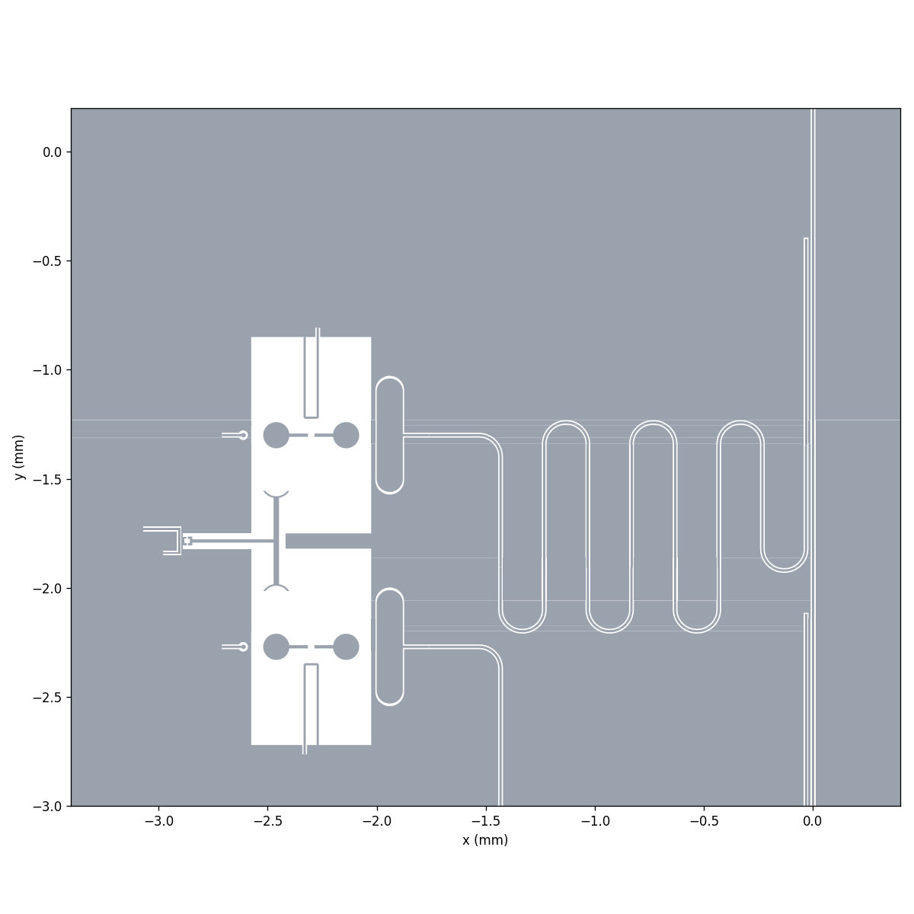

# Design2: lab FTF set (Q1 – Q3 – Q2, FXTFX24-W7-0x-V.3.1) with CPW 10 / 6 µm

The lab's round-pad fluxonium (`FluxoniumPocket`, JJ + array) and grounded tunable-transmon
coupler (`Tmon_c`), rebuilt as one FTF set and simulated with the same method as Design1.



## Layout

| folder | contents |
|---|---|
| `pattern design/` | `ftf_layout.py` (one set Q1 – Q3 – Q2, positions and options from the FXTFX24 notebook). Components are shared in `../pattern design/` (`fluxonium_withJJ.py`, `tmon_c.py`) |
| `simulation/` | `q3d_ftf.py` (Q3D of Q1, Q2, Q3) and `results/` |
| `gds/` | Junction-free base metal with Q3 SQUID landings. `ftf_layout.gds` has plain landings. `ftf_layout_fab.gds` adds Dolan recesses and ground perforations. `layout3 ftf.gds` (the lab layout, reference) |
| `design_parameters.txt` | All numbers of this design |
| `fig/layout/` | Plots of the exported GDS, same set and format as Design1 / 3 (`python ftf_layout.py`; rules in `../skill/layout_figures.md`) |

Numbers: `design_parameters.txt`. Method: `../Design1/notes/capacitance_method.md`,
`../skill/cap_matrix_analysis.md` (shared with Design1).

## Changes with respect to the lab design

* **CPW 10 / 6 µm** is now the default of every component here (flux line, charge line,
  readout line: `cpw_width='10um'`, `cpw_gap='6um'`), instead of the `cpw_width` / `cpw_gap`
  design variables (lab: 15 / 5.909 µm, flux line gap 8.409 / 11.233 µm).
* **Arm stubs removed:** the two small stubs on each pad stem (the contact of the inductor
  line, 65 µm from the centre) are not drawn, `show_l_arms='False'` in the three fluxonium
  files. `show_l_arms='True'` restores them (needed if the array has to touch the pads).
* **Q3 SQUID mask:** Both exports use the Design3 20 × 24 µm rectangular opening and two 5 µm JJ gaps. The fab export recesses each landing 4 µm deep × 2 µm wide. Both ground-side recesses have the same +2 µm offset along the component's local x axis. The SQUID is aligned to the existing Design2 ground edge. The parameter tables below describe the previous simulation geometry.

* **Simulation model (2026-11-12):** `build_design(for_process=True)` (used by `simulation/q3d/q3d_ftf.py`)
  sets `u_array='True'` on Q1 / Q2: the same loop as Design1 / 3 - loop = lead line from the stem ends with the JJ as its short middle gap (qubit centre); U = two lumped-L sides (100 nH each = 200 nH) joined by a metal closing end; the U points to the flux bias line. Checked in AEDT (render only):
  `simulation/results/runs/render_check/`. The Q3D run `cpw10_6` below was made with
  the JJ pads (not rerun; the pads are a few um, effect expected to be negligible).

## Latest parameters (run `cpw10_6`)

| | Ec | C_Σ |
|---|---|---|
| Q1 (FX) | 0.979 GHz | 19.79 fF |
| Q2 (FX) | 0.979 GHz | 19.79 fF |
| Q3 (TC) | 0.202 GHz | 95.75 fF |

| J/2π (per n n) | 5 nodes | 7 nodes (readout pads included) |
|---|---|---|
| Q1 – Q3 | 25.9 MHz | 24.9 MHz |
| Q2 – Q3 | 25.7 MHz | 24.7 MHz |
| Q1 – Q2 | 1.28 MHz | 1.43 MHz |

Readout (pad only): β = 0.101 for both, g/2π = 77.8 / 82.5 MHz per n (f_r 6.109 / 6.475 GHz,
Z0 = 50.9 Ω). Charge lines: 0.31 fF, β = 0.0063, T1 limit 8.3 ms.
Lab matrix (15 / 5.909 µm): Ec_FX 0.927 GHz, Ec_TC 0.196 GHz, J 24.8 MHz, β 0.105.
Resonators, κ and f_r were not redone for 10 / 6 µm.

## Running

Environment as in `../Design1/README.md` (`qmetal` env, start AEDT first).

```
cd "pattern design"
python ftf_layout.py                 # junction-free gds/*.gds, plots to fig/layout/
cd ../simulation
python q3d_ftf.py mytag              # Q3D, ~1 min, writes results/runs/<tag>_cmat_fF.csv, _summary.json
```

Results folders as in Design1: `latest/` current design (`cpw10_6`), `previous/` step before,
`runs/` new runs. When a run becomes the new design point, move the old `latest/` files to `previous/`.

## Design notes

FTF-specific workflow shared by Design1–3 (layout script knobs, GDS export options, standard figures): [`Design3/notes/ftf_workflow.md`](../Design3/notes/ftf_workflow.md).
