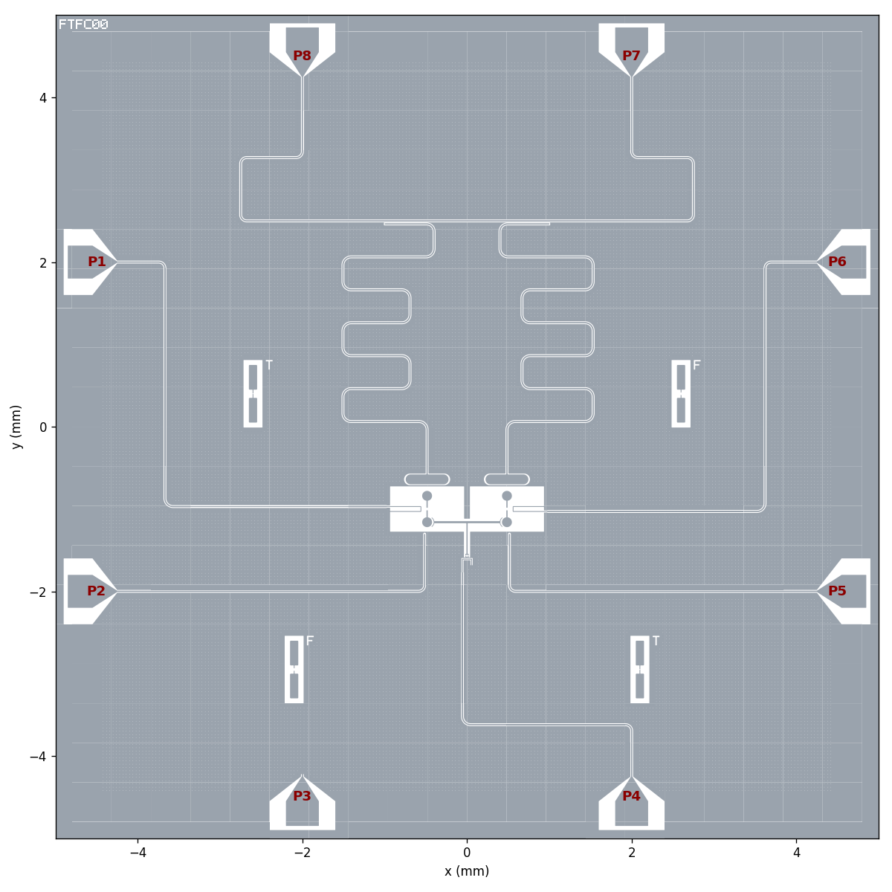
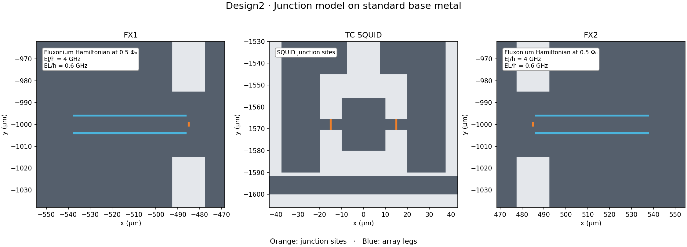

# Design2_FTF_Andersen · Layout3 FTF

**Figures:** [fig/](fig/README.md) holds the whole chip ([`chip.png`](fig/chip.png)) and one close-up per part, rendered from the current GDS by `code/general/plot_design_figs.py`.



**40 µm cheese fab mask (2026-11-23, no EM rerun).** Fab GDS (`gds/Design2_2026-11-23_wafer_r11_fab.gds`) is the parent mask (`gds/Design2_2026-11-18_wafer_r11_fab.gds`) with the ground perforation rebuilt on a 40 µm lattice (5 × 5 µm holes, was 20 µm). The KLayout comparison shows only moved holes; simulation geometry is unchanged. Used by the `Fabrication output/20261123` NTHU wafer. Record: `design.json` → `metal_width_candidate.fabrication_gds_cheese40`.

**r12 FluxoniumDelft candidate (2026-11-22, pending review, no EM rerun).** The fluxonia Q1 / Q2 are now drawn by the shared [`FluxoniumDelft`](../pattern%20design/fluxonium/fluxonium_delft.py) (fab: [`FluxoniumDelftFab`](../pattern%20design/fluxonium/fluxonium_delft_fab.py), 2 × 4 µm Dolan notches) instead of the copy recovered from the source mask: `layout3_full.recover()` swaps the FX pockets and line gaps for the component geometry (`use_fluxonium_delft`, options `FX_OPTIONS`; Q2 mirrored with the flux signal on the other U leg; hairpin `array_length` 54 µm as the earlier Design2 model), and `build_linear_design()` takes leads, hairpin end and junction lines from the component (names unchanged). Only change vs r11: the four lab Manhattan arm stubs on the Q1 / Q2 stems (28.1 µm² each) are gone; notches and junction lines are identical. r12 companion GDS (`gds/Design2_2026-11-22_wafer_r12_reference.gds`) (from r11 + the same swap: `layout/export_fluxonium_delft_r12.py`) · figures (`fig/candidates/2026-11-22_wafer_r12/`) · record `fluxonium_delft_candidate` in [design.json](design.json). The r12 fab GDS is not exported yet (Stage 3), and `export_wafer_test_junctions.py` currently fails on the removed `DesignTestJunction/` import. Earlier electrical results: needs_revalidation.

**r11 metal-width candidate (2026-11-18, pending confirmation, no EM rerun).** Full rebuild with the 4 µm minimum-metal rule; TC coupler crescent tips trimmed to 4 µm, design ID `FTFC00` 150 µm. Fab GDS (`gds/Design2_2026-11-18_wafer_r11_fab.gds`) · Companion GDS (`gds/Design2_2026-11-18_wafer_r11_reference.gds`) · Before / after (`Design2_2026-11-18_wafer_r11_compare.png`, removed 2026-11-19; in git history) · Design ID check (`Design2_2026-11-18_wafer_r11_fab_design_id.png`, removed 2026-11-19; in git history). Record: `metal_width_candidate` in [design.json](design.json).

The **r10 SQUID ground-tail candidate** sets the thickness from the TC loop floor to the lower pocket edge to 7 µm. The lower pocket boundary moves 3 µm toward the loop. The candidate starts from r9. The fabrication and unnotched reference exports retain the r9 flux termination and use the new pocket boundary. Electrical validation, including mutual inductance, is pending for r10.

r10 fabrication GDS (`Design2_2026-11-18_wafer_r10_fab.gds`, removed 2026-11-18; in git history) · r10 unnotched reference (`Design2_2026-11-18_wafer_r10_reference.gds`, removed 2026-11-18; in git history) · TC detail (`Design2_2026-11-18_wafer_r10_fab_tc_tail_check.png`, removed 2026-11-18; in git history)

Reproduce with `python -B code/general/export_wafer_test_junctions.py --design Design2_FTF_Andersen --squid-tail-review --output unused_fab.gds` in qmetal. Add `--reference-only` with another unused filename for the unnotched companion. No HFSS or Q3D solver was rerun for r10.

The **r9 flux-ground candidate** increases the TC ground strip from 1.591 to 5.091 µm in both GDS variants. The imported TC flux termination moves 3.5 µm away from the SQUID and rejoins the existing route. One ground perforation falls inside the 50 µm etch keep-out after the move and is filled. The user confirmed the candidate geometry before the 18 November push. The local HFSS TC check gives 1.189 and 1.162 pH at the two sense gaps at 10 MHz. Both exceed 1 pH. Full-route validation and pass-count stability remain pending. [Mutual-inductance check](notes/mutual_ground_20261118.md)

r9 fabrication GDS (`Design2_2026-11-18_wafer_r9_fab.gds`, removed 2026-11-18; in git history) · r9 unnotched reference (`Design2_2026-11-18_wafer_r9_reference.gds`, removed 2026-11-18; in git history) · TC mask detail (`Design2_2026-11-18_wafer_r9_fab_tc_flux_ground_check.png`, removed 2026-11-18; in git history) · Reproduction: `export_wafer_test_junctions.py --design Design2_FTF_Andersen --flux-ground-review --output <new>.gds` (add `--reference-only` for the companion)

**Current wafer layout 2026-11-16_wafer_r8.** Four side launches use y = ±2.00 mm. The spare P3 is grounded. T is at the upper left and lower right. F is at the upper right and lower left. Electrical revalidation is pending.

Fab GDS (`gds/Design2_2026-11-16_wafer_r8_fab.gds`) · Unnotched reference GDS (`gds/Design2_2026-11-16_wafer_r8_reference.gds`) · Fab mask preview (`Design2_2026-11-16_wafer_r8_fab_check.png`, removed 2026-11-19; in git history) · Archived GDS (`gds/previous/`)

The fab mask has 171,388 ground openings. The ground extends through the former 50 µm edge margin to join the perimeter. The launches use straight lead-ins from the standard pad coordinates, with one rounded turn per active port onto the retained route. The spare P3 is grounded at its neck. Both fluxonium charge-line tips have a 12.500 µm ground strip. The parent mask had no corner crosses. Reproduce from the repository root with the qmetal Python: `python -B code/general/export_wafer_test_junctions.py --design Design2_FTF_Andersen --output <new path>.gds`, plus `--reference-only` and a separate output path for the companion. [10 mm die standard](../skill/gds_export.md#10-mm-wafer-die-standard).

The etched die ID `FTFC00` is 50 µm inside the top and left die edges. The 5 × 5 µm ground perforations use a 20 µm centre pitch and a 547.5 µm four-edge keep-out. See the [wafer cheese rule](../skill/gds_export.md#3-checks-after-an-export). The r6 to r7 launch check (`Design2_2026-11-16_wafer_r7_launch_cheese_check.png`, removed 2026-11-19; in git history) records the earlier 50 µm grid.


> **Directory reorganization (2026-11-15)**: [Layout code](layout/) · [Simulation entry points](simulation/README.md) · [Results index](results/README.md) · [Adopted version](design.json). Solvers were not rerun. Moving historical values does not make them final confirmed values. Create a new run for new executions and confirm final parameters before commit/push.


The current layout uses the [wire-bond launch pad standard](../skill/gds_export.md#wire-bond-launch-pad-standard). The full-chip and fab GDS restore both CPW slots through the taper and neck of the FX1, FX2 and TC flux launches and the lower-left grounded spare. The original device-end ground connections are retained. The launch repair is geometry-checked. The saved electrical results use earlier launch geometry.

One fluxonium–transmon–fluxonium device with a grounded transmon coupler.



Regenerate the annotated junction figure from the repository root with
`python -B code/general/plot_junction_layout.py Design2_FTF_Andersen`. The overlay marks the junction and array locations on the standard base-metal mask. The labels for both fluxoniums use the circuit Hamiltonian inputs \(E_J/h=4.0\) GHz and \(E_L/h=0.6\) GHz at \(0.5\Phi_0\).

## Current layout3 configuration

The underlying layout is reconstructed from the supplied Layout3 FTF reference mask (`gds/previous/layout3 ftf.gds`). It has eight 400 × 300 µm PCB launch pads, two readout resonators, and five control routes. The bottom-left launch is a grounded spare in the source GDS. The launch necks use the reference 15/10 µm CPW dimensions. The internal traces follow the source mask. The wafer model is 525 µm silicon. The reference metal outline is 9.9 × 9.9 mm within the 10 × 10 mm die.

The grounded T-shaped transmon uses a 20 × 24 µm SQUID opening with two 5 µm JJ gaps. The fab mask adds 4 µm deep × 2 µm wide Dolan recesses on both FX stems and both TC junctions. The TC ground-side recesses have the paired +2 µm offsets. The masks contain base metal. Corner test junctions and JJ/array process layers are omitted.

The lower-right chip ID **FTFC00** is etched in the base metal on both masks, using the Design3_FTF_NTHU label style.

*Restored full-chip layout* (`ftf_layout_chip.png`, removed 2026-11-19; in git history)

FTFC00 detail (`ftfc00_detail.png`, removed 2026-11-19; in git history) · Fab SQUID detail (`ftf_layout_tc_fab.png`, removed 2026-11-19; in git history) · Port and geometry checks (`results/general/legacy/layout3_full/layout_checks.json`)

`ftf_layout.build_design()` loads this full-chip geometry in Qiskit Metal. To export both mask variants, run the following in the Qiskit Metal environment.

```powershell
python "layout/layout3_full.py"
python "layout/layout3_full.py" --fab
```

## Electrical verification of the restored chip

Q3D used the full 10 × 10 mm planar metal mask, a 525 µm silicon substrate, and the two original readout resonators. The eight-pass run ended at 1.707% global matrix change against a 0.5% target. The values below are provisional. From pass 7 to 8, E_C/h changed by at most 0.35%, the three J coefficients by at most 0.45%, and charge-line capacitance to the transmon by at most 0.63%.

| Device | E_C/h (GHz) | C_Σ (fF) | g/2π to left readout (MHz per n) | g/2π to right readout (MHz per n) |
|---|---:|---:|---:|---:|
| FX1 | 0.939 | 20.63 | 83.46 | 1.09 |
| Grounded transmon | 0.141 | 137.23 | 6.44 | 6.67 |
| FX2 | 0.939 | 20.64 | 1.07 | 86.39 |

The readout g estimates use nominal frequencies of 5.9 and 6.1 GHz and 45.1 Ω. The source layout has two readout resonators and no dedicated transmon readout. The Maxwell feedline-to-readout capacitances are 13.177 and 13.188 fF, corresponding to estimated external κ/2π of 0.911 and 1.009 MHz at those nominal frequencies.

The magnitudes of the charge–charge Hamiltonian coefficients |J|/2π are 199.49 MHz (FX1–TC), 199.38 MHz (FX2–TC), and 36.58 MHz (FX1–FX2), before applying transition charge matrix elements. Both drive lines couple directly to the transmon, with 0.32059 fF (left) and 0.31618 fF (right). The own fluxonium drive capacitances to the upper/lower pads are 0.08834/0.42952 fF (left) and 0.08360/0.42321 fF (right).

The bare-transition calculation uses \(E_J/h=4.0\) GHz and \(E_L/h=0.6\) GHz for both fluxoniums at \(0.5\Phi_0\), with \(E_J/E_C=50\) for the TC reference calculation. It gives bare \(f_{01}\) of 0.25514 / 2.67368 / 0.25510 GHz (FX1 / TC / FX2). The \(0\to1\) matrix-element coupling amplitudes are 18.42 MHz (FX1–TC), 18.40 MHz (FX2–TC), and 0.263 MHz (FX1–FX2). The Maxwell matrix covers the metal in the mask. Regenerate the transition estimates with `python -B Design2_FTF_Andersen/simulation/qubit/transition_estimates.py` from the repository root.

Transition estimates (`results/qubit/legacy/layout3_full/transition_estimates.json`) · Maxwell matrix (`results/general/legacy/layout3_full/capacitance_fF.csv`) · Q3D convergence (`results/general/legacy/layout3_full/q3d_convergence.csv`) · Pass 6–8 parameter stability (`results/general/legacy/layout3_full/q3d_parameter_stability.csv`) · Extracted parameters (`results/general/legacy/layout3_full/electrical.json`)

The passive two-port HFSS model completed 12 adaptive passes with ΔS = 0.00768. Its 4.8–7.5 GHz interpolating sweep reports 2.5 MHz sample spacing. The complex S11/S21 pole scan locates dips near 6.499 and 6.713 GHz, with additional dips elsewhere in the band. The sweep underresolves the dips, and the largest two-port power-balance error is 50.2%. The pole list is diagnostic; mode assignment, linewidth and the final JJ-loaded readout frequencies require further validation.

The SQUID mutual-inductance extraction gives 2.058 pH and 2.065 pH for the two branch models, with opposite sign for the selected integration directions. The mean magnitude is 2.061 pH, equivalent to 1.003 mA per Φ₀. The reported M is the f → 0 intercept of a fit versus f² to the 10–100 MHz sweep. The SQUID sweep variation is below 0.17%. Both cases hit 15 passes above the requested ΔS of 0.0002. From pass 14 to 15 at 100 MHz, M changed by 2.0% (left) and 0.6% (right).

The FX1 and FX2 flux lines give 0.848 and 0.861 pH at f → 0, or 2.439 and 2.402 mA per Φ₀. The sense-port inductances are both about 200.07 nH at 10 MHz, consistent with the modeled array. All four cases reached their 15-pass limit above ΔS = 0.0002. There were no port-contact warnings in the solver logs. At 100 MHz, M changed by 0.02% and 0.05% in the final pass for FX1 and FX2.

Mutual-inductance data (`results/flux/legacy/layout3_full/mutual_summary.json`) · M versus adaptive pass (`results/general/legacy/layout3_full/D2_M_mesh_stability.csv`)

The full-chip linear-junction model used 34.38 nH per fluxonium JJ, two 100 nH array segments per fluxonium, and two 50 nH SQUID junctions. It reached 12 passes with final ΔS = 0.01052. AEDT flagged incomplete adaptive convergence because the preceding pass was above tolerance. The driven sweep from 6.25 to 6.85 GHz and the two refined sweeps over 6.481–6.514 and 6.697–6.728 GHz did not reproduce the passive-model dips. The circuit-model transition estimates above use their stated bias assumptions. The isolated left and right eigenmode checks each reached six passes. Their maximum final frequency changes were 19.87% and 18.22%, respectively. A spatial field check found that the four left-fixture modes were dominated by the lower chip region. The 6.840 GHz mode in the right fixture had the highest right-resonator-region field score (65.2% of the five probe volumes). It remains a candidate because the eigenmode mesh did not converge. Full-chip loaded readout frequencies and linewidths remain unresolved. The local eigenmode and capacitor estimates are below.

Loaded S11/S21 (`results/resonator/legacy/layout3_full/linear_readout.png`) · Loaded convergence (`results/resonator/legacy/layout3_full/linear_readout_hfss_convergence.csv`) · Lower window (`results/resonator/legacy/layout3_full/linear_readout_window1.csv`) · Upper window (`results/resonator/legacy/layout3_full/linear_readout_window2.csv`)

Eigenmode field scores (`results/resonator/legacy/layout3_full/eigen_readout_localization.csv`) · Left eigenmode passes (`results/resonator/legacy/layout3_full/eigen_readout_left_freqs.csv`) · Right eigenmode passes (`results/resonator/legacy/layout3_full/eigen_readout_right_freqs.csv`)

Passive S11/S21 (`results/resonator/legacy/layout3_full/readout.png`) · Complex S parameters (`results/resonator/legacy/layout3_full/readout_sparams.csv`) · HFSS convergence (`results/resonator/legacy/layout3_full/readout_hfss_convergence.csv`)

### Readout mode identification and external linewidth

| Readout | Local eigenmode (GHz) | Readout-region field score | Last-pass mode shift (MHz) | Feed coupling (fF) | Q_ext | κ_ext/2π (MHz) |
|---|---:|---:|---:|---:|---:|---:|
| Left / FX1 | 6.3143 | 92.7% | +7.8 | 13.177 | 4319 | 1.46 |
| Right / FX2 | 6.1031 | 68.6% | +10.2 | 13.188 | 4616 | 1.32 |

The local eigenmode fixtures isolate one original meander and readout pad at a time, with the neighboring fluxonium and its linear JJ and array. The model has 525 µm silicon, a 15 µm trace seed, a grounded plane on the feed side of the coupler, and sixteen ideal ground straps per fixture. The field score is the integral of |E|² in the coupling-end, meander and pad probes divided by the integral in all four sampled regions. Both fixtures reached six passes. The maximum final shifts over all solved modes were 0.80% and 0.84% against the 0.30% criterion. The table gives local fixture frequencies with residual mesh and full-chip loading uncertainty. The right mode has appreciable field in the fluxonium region (31.4% of the sampled integral). Its linewidth from the bare λ/2 capacitance model is an estimate without a hybrid-mode participation correction.

The linewidth estimate uses the whole-chip Q3D Maxwell off-diagonal elements and the local eigenmode frequencies. The 15/10 µm CPW impedance is estimated at 51.59 Ω for εᵣ = 11.9. The coupling capacitor sees the two matched directions of the through line in parallel. With R = Z_feed/2 and C_mode = π/(2ωZ_res), the external conductance is G_ext = (ωC_c)²R/[1+(ωC_cR)²], giving Q_ext = ωC_mode/G_ext and κ_ext/2π = f/Q_ext. Using the previous 45.1 Ω assumption for both lines gives 1.12 and 1.01 MHz. The estimate treats the coupler as a lumped capacitor and includes external decay only. From Q3D pass 7 to 8, the left and right coupling capacitances changed by +1.12% and +0.82%.

Referring the mode capacitance to the coupling end using ∫ε|E|²dV / |V_end|² gives 889 and 1248 fF. Using the same Q3D coupling C_c, κ_ext/2π is **1.26 MHz (left)** and **0.84 MHz (right)** with this normalization. The electric-to-magnetic energy check gives U_M/U_E = 1.000/0.999, including the JJ and array inductors. The inductor fractions of the magnetic energy are 7.5%/31.7%. The sampled coupling-end voltage varies by less than 1.3% across five probes. This remains a local-fixture estimate using a lumped capacitive feed coupling.

Modal capacitance data (`results/resonator/legacy/layout3_full/readout_eigenmode/modal_linewidth.csv`) · Eigenmode field scores and mesh trajectory (`results/resonator/legacy/layout3_full/readout_eigenmode/readout_eigenmode_fields.png`) · Readout parameter CSV (`results/general/legacy/layout3_full/readout_eigenmode/readout_parameters.csv`)

Run these simulations from `Design2_FTF_Andersen` in the Qiskit Metal environment with AEDT open.

```powershell
python simulation/qubit/run_q3d.py
python simulation/resonator/run_readout.py
python simulation/resonator/run_linear_readout.py
python simulation/resonator/run_res_modes.py
python simulation/flux/run_mutual.py tc_left tc_right left right
python simulation/general/analyse.py
```

The readout model uses the two 50 Ω chip launches. The mutual-inductance models use one flux launch and one JJ sense port at a time, with the other SQUID branch closed for each transmon measurement. The EM models use planar on-chip metal and omit the PCB, bond wires, and package.

## Earlier notebook-derived model

The remaining layout and simulation tables document the previous one-set notebook model.


## Layout

| folder | contents |
|---|---|
| `layout/` | `ftf_layout.py` (one set Q1 – Q3 – Q2, positions and options from the FXTFX24 notebook). `components/fluxonium_pocket.py`: the lab `FluxoniumPocket` (moved here 2026-11-22 from the shared `fluxonium_withJJ.py`, unchanged, Design2 only; the shared Delft component is now `pattern design/fluxonium/fluxonium_delft.py`). Shared: `../pattern design/transmon/tmon_c.py` |
| `simulation/` | `q3d_ftf.py` (Q3D of Q1, Q2, Q3) and `results/` |
| `gds/` | Junction-free base metal with Q3 SQUID landings. `ftf_layout.gds` has plain landings. `ftf_layout_fab.gds` adds FX/TC Dolan recesses and ground perforations. `layout3 ftf.gds` (the lab layout, reference) |
| `design_parameters.txt` | All numbers of this design |
| `fig/layout/` | Plots of the exported GDS, same set and format as Design1_FTF_v1 / 3 (`python ftf_layout.py`; rules in `../skill/layout_figures.md`) |

Numbers: `design_parameters.txt`. Method: `../Design1_FTF_v1/notes/capacitance_method.md`,
`../skill/cap_matrix_analysis.md` (shared with Design1_FTF_v1).

## Changes with respect to the lab design

* **CPW 10 / 6 µm** is now the default of every component here (flux line, charge line,
  readout line: `cpw_width='10um'`, `cpw_gap='6um'`), instead of the `cpw_width` / `cpw_gap`
  design variables (lab: 15 / 5.909 µm, flux line gap 8.409 / 11.233 µm).
* **Arm stubs removed:** the two small stubs on each pad stem (the contact of the inductor
  line, 65 µm from the centre) are not drawn, `show_l_arms='False'` in the three fluxonium
  files. `show_l_arms='True'` restores them (needed if the array has to touch the pads).
* **Q3 SQUID mask:** Both exports use the Design3_FTF_NTHU 20 × 24 µm rectangular opening and two 5 µm JJ gaps. The fab export recesses each landing 4 µm deep × 2 µm wide. Both ground-side recesses have the same +2 µm offset along the component's local x axis. The SQUID is aligned to the existing Design2_FTF_Andersen ground edge. The parameter tables below describe the previous simulation geometry.

* **Simulation model (2026-11-12):** `build_notebook_design(for_process=True)` (used by `simulation/qubit/q3d_ftf.py`)
  sets `u_array='True'` on Q1 / Q2: the same loop as Design1_FTF_v1 / 3 - loop = lead line from the stem ends with the JJ as its short middle gap (qubit centre); U = two lumped-L sides (100 nH each = 200 nH) joined by a metal closing end; the U points to the flux bias line. Checked in AEDT (render only):
  `results/general/legacy/runs/render_check/`. The Q3D run `cpw10_6` below was made with
  the JJ pads (not rerun; the pads are a few um, effect expected to be negligible).

## Latest parameters (run `cpw10_6`)

| | Ec | C_Σ |
|---|---|---|
| Q1 (FX) | 0.979 GHz | 19.79 fF |
| Q2 (FX) | 0.979 GHz | 19.79 fF |
| Q3 (TC) | 0.202 GHz | 95.75 fF |

| J/2π (per n n) | 5 nodes | 7 nodes (readout pads included) |
|---|---|---|
| Q1 – Q3 | 25.9 MHz | 24.9 MHz |
| Q2 – Q3 | 25.7 MHz | 24.7 MHz |
| Q1 – Q2 | 1.28 MHz | 1.43 MHz |

Historical readout (pad only): β = 0.101 for both, g/2π = 77.8 / 82.5 MHz per n (f_r 6.109 / 6.475 GHz,
Z0 = 50.9 Ω). Charge lines: 0.31 fF, β = 0.0063, T1 limit 8.3 ms.
Lab matrix (15 / 5.909 µm): Ec_FX 0.927 GHz, Ec_TC 0.196 GHz, J 24.8 MHz, β 0.105.
Resonators, κ and f_r were not redone for 10 / 6 µm.

## Running

Environment as in `../Design1_FTF_v1/README.md` (`qmetal` env, start AEDT first).

```
cd "layout"
python ftf_layout.py                 # junction-free gds/*.gds, plots to fig/layout/
cd ../simulation
python q3d_ftf.py mytag              # Q3D, ~1 min, writes results/runs/<tag>_cmat_fF.csv, _summary.json
```

Historical results folders: `latest/` contains the notebook baseline (`cpw10_6`), `previous/` retains the preceding run,
`runs/` new runs. When a run becomes the new design point, move the old `latest/` files to `previous/`.

## Design notes

FTF-specific workflow shared by Design1_FTF_v1–3 (layout script knobs, GDS export options, standard figures): [`note/ftf_workflow.md`](../note/ftf_workflow.md).
