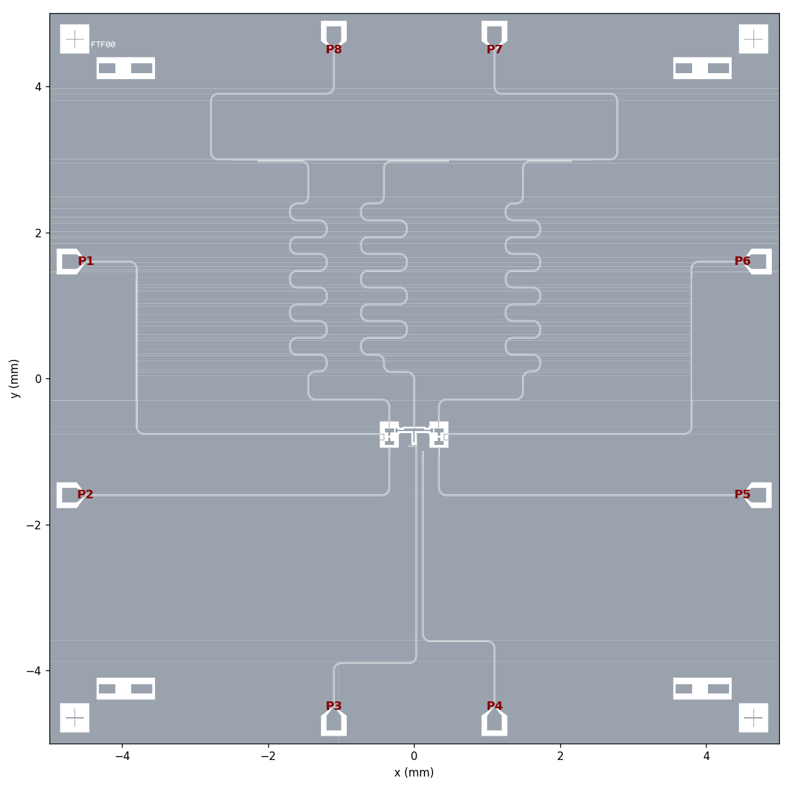

# Metal-agnet: one FTF set (fluxonium – tunable transmon coupler – fluxonium)

## Current Design3 parameters (2026-11-13)

This run uses the 20 µm coupler gap to both fluxonium bottom pads, the 150 × 20 µm transmon readout pad, and the 20 × 14 µm rectangular SQUID opening. The silicon model is 525 µm thick.

| Device | $E_C/h$ (GHz) | Readout frequency (GHz) | Offset from target (MHz) | Readout $g/2\pi$ (MHz) | Feedline $\kappa/2\pi$ (MHz) |
|---|---:|---:|---:|---|---:|
| FX1 | 1.062 | 6.279 | −20.8 | 87.6 per unit $n$ | 1.97 |
| Transmon (TC) | 0.215 | 6.058 | +57.9 | **102.3**, Design3 convention at $E_J/E_C=50$ | 3.05 |
| FX2 | 1.064 | 6.457 | −42.9 | 87.4 per unit $n$ | 1.94 |

| Qubit pair | $\lvert J\rvert/2\pi$ (MHz) | $0\to1$ coupling magnitude (MHz) |
|---|---:|---:|
| FX1–TC | 127.4 | 14.86 |
| FX2–TC | 125.7 | 14.69 |
| FX1–FX2 | 9.32 | 0.087 |

The direct capacitances from the FX1, TC, and FX2 charge lines to the transmon island are **0.05927, 0.03013, and 0.06020 fF**, respectively. Each FX line couples to the island with about twice the direct capacitance of the TC charge line.

These are simulation estimates. The Q3D device matrix reached its 6-pass limit with a final change of 4.35%. All three HFSS eigenmode runs reached 17 passes, with the reported modes still moving by 6–9 MHz on the final pass. The feedline linewidths are Q3D-based estimates. The [parameter report](final_parameter_check.md) includes the model assumptions, mode assignments, convergence data, and raw matrices. The [design change comparison](design_change_comparison.md) records the earlier layouts and flux-line mutual inductances.

### Flux bias line mutual inductance

| Device | Mutual inductance magnitude (pH) | Current for one flux quantum (mA) |
|---|---:|---:|
| FX1 | 1.0307 | 2.0062 |
| Transmon (TC) | 0.7175 | 2.8820 |
| FX2 | 1.0313 | 2.0050 |

The current is $I_{\Phi_0}=\Phi_0/|M|$, using the 10 MHz HFSS result from each bias line to its own loop. The TC value averages the two JJ-open simulations of the rectangular SQUID before the 2 µm mask shift. See the [mutual inductance comparison](design_change_comparison.md#自身-bias-line--loop-互感) for the raw sweeps.

## Design history

> **Design3** = Design1 with the readout pads reduced for g ~ 80 MHz (copied 2026-11-03; Design1 is unchanged).
> Numbers: `design_parameters.txt`.
> Readout pad 10 x 40 um (was 100 x 40 um), gap 10 / 11.45 um (FX1 / FX2, was 19.75 / 21.2 um).
> Q3D `ro_w10` (`simulation/results/runs/ropad_w10_g10_*`): g 80.9 / 80.5 MHz (was 161 / 160), Ec_FX 1.340 / 1.342 GHz,
> J_1c / J_12 154.8 / 19.6 MHz; with EJ 4, EL 0.6 GHz: chi 1.74 / 1.99 MHz (`simulation/scq_dispersive.py`),
> ZZ -0.28 kHz (`simulation/zz_analysis.py`, `../Design1/notes/zz_method.md`). The historical baseline section below describes Design1
> (resonator lengths / f_r and kappa are not retuned for the new pads; HFSS eigenmode: `simulation/results/runs/eigen_*`).
> Flux line -> loop mutual inductance re-run for Design3 (`simulation/driven/run_mutual_d3.py`): M = 0.574 pH, I_Phi0 = 3.60 mA
> (`fig/mutual/mutual_fx_impedance.png`; the old figure used the tip-20 um run). `fig/zz/` is made with the Design3 couplings.
> **Flux line (2026-11-03): M = 1.04 pH, I_Phi0 = 1.99 mA** (HFSS `mutual_d3_fl11_h80`; was 0.574 pH): U-loop height 80 um (was 50),
> tip gap 11 um (was 15). Sweep `simulation/driven/sweep_mutual.py`: fl_sep 10 / 8 / 6 um at height 50: 0.78 / 0.89 / 1.04 pH;
> height 80: sep 12 / 10 / 8: 0.98 / 1.10 / 1.24 pH. Q3D `d3_flux11_h80`: Ec_FX 1.335 / 1.338 GHz, J_1c / J_12 153.9 / 19.3 MHz,
> g 79.9 / 79.6 MHz, charge-line T1 3.9 ms (all within ~1 % of the 15 um / 50 um version). Flux-line T1 limit (50 Ohm, T = 0,
> f01 0.52 GHz): ~94 ms at 1.04 pH (308 ms at 0.574 pH), ~M^2.
> New pattern `pattern design/test_junction.py` (`TestJunction`: pocket + two pads, junction site left empty); the four chip-corner
> test structures in `ftf_layout.py` now use it (geometry unchanged).


A Qiskit Metal layout of two fluxoniums coupled through a grounded tunable-transmon
coupler, on a 10 × 10 mm chip. It includes readout resonators, charge and flux lines,
and launch pads at fixed PCB port positions. Ec, couplings, readout g and κ are
tuned with Ansys Q3D, and the resonator frequencies are checked with HFSS eigenmode.



## Repository layout

| folder | contents |
|---|---|
| `pattern design/` | `ftf_layout.py` (build, GDS export, plots). The components are shared in `../pattern design/`: `my_fluxonium.py` (pads with 30 µm stems, 30 µm stem gap), `fluxonium.py` (`FluxoniumArrayJJ`): the simulation model of every fluxonium run (Q3D, HFSS eigenmode, mutual inductance): loop = lead line from the stem ends with the JJ as its short middle gap (qubit centre); U = two lumped-L sides (100 nH each = 200 nH) joined by a metal closing end; `flux_as_ground='True'` for Q3D, `my_tmon.py` (grounded tunable coupler), `pcbport.py` (PCB port positions) |
| `simulation/` | Ansys Q3D / HFSS scripts, sweeps in `tuning/`, results in `results/` (see [Simulation](#simulation)) |
| `design_parameters.txt` | All final numbers of this design |
| `../note/` (shared) | `cap_matrix.py` (matrix → Ec / J / g / charge-line code); Design1 method + tuning log: `../Design1/notes/` (`capacitance_method.md`, `mutual_inductance_method.md`, `zz_method.md`) |
| `gds/` | Junction-free mask: `ftf_layout_fab.gds` (cheesed ground), `ftf_layout.gds` (no cheesing). How: `../skill/gds_export.md` |
| `fig/` | `layout/`: plots of the exported GDS (`ftf_layout.py`, rules in `../skill/layout_figures.md`); `mutual/`: flux-line mutual inductance (`fluxonium.py`, `simulation/plot_mutual_z.py`) |
| `../skill/` (shared) | Rules for this workflow: components / layout (`skill.md`), GDS export (`gds_export.md`), capacitance-matrix and mutual-inductance analysis, chip DRC |
| `Agend.md` | Entry point and agenda for design sessions: status, workflow, open items |

Port use: P7 / P8 readout feedline, P1 / P6 FX flux, P2 / P5 FX charge, P3 TC flux,
P4 TC charge.

The FTF00 base-metal masks retain both rectangular transmon SQUID landing electrodes,
with the two 5 µm JJ gaps open. The mask shifts the SQUID 2 µm toward the stem,
leaving 1 µm of overlap at the ground contact. The simulation data above precede this shift. Fabrication adds the Dolan patterns, fluxonium JJs,
and fluxonium arrays. FTF00 is etched at the lower-right corner. The corner test
structures are omitted in these exports.

The standard GDS uses unnotched contact pads. The fab GDS enables
`fab_contacts=True` to add a 2 µm wide, 4 µm deep contact notch at each
fluxonium stem end and on both electrodes at each TC junction site. At both TC JJ sites, the ground-side notch is offset +2 µm along the chip x axis relative to the island-side notch.

[FTF00 base metal](gds/FTF00_metal_only.gds) ·
[FTF00 fabrication mask with ground holes](gds/FTF00_metal_only_fab.gds).

## Historical Design1 baseline (v4.1: real JJ array, flux tip 15 µm; CPW 10 / 6 µm)

Source: `simulation/results/latest/` — current layout, **all CPWs 10 / 6 µm (Z0 = 50.9 Ω)**,
FX with the real 55 × 10 µm array (2 µm wires and leads) and the flux-line tip 15 µm from the
array end. Everything below is computed from the Q3D capacitance matrices (no retuning):
`fxarray_fl15` (FX1 + TC + FX2 with the three resonators rendered) and `kappa_cpw10_6`
(feedline + tees + resonators, FX not rendered, so unchanged). The "previous" column is
`cpw10_6` (old array placeholder, tip 20 µm; `simulation/results/previous/`).
Full list: `design_parameters.txt`.

**Flux line → loop mutual inductance** (HFSS driven modal, M = Im Z21/ω):
**M = 0.575 pH, I_Φ0 = 3.6 mA** (tip 20 µm: 0.440 pH, 4.7 mA). Method:
`../Design1/notes/mutual_inductance_method.md`.

**Charging energies**, Ec = e²/2 · C̃⁻¹[i,i]

| | Ec | C_Σ | previous | target |
|---|---|---|---|---|
| FX1 | 1.322 GHz | 14.65 fF | 1.310 GHz | 1.3 GHz |
| FX2 | 1.326 GHz | 14.61 fF | 1.312 GHz | 1.3 GHz |
| TC | 0.202 GHz | 95.89 fF | 0.201 GHz | 0.2 GHz |

**Qubit–qubit coupling**, J = 4e² C̃⁻¹[i,j] / h, per charge number (n_i n_j)

| | J/2π | previous |
|---|---|---|
| FX1 – TC (f–t) | 140.0 MHz | 136.9 MHz |
| FX2 – TC (f–t) | 141.9 MHz | 138.9 MHz |
| FX1 – FX2 (f–f, direct) | 16.5 MHz | 16.1 MHz |

**Qubit–resonator coupling**, ħg = 2e β V_zpf, β = C̃⁻¹[q,r]/C̃⁻¹[r,r],
V_zpf = ω_r √(ħZ0/π) (λ/2, Z0 = 50.9 Ω, ω_r = design frequency)

| | β | V_zpf | g/2π | previous | target |
|---|---|---|---|---|---|
| FX1 – R1 (6.3 GHz) | 0.203 | 1.64 µV | 160.9 MHz (per n) | 157.9 MHz | 150 MHz |
| FX2 – R2 (6.5 GHz) | 0.196 | 1.69 µV | 160.3 MHz (per n) | 157.1 MHz | 150 MHz |
| TC – R_TC (6.0 GHz) | 0.233 | 1.56 µV | 157.1 MHz (transmon conv., EJ/Ec = 50; 175.6 MHz per n) | 159.4 MHz | 150 MHz |

The 10 / 6 µm CPW raised g by √(50.9/45) ≈ 6 % (β unchanged); not retuned yet.

**Readout resonators** (λ/2, CoupledLineTee on one feedline P8 → P7, 99 µm fillets),
Q_c = π / (Z0 Zr (C₁ω)²), κ = f/Q_c, Z0 = Zr = 50.9 Ω, C₁ = −C[resonator, feedline]

| | f (design) | C₁ to feedline | Q_c | κ/2π | previous κ | κ target | length | tee coupling length |
|---|---|---|---|---|---|---|---|---|
| R1 (FX1) | 6.3 GHz | 11.96 fF | 5413 | 1.16 MHz | 2.08 MHz | 2 MHz | 9.268 mm | 0.689 mm |
| R_TC | 6.0 GHz | 15.50 fF | 3552 | 1.69 MHz | 3.05 MHz | 3 MHz | 9.610 mm | 0.882 mm |
| R2 (FX2) | 6.5 GHz | 11.42 fF | 5577 | 1.17 MHz | 2.08 MHz | 2 MHz | 8.983 mm | 0.662 mm |

The tee lengths were set with the 15 / 5.909 µm Cc fit (24.0 fF/mm); the 10 / 6 µm tees give
about 18.5 fF/mm, so κ is ~58 % of target. f_r is the design value: the lengths are analytic
(with the old HFSS correction) and have not been checked with HFSS for 10 / 6 µm.

**Charge (XY) lines**, Γ₁ = 8e²β²|n|²ωR/ħ, R = 50 Ω

| | C to qubit | β | T1 limit | power at chip, 10 MHz Rabi | previous T1 |
|---|---|---|---|---|---|
| FX1 | 0.322 fF | 0.0094 | 3.7 ms | −83 dBm | 3.8 ms |
| FX2 | 0.340 fF | 0.0098 | 3.4 ms | −84 dBm | 3.6 ms |
| TC | 0.039 fF | 0.00041 | 1.6 ms | −77 dBm | 1.7 ms |

FX: f01 = 0.5 GHz, |n01| = 0.1 assumed; TC: f = 5 GHz, EJ/Ec = 50 assumed.

## Running

Environment: the `qmetal` conda env (quantum-metal 0.7.4, PySide6, pyEPR, gdspy),
Ansys Electronics Desktop 2021 R2 for Q3D / HFSS (start AEDT before any simulation script).

```
cd "pattern design"
python ftf_layout.py                 # build the chip, write the junction-free gds/*.gds and fig/*/*.png
```

In Python: `from ftf_layout import build_design; design = build_design()`. Use
`build_design(for_process=True)` for the simulation geometry, and
`export_gds(build_design(jj_metal=False), file, fab=True)` for the cheesed fabrication GDS
(`../skill/gds_export.md`).

## Simulation

All scripts build the chip with `pattern design/ftf_layout.py`; the capacitance-matrix maths
is in `../note/cap_matrix.py`, the method in `../Design1/notes/capacitance_method.md`.

| script (`simulation/`) | what it computes | output |
|---|---|---|
| `q3d_ftf.py` | Ec, J (f–t, f–f), readout g, charge-line coupling / T1 limit: Q3D of FX1 + TC + FX2 (`with_resonators=True` adds the resonators) | `<tag>_cmat_fF.csv`, `<tag>_summary.json` |
| `q3d_kappa.py` | κ: Q3D of feedline + tees + resonators, C₁ = −C[res, feedline] | `<tag>.csv`, `<tag>_cmat_fF.csv` |
| `q3d_tee.py` | tee coupling capacitance Cc vs coupling length (linear fit used by the layout) | `tee_sweep.csv` |
| `hfss_eigen_res.py` | f_r: HFSS eigenmode, resonator + tee + its qubit | `eigen_resonators.csv`, `eigen_<name>_convergence.csv` |
| `hfss_mutual_fx.py` | flux line → fluxonium loop M = Im Z21 / ω: HFSS driven modal, one `FluxoniumArrayJJ` (`../Design1/notes/mutual_inductance_method.md`) | `<tag>_Z.csv`, `<tag>_summary.json` |
| `tuning/sweep_FX.py` | FX Ec / readout g around the current FX geometry | `sweep_<set>.csv` |
| `tuning/sweep_TC.py` | TC Ec / g / charge-line T1 around the current TC geometry | `sweep_<set>.csv` |
| `tuning/sweep_FX_charge_line.py` | FX charge-line tip position vs T1 limit | `sweep_fx_charge.csv` |
| `reference/analyse_fxtfx24.py` | Ec / J / g of one FTF set of FXTFX24-W7-0x-V.3.1 (comparison, `../Design1/notes/capacitance_method.md` §10) | – |

```
cd simulation
python -c "from q3d_ftf import Q3DRunner; r = Q3DRunner(); r.run('mytag', with_resonators=True); r.close()"
python q3d_kappa.py mytag
python q3d_tee.py 0.4 0.8 1.2          # coupling lengths in mm
python hfss_eigen_res.py FX1 TC FX2    # ~10 min per resonator
python hfss_mutual_fx.py mytag         # flux-line mutual inductance
python tuning/sweep_TC.py tc5
```

New runs are written to `simulation/results/runs/`. When a run becomes the new design point,
move the current `latest/` files to `previous/` and the new ones to `latest/`, and update the
tables above and `design_parameters.txt`.

| folder (`simulation/results/`) | content |
|---|---|
| `latest/` | Current design (real array, tip 15 µm, CPW 10 / 6 µm): `fxarray_fl15` (Ec, J, g, charge lines), `kappa_cpw10_6` (κ) |
| `previous/` | Step before (CPW 15 / 5.909 µm): `tc5_x120_cl250` (Ec, J, g, charge lines) and `sweep_tc5.csv`; `v4_pads_only` (readout-pad C used for the resonator lengths); `tee_*` (Cc fit, 15 / 5.909 µm tee); `kappa_v4d_conv` (κ); `eigen_*` (HFSS f_r) |
| `reference/` | FXTFX24 cell-33 capacitance matrix |
| `runs/` | New runs |

`*_cmat_fF.csv` is the Q3D Maxwell matrix in fF, `*_summary.json` the analysed parameters with
the geometry overrides used, `*.log` the console output, `sweep_*.csv` the table of one sweep.
Older runs (v1–v3: commit `32bed39`; v4_final / kappa_v4c: commit `ce5674d`) were in an earlier
repository that is not available; this repository starts on 2026-11-03 (v4.1), so commit
references to `32bed39` / `ce5674d` in the notes point there.

| solver | setting | use |
|---|---|---|
| Q3D | Medium order, no auto increase, 0.5 %, 6 passes (~1 min) | Ec / J / g |
| Q3D | 12 passes, 0.2 % (~2.5 min) | κ (`KAPPA_SETUP`), since κ ∝ C² |
| HFSS eigenmode | 0.05 %, ≤ 17 passes (~10 min) | f_r (25 passes used > 14 GB RAM) |

### Re-run with the CPW 10 / 6 µm component defaults (2026-11-03)

The components now default to `cpw_width='10um'`, `cpw_gap='6um'` (no design variables needed). Re-running
`Q3DRunner().run('cpw10_6_rerun', with_resonators=True)` (`simulation/results/runs/`) gives the same design
point: Ec 1.322 / 0.202 / 1.326 GHz (FX1 / TC / FX2), J 139.7 / 141.5 / 16.5 MHz, g 161.3 / 160.2 / 175.5 MHz
(per n), charge-line T1 3.9 ms (FX1) / 1.8 ms (TC).

## Design notes

FTF-specific workflow shared by Design1–3 (layout script knobs, GDS export options, standard figures): [`Design3/notes/ftf_workflow.md`](notes/ftf_workflow.md).
