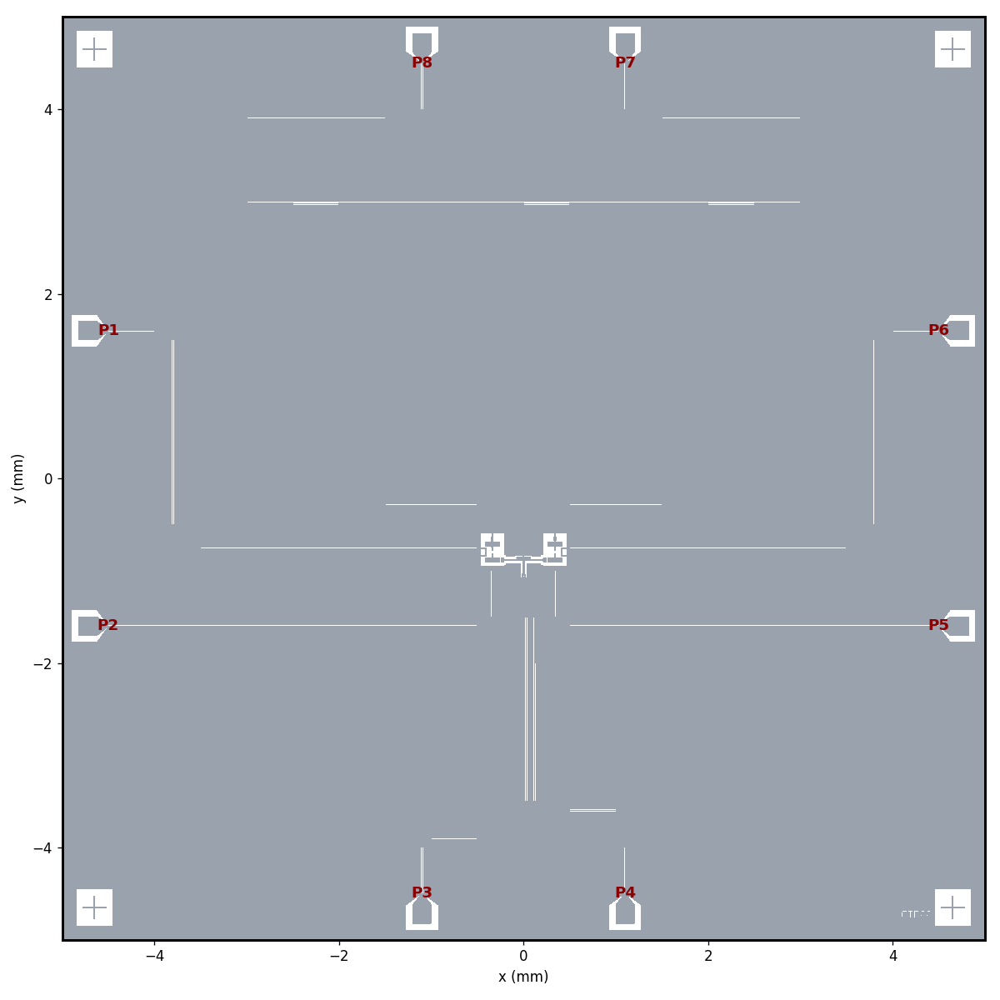
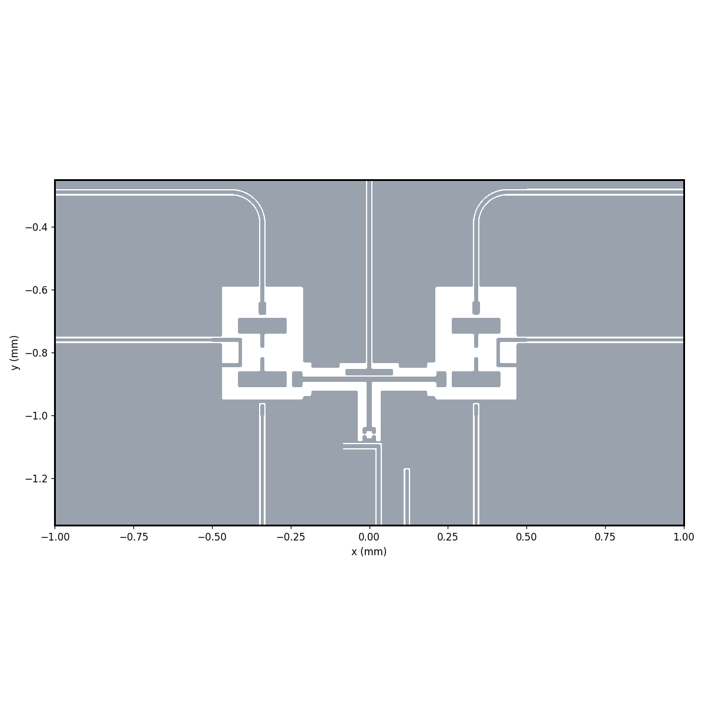
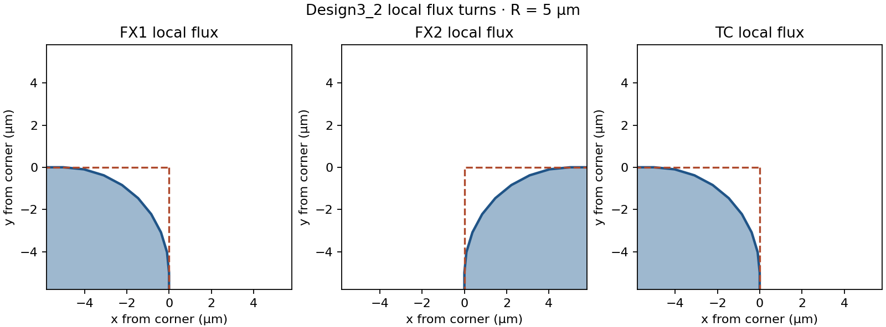

# Design3_2 · 圓角版 FTF00

基於 Design3 的 FTF00。版圖與元件原始碼集中在 `pattern design/`，可將整個資料夾分享給其他人。

- `gds/FTF00_metal_only.gds` 是無接地孔、無製程接觸缺口的一般版。
- `gds/FTF00_metal_only_fab.gds` 包含圓角接地孔、FX 接觸缺口與 TC 兩側同向偏移 +2 µm 的接觸缺口。
- 兩版保留右下角 FTF00 標記與 SQUID 落腳金屬。JJ、array 及 test junction 區按 FTF00 交付版設定。
- 圓角在最終正片金屬上處理，先合併相接的金屬多邊形，再處理外角與內角。直角目標 R = 5 µm，包含 FX1、FX2 的 U 形 local flux line 及 TC 的 L 形 flux line。相鄰邊至少 10 µm 時採用 R = 5 µm。較短邊的半徑限制為相鄰較短邊的 45%，2 µm 寬的 fab 缺口處最多 R = 0.9 µm。原有 CPW 彎道沿用 99 µm 的走線設定。
- 最終 GDS 展平到 TOP，正片金屬統一為 layer 1 / datatype 0，座標單位 µm，資料庫解析度 1 nm。圓弧以多邊形近似。

## Current Design3_2 parameters

### TC readout and flux bias

| Parameter | Baseline | Updated |
|---|---:|---:|
| TC readout target (GHz) | 6.000 | 6.800 |
| TC readout eigenmode (GHz) | 6.0416 | 6.8228 |
| Readout path including tee (mm) | 9.610 | 8.523 |
| SQUID opening (µm) | 20 × 14 | 20 × 24 |
| TC local flux-line separation parameter (µm) | 10 | 10 |
| Mutual inductance magnitude (pH) | 0.6139 | 1.0740 |
| Current for one flux quantum (mA) | 3.3682 | 1.9253 |

The TC tee coupling length is 1.162 mm. HFSS eigenmode gives 6.8228 GHz (+22.85 MHz from target) after 17 passes. The final frequency change was 0.1375% with a 0.05% target for two consecutive passes. Solver status is tolerance not reached. The near-to-far CPW electric-field intensity ratio is 9.30. [Eigenmode convergence](simulation/results/D32_TC68_852300_s1000_h2400_convergence.csv) · [Field samples](simulation/results/D32_TC68_852300_s1000_h2400_field_samples.csv)

The 10 MHz mutual-inductance magnitudes are 1.0267 pH and 1.1213 pH for the left and right JJ fixtures. Both driven solves completed 12 passes and had no port warnings. The table averages the two magnitudes. [Left sweep](simulation/results/d32_tc_m_s1000_h2400_left_Z.csv) · [Right sweep](simulation/results/d32_tc_m_s1000_h2400_right_Z.csv)

[Flux-line magnetic field](fig/simulation/tc_mutual_Bz.png) · [SQUID opening detail](fig/simulation/tc_mutual_Bz_detail.png)

The full-chip capacitance and feedline linewidth tables below describe the baseline layout. The updated TC geometry has its own HFSS readout and mutual-inductance results above.

## Baseline simulation · 6.0 GHz TC design

The electrical model uses the Design3_2 QComponents with local polygon fillets targeting R = 5 µm. CPW centerlines and junction boundaries use the native AEDT renderer. The driven mutual-inductance models preserve straight port landings. The model omits fabrication contact notches and ground perforations. The rounded electrical polygons are generated before rendering and can differ locally from the final GDS, which rounds the assembled mask. Launch pads retain the Design3_2 width of 200 µm.

| Device | $E_C/h$ (GHz) | Readout frequency (GHz) | Offset from target (MHz) | Readout $g/2\pi$ (MHz) | Feedline $\kappa/2\pi$ (MHz) |
|---|---:|---:|---:|---:|---:|
| FX1 | 1.0249 | 6.300575 | 0.58 | 91.23 | 2.171 |
| TC | 0.2038 | 6.041648 | 41.65 | 108.86 | 3.312 |
| FX2 | 1.0274 | 6.470528 | -29.47 | 90.33 | 2.104 |

FX readout coupling is per unit charge number. TC follows the Design3 convention at $E_J/E_C=50$. Readout $g$ and $\kappa$ use the HFSS candidate frequency when available, and the design frequency otherwise. Feedline linewidths come from the passive Q3D model.

| Qubit pair | $\lvert J\rvert/2\pi$ (MHz) | $0\to1$ coupling magnitude (MHz) |
|---|---:|---:|
| FX1–TC | 125.831 | 14.537 |
| FX2–TC | 124.759 | 14.448 |
| FX1–FX2 | 9.598 | 0.084 |

The direct capacitances to the TC island are FX1 0.05628 fF, TC 0.02807 fF, FX2 0.05734 fF.

### Flux bias line mutual inductance

| Device | Mutual inductance magnitude (pH) | Current for one flux quantum (mA) |
|---|---:|---:|
| FX1 | 1.0239 | 2.0196 |
| TC | 0.6139 | 3.3682 |
| FX2 | 1.0209 | 2.0256 |

The current is $I_{\Phi_0}=\Phi_0/|M|$. Mutual inductance is sampled at 10 MHz. The TC result averages the two JJ-open fixture magnitudes.

### Solver results and convergence

| Device | Candidate modes (GHz) | Selected mode | Last-pass drift (MHz) | Passes | Max Δf (%) | HFSS status |
|---|---|---:|---:|---:|---:|---|
| FX1 | 6.300575, 6.547393 | 1 (target proximity and CPW field) | +2.04 | 23 | 0.145 | Tolerance not reached |
| TC | 6.041648, 8.716819 | 1 (proximity candidate) | -0.93 | 16 | 0.045 | Converged |
| FX2 | 6.470528 | 1 (CPW field probe) | +10.86 | 19 | 0.168 | Tolerance not reached |

HFSS uses one qubit, its readout resonator and its tee per solve. The eigenmode convergence target is 0.05% for two consecutive passes. Mode selection uses CPW field probes and frequency proximity. FX1 retained 23 passes before the stalled final pass was stopped. FX2 used a single-mode solve with a 5.75 GHz minimum frequency. TC mode 1 remains a frequency-proximity assignment.

Device capacitance matrix last exported pass is 16, with ΔC = 0.337% and a 0.5% target.

Feedline matrix last exported pass is 22, with ΔC = 0.133% and a 0.2% target.

Last-pass changes in κ at fixed design frequencies were FX1 0.64%, TC 0.13%, FX2 0.95%. [Feedline coupling by pass](simulation/results/d32_kappa_by_pass.csv)

Mutual-inductance sweep variation across 10–100 MHz is FX1 1.35%, TC 0.00%/0.00%, FX2 1.34%.

FX1 uses the reviewed R5 model. HFSS reported no port warnings. The adaptive mesh converged in 12 passes (final ΔS = 5.87e-07, target 0.0002). [Impedance sweep](simulation/results/d32_fx1_port_review_Z.csv) · [Adaptive convergence](simulation/results/d32_fx1_port_review_convergence.csv) · [HFSS messages](simulation/results/d32_fx1_port_review_messages.log)

FX2 completed 12 adaptive passes with final ΔS = 2.69e-06 (target 0.0002). HFSS reported no port warnings. [FX2 sweep](simulation/results/d32_mutual_fixed_fx2_Z.csv) · [FX2 convergence](simulation/results/d32_mutual_fixed_fx2_convergence.csv)

Both TC SQUID fixtures completed 12 adaptive passes. [Left JJ sweep](simulation/results/d32_mutual_contact_tc_left_Z.csv) · [Right JJ sweep](simulation/results/d32_mutual_contact_tc_right_Z.csv)

[Raw solver outputs](simulation/results) · [Solver runner](simulation/run_remaining.py)

## 版圖





[FX1 局部](fig/layout/ftf_layout_fx1.png) · [FX2 局部](fig/layout/ftf_layout_fx2.png) · [Transmon 局部](fig/layout/ftf_layout_tc.png)




## 重建

在 Qiskit Metal 環境執行。已使用 quantum-metal 0.7.4、Shapely 2.1.2、gdstk 1.0.0、gdspy 1.6.13。

```powershell
python -X utf8 "pattern design/ftf_layout.py" --test-junctions no --radius-um 5
```

省略 `--test-junctions` 時，匯出程式會詢問是否加入四角測試結構。
