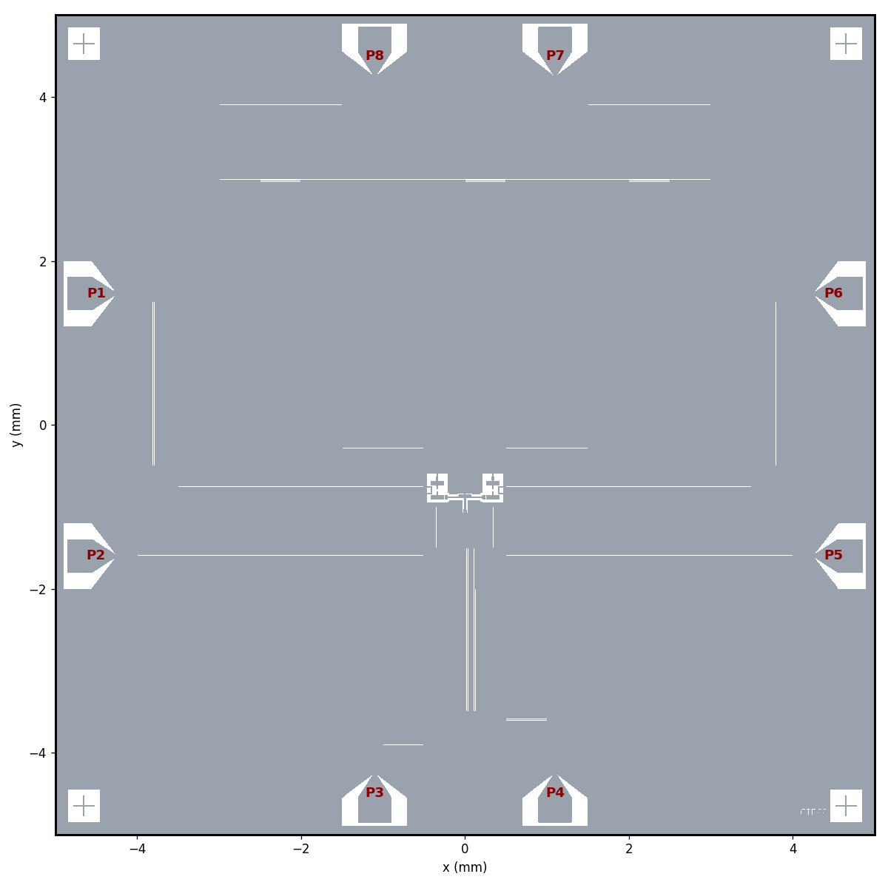
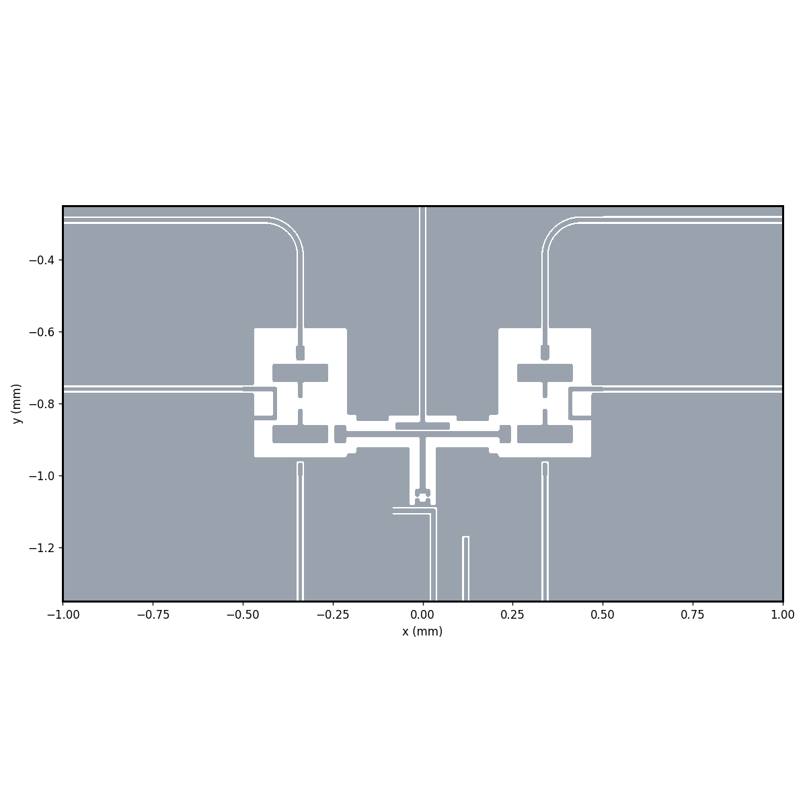
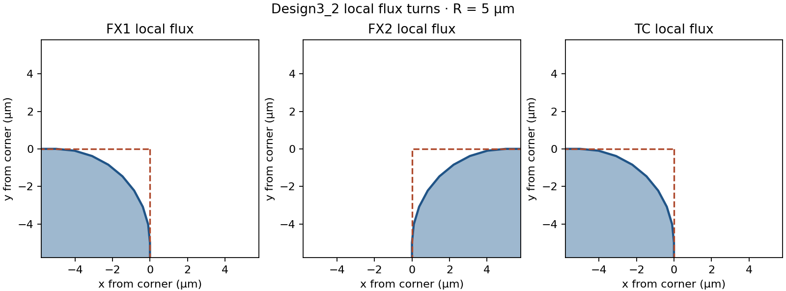

# Design3_2 · Rounded FTF00

**Current wafer layout 2026-11-16_wafer_r7.** Four side launches use y = ±2.00 mm. The fab uses the rounded mask geometry. Electrical revalidation is pending.

[Fab GDS](gds/Design3_2_2026-11-16_wafer_r7_fab.gds) · [Unnotched reference GDS](gds/Design3_2_2026-11-16_wafer_r7_reference.gds) · [Fab mask preview](fig/Design3_2_2026-11-16_wafer_r7_fab_check.png) · [Archived GDS](gds/previous/) · [Wafer index and export commands](../note/wafer_placement_2026-11-16.md)

The etched die ID `FTF00` is 50 µm inside the top and left die edges. The 5 × 5 µm ground perforations use a 20 µm centre pitch and a 547.5 µm four-edge keep-out. See the [wafer cheese rule](../skill/gds_export.md#3-checks-after-an-export).


> **Directory reorganization (2026-11-15)**: [Layout code](layout/) · [Simulation entry points](simulation/README.md) · [Results index](results/README.md) · [Adopted version](design.json). Solvers were not rerun. Moving historical values does not make them final confirmed values. Create a new run for new executions and confirm final parameters before commit/push.


The current layout uses the [Design6 launch pad standard](../skill/launch_pad.md). Saved solver results correspond to the launch geometry used in their original runs.

Based on the Design3 FTF00. The chip script is `layout/ftf_layout.py`; the Design3_2-specific component versions (fluxonium, my_fluxonium, my_tmon, test_junction, xmark, pcbport, round_mask, gds_tools and the `_fab` variants) are in `layout/components/`. Design3_3, Design6 and the wafer test-junction export import them from there, so `layout/` can still be shared as a unit.

- `gds/previous/FTF00_metal_only.gds` is the earlier version without ground perforations or fabrication contact notches.
- `gds/previous/FTF00_metal_only_fab.gds` is the earlier fab with rounded ground perforations, FX contact notches, and TC contact notches shifted +2 µm in the same direction on both sides.
- Both versions retain the lower-right FTF00 label and SQUID landing metal. JJ, array, and test-junction regions follow the FTF00 delivery configuration.
- Rounding is applied to the final positive metal: merge touching metal polygons first, then round exterior and interior corners. The target radius for right angles is R = 5 µm, including the FX1/FX2 U-shaped local flux lines and the TC L-shaped flux line. Use R = 5 µm when adjacent edges are at least 10 µm long. For shorter edges, limit the radius to 45% of the shorter adjacent edge; the 2 µm-wide fabrication notches therefore have at most R = 0.9 µm. Existing CPW bends retain the 99 µm routing setting.
- Flatten the final GDS into TOP, with positive metal on layer 1 / datatype 0, coordinates in µm, and database precision of 1 nm. Approximate arcs with polygons.

## Current Design3_2 parameters

### TC readout and flux bias

| Parameter | Baseline | Updated |
|---|---:|---:|
| TC readout target (GHz) | 6.000 | 6.800 |
| TC readout eigenmode (GHz) | 6.0416 | 6.8228 |
| Readout path including tee (mm) | 9.610 | 8.523 |
| SQUID opening (µm) | 20 × 14 | 20 × 24 |
| TC local flux-line separation parameter (µm) | 10 | 10 |
| Mutual inductance magnitude (pH) | 0.6139 | 1.0740 |
| Current for one flux quantum (mA) | 3.3682 | 1.9253 |

The TC tee coupling length is 1.162 mm. HFSS eigenmode gives 6.8228 GHz (+22.85 MHz from target) after 17 passes. The final frequency change was 0.1375% with a 0.05% target for two consecutive passes. Solver status is tolerance not reached. The near-to-far CPW electric-field intensity ratio is 9.30. [Eigenmode convergence](results/resonator/legacy/D32_TC68_852300_s1000_h2400_convergence.csv) · [Field samples](results/resonator/legacy/D32_TC68_852300_s1000_h2400_field_samples.csv)

The 10 MHz mutual-inductance magnitudes are 1.0267 pH and 1.1213 pH for the left and right JJ fixtures. Both driven solves completed 12 passes and had no port warnings. The table averages the two magnitudes. [Left sweep](results/flux/legacy/d32_tc_m_s1000_h2400_left_Z.csv) · [Right sweep](results/flux/legacy/d32_tc_m_s1000_h2400_right_Z.csv)

[Flux-line magnetic field](fig/simulation/tc_mutual_Bz.png) · [SQUID opening detail](fig/simulation/tc_mutual_Bz_detail.png)

The full-chip capacitance and feedline linewidth tables below describe the baseline layout. The updated TC geometry has its own HFSS readout and mutual-inductance results above.

## Baseline simulation · 6.0 GHz TC design

The electrical model uses the Design3_2 QComponents with local polygon fillets targeting R = 5 µm. CPW centerlines and junction boundaries use the native AEDT renderer. The driven mutual-inductance models preserve straight port landings. The model omits fabrication contact notches and ground perforations. The rounded electrical polygons are generated before rendering and can differ locally from the final GDS, which rounds the assembled mask. Those electrical results used the earlier 200 µm launch pads.

| Device | $E_C/h$ (GHz) | Readout frequency (GHz) | Offset from target (MHz) | Readout $g/2\pi$ (MHz) | Feedline $\kappa/2\pi$ (MHz) |
|---|---:|---:|---:|---:|---:|
| FX1 | 1.0249 | 6.300575 | 0.58 | 91.23 | 2.171 |
| TC | 0.2038 | 6.041648 | 41.65 | 108.86 | 3.312 |
| FX2 | 1.0274 | 6.470528 | -29.47 | 90.33 | 2.104 |

FX readout coupling is per unit charge number. TC follows the Design3 convention at $E_J/E_C=50$. Readout $g$ and $\kappa$ use the HFSS candidate frequency when available, and the design frequency otherwise. Feedline linewidths come from the passive Q3D model.

| Qubit pair | $\lvert J\rvert/2\pi$ (MHz) | $0\to1$ coupling magnitude (MHz) |
|---|---:|---:|
| FX1–TC | 125.831 | 14.537 |
| FX2–TC | 124.759 | 14.448 |
| FX1–FX2 | 9.598 | 0.084 |

The direct capacitances to the TC island are FX1 0.05628 fF, TC 0.02807 fF, FX2 0.05734 fF.

### Flux bias line mutual inductance

| Device | Mutual inductance magnitude (pH) | Current for one flux quantum (mA) |
|---|---:|---:|
| FX1 | 1.0239 | 2.0196 |
| TC | 0.6139 | 3.3682 |
| FX2 | 1.0209 | 2.0256 |

The current is $I_{\Phi_0}=\Phi_0/|M|$. Mutual inductance is sampled at 10 MHz. The TC result averages the two JJ-open fixture magnitudes.

### Solver results and convergence

| Device | Candidate modes (GHz) | Selected mode | Last-pass drift (MHz) | Passes | Max Δf (%) | HFSS status |
|---|---|---:|---:|---:|---:|---|
| FX1 | 6.300575, 6.547393 | 1 (target proximity and CPW field) | +2.04 | 23 | 0.145 | Tolerance not reached |
| TC | 6.041648, 8.716819 | 1 (proximity candidate) | -0.93 | 16 | 0.045 | Converged |
| FX2 | 6.470528 | 1 (CPW field probe) | +10.86 | 19 | 0.168 | Tolerance not reached |

HFSS uses one qubit, its readout resonator and its tee per solve. The eigenmode convergence target is 0.05% for two consecutive passes. Mode selection uses CPW field probes and frequency proximity. FX1 retained 23 passes before the stalled final pass was stopped. FX2 used a single-mode solve with a 5.75 GHz minimum frequency. TC mode 1 remains a frequency-proximity assignment.

Device capacitance matrix last exported pass is 16, with ΔC = 0.337% and a 0.5% target.

Feedline matrix last exported pass is 22, with ΔC = 0.133% and a 0.2% target.

Last-pass changes in κ at fixed design frequencies were FX1 0.64%, TC 0.13%, FX2 0.95%. [Feedline coupling by pass](results/resonator/legacy/d32_kappa_by_pass.csv)

Mutual-inductance sweep variation across 10–100 MHz is FX1 1.35%, TC 0.00%/0.00%, FX2 1.34%.

FX1 uses the reviewed R5 model. HFSS reported no port warnings. The adaptive mesh converged in 12 passes (final ΔS = 5.87e-07, target 0.0002). [Impedance sweep](results/flux/legacy/d32_fx1_port_review_Z.csv) · [Adaptive convergence](results/flux/legacy/d32_fx1_port_review_convergence.csv) · [HFSS messages](results/flux/legacy/d32_fx1_port_review_messages.log)

FX2 completed 12 adaptive passes with final ΔS = 2.69e-06 (target 0.0002). HFSS reported no port warnings. [FX2 sweep](results/flux/legacy/d32_mutual_fixed_fx2_Z.csv) · [FX2 convergence](results/flux/legacy/d32_mutual_fixed_fx2_convergence.csv)

Both TC SQUID fixtures completed 12 adaptive passes. [Left JJ sweep](results/flux/legacy/d32_mutual_contact_tc_left_Z.csv) · [Right JJ sweep](results/flux/legacy/d32_mutual_contact_tc_right_Z.csv)

[Raw solver outputs](results/general/legacy) · [Solver runner](simulation/general/run_remaining.py)

## Layout





[FX1 detail](fig/layout/ftf_layout_fx1.png) · [FX2 detail](fig/layout/ftf_layout_fx2.png) · [Transmon detail](fig/layout/ftf_layout_tc.png)




## Rebuild

Run in the Qiskit Metal environment. Versions used: quantum-metal 0.7.4, Shapely 2.1.2, gdstk 1.0.0, and gdspy 1.6.13.

```powershell
python -X utf8 "layout/ftf_layout.py" --test-junctions no --radius-um 5
```

If `--test-junctions` is omitted, the export script asks whether to include the four corner test structures.
