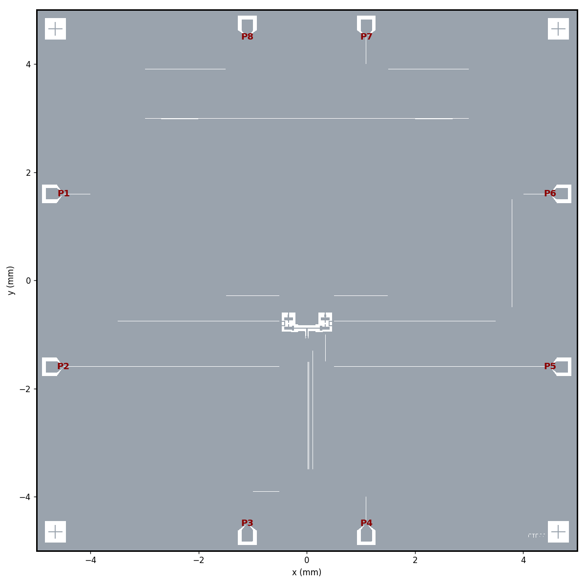
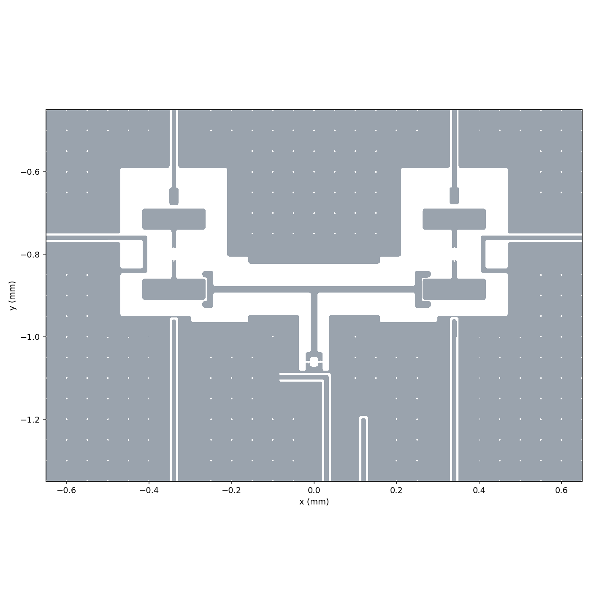
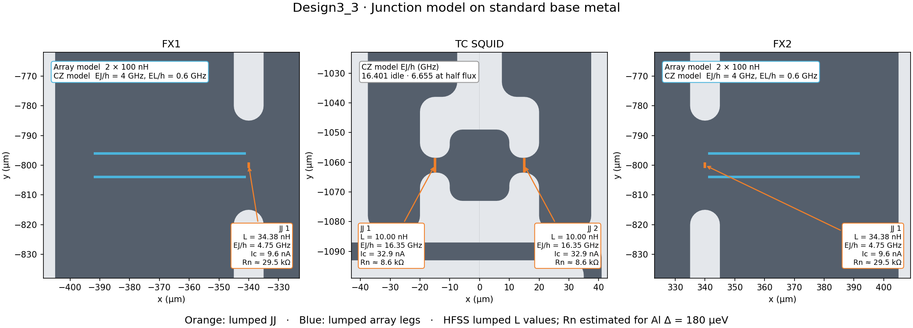

# Design3_3

The TC uses a straight ㄈ bracket with rounded corners at each FX bottom pad. The final upper and lower arms both reach 6.7 µm past the inner pad edge on FX1 and 18.9 µm on FX2. The bracket is 15 µm wide and has 4 µm minimum pad clearance. TC-to-charge-line clearance is 75.29 / 64.29 µm and TC-to-FX-junction-sheet clearance is 81.13 / 70.77 µm. There are two FX readout resonators and a dedicated TC charge line and flux line.

## Final GDS

| Mask | Fabrication features |
|---|---|
| [Standard](gds/Design3_3_2026-11-15_nocheese.gds) | Solid ground and standard contact lands |
| [Fab](gds/Design3_3_2026-11-15.gds) | Ground perforations and 2 µm-wide, 4 µm-deep contact recesses. The two TC ground-side recesses have the same +2 µm offset. |

Both 10 × 10 mm masks use positive base metal on layer 1/0, with the FTF00 die marking and open junction gaps. The TC SQUID base-metal landing electrodes are included for junction placement. Array, junction and test-junction patterns are omitted.







Regenerate the annotated junction figure from the repository root with
`python -B note/plot_junction_layout.py Design3_3`. The overlay shows the lumped HFSS junction and array locations on the standard base-metal mask.

## Q3D

| Parameter | Design3e e4 | Original bracket, 34/34 µm | First tune, 6/20 µm | Final, 6.7/18.9 µm |
|---|---:|---:|---:|---:|
| Signed FX1–TC charge coefficient (MHz) | +310.18 | +413.82 | +306.01 | +309.13 |
| Signed FX2–TC charge coefficient (MHz) | −370.45 | −412.73 | −374.57 | −369.67 |
| Signed FX1–FX2 charge coefficient (MHz) | −69.60 | −111.10 | −68.54 | −68.30 |
| FX1 / TC / FX2 charging energy (GHz) | 1.0081 / 0.2067 / 1.0008 | 0.9878 / 0.1928 / 0.9902 | 1.0109 / 0.2095 / 1.0029 | 1.0105 / 0.2096 / 1.0036 |
| FX1 own drive magnitude | 0.008852 | 0.008126 | 0.009029 | 0.009015 |
| FX2 own drive magnitude | 0.008653 | 0.008555 | 0.009108 | 0.009140 |
| FX1 / FX2 charge line to TC direct capacitance (fF) | 0.13253 / 0.17832 | 0.15922 / 0.16813 | 0.11250 / 0.13925 | 0.11340 / 0.13777 |
| TC own charge line to TC direct capacitance (fF) | 0.03349 | 0.03378 | 0.03252 | 0.03250 |

The final Q3D solution exported at pass 12 with ΔC = 1.235% against the 0.65% setup target. Pass 11 gave +309.050 / −369.070 MHz. The matrix includes the two FX readout conductors and the three local charge-line electrodes. The drive coefficients use the inverse capacitance matrix in the fluxonium differential coordinates.

The circuit model gives idle ZZ = −0.621 kHz and exchange magnitude 0.227 kHz at 6.0 GHz, and ZZ = −1.573 kHz and exchange magnitude 2.248 kHz at the 3.82 GHz CZ point. The effective junction energies for those endpoints are 16.401 / 6.655 GHz after division by h.

- [Full charge-drive, capacitance and coupling comparison](results/comparison.csv)
- [Final Q3D matrix](results/arms6p7_18p9_cmat_fF.csv)
- [Adaptive convergence](results/arms6p7_18p9_convergence.csv)
- [Original 34 µm bracket preview](results/bracket34_layout.png)
- [Tuned Q3D project](aedt/D33Tune.aedt)

## Readout verification

| Readout | Design3_2 frequency (GHz) | Design3_3 frequency (GHz) | Design3_2 external κ/2π (MHz) | Design3_3 external κ/2π (MHz) | Design3_2 g/2π per unit charge (MHz) | Design3_3 g/2π per unit charge (MHz) | Design3_3 g₀₁/2π (MHz) |
|---|---:|---:|---:|---:|---:|---:|---:|
| FX1 | 6.3006 | 6.3169 | 2.171 | 1.996 | 91.23 | 92.06 | 8.46 |
| FX2 | 6.4705 | 6.4955 | 2.104 | 1.965 | 90.33 | 91.90 | 8.39 |

The Design3_2 values are the previous simulated references. HFSS models each readout with its tee and its own fluxonium, with the tee primary open at both ends. CPW near-slot to off-slot mean \(\lvert E\rvert^2\) ratios are 12.2 and 44.9 for the selected modes, versus 3.6 and 8.2 for the other modes at 8.845 and 9.001 GHz. The selected frequencies moved +1.43 and −1.20 MHz on the final pass. After 15 passes, HFSS reported maximum changes of 0.126% and 0.089%, above the 0.05% setup target.

External κ uses each tee-to-feedline capacitance (15.595 and 14.842 fF) of the passive two-readout Q3D model, with the eigenmode frequencies and 50.9 Ω CPW impedance. It estimates external coupling linewidth. The overall Q3D matrix ended at ΔC = 1.338% after 14 passes against a 0.20% target. The external linewidth estimates moved 0.12% and 0.49% from pass 13 to 14. The same frequency-dependent conversion is used for the old values.

The per-unit-charge \(g\) uses the coupled-device Q3D matrix and the half-wave resonator zero-point voltage at the simulated frequency. The \(0\to1\) value includes the fluxonium charge matrix element at half flux with \(E_J/h=4\) GHz and \(E_L/h=0.6\) GHz. The corresponding Design3_2 values were 8.51 and 8.45 MHz. The final coupled-device Q3D matrix was also rechecked for \(E_C/h\). Pass 11 → 12 gives FX1 1.0128 → 1.0105 GHz, TC 0.2104 → 0.2096 GHz, and FX2 1.0069 → 1.0036 GHz. Design3_2 values were 1.0249, 0.2038 and 1.0274 GHz in the same order. The Q3D table above retains the Design3e and original bracket comparisons.

- [FX1 eigenmode convergence](results/readout_FX1_convergence.csv)
- [FX2 eigenmode convergence](results/readout_FX2_convergence.csv)
- [FX1 CPW field samples](results/readout_FX1_slots.csv)
- [FX2 CPW field samples](results/readout_FX2_slots.csv)
- [Feedline Q3D matrix](results/readout_kappa_cmat_fF.csv)
- [Feedline Q3D convergence](results/readout_kappa_convergence.csv)
- [Electrical verification data](results/readout_flux_parameters.json)
- [Readout and flux AEDT project](aedt/D33Verify.aedt)

## Flux-line mutual inductance

| Local flux line → own loop | Design3_2 reference \(\lvert M\rvert\) (pH) | Design3_3 \(\lvert M\rvert\) (pH) | Design3_2 \(I_{\Phi_0}\) (mA) | Design3_3 \(I_{\Phi_0}\) (mA) |
|---|---:|---:|---:|---:|
| FX1 | 1.0239 | 1.0198 | 2.0196 | 2.0276 |
| FX2 | 1.0209 | 1.0244 | 2.0256 | 2.0186 |
| TC SQUID | 1.0740 | 1.1154 | 1.9253 | 1.8539 |

The TC reference is the updated Design3_2 20 × 24 µm SQUID. The TC result averages the left and right fixture magnitudes of 1.0668 and 1.1640 pH. Each entry uses the reciprocal HFSS transfer impedance at 10 MHz and \(I_{\Phi_0}=\Phi_0/\lvert M\rvert\). Signs in the raw files reflect port orientation. The fixtures model the local flux tip and its own loop. All four runs used 12 adaptive passes, with final ΔS of 3.73e−7, 7.42e−7, 2.51e−5 and 2.91e−5 for FX1, FX2, TC left and TC right. The HFSS message logs showed no port warnings.

- [FX1 transfer impedance](results/m_fx1_Z.csv)
- [FX2 transfer impedance](results/m_fx2_Z.csv)
- [TC left transfer impedance](results/m_tc_left_Z.csv)
- [TC right transfer impedance](results/m_tc_right_Z.csv)

## CZ verification

Both fluxoniums stay at half flux, with EJ/h = 4 GHz and EL/h = 0.6 GHz. The TC travels from the 6.0 GHz zero-flux idle point to the 3.82 GHz half-flux point and back with half-cosine flux ramps. The I/Q pulse is applied to the TC charge line and the gate is evaluated after virtual-Z correction. The final time evolution retains the microwave carrier and counter-rotating terms, using 9 levels per fluxonium, 7 TC levels, 40 dressed states and 440 slices per ramp.

| Full sequence | Timing (ns) | Drive (GHz) | Coherent average fidelity | Worst-case leakage |
|---|---:|---:|---:|---:|
| Final Q3D matrix | 4 + 23 + 4 = 31 | 4.020835 | 99.9340% | 0.1078% |
| Pass-11 matrix, retuned | 4 + 23 + 4 = 31 | 4.021620 | 99.9370% | see CSV |
| Final matrix, longer pulse | 5 + 25 + 5 = 35 | 4.021528 | 99.9713% | 0.0370% |

For the 31 ns pulse the nearest TC-port-driven competing transition is 74.91 MHz away. The bare TC charge-operator matrix element evaluated between the dressed transition states has magnitude 0.8299, and the TC port-weighted element is 0.0003856. These are coherent model results with ideal applied flux and microwave envelopes. Hardware bandwidth, settling, readout-mode dynamics and decoherence are outside this calculation.

- [Full-carrier pulse verification](results/arms6p7_18p9_cmat_fF_iq_300steps_full.csv)
- [Pass-11 sensitivity](results/arms6p7_18p9_pass11_cmat_fF_iq_240steps_full.csv)

## Reproduce

Run from the repository root in the Qiskit Metal environment.

```powershell
python -B Design3_3/q3d.py arms6p7_18p9 --length 6.7 18.9
python -B Design3_3/preview.py
python -B Design3_3/export_gds.py --date 2026-11-15
python -B Design3_3/recheck_readout_flux.py fx1 fx2 tc_left tc_right kappa FX1 FX2
python -B Design3_3/probe_readout.py
python -B Design3_3/report_readout_flux.py
python -B Design3_3/optimize_pulse.py Design3_3/results/arms6p7_18p9_cmat_fF.csv --ramp-points 300 --ramp-ns 2 3 4 5 --candidates 7 --gate-ns 31 35
python -B Design3_3/recheck_pulse.py Design3_3/results/arms6p7_18p9_cmat_fF.csv Design3_3/results/arms6p7_18p9_cmat_fF_iq_300steps.csv --full --count 10
```
