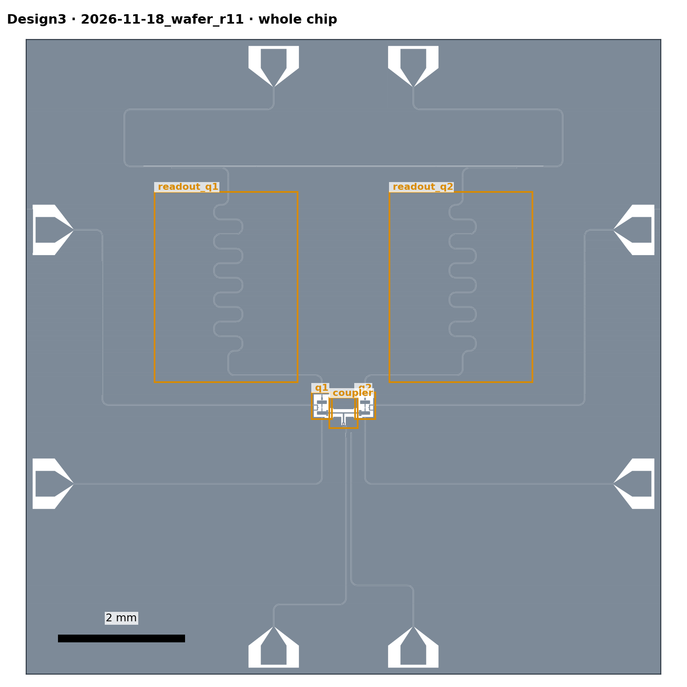
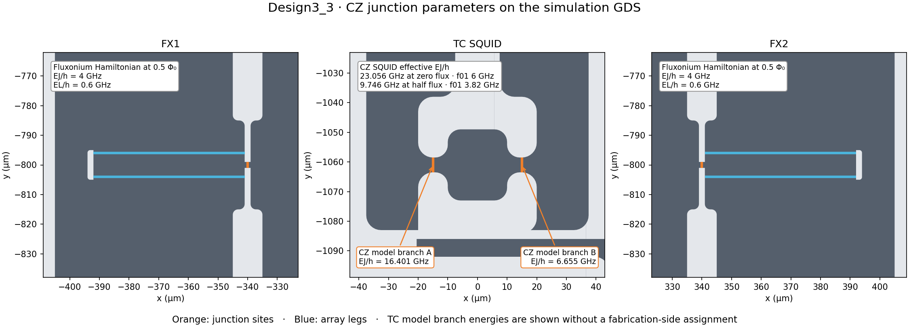

# Design3_FTF_NTHU (main FTF)

**Figures:** [fig/](fig/README.md) holds the whole chip ([`chip.png`](fig/chip.png)) and one close-up per part, rendered from the current GDS by `code/general/plot_design_figs.py`.



**40 µm cheese fab mask (2026-11-23, no EM rerun).** Fab GDS (`gds/Design3_2026-11-23_wafer_r11_fab.gds`) is the parent mask (`gds/Design3_2026-11-18_wafer_r11_fab.gds`) with the ground perforation rebuilt on a 40 µm lattice (5 × 5 µm holes, was 20 µm). The KLayout comparison shows only moved holes; simulation geometry is unchanged. Used by the `Fabrication output/20261123` NTHU wafer. Record: `design.json` → `metal_width_candidate.fabrication_gds_cheese40`.

Formerly `Design3_3`; renamed on 2026-11-18 when the former Design3_FTF_NTHU and Design3_2 were removed (git history keeps them). Files and records dated before the rename keep the `Design3_3_` prefix. The main FTF uses `layout/ftf_layout.py` (from Design3_2), the shared QComponents in `pattern design/`, and the local `layout/components/round_mask.py`.

**Main FTF layout.** `layout/layout.py` `build_design()` is the reference FTF chip. By default the transmon coupler (TC) has no readout pad, tee or resonator, and the feedline runs straight from tee_FX1 to tee_FX2. `build_design(tc_readout=True)` adds the Design3_2 TC readout (pad 150 × 20 µm, `ro_sep` 5 µm, its tee and resonator); that combination has not been simulated with the Design3_FTF_NTHU coupler arms.

**r11 metal-width candidate (2026-11-18, pending confirmation, no EM rerun).** Full rebuild from the current QComponents: no metal below 4 µm outside resonator parts and the design ID ([chip_drc.md C12a](../skill/chip_drc.md)); FX1/FX2 `cl_sep` 10 µm (4 µm ground strip, r9/r10 had 3 µm); TC flux `fbl_sep` 10.5 µm with a 7 µm SQUID ground tail (7.5 µm strip); design ID `FTF00` 150 µm high, checked on the mask. Both variants use the shared `pattern design/transmon/tmon_coupler_dolan_nthu.py`. Relative to r10 only the two charge-line tips and the design ID changed. Charge-line coupling and flux-line M need revalidation.

| Variant | Fab | Simulation | Checks |
|---|---|---|---|
| No TC readout (default) | r11 fab (`gds/Design3_2026-11-18_wafer_r11_fab.gds`) | r11 sim (`gds/Design3_2026-11-18_wafer_r11_sim.gds`) | r10 → r11 (`Design3_2026-11-18_wafer_r11_compare.png`, removed 2026-11-19; in git history) · design ID (`Design3_2026-11-18_wafer_r11_fab_design_id.png`, removed 2026-11-19; in git history) |
| With TC readout (`tc_readout=True`) | r11 tcres fab (`gds/Design3_2026-11-18_wafer_r11_tcres_fab.gds`) | r11 tcres sim (`gds/Design3_2026-11-18_wafer_r11_tcres_sim.gds`) | without → with readout (`Design3_2026-11-18_wafer_r11_tcres_compare.png`, removed 2026-11-19; in git history) · design ID (`Design3_2026-11-18_wafer_r11_tcres_fab_design_id.png`, removed 2026-11-19; in git history) |

Reproduce: `python -X utf8 code/general/export_wafer_test_junctions.py --design Design3_FTF_NTHU --candidate metal_width_candidate[_tc_readout] [--reference-only]`. Records: `metal_width_candidate*` in [design.json](design.json).

## E-beam junctions in the fab render (2026-11-20)

`build_design(jj_metal=False, fab_contacts=True, ebeam_junctions=True)` adds the e-beam junction drawings, on layers 11–14,
on the fab components' contact hooks ([skill](../skill/ebeam_junction.md), [fab workflow](../skill/gds_export.md#21-fab-gds-workflow)).
- **Energies**: `EBEAM_JUNCTIONS` in [layout.py](layout/layout.py) holds the FX small JJ at 4 GHz (80 / 92 nm) and the TC at
  11.528 / 11.528 GHz (396 / 396 nm). The symmetric TC is the user's choice of 2026-11-20. The CZ model's
  16.401 / 6.655 GHz branches are not used, so the CZ result needs revalidation.
- **Check**: on 2026-11-20 the drawn layers equal the DesignTestJunction r4 overlay on the r11 hooks (XOR below 1e-10 µm²).
  The qiskit-metal render writes them unchanged.
- **Not done**: no fab GDS has been delivered from this option, `final_selection` is pending, and no simulation was
  rerun.

## Draft e-beam junction overlay (r11, 2026-11-19, historical)

Draft GDS (`gds/Design3_2026-11-19_wafer_r11_ebeamjj_fab.gds`) ·
Site checks (`Design3_2026-11-19_wafer_r11_ebeamjj_fab_sites.png`, removed 2026-11-19; in git history) ·
Legacy placement script (`layout/add_ebeam_junctions.py`, removed; in git history — new exports use `code/ebeam/ebeam_junction_placement.py` inside `layout/build.py`)

The candidate adds FX1 and mirrored FX2 array drawings plus two parallel
single-junction TC drawings to the r11 mask without TC readout. The parent
metal on 1/0 is unchanged. Junction, recess, array and array-bar drawings use
11/0–14/0. The figure is a check of the exported GDS, not a GUI screenshot.
The `ebeam_junction_candidate` entry in [design.json](design.json) records
the complete draft options, placement checks and pending decisions.

Contacts nominally overlap each hook bottom by 1 µm. The FX recess strips
retain a 5 nm side overlap with the hook walls. Contact convention, layer
mapping, evaporation alignment, TC orientation and the TC-readout variant
remain pending user confirmation. No fabrication or EM validation has been
performed; existing electrical results do not validate these junction drawings.

Reproduce from the repository root with `python -X utf8 Design3_FTF_NTHU/layout/add_ebeam_junctions.py`.
The script refuses to overwrite outputs; use `--output` and `--figure` for
a separate export, and optionally `--record` to save its checks.

The **r10 SQUID ground-tail candidate** sets the TC loop-floor-to-pocket-edge thickness to 7 µm. It builds on r9, including the 3 µm FX charge-line ground strips. The rounded lower pocket corners use the revised edge. Mutual inductance and other electrical results require revalidation for r10. No EM solver was rerun for this change.

r10 fabrication GDS (`Design3_3_2026-11-18_wafer_r10_fab.gds`, removed 2026-11-18; in git history) · r10 simulation GDS (`Design3_3_2026-11-18_wafer_r10_sim.gds`, removed 2026-11-18; in git history) · TC detail (`Design3_3_2026-11-18_wafer_r10_fab_tc_tail_check.png`, removed 2026-11-18; in git history)

The **r9 charge-ground candidate** retracts the FX2 charge-line tip by 1 µm. The geometry uses a 9 µm pocket-to-tip spacing and a 99 µm stub with the same 10/6 µm CPW and pin position. FX1 and FX2 each have a 3.000 µm minimum ground strip in the fabrication and simulation GDS. r9 carries the r8 TC flux-ground update. The user confirmed this geometry before the 18 November push. The local TC mutual-inductance recheck is borderline at 1.0026 pH for the finer left-sense fixture, with a 1.48% pass-count change. A margin above 1 pH is not established. Charge-drive coupling requires revalidation. [Mutual-inductance check](notes/mutual_ground_20261118.md)

r9 fabrication GDS (`Design3_3_2026-11-18_wafer_r9_fab.gds`, removed 2026-11-18; in git history) · r9 simulation GDS (`Design3_3_2026-11-18_wafer_r9_sim.gds`, removed 2026-11-18; in git history) · FX2 mask detail (`Design3_3_2026-11-18_wafer_r9_fab_fx2_charge_ground_check.png`, removed 2026-11-18; in git history) · Reproduction: `export_wafer_test_junctions.py --design Design3_FTF_NTHU --charge-ground-review --output <new>.gds` (add `--reference-only` for the companion)

The **r8 flux-ground candidate** increases the TC SQUID-to-flux-metal separation to 10.5 µm with a 6 µm CPW slot. The minimum ground strip is 4.500 µm in both GDS variants. Candidate confirmation is pending. Earlier electrical results require revalidation for r8. No HFSS or Q3D solver was rerun.

r8 fabrication GDS (`Design3_3_2026-11-18_wafer_r8_fab.gds`, removed 2026-11-18; in git history) · r8 simulation GDS (`Design3_3_2026-11-18_wafer_r8_sim.gds`, removed 2026-11-18; in git history) · TC mask detail (`Design3_3_2026-11-18_wafer_r8_fab_tc_flux_ground_check.png`, removed 2026-11-18; in git history) · Reproduction: `export_wafer_test_junctions.py --design Design3_FTF_NTHU --flux-ground-review --output <new>.gds` (add `--reference-only` for the companion)

**Current wafer layout 2026-11-16_wafer_r7.** Four side launches use y = ±2.00 mm. T is at the upper left and lower right. F is at the upper right and lower left. Electrical revalidation is pending.

Fab GDS (`gds/Design3_3_2026-11-16_wafer_r7_fab.gds`) · Simulation geometry GDS (`gds/Design3_3_2026-11-16_wafer_r7_sim.gds`) · Fab mask preview (`Design3_3_2026-11-16_wafer_r7_fab_check.png`, removed 2026-11-19; in git history) · Archived GDS (`gds/previous/`)

The fab mask has 173,429 ground openings. The old corner cross polygons and their 5 µm margin are replaced by one ground polygon per corner. Reproduce from the repository root with the qmetal Python: `python -B code/general/export_wafer_test_junctions.py --design Design3_FTF_NTHU --output <new path>.gds`, plus `--reference-only` and a separate output path for the companion. [10 mm die standard](../skill/gds_export.md#10-mm-wafer-die-standard).

The etched die ID `FTF00` is 50 µm inside the top and left die edges. The 5 × 5 µm ground perforations use a 20 µm centre pitch and a 547.5 µm four-edge keep-out. See the [wafer cheese rule](../skill/gds_export.md#3-checks-after-an-export).


> **Directory reorganization (2026-11-15)**: [Layout code](layout/) · [Simulation entry points](simulation/README.md) · [Results index](results/README.md) · [Adopted version](design.json). Solvers were not rerun. Moving historical values does not make them final confirmed values. Create a new run for new executions and confirm final parameters before commit/push.


The current layout uses the [wire-bond launch pad standard](../skill/gds_export.md#wire-bond-launch-pad-standard). Saved solver results/general/legacy correspond to the launch geometry used in their original runs.

The TC uses a straight ㄈ bracket with rounded corners at each FX bottom pad. The final upper and lower arms both reach 6.7 µm past the inner pad edge on FX1 and 18.9 µm on FX2. The bracket is 15 µm wide and has 4 µm minimum pad clearance. TC-to-charge-line clearance is 75.29 / 64.29 µm and TC-to-FX-junction-sheet clearance is 81.13 / 70.77 µm. There are two FX readout resonators and a dedicated TC charge line and flux line.

## Short local TC flux line

The TC uses the Design6_TXT B2 L-shaped flux line with a 45 µm bar setting, 9 µm separation, +12 µm x offset and 10/6 µm CPW. The metal bar spans 65 µm compared with 120 µm in the previous layout. The layout check passed with 4.00 µm minimum TC-to-FX bottom-pad clearance.

The local driven HFSS fixtures give |M| = 1.0457 / 1.1514 pH at 10 MHz for the left and right JJ sense ports. The mean magnitude is 1.0985 pH (1.8823 mA per Φ₀), 1.51% below the previous 1.1154 pH. The 12-pass fixtures ended at ΔS = 2.0967e-05 / 2.1579e-05, with no port warnings. The Q3D, readout, FX mutual-inductance and CZ sections below report earlier models and require revalidation for the current mask.

Short-line results (`results/flux/20261115_tc_flux_b2/summary.json`) · Run manifest (`results/flux/20261115_tc_flux_b2/manifest.json`)

## Final GDS

| GDS | Contents |
|---|---|
| Earlier simulation (`gds/previous/Design3_3_2026-11-15_sim.gds`) | Unnotched solver electrodes on layer 1, with four JJ and four array-segment annotations on layer 50/0. HFSS applies the lumped inductances from QGeometry. |
| Earlier fab (`gds/previous/Design3_3_2026-11-15_fab.gds`) | Positive base metal on layer 1/0, FTF00 die marking, ground perforations and eight Dolan hooks. Each hook is 2 µm wide and 4 µm deep. Both TC ground-side hooks have the same +2 µm offset. |

Both files use a 10 × 10 mm outline. The fab mask retains the TC SQUID landing electrodes and open junction gaps. The fab supplies the JJ and array process layers. Corner test-junction structures are omitted.

*Historical Design3_FTF_NTHU full chip from the fab GDS* (`Design3_3_2026-11-15_layout.png`, removed 2026-11-19; in git history)

*Historical Design3_FTF_NTHU device area from the fab GDS* (`Design3_3_2026-11-15_detail.png`, removed 2026-11-19; in git history)



Regenerate the annotated junction figure from the repository root with
`python -B code/general/plot_junction_layout.py Design3_FTF_NTHU`. The overlay shows the lumped HFSS junction and array locations on the simulation GDS. The annotated energies come from the 31 ns CZ Hamiltonian. Each fluxonium uses \(E_J/h = 4\) GHz and \(E_L/h = 0.6\) GHz at half flux. The TC has effective \(E_J/h\) of 23.056 GHz at zero flux and 9.746 GHz at half flux. The corresponding model branches are 16.401 and 6.655 GHz. Their placement in the figure is illustrative because the circuit calculation does not specify a fabrication-side assignment.

## Q3D

| Parameter | Design3e e4 | Original bracket, 34/34 µm | First tune, 6/20 µm | Final, 6.7/18.9 µm |
|---|---:|---:|---:|---:|
| Signed FX1–TC charge coefficient (MHz) | +310.18 | +413.82 | +306.01 | +309.13 |
| Signed FX2–TC charge coefficient (MHz) | −370.45 | −412.73 | −374.57 | −369.67 |
| Signed FX1–FX2 charge coefficient (MHz) | −69.60 | −111.10 | −68.54 | −68.30 |
| FX1 / TC / FX2 charging energy (GHz) | 1.0081 / 0.2067 / 1.0008 | 0.9878 / 0.1928 / 0.9902 | 1.0109 / 0.2095 / 1.0029 | 1.0105 / 0.2096 / 1.0036 |
| FX1 own drive magnitude | 0.008852 | 0.008126 | 0.009029 | 0.009015 |
| FX2 own drive magnitude | 0.008653 | 0.008555 | 0.009108 | 0.009140 |
| FX1 / FX2 charge line to TC direct capacitance (fF) | 0.13253 / 0.17832 | 0.15922 / 0.16813 | 0.11250 / 0.13925 | 0.11340 / 0.13777 |
| TC own charge line to TC direct capacitance (fF) | 0.03349 | 0.03378 | 0.03252 | 0.03250 |

The final Q3D solution exported at pass 12 with ΔC = 1.235% against the 0.65% setup target. Pass 11 gave +309.050 / −369.070 MHz. The matrix includes the two FX readout conductors and the three local charge-line electrodes. The drive coefficients use the inverse capacitance matrix in the fluxonium differential coordinates.

The circuit model gives idle ZZ = −0.621 kHz and exchange magnitude 0.227 kHz at 6.0 GHz, and ZZ = −1.573 kHz and exchange magnitude 2.248 kHz at the 3.82 GHz CZ point. The effective SQUID energies for those endpoints are 23.056 / 9.746 GHz after division by h.

- Full charge-drive, capacitance and coupling comparison (`results/qubit/legacy/comparison.csv`)
- Final Q3D matrix (`results/qubit/legacy/arms6p7_18p9_cmat_fF.csv`)
- Adaptive convergence (`results/qubit/legacy/arms6p7_18p9_convergence.csv`)
- Original 34 µm bracket preview (`results/qubit/legacy/bracket34_layout.png`)
- Tuned Q3D project (AEDT project deleted in the 2026-11-16 cleanup; never tracked in git)

## Readout verification

| Readout | Design3_2 frequency (GHz) | Design3_FTF_NTHU frequency (GHz) | Design3_2 external κ/2π (MHz) | Design3_FTF_NTHU external κ/2π (MHz) | Design3_2 g/2π per unit charge (MHz) | Design3_FTF_NTHU g/2π per unit charge (MHz) | Design3_FTF_NTHU g₀₁/2π (MHz) |
|---|---:|---:|---:|---:|---:|---:|---:|
| FX1 | 6.3006 | 6.3169 | 2.171 | 1.996 | 91.23 | 92.06 | 8.46 |
| FX2 | 6.4705 | 6.4955 | 2.104 | 1.965 | 90.33 | 91.90 | 8.39 |

The Design3_2 values are the previous simulated references. HFSS models each readout with its tee and its own fluxonium, with the tee primary open at both ends. CPW near-slot to off-slot mean \(\lvert E\rvert^2\) ratios are 12.2 and 44.9 for the selected modes, versus 3.6 and 8.2 for the other modes at 8.845 and 9.001 GHz. The selected frequencies moved +1.43 and −1.20 MHz on the final pass. After 15 passes, HFSS reported maximum changes of 0.126% and 0.089%, above the 0.05% setup target.

External κ uses each tee-to-feedline capacitance (15.595 and 14.842 fF) of the passive two-readout Q3D model, with the eigenmode frequencies and 50.9 Ω CPW impedance. It estimates external coupling linewidth. The overall Q3D matrix ended at ΔC = 1.338% after 14 passes against a 0.20% target. The external linewidth estimates moved 0.12% and 0.49% from pass 13 to 14. The same frequency-dependent conversion is used for the old values.

The per-unit-charge \(g\) uses the coupled-device Q3D matrix and the half-wave resonator zero-point voltage at the simulated frequency. The \(0\to1\) value includes the fluxonium charge matrix element at half flux with \(E_J/h=4\) GHz and \(E_L/h=0.6\) GHz. The corresponding Design3_2 values were 8.51 and 8.45 MHz. The final coupled-device Q3D matrix was also rechecked for \(E_C/h\). Pass 11 → 12 gives FX1 1.0128 → 1.0105 GHz, TC 0.2104 → 0.2096 GHz, and FX2 1.0069 → 1.0036 GHz. Design3_2 values were 1.0249, 0.2038 and 1.0274 GHz in the same order. The Q3D table above retains the Design3e and original bracket comparisons.

- FX1 eigenmode convergence (`results/resonator/legacy/readout_FX1_convergence.csv`)
- FX2 eigenmode convergence (`results/resonator/legacy/readout_FX2_convergence.csv`)
- FX1 CPW field samples (`results/resonator/legacy/readout_FX1_slots.csv`)
- FX2 CPW field samples (`results/resonator/legacy/readout_FX2_slots.csv`)
- Feedline Q3D matrix (`results/resonator/legacy/readout_kappa_cmat_fF.csv`)
- Feedline Q3D convergence (`results/resonator/legacy/readout_kappa_convergence.csv`)
- Electrical verification data (`results/general/legacy/readout_flux_parameters.json`)
- Readout and flux AEDT project (AEDT project deleted in the 2026-11-16 cleanup; never tracked in git)

## Flux-line mutual inductance

| Local flux line → own loop | Design3_2 reference \(\lvert M\rvert\) (pH) | Design3_FTF_NTHU \(\lvert M\rvert\) (pH) | Design3_2 \(I_{\Phi_0}\) (mA) | Design3_FTF_NTHU \(I_{\Phi_0}\) (mA) |
|---|---:|---:|---:|---:|
| FX1 | 1.0239 | 1.0198 | 2.0196 | 2.0276 |
| FX2 | 1.0209 | 1.0244 | 2.0256 | 2.0186 |
| TC SQUID | 1.0740 | 1.1154 | 1.9253 | 1.8539 |

The TC reference is the updated Design3_2 20 × 24 µm SQUID. The TC result averages the left and right fixture magnitudes of 1.0668 and 1.1640 pH. Each entry uses the reciprocal HFSS transfer impedance at 10 MHz and \(I_{\Phi_0}=\Phi_0/\lvert M\rvert\). Signs in the raw files reflect port orientation. The fixtures model the local flux tip and its own loop. All four runs used 12 adaptive passes, with final ΔS of 3.73e−7, 7.42e−7, 2.51e−5 and 2.91e−5 for FX1, FX2, TC left and TC right. The HFSS message logs showed no port warnings.

- FX1 transfer impedance (`results/flux/legacy/m_fx1_Z.csv`)
- FX2 transfer impedance (`results/flux/legacy/m_fx2_Z.csv`)
- TC left transfer impedance (`results/flux/legacy/m_tc_left_Z.csv`)
- TC right transfer impedance (`results/flux/legacy/m_tc_right_Z.csv`)

## CZ verification

Both fluxoniums stay at half flux, with EJ/h = 4 GHz and EL/h = 0.6 GHz. The TC travels from the 6.0 GHz zero-flux idle point to the 3.82 GHz half-flux point and back with half-cosine flux ramps. The I/Q pulse is applied to the TC charge line and the gate is evaluated after virtual-Z correction. The final time evolution retains the microwave carrier and counter-rotating terms, using 9 levels per fluxonium, 7 TC levels, 40 dressed states and 440 slices per ramp.

| Full sequence | Timing (ns) | Drive (GHz) | Coherent average fidelity | Worst-case leakage |
|---|---:|---:|---:|---:|
| Final Q3D matrix | 4 + 23 + 4 = 31 | 4.020835 | 99.9340% | 0.1078% |
| Pass-11 matrix, retuned | 4 + 23 + 4 = 31 | 4.021620 | 99.9370% | see CSV |
| Final matrix, longer pulse | 5 + 25 + 5 = 35 | 4.021528 | 99.9713% | 0.0370% |

For the 31 ns pulse the nearest TC-port-driven competing transition is 74.91 MHz away. The bare TC charge-operator matrix element evaluated between the dressed transition states has magnitude 0.8299, and the TC port-weighted element is 0.0003856. These are coherent model results/general/legacy with ideal applied flux and microwave envelopes. Hardware bandwidth, settling, readout-mode dynamics and decoherence are outside this calculation.

- Full-carrier pulse verification (`results/qubit/legacy/arms6p7_18p9_cmat_fF_iq_300steps_full.csv`)
- Pass-11 sensitivity (`results/qubit/legacy/arms6p7_18p9_pass11_cmat_fF_iq_240steps_full.csv`)

## Reproduce

Run from the repository root in the Qiskit Metal environment.

```powershell
python -B Design3_FTF_NTHU/simulation/qubit/q3d.py arms6p7_18p9 --length 6.7 18.9
python -B Design3_FTF_NTHU/layout/preview.py
python -B Design3_FTF_NTHU/layout/export_gds.py --date 2026-11-15
python -B Design3_FTF_NTHU/simulation/flux/recheck_readout_flux.py fx1 fx2 tc_left tc_right kappa FX1 FX2
python -B Design3_FTF_NTHU/simulation/resonator/probe_readout.py
python -B Design3_FTF_NTHU/simulation/flux/report_readout_flux.py
python -B Design3_FTF_NTHU/simulation/qubit/optimize_pulse.py Design3_FTF_NTHU/results/general/legacy/arms6p7_18p9_cmat_fF.csv --ramp-points 300 --ramp-ns 2 3 4 5 --candidates 7 --gate-ns 31 35
python -B Design3_FTF_NTHU/simulation/qubit/recheck_pulse.py Design3_FTF_NTHU/results/general/legacy/arms6p7_18p9_cmat_fF.csv Design3_FTF_NTHU/results/general/legacy/arms6p7_18p9_cmat_fF_iq_300steps.csv --full --count 10
```
