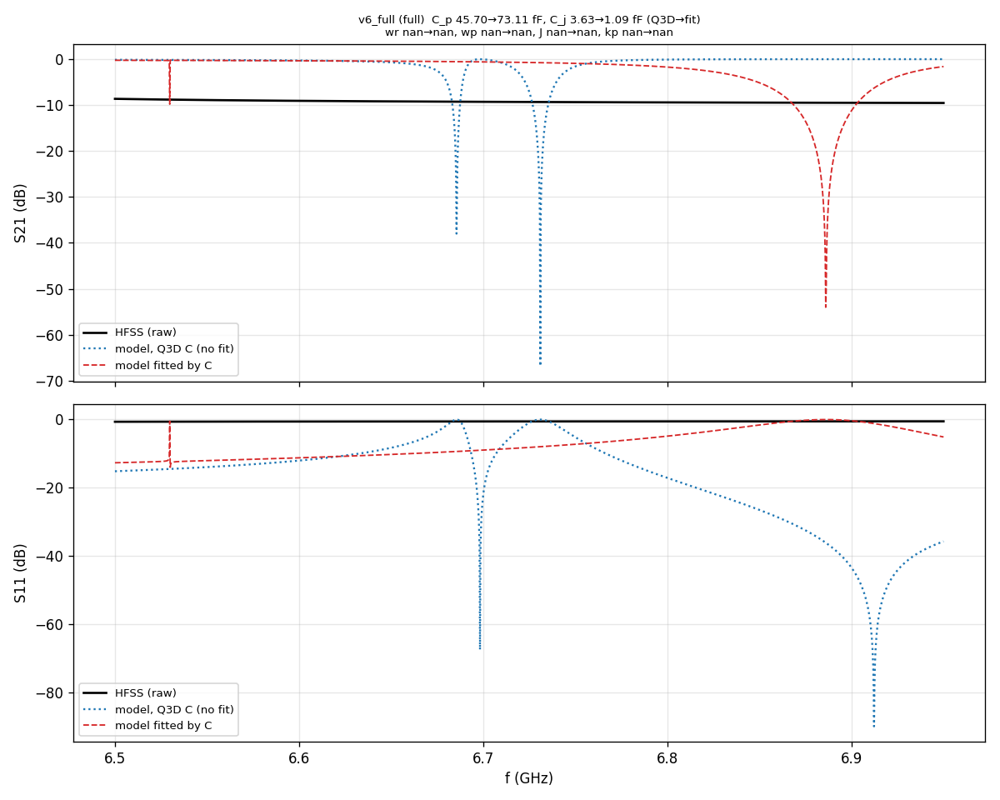
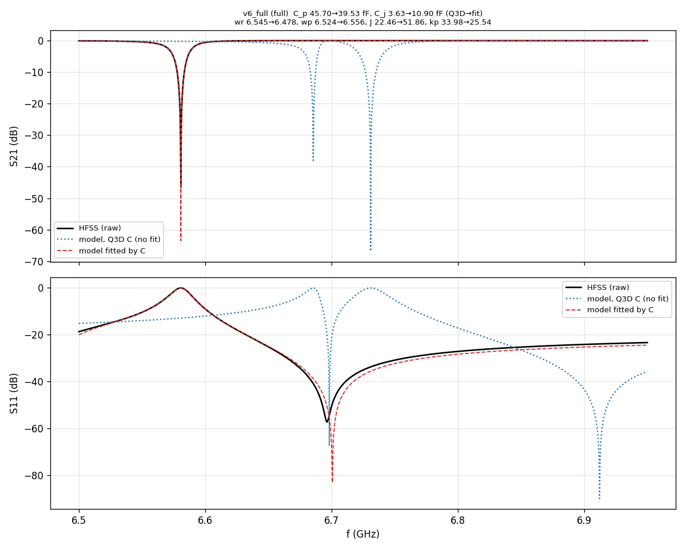

# Design6 run record — capacitor model vs HFSS couplings

Method: `README.md`.

## v6_full — full  (2026-11-09 16:01) — **INVALID: Mesh Link not imported (ImportMesh=false, 10,082 elements instead of 438,252); do not use this S21 or fit**

Design6 verification, full channel (no C_in), eigenmode mesh (1st order, Delta F 0.1 %) imported into driven 2nd order, 1 pass (no refinement), short feed, HFSS wire bonds

HFSS: method eigenmode mesh -> driven (mesh link), sweep 6.5-6.95 GHz, 1801 pts, Fast, eig_setup {'min_freq_ghz': 6.5, 'n_modes': 2, 'max_delta_f': 0.1, 'max_passes': 15, 'min_passes': 3, 'min_converged': 2, 'pct_refinement': 20, 'basis_order': 1}, driven_setup {'freq_ghz': 6.71, 'max_delta_s': 0.003, 'max_passes': 1, 'min_passes': 1, 'min_converged': 1, 'pct_refinement': 10, 'basis_order': 2}, mesh_lines 10um, mesh_caps 5um, eig {'passes': 3, 'elements': 438252, 'last_df_pct': 0.33499, 'note': 'run_all -MeshLink (1st order, 10/5 um initial mesh); Delta F changed 0.05 -> 0.1 % in AEDT by Jay after pass 3; continued in AEDT to the end'}, driven {'passes': 1, 'elements': 10082, 'last_dS': nan, 'minutes': 1.0}, minutes 1.0, temp_dir D:/HFSS_temp

**Capacitances** (series, fF; Q3D: Design6 Q3D (results\2026-11-09\1205_q3d6_full))

| | C_p | C_j |
|---|---|---|
| Q3D | 45.70 | 3.63 |
| fitted to HFSS S21 | 73.11 | 1.09 |
| difference | +60.0 % | -70.0 % |

**Couplings** (rows 2 and 3 at the HFSS-fitted lengths: their difference is the capacitor model alone)

| | ω_r (GHz) | ω_p (GHz) | J (MHz) | κ_p (MHz) |
|---|---|---|---|---|
| design (drawn lengths, Q3D C) | 6.6983 | 6.7200 | 20.3 | 37.0 |
| fitted lengths, Q3D C | nan | nan | nan | nan |
| fitted lengths, fitted C = HFSS | nan | nan | nan | nan |

Fit: dLf -0.2425, dLr +0.1286, s_p +1.6000, s_j +0.3000, phi -1.3754, tau +0.0500; rms |S21 − HFSS|: Q3D model 0.6204, fitted 0.5532

### 2026-11-09 16:0x — Mesh Link retry, still not registered (no valid v6_full result yet)

- Cause of the 16:01 run: AEDT saved `ImportMesh=false` in the driven setup although EditSetup raised no error (GetMessages shows nothing).
- Tried via script on a driven design (v6_full_1604_hfss): nested list with and without `'NAME:MeshLink'`, `Project:=` as `This Project*` / `Project1` / full path, `Soln:=` `Setup : LastAdaptive` / `Setup : Adaptive_3`, a minimal `['NAME:MeshLink','ImportMesh:=',True]`, and InsertSetup with MeshLink. Scalar fields (MaximumPasses) are applied by the same EditSetup, only MeshLink is dropped; `InsertMeshLinkedSetup` raises a COM error. Both designs have no variables, so a variable mismatch is not the reason.
- `hfss6_meshlink.py` now saves the project after EditSetup and asserts `ImportMesh=true`, so a silent failure stops the run before the solve. v6_full_1604_hfss is an unsolved test design (not valid, setup edited by the tests).
- Next: set Import Mesh in the AEDT GUI (Setup > Advanced), then rerun the sweep only.

### 2026-11-09 16:11-16:30 — fresh eigenmode + more Mesh Link tests, still ImportMesh=false

- Fresh eigenmode `v6_full_eig_1611_hfss` (1st order, 3 passes, completed normally: 409,302 elements, Δf 0.30 %) -> driven `v6_full_1625_hfss`: assert stopped the run, ImportMesh=false again. So an unfinished/stopped source solution is not the cause.
- The two designs have the same port edges (same entity IDs 4105->4103, 4122->4120), no variables.
- Even a driven source (`v6_full_1600_hfss`, solved) -> target is not accepted; Product '' / 'HFSS', Design 'This Design*' also not. Only `InsertMeshLinkedSetup('Setup')` works: it writes a self-link (ImportMesh=true, Design='This Design*', LinkID=...), so the ImportMesh=true format exists but EditSetup does not set it for another design.
- Still no valid S21.

## v6_full — full  (2026-11-09 18:19)

Design6 full channel, eigenmode mesh (v6_full_eig_1611_hfss, 409302 el) imported into v6_full_1625_hfss (Mesh Link set in AEDT GUI), 1 pass 2nd order, Fast sweep

HFSS: method eigenmode mesh -> driven (mesh link, set in GUI), sweep 6.5-6.95 GHz, 1801 pts, Fast, driven_design v6_full_1625_hfss, eig_design v6_full_eig_1611_hfss, eig {'passes': 3, 'elements': 409302}, driven {'passes': 1, 'elements': 409302, 'minutes': 100.3}, minutes 100.3

**Capacitances** (series, fF; Q3D: Design6 Q3D (results\2026-11-09\1205_q3d6_full))

| | C_p | C_j |
|---|---|---|
| Q3D | 45.70 | 3.63 |
| fitted to HFSS S21 | 39.53 | 10.90 |
| difference | -13.5 % | +200.0 % |

**Couplings** (rows 2 and 3 at the HFSS-fitted lengths: their difference is the capacitor model alone)

| | ω_r (GHz) | ω_p (GHz) | J (MHz) | κ_p (MHz) |
|---|---|---|---|---|
| design (drawn lengths, Q3D C) | 6.6983 | 6.7200 | 20.3 | 37.0 |
| fitted lengths, Q3D C | 6.5448 | 6.5240 | 22.5 | 34.0 |
| fitted lengths, fitted C = HFSS | 6.4777 | 6.5556 | 51.9 | 25.5 |

Fit: dLf +0.1306, dLr +0.1038, s_p +0.8650, s_j +3.0000, phi +3.1416, tau +0.0010; rms |S21 − HFSS|: Q3D model 0.4174, fitted 0.0031

Method of the 18:19 run: eigenmode `v6_full_eig_1611_hfss` (1st order, 3 passes, 409,302 el, Δf 0.30 %) -> driven `v6_full_1625_hfss` with Mesh Link set by hand in the AEDT GUI (script EditSetup cannot set it; GUI wrote ImportMesh=true, PathRelativeTo='SourceProduct', ForceSourceToSolve=false, PreservePartnerSoln=false), 1 pass, 2nd order, Fast 6.5-6.95 GHz / 0.25 MHz. **Check: driven solved elements 409,302 = eigenmode mesh (valid).** Solve 100 min. Runner: `simulation/driven/run_linked_gui.py`. S-parameters: `simulation/results/v6_full_S.csv`.
Caution on the fit: s_j = +3.0000 and phi = +3.1416 sit on their bounds, so C_j (10.90 fF, +200 %) is not a reliable estimate; C_p -13.5 %.

### 2026-11-09 evening — checks after the 18:19 run

- HFSS eigenmode (pass 2 of a 4-mode run from 5.5 GHz, aborted by Jay, Δf ~1 %): modes 6.381 GHz (kappa/2pi 28 MHz) and 6.576 GHz (43 MHz) -> J/2pi ~ 95 MHz, kappa_p/2pi ~ 71 MHz, mean 6.48 GHz. Model with Q3D C: J 20, kappa_p 37, 6.685/6.73 GHz. The 6.5-6.95 GHz sweep missed the lower mode. `v6_full_1625_hfss` sweep was changed to 6.1-6.9 GHz (3201 pts), not solved yet.
- Q3D with HFSS wire bonds (2007_q3d6_full): C_p 45.97, C_j 3.636 fF (no bonds: 45.70 / 3.635), so bonds are not the cause. q3d6.py now treats the merged ground net `g_wb` as ground.
- Q3D C_j (whole channel, wire bonds) vs hammer gap: 19 um 3.64, 30 um 2.75, 40 um 2.25, 60 um 1.66 fF (C_p 45.97 unchanged); runs 2100/2105/2110_q3d6_full. Wallraff 2.5 fF -> J 15 MHz, Cai 2 fF -> 8.8 MHz.
- Substrate: HFSS/Q3D 'silicon' (11.9) -> `silicon_eps11p45` (11.45, Swiadek thesis / Krupka 2015) in Design5 + Design6 layouts (env SI_EPS), made by save_aedt.use_project. Runs above this line used 11.9; later runs use 11.45.
