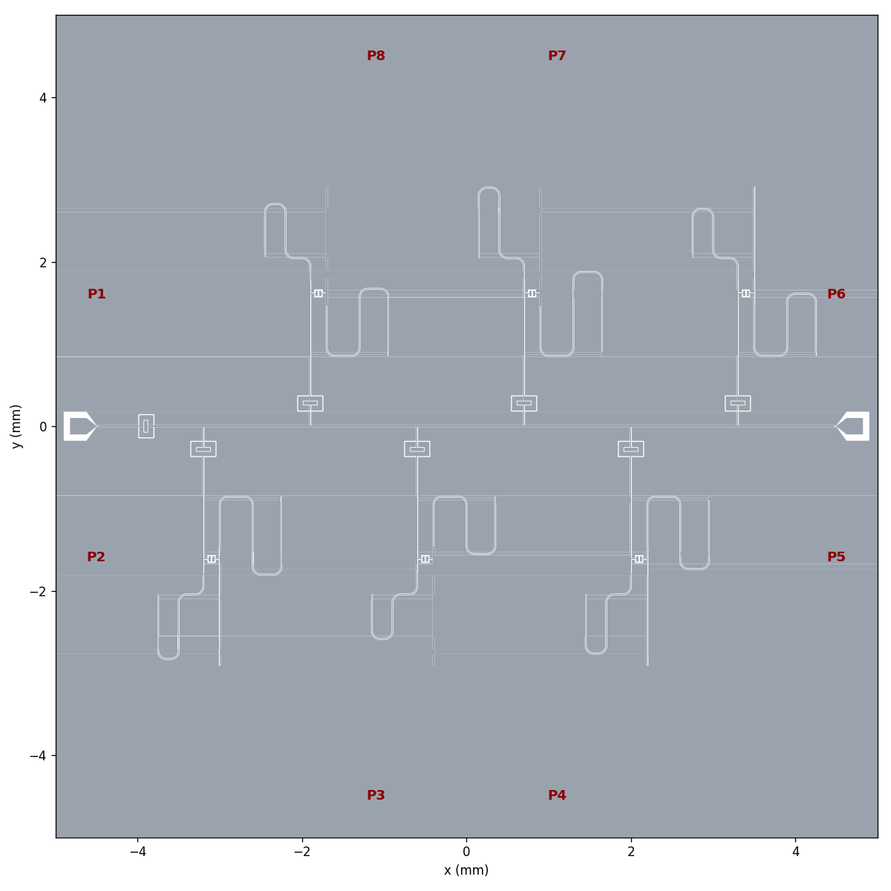
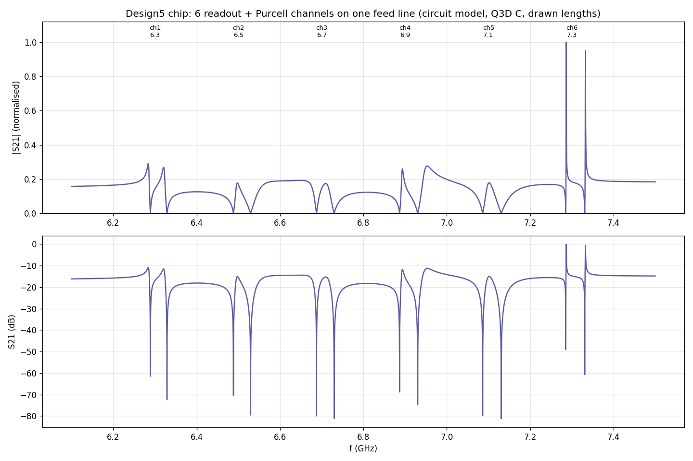

# Design5：readout resonator + 獨立 Purcell filter（Wallraff 型）

Design5 是 Design6 的 W1 版本，參數照 Wallraff group 論文的 Table 2.4 Q35
（參考資料在 `SQL HFSS/note/wallraff reference/`）。

Design5 包含兩種 layout：
- **單一 channel**（`design5_layout.py`）：用來做 HFSS 驗證、校正模型。
- **10 mm × 10 mm 晶片**（`chip6_layout.py`）：一條 feed line 上掛 6 組 resonator + Purcell filter，頻率 6.3–7.3 GHz，間隔 200 MHz。

每次 HFSS 的結果都記在 `run_record.md`。

---

## 1. 資料夾結構

```
Design5/
├─ README.md                  本文件：結構、流程、每個耦合 / 電容的功能、know-how
├─ run_record.md              每次 HFSS 的記錄：C、S21/S11、用 C 擬合、直接擬合、比較表
├─ pattern design/
│  ├─ design5_layout.py       單一 channel（預設 W1；D5_VARIANT=P1 = 舊的 c6_P1）
│  └─ chip6_layout.py         6-channel 晶片（port 在左右正中間、直的 feed line；上下鏡像交錯；2-leg serpentine；
│                             CHIP6_STYLE=hairpin → Design6 的 U-turn 版本）
│  （元件 enclosing_cap / hammer_cap 等在共用的 SQL HFSS/pattern design/）
├─ simulation/
│  ├─ theory5.py              ABCD / 導納電路模型（Q3D C + 理想 CPW）；n0_env_Y = n0 處的環境
│  ├─ modes5.py               由電路取 ω_p, ω_r, J, κ_p（極點 / 零點，不擬合）；eq. 2.137 直接擬合
│  ├─ q3d_full5.py            整條 channel 一起跑 Q3D（所有電容一起，不分開跑）
│  ├─ hfss_chan5.py           單一 channel 的 HFSS driven modal，跑完自動呼叫 analyze5
│  ├─ hfss_chip6.py           整片晶片的 HFSS + 晶片分析（各 channel 的 dip、模型、eq. 2.137 擬合）
│  ├─ hfss_dirs.py            把 AEDT 的 temp 目錄設到 D:/HFSS_temp（兩個 HFSS 腳本開跑前都會呼叫）
│  ├─ analyze5.py             每個 run 的分析與記錄（寫進 run_record.md）
│  ├─ solve_chip6.py          6 個 channel 的長度（ω_r = f_k, ω_p = f_k + 19 MHz）
│  ├─ chip6_theory.py         晶片層級 S21（一條 feed line、6 個 channel、實際畫出的長度）
│  └─ results/                Q3D 矩陣、長度、理論圖；每個 HFSS run 一個資料夾 <time>_<tag>/
├─ gds/   design5.gds, chip6.gds
└─ fig/   design5_layout.png, chip6_layout.png
```

## 2. 流程（指令）

| 步驟 | 指令 | 輸出 |
|---|---|---|
| 單一 channel layout | `python "pattern design/design5_layout.py"` | gds/design5.gds, fig/design5_layout.png |
| 整條 channel 的 Q3D | `python simulation/q3d/q3d_full5.py` | results/q3d5_full_caps.json（series C、所有互電容、對地 C 檢查） |
| HFSS + 記錄 | `python simulation/driven/hfss_chan5.py c5_W1 6.2 7.2` | results/<time>_c5_W1/，並在 run_record.md 加一段 |
| 只重新分析 | `python simulation/analyze5.py <tag>` | 同上 |
| 晶片長度 | `python simulation/solve_chip6.py` | results/chip6_lengths.json |
| 晶片 layout | `python "pattern design/chip6_layout.py"` | gds/chip6.gds, fig/chip6_layout.png |
| 晶片理論 S21 | `python simulation/chip6_theory.py` | results/chip6_theory.png |

Python 環境：`C:\Users\QEL\miniforge-pypy3\envs\qmetal\python.exe`

**每次 run 的輸出只有三樣**：電容（Q3D 與擬合值）、HFSS S21/S11 原始資料、一張比較圖（HFSS 原始資料 / Q3D 電容的模型 / 擬合後的模型）。
**存放**：`simulation/results/<YYYY-MM-DD>/<HHMM>_<tag>/`（`runstore.py`），每次重新分析另存 `<tag>_compare_<YYYYmmdd_HHMM>.png/.json`，不覆蓋。
重新分析：`python simulation/driven/hfss_chip6.py --analyze <tag>`。

---

## 3. 每個耦合與電容的功能

```
P1 ─[C_in]─ feed line ──┬── n0 ──── … 其他 channel … ── P2
                        │ stub
                     [C_p] hugger（filter ↔ feed line：κ_p）
                        │
                Purcell filter λ/4（C_p 端開路，另一端短路）
                        │ 距 C_p 開路端 L_pf = 1.2 mm 處分出
                     [C_j] hammer（filter ↔ resonator：J）
                        │ 距開路端 L_rr = 1.3 mm
                readout resonator λ/4（開路端 = 實際元件中 qubit 所在處，另一端短路）
```

| 元件 | 數值（Design5） | 功能 | 調整什麼、會發生什麼 |
|---|---|---|---|
| **C_in**（feed line 輸入端的 enclosing cap） | 41 fF（Wallraff 50 fF） | 讓 feed line 的輸入端呈高阻抗：從 channel 反射回來的訊號不會回到輸入線，訊號主要往輸出端走（Wallraff：降低 crosstalk）。 | 串聯 1/(ωC) ≈ 580 Ω，所以插入損耗約 16 dB（Wallraff：44 → 73 fF 時，14.2 → 10 dB）。C_in 和各 channel 之間會形成駐波，baseline 起伏就是這個原因。C_in 也讓 n0 處只剩約一個 Z0 的負載，因此**通道內的 κ_p 約為匹配線值的 1.8 倍**。單一 channel 版（Cai 論文的形狀）把 C_in 放在 n0 旁邊，peak 才會對稱。 |
| **n0 T 接點 + stub** | stub 0.1 mm | 把整個分支以並聯方式接到 feed line 上（hanger）。 | stub 長度會進入相位，影響 C_p 的有效值。 |
| **C_p**（hugger：frame 包住 plate） | series 45.9 fF；frame 對地 119 fF，接在 **filter 側** | filter 和 feed line 的耦合，決定 **κ_p**（filter 的線寬），約與 (ωC_p)² 成正比。 | plate 越寬 C_p 越大，κ_p 越大（140 µm → 40.6 fF，165 µm → 45.4 fF）。**方向很重要：**frame 的大對地電容放在 filter 側（Wallraff 的 C_pfg ≈ 93 fF），會把 filter 開路端的頻率拉低約 0.2 GHz，所以 filter 要縮短 0.17 mm；feed line 這側只剩 15 fF，n0 的反射比較小。 |
| **Purcell filter**（λ/4，C_p 端開路，另一端短路） | 3.10–3.72 mm，ω_p = ω_r + 19 MHz | resonator 到外界的唯一路徑，在 ω_p 附近形成帶通。qubit 頻率離 ω_p 很遠，所以 Purcell 衰減會被再抑制一次，因子約為 (ω_q/ω_r)·κ_p/(2Δ)（Sete 2015）。 | Wallraff 設 ω_p ≈ ω_r − Λ（Λ = qubit 造成的 Lamb shift），讓 filter 對準被 qubit dressed 之後的 resonator。 |
| **C_j**（hammer：兩片平行板） | 只算 hammer 2.59 fF；整條 channel 3.43 fF（含平行線、T 接點） | filter 和 resonator 的耦合 **J** ≈ (ωC_j/2)/√(C_f C_r) × 兩個 tap 處的電壓係數。 | gap 26 → 19 µm 時，C_j 2.0 → 2.6 fF。tap 越靠近開路端，電壓越大，J 越大。Wallraff 用 2.5 fF 得到 J ≈ 15 MHz（量測 16–21 MHz）。Design5 的 J 為 18–21 MHz。 |
| **readout resonator**（λ/4） | 4.04–4.68 mm | readout 模態。開路端是實際元件中接 qubit（C_qr）的地方。 | 在 J ≪ κ_p 的區域，resonator 的有效線寬 κ_eff ≈ 4J²κ_p / (κ_p² + 4Δ_rp²)。Design5 是 2J ≈ κ_p 的混合區：S21 會出現兩個 dip，中間 ω_r 處是 peak（論文的形狀）。κ_p/4 > J 時，兩個 dip 分不開。 |
| **C_pff / C_prg / C_AB**（寄生） | — | C_pff：hugger 在 feed line 側的對地電容。C_prg：hammer 的對地電容（Design5 為 13 fF，Wallraff 為 2 fF，因為 pocket 較小）。C_AB：air bridge 的對地電容。 | 都會把頻率拉低，必須包含在模型裡。Q3D 的 π 網路就是為了這個。 |

---

## 4. 10 mm × 10 mm 晶片：6 組 channel（`chip6_layout.py`）



- **port 在左右兩邊的正中間，互相平行對齊：**輸入 Pin 在（−4.5, 0），輸出 Pout 在（4.5, 0）。feed line 是一條直線，**完全沒有彎**。C_in 緊接在輸入 pad 後面（x = −3.9）。
  - 注意：這兩個位置不是 8-port PCB 快照上的 port。那張 PCB 的側邊 port 在 y = ±1.6 mm，打線或 PCB 要配合。
- **channel 配置：**上方 3 組（鏡像，往上長）、下方 3 組（往下長），兩排錯開半個 pitch（pitch 2.6 mm，T 接點間距 1.3 mm）。整片用到 x −3.8…4.3 mm、y ±2.9 mm。
- **meander：**
  - 接點旁只留短的水平段：filter 0.30 mm、resonator 0.40 mm，原本是 0.5 / 0.87 mm；
  - 每組都是 **2 條等高的 legs**，朝遠離 feed line 的方向走；
  - leg 高度：filter 0.54–0.86 mm，resonator 0.70–1.02 mm；leg 間距：filter 0.25 mm、resonator 0.35 mm；
  - 每組 channel 寬 **1.5 mm**（原本 2.2 mm）。
- **頻率排列：**用暴力搜尋決定，沿 feed line 依序為 6.5↓ 6.9↑ 7.3↓ 6.3↑ 6.7↓ 7.1↑ GHz。
  - 同排相鄰的 channel（金屬最近 0.42–0.56 mm）至少相差 **600 MHz**；
  - feed line 上相鄰的 T 接點至少相差 **400 MHz**。
- **間距：**
  - channel 之間的金屬最近 **1.05 mm**；
  - pad 或 C_in 到 channel 0.47 mm。
- **電容：**6 組都相同（C_p plate 165 µm，C_j gap 19 µm，用整條 channel 的 Q3D C）。只有長度不同。tap 位置都是 1.2 / 1.3 mm。
- **繞線：**filter 和 resonator 用確定性 serpentine 繞線，長度精確（含 fillet 修正）。原本的 RouteMixed meander 在短線上會失敗或長度錯誤。

| ch | f_r (GHz) | ω_p (GHz) | L_filter (mm) | L_res (mm) | J (MHz) | κ_p 匹配線 (MHz) |
|---|---|---|---|---|---|---|
| 1 | 6.300 | 6.319 | 3.7240 | 4.6847 | 17.9 | 31.3 |
| 2 | 6.500 | 6.519 | 3.5824 | 4.5391 | 18.6 | 34.2 |
| 3 | 6.700 | 6.719 | 3.4495 | 4.4024 | 19.3 | 37.3 |
| 4 | 6.900 | 6.919 | 3.3246 | 4.2736 | 19.9 | 40.6 |
| 5 | 7.100 | 7.119 | 3.2070 | 4.1522 | 20.5 | 44.0 |
| 6 | 7.300 | 7.319 | 3.0960 | 4.0375 | 21.1 | 47.6 |

（Wallraff Table 2.4：J 15–16 MHz（量測 16–21），κ_p 35–63 MHz。）

- 晶片層級 S21（電路模型）：每個 channel 兩個 dip，共 12 個；baseline 是 C_in 造成的駐波，跟 Wallraff 的 Fig. 2.30 很像。

  

- κ_p 隨頻率上升，因為 C_p 相同，而 κ_p 約與 ω²·C_p² 成正比。如果要讓 6 組的 κ_p 相同，高頻 channel 要用比較窄的 C_p plate。

---

## 5. Know-how（這次學到的）

### HFSS
0. **（規則，2026-11-09）Purcell filter 專案一律：eigenmode 切 mesh → driven 直接使用、不再 refine。**eigenmode 用 first order、
   初始 mesh 線 10 µm / 電容 5 µm、Delta F 0.1 %；driven 用 Mesh Link 匯入、Maximum Passes = 1，然後 sweep。
   兩個 design 要在同一個 AEDT project。腳本：`Design6/simulation/driven/hfss6_meshlink.py`；細節見 `skill/skill.md` §10。
1. **Interpolating sweep 會漏掉窄的 dip。**c6_T5 在 6.6–6.8 GHz 看起來是平的，實際上 6.754 GHz 有 dip。做法：先用寬範圍的 Fast（或 Discrete）找到 dip，再做細掃。
2. **solution frequency 不要放在無損零點上**，否則 ΔS 永遠收斂不到 0.003 以下。最少 passes 和步長見 `skill/skill.md` §10（driven 15 passes、0.25 MHz）。
3. **ResEnd 只有 pin。沒列在 `open_terminations` 的 route 端點會被 renderer 短路。**resonator 的開路端一定要列進去。blk_T5 就是因為漏列而把開路端接地。
4. **C: 剩不到 80 GB 時，Analyze 會出現 COM error -2147352567。**HFSS 的 scratch 放在 `%TEMP%\hfss_*.pjt`，一個可達幾十 GB。
   - 現在 `hfss_chan5.py` 和 `hfss_chip6.py` 開跑前都會呼叫 `hfss_dirs.use_d_drive()`，用 AEDT 的 `SetTempDirectory` 把 temp 目錄設成 **`D:/HFSS_temp`**（D: 約 1.7 TB）。
   - 設定後會讀回 `GetTempDirectory()` 確認；沒改成功就停止，不會開始求解。實際使用的目錄會記在每個 run 的 meta 裡。
   - 用環境變數 `HFSS_TEMP` 可以換成別的目錄。`python simulation/hfss_dirs.py` 只讀取、印出目前的設定。
   - 這個設定是 AEDT 的應用程式選項，之後的 session 也會保留。它不會搬動正在跑的求解，只對下一次 Analyze 生效。

### 模型與擬合
5. **不要把一個幾何的 fit factor 套到另一個幾何。**c6_T5 用了 c6_T3h 的 s_p、s_j、kv，結果整個偏掉。只算 filter 時，原始 Q3D 模型和 HFSS 只差 0.2%（6.851 vs 6.836 GHz）。
6. **論文的雙 dip 是 S21 的傳輸零點**，也就是 n0 接地時 filter + resonator 的無損模態。最小分裂 = 2J，和 κ_p 無關。peak 的不對稱（Fano）來自 C_in 的反射加上 l_feed_c；單一 channel 把 C_in 放在 n0 旁邊，peak 就會對稱。
7. **ω_p, ω_r, J, κ_p 直接從電路取，不用擬合：**
   - ω_r = 分支導納的實零點；
   - 兩個複數極點 = [[ω_p + iκ_p/2, J], [J, ω_r]] 的特徵值；
   - 用 Im J² ≈ 0 檢查一致性。
   - 注意符號：HFSS 和 ABCD 用 e^{+jωt}，極點的 Im > 0。
8. **eq. 2.137 直接擬合 S21：**
   - 要對 conj(S21) 擬合，因為 eq. 2.137 用 e^{−iωt}，不取共軛的話共振圓會反轉、κ 變負；
   - 用兩個零點 z1, z2 來參數化：ω_p = z1 + z2 − ω_r，J² = ω_p ω_r − z1 z2；
   - 先擬合背景，再擬合共振，最後全部一起。
9. **κ_p 取決於 n0 處的環境。**有 C_in 時，通道內的 κ_p 約為匹配線值的 1.8 倍。比較時要說清楚用哪個定義：Wallraff Table 2.4 是匹配線；通道 S21 擬合看到的是通道內的值。
10. **用 C 擬合要同時擬合 complex S21 和 S11，並加 soft prior。**如果資料裡只有一個特徵，參數會 degenerate（J、κ、長度互相補償）。
11. **混合 EM–電路模型：**C_j 區域用 HFSS 3-port，其餘用電路，Y_in = Y11 − Y1x (Yxx + diag Y_L)⁻¹ Yx1。port 的極性反過來沒有影響。

9b. **晶片上的 κ_p 取決於 n0 到 C_in 的距離 d**（`simulation/chip6_kappa_env.py`，`results/chip6_kappa_env.png`）：
   - C_in 幾乎是開路端。從 n0 看回 C_in，Re Z_env 隨 d 以 **λ/2** 為週期振盪。
   - d ≈ 0 和 d ≈ λ/2 時，κ_p 約為匹配線的 2 倍；在約 0.9·λ/4（6.7 GHz 時約 4 mm）是電壓節點，κ_p → 0。
   - 晶片現在的 κ_p：ch2 59、ch4 28、**ch6 0.9**、**ch1 12**、ch3 47、ch5 93 MHz（匹配線 31–48）。
   - 拿掉 C_in 時是 21–44 MHz。
   - 所以 C_p 不是「越遠越大」：要看 d 在駐波的哪個位置。靠近節點要加大，靠近腹點要縮小；正好落在節點附近的 channel 用 C_p 救不回來，只能移動位置。Wallraff 每組的 C_pf 不同（37–49 fF），就是在補償這個。

9c. **resonator 的 dip 不適合用 notch circle fit**（2026-11-09，在電路模型上測過）：filter 的寬響應對 resonator 是有斜率的背景，W1 的線寬會低估 10–14 %；放在晶片上時 6 組有 4 組直接失敗。lab 的 `notch_port` 和 HFSS 一樣是 e^{+jωt}，S21 不能取 conj。

### Q3D 與電容
12. **整條 channel 一起跑 Q3D，不要分開跑小塊：**
    - C_in、C_p 只差約 1%，但 C_j 多了 32%（2.59 → 3.43 fF），因為 filter 和 resonator 的線也有耦合；
    - 跑整條時，短路端要畫成開路，否則該網路會併入地；
    - 只用互電容。π 網路的對地 C 用分開跑的結果，因為整條網路的對地 C 包含線本身的 C = L/(Z0 v) = 163.5 fF/mm；
    - 檢查：扣掉線 C 之後剩下的值，應等於分開跑的對地 C（filter 網路 132 fF = 119 + 13）。
13. **Hugger 的方向決定大對地電容在哪一側。**放在 filter 側會讓 filter 變短；放在 feed line 側會讓 n0 負載變重，反射變大。

### Layout
14. **qiskit-metal 的 RouteMixed meander 在短線上不可靠：**
    - 有時直接失敗，有時長度錯誤（甚至是負的）；
    - 有時留下比 2×fillet 還短的線段，導致 GDS 匯出失敗（gdstk 的 "Unable to retrieve item"）。
    - 做法：自己算 serpentine。等高的 legs，長度扣掉每個 90° 角的 r(2 − π/2)，長度精確。
15. **晶片 layout：**
    - port 放在左右正中間、互相對齊，feed line 就是一條直線（不用彎，駐波最少）；channel 上下交錯，上方用鏡像（orientation 取負號、stub_up 反向）；
    - serpentine 的 legs 數固定（每組 2 條），leg 高度依長度自動調整：外觀一致、寬度窄、長度精確；
    - 頻率順序用暴力搜尋，同時拉開「同排相鄰」和「feed line 上相鄰」兩種距離的頻率差；
    - 鏡像 channel 的 pin 命名保持不變（prime_end 永遠朝向 feed line），所以同一套 channel 函式可以上下共用。
16. **Design6 c6_P1 的 410 MHz 分裂還沒解釋。**它不是 C_j 造成的：Wallraff 用 2.5 fF 只得到 15 MHz，整條 channel 的 Q3D 也只多 0.8 fF。Design5 W1 的 HFSS 可以用來判斷問題是否出在 layout 本身。

---

## 6. 狀態與下一步

- [x] W1 單一 channel 的 layout，Q3D（分開跑 + 整條一起），以及用模型解出的長度
- [x] 記錄 / 分析流程（用合成資料測試：用 C 擬合可精確找回參數；直接擬合的誤差在 2–12 MHz 內）
- [x] 6-channel 晶片的 layout、GDS 和晶片層級理論 S21
- [ ] HFSS：單一 channel `c5_W1`（約 40 分鐘），用來驗證模型
- [ ] 晶片的 HFSS：全晶片很重。建議先跑單一 channel，再逐一跑 channel，或分區跑
- [ ] 如果需要 6 組 κ_p 相同：依頻率調整 C_p 的 plate 寬度
- 注意：單一 channel（`design5_layout.py`）仍用 RouteMixed meander；晶片用 serpentine。長度相同，但形狀略有不同。

## Design notes

設計紀錄（W1、舊六通道晶片、目前 chip6_d4 與全晶片模擬狀態）：[`notes/purcell_design5.md`](notes/purcell_design5.md)。
