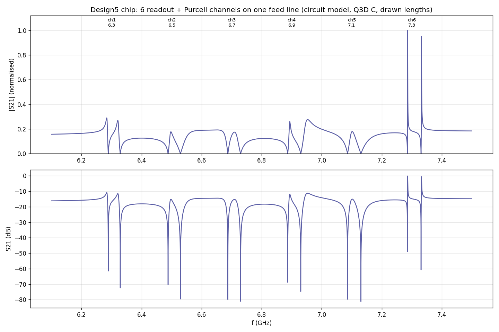

# Design5: readout resonator + independent Purcell filter (Wallraff type)

**Figures:** [fig/](fig/README.md) holds the whole chip ([`chip.png`](fig/chip.png)) and one close-up per part, rendered from the current GDS by `code/general/plot_design_figs.py`.

## PurcellReadout candidates (2026-11-19, unconfirmed)

Both use the shared [`PurcellReadout`](../pattern%20design/resonator/purcell_readout.py): six channels at 6.0–7.0 GHz,
C_in after the input launch, 16/9 µm CPW. Lengths come from the frequency model with the Q3D loads of
`results/resonator/20261119_005709_prr_q3d_b73dae27`. Built by [`layout/chip6_purcell_resonator_pair.py`](layout/chip6_purcell_resonator_pair.py).

| Revision | Config | Tee placement | GDS | Status |
|---|---|---|---|---|
| `purcell_resonator_pair_r1` | [readout_purcell_resonator_pair.json](parameters/readout_purcell_resonator_pair.json) | copied from chip6_d4 | [sim](gds/Design5_2026-11-19_purcell_resonator_pair_r1_sim.gds) · [fab PR01](gds/Design5_2026-11-19_purcell_resonator_pair_r1_pr01_fab.gds) | in the [20261119 wafer](../20261119/README.md) |
| `purcell_resonator_pair_r2` | [readout_purcell_resonator_pair_r2.json](parameters/readout_purcell_resonator_pair_r2.json) | chosen to avoid the C_in standing-wave minima; ch5 / ch6 C_p raised to 44.75 / 44.03 fF | [sim](gds/Design5_2026-11-19_purcell_resonator_pair_r2_sim.gds) · layout (`Design5_2026-11-19_purcell_resonator_pair_r2_layout.png`, removed 2026-11-19; in git history) | no fab mask yet |

**C_in standing wave.**
- **Cause:** the series C_in reflects the input side of the feed, so κ_p depends on the tee position (period
  λ/2 ≈ 9 mm at v ≈ 1.2e8 m/s). Method: [skill section 5](../skill/purcell_resonator_design.md).
- **r1:** the tees sat where the channels were. ch6 landed near a minimum.
- **r2:** tees are placed with the full-feed circuit model to maximise the worst κ_p over frequency, velocity and
  capacitance corners. Channels still below target get a larger C_p, sized with Q3D coupons
  (`20261119_105730`, `20261119_110105`).

κ_p/2π (MHz). Target: the matched-feed value with C_p 40.10 fF. Model: circuit model with C_in, no HFSS input. HFSS:
six-channel driven S21, 1 adaptive pass, pole fit.

| Channel | Target | r1 model | r1 HFSS | r2 model | r2 HFSS |
|---|---|---|---|---|---|
| ch1 | 21.7 | 9.5 | 13.3 (0.61×) | 24.8 | 17.7 (0.82×) |
| ch2 | 24.0 | 34.1 | 31.0 (1.29×) | 31.9 | 28.5 (1.19×) |
| ch3 | 26.4 | 36.1 | 38.8 (1.47×) | 24.2 | 19.2 (0.73×) |
| ch4 | 28.9 | 13.5 | 10.8 (0.37×) | 33.0 | 32.6 (1.13×) |
| ch5 | 31.6 | 46.5 | 35.2 (1.11×) | 32.1 | 29.3 (0.93×) |
| ch6 | 34.5 | 0.7 | 2.6 (0.07×) | 33.4 | 29.2 (0.85×) |

Runs:
- **r1:** S21 [20261119_084442](results/resonator/20261119_084442_prr_driven_ch1_2_3_4_5_6_5c1f6fee/run.json); fit
  [20261119_093524](results/resonator/20261119_093524_prr_s21_reanalysis_0397d3ed/summary.json); model
  [20261119_100418](results/resonator/20261119_100418_prr_circuit_model_f018d8c2/summary.json).
- **r2:** S21 [20261119_110414](results/resonator/20261119_110414_prr_driven_ch1_2_3_4_5_6_0e2eed6c/run.json); fit
  [20261119_115106](results/resonator/20261119_115106_prr_s21_reanalysis_b98ae507/summary.json); model
  [20261119_115218](results/resonator/20261119_115218_prr_circuit_model_71a04f88/summary.json).

[HFSS S21 vs Q3D-based model, r1 and r2](results/resonator/20261119_123143_prr_compare_plot_58bd64e4/s21_vs_q3d.png)
(|S21|, κ_p, J and frequency offsets per channel; `simulation/resonator/purcell_resonator_pair_compare_plot.py`).

Reading:
- **κ_p spread:** across the six channels it went from 0.07–1.47× (r1) to 0.73–1.19× (r2). No channel is near a
  minimum.
- **Model vs HFSS:** HFSS sits 0–30 % below the model with C_in in r2.
- **J:** 1.06–1.12× the hammer model on five channels.
- **Frequencies:** at 1 pass all are 24–113 MHz low, and f_r sits 10–67 MHz below f_p. This is mesh error that
  differs between filter and resonator.
- **ch5 fit:** in r2, ch5 has f_r − f_p = −58 MHz. Its resonator-like dip at 6.687 GHz is only a
  few 0.2 MHz samples wide, so the two-pole inversion fails (J² < 0). Its κ_p (sum of the pole widths, 29.3 MHz)
  is an estimate.

Not done:
- **Converged HFSS:** no run has more than 1 pass. Do not trim lengths from these frequencies.
- **r2 fab mask:** not generated. The 20261119 wafer still carries r1.
- **Air bridges:** none on the masks.

## Earlier wafer layout


**Current wafer layout 2026-11-16_wafer_r7.** Six straight hammer pairs use 190 µm centre spacing and centred side launches. The fab has bare corners. See the [local Q3D checks](notes/wafer_hammer_parallel_2026-11-16.md). Full-chip electrical validation is pending.

[Fab GDS](gds/Design5_2026-11-16_wafer_r7_fab.gds) · [Simulation geometry GDS](gds/Design5_2026-11-16_wafer_r7_sim.gds) · Fab mask preview (`Design5_2026-11-16_wafer_r7_fab_check.png`, removed 2026-11-19; in git history) · [Archived GDS](gds/previous/) · [Wafer index and export commands](../note/wafer_placement_2026-11-16.md)

The 5 × 5 µm ground perforations use a 20 µm centre pitch and a 547.5 µm four-edge keep-out. See the [wafer cheese rule](../skill/gds_export.md#3-checks-after-an-export).

## Fabrication release

- Previous [fab GDS](gds/previous/Design5_2026-11-13_fab.gds) and [simulation GDS](gds/previous/Design5_2026-11-13_sim.gds).
- The previous PFR00 mask keeps the die marks and ground perforations. Four corner test-junction pockets and pads were removed.
- [Previous GDS and figures](gds/previous/) · [Layout previews](fig/previous/).
- Resonator linewidth for this six-channel mask has no converged full-chip HFSS extraction. The release table reports model Purcell linewidths. The [older driven fit](results/resonator/2026-11-09/1134_chip6_v1/chip6_v1_chip_analysis_20261109_1134.json) uses earlier geometry and ended at ΔS = 0.65953. The [current-core eigenmode run](results/resonator/2026-11-12/chip6_d4_full/eig/eigen_convergence.csv) saved one pass.


> **Directory reorganization (2026-11-15)**: [Layout code](layout/) · [Simulation entry points](simulation/README.md) · [Results index](results/README.md) · [Adopted version](design.json). Solvers were not rerun. Moving historical values does not make them final confirmed values. Create a new run for new executions and confirm final parameters before commit/push.


The current layout uses the [Design6 launch pad standard](../skill/launch_pad.md). Saved solver results correspond to the launch geometry used in their original runs.

Design5 is the W1 version of Design6, with parameters following Table 2.4 Q35 of the Wallraff group thesis
(thesis sec. 2.5, Table 2.4; summarised in `SQL HFSS/note/purcell_filter_method.md` section 2).

Design5 contains two layouts:
- **Single channel** (`design5_layout.py`): for HFSS validation and model calibration.
- **10 mm × 10 mm chip** (`chip6_layout.py`): 6 resonator + Purcell filter pairs on one feedline, spanning 6.3–7.3 GHz in 200 MHz steps.

Each HFSS run is documented in `run_record.md`.

---

## 1. Directory structure

```
Design5/
├─ README.md                  Structure, workflow, coupling/capacitance roles, and practical notes
├─ run_record.md              HFSS records: C, S21/S11, capacitance fit, direct fit, and comparisons
├─ layout/
│  ├─ design5_layout.py       Single channel (default W1; D5_VARIANT=P1 selects the former c6_P1)
│  └─ chip6_layout.py         6-channel chip (ports centered on left/right edges, straight feedline, mirrored staggered channels, 2-leg serpentine;
│                            CHIP6_STYLE=hairpin selects the Design6 U-turn layout)
│  (Shared enclosing_cap / hammer_cap components are in SQL HFSS/pattern design/.)
├─ simulation/
│  ├─ theory5.py             ABCD/admittance model: Q3D capacitances and ideal CPW; n0_env_Y gives the environment at n0
│  ├─ modes5.py              Extracts ωp, ωr, J, κp from poles/zeros without fitting; direct fit using Eq. 2.137
│  ├─ q3d_full5.py           Q3D of the complete channel
│  ├─ hfss_chan5.py          Driven HFSS; calls analyze5
│  ├─ hfss_chip6.py          Full-chip HFSS, dip detection, circuit model, and Eq. 2.137 fitting
│  ├─ hfss_dirs.py           Sets scratch directory to D:/HFSS_temp before either HFSS script runs
│  ├─ analyze5.py            Analysis and run_record updates
│  ├─ solve_chip6.py         Solves lengths for 6 channels with ωr=fk and ωp=fk+19 MHz
│  ├─ chip6_theory.py         Chip-level S21: one feedline, 6 channels, and actual drawn lengths
│  └─ results/               Q3D matrices, lengths, theory figures; one <time>_<tag>/ directory per HFSS run
├─ gds/   design5.gds, chip6.gds
└─ fig/   design5_layout.png, chip6_layout.png
```

## 2. Workflow and commands

| Step | Command | Output |
|---|---|---|
| Single-channel layout | `python "layout/design5_layout.py"` | `gds/design5.gds`, `fig/design5_layout.png` |
| Q3D | `python simulation/resonator/q3d_full5.py` | `results/q3d5_full_caps.json`: series/mutual capacitances and ground-capacitance checks |
| HFSS | `python simulation/resonator/hfss_chan5.py c5_W1 6.2 7.2` | `results/<time>_c5_W1` and run record |
| Reanalysis | `python simulation/resonator/analyze5.py <tag>` | Same analysis workflow |
| Solve lengths | `python simulation/resonator/solve_chip6.py` | `results/chip6_lengths.json` |
| Chip layout | `python "layout/chip6_layout.py"` | `gds/chip6.gds`, `fig/chip6_layout.png` |
| Chip theory S21 | `python simulation/resonator/chip6_theory.py` | `results/chip6_theory.png` |

Python environment: `C:\Users\QEL\miniforge-pypy3\envs\qmetal\python.exe`

**Each run has three outputs**: Q3D and fitted capacitances; raw HFSS S21/S11; one comparison figure showing raw HFSS data, the Q3D-capacitance model, and the fitted model.
**Storage**: `results/resonator/legacy/<YYYY-MM-DD>/<HHMM>_<tag>/` (`runstore.py`); save each reanalysis separately as `<tag>_compare_<YYYYmmdd_HHMM>.png/.json`, without overwriting.
Reanalysis: `python simulation/resonator/hfss_chip6.py --analyze <tag>`.

---

## 3. Roles of couplings and capacitances

```
P1 ─[C_in]─ feed line ──┬── n0 ──── … other channels … ── P2
                        │ stub
                     [C_p] hugger（filter ↔ feed line：κ_p）
                        │
                Purcell filter λ/4 (C_p end open, other end shorted)
                        │ Branch at L_pf = 1.2 mm from the C_p open end
                     [C_j] hammer（filter ↔ resonator：J）
                        │ L_rr = 1.3 mm from the open end
                Readout resonator λ/4 (open end at the device qubit, other end shorted)
```

| Element | Value (Design5) | Function and tuning effects |
|---|---|---|
| C_in | 41 fF (Wallraff: 50 fF) | High-impedance input directs reflected signals predominantly toward the output, reducing crosstalk. Series impedance 1/(ωC) ≈ 580 Ω; insertion loss about 16 dB. Wallraff: 44→73 fF gives 14.2→10 dB. Standing waves shape the baseline. Near n0, approximately one Z0 load gives κp about 1.8× the matched-line value. Placing C_in near n0 in a single channel gives a symmetric peak. |
| n0 tee stub | 0.1 mm | Parallel hanger branch; stub phase affects effective C_p. |
| C_p hugger | 45.9 fF series; 119 fF frame-to-ground | Frame surrounds the plate on the filter side. Filter–feedline coupling gives κp approximately proportional to (ωC_p)². Plate width 140→165 µm gives 40.6→45.4 fF. Ground loading on the filter side lowers its frequency: Wallraff C_pfg 93 fF lowers it by 0.2 GHz, requiring 0.17 mm shortening. Feedline-side loading of 15 fF produces less reflection. |
| Purcell filter | λ/4, length 3.10–3.72 mm | Open at C_p, shorted at the other end; ωp = ωr + 19 MHz. Provides the resonator's bandpass environment. Far-detuned qubit decay is suppressed by the factor (ωq/ωr)κp/(2Δ) (Sete 2015). Wallraff uses ωp ≈ ωr − Λ to align with the Lamb-shifted resonator. |
| C_j hammer | 2.59 fF isolated; 3.43 fF full channel | Two parallel plates; lines and tees add coupling. J ≈ (ωC_j/2)/√(CfCr), multiplied by tap-voltage factors. Gap 26→19 µm gives C_j 2.0→2.6 fF; taps closer to open ends couple more strongly. Wallraff: 2.5 fF gives J 15 MHz (measured 16–21); Design5: J 18–21 MHz. |
| Readout resonator | λ/4, length 4.04–4.68 mm | Open end couples through C_qr. For weak J, κeff ≈ 4J²κp/(κp²+4Δrp²). Design5 has 2J ≈ κp: two mixed dips with a central peak at ωr. Dips are unresolved when κp/4 > J. |
| Parasitics | C_pff, C_prg, C_AB | Feed-to-ground loading; hammer-to-ground C_prg is 13 fF in Design5 versus 2 fF in Wallraff's smaller pocket. C_AB represents airbridge loading. Include Q3D π networks for the frequency shifts. |

---

## 4. 10 × 10 mm six-channel chip: chip6_layout

The former `fig/chip6_layout.png` is unavailable.

- Ports: Pin (−4.5, 0), Pout (4.5, 0); straight feedline without bends; C_in at x = −3.9.
- This differs from the 8-port PCB with side ports at y = ±1.6; bonding and PCB connections must match.
- Three upper channels are mirrored upward; three lower channels point downward, staggered by half a pitch. Pitch 2.6 mm, tee spacing 1.3 mm; extent x = −3.8…4.3, y = ±2.9.
- **meander：**
- Horizontal sections near the taps: filter 0.30 mm, resonator 0.40 mm (previously 0.5/0.87 mm).
- Two equal serpentine legs extend away from the feedline.
- Leg heights: filter 0.54–0.86 mm, resonator 0.70–1.02 mm; pitch 0.25/0.35 mm.
- Channel width: 1.5 mm (previously 2.2 mm).
- Frequency ordering from brute-force search: 6.5↓, 6.9↑, 7.3↓, 6.3↑, 6.7↓, 7.1↑ GHz.
- Nearest metal in the same row: 0.42–0.56 mm apart; minimum frequency separation 600 MHz.
- Adjacent feedline tees have at least 400 MHz frequency separation.
### Spacing
- Nearest metal between channels: 1.05 mm.
- Pad/C_in to channel: 0.47 mm.
- All 6 channels use the same capacitor geometry: C_p plate 165 µm, C_j gap 19 µm. Full-channel Q3D values are reused; only lengths vary, with taps at 1.2/1.3 mm.
- Deterministic serpentine construction accounts for fillets to maintain exact length; RouteMixed can fail on short routes.

| ch | f_r (GHz) | ω_p (GHz) | L_filter (mm) | L_res (mm) | J (MHz) | κ_p, matched line (MHz) |
|---|---|---|---|---|---|
| 1 | 6.300 | 6.319 | 3.7240 | 4.6847 | 17.9 | 31.3 |
| 2 | 6.500 | 6.519 | 3.5824 | 4.5391 | 18.6 | 34.2 |
| 3 | 6.700 | 6.719 | 3.4495 | 4.4024 | 19.3 | 37.3 |
| 4 | 6.900 | 6.919 | 3.3246 | 4.2736 | 19.9 | 40.6 |
| 5 | 7.100 | 7.119 | 3.2070 | 4.1522 | 20.5 | 44.0 |
| 6 | 7.300 | 7.319 | 3.0960 | 4.0375 | 21.1 | 47.6 |

(Wallraff Table 2.4: J 15–16 MHz, measured 16–21; κ_p 35–63 MHz.)

- Chip-level circuit S21 has two dips per channel, 12 total. C_in produces a standing-wave baseline resembling Wallraff Fig. 2.30.

  

- κ_p increases with frequency because C_p is fixed and κ_p is approximately proportional to ω²·C_p². Equal κ_p across all 6 channels requires narrower C_p plates at higher frequencies.

---

## 5. Practical lessons

### HFSS
0. **Project rule (2026-11-09): generate the mesh in eigenmode, then reuse it in driven without further refinement.** Use first-order eigenmode,
   initial mesh of 10 µm on lines / 5 µm on capacitors, Delta F 0.1%; import through Mesh Link in driven, set Maximum Passes = 1, then sweep.
   Both designs must belong to the same AEDT project. Script: `Design6/simulation/flux/hfss6_meshlink.py`; details in `skill/skill.md` §10.
1. **Interpolating sweeps can miss narrow dips.** c6_T5 looked flat over 6.6–6.8 GHz but had a dip at 6.754 GHz. Locate dips using a broad Fast or Discrete sweep, then refine.
2. **Do not place the solution frequency at a lossless zero:** ΔS may never fall below 0.003. Minimum passes and step size are documented in `skill/skill.md` §10 (driven: 15 passes, 0.25 MHz).
3. **ResEnd provides only a pin. The renderer shorts route endpoints omitted from `open_terminations`.** Always list resonator open ends. The omission grounded the intended open end in blk_T5.
4. **With less than 80 GB free on C:, Analyze can fail with COM error -2147352567.** HFSS scratch files in `%TEMP%\hfss_*.pjt` can occupy tens of GB each.
   - `hfss_chan5.py` and `hfss_chip6.py` call `hfss_dirs.use_d_drive()` before solving. AEDT `SetTempDirectory` sets **`D:/HFSS_temp`** (D: approximately 1.7 TB).
   - The scripts verify the setting with `GetTempDirectory()` and stop if it failed. Each run records the actual directory in metadata.
   - Override with `HFSS_TEMP`. `python simulation/hfss_dirs.py` only reads and prints the current setting.
   - This AEDT application option persists across sessions. It does not move an active solve; it applies to the next Analyze.

### Models and fitting
5. **Do not transfer fit factors between geometries.** Applying c6_T3h values of s_p, s_j, and kv to c6_T5 shifted the entire response. For the filter alone, the unadjusted Q3D model differed from HFSS by only 0.2% (6.851 versus 6.836 GHz).
6. **The two dips in the thesis are S21 transmission zeros:** the lossless filter–resonator modes with n0 grounded. Minimum splitting is 2J, independent of κ_p. Fano asymmetry comes from C_in reflections and l_feed_c; placing C_in next to n0 makes a single-channel peak symmetric.
7. **Extract ω_p, ω_r, J, κ_p directly from the circuit without fitting:**
   - ω_r is the real zero of the branch admittance;
   - the two complex poles are eigenvalues of [[ω_p + iκ_p/2, J], [J, ω_r]];
   - check consistency using Im J² ≈ 0.
   - Sign convention: HFSS and ABCD use e^{+jωt}, so poles have Im > 0.
8. **Direct S21 fitting with Eq. 2.137:**
   - Fit conj(S21), because Eq. 2.137 uses e^{−iωt}; otherwise the resonance circle reverses and κ becomes negative.
   - Parameterize using zeros z1, z2: ω_p = z1 + z2 − ω_r, J² = ω_p ω_r − z1 z2.
   - Fit background first, resonances next, then all parameters together.
9. **κ_p depends on the environment at n0.** With C_in, its in-channel value is about 1.8 times the matched-line value. State the definition when comparing: Wallraff Table 2.4 uses a matched line; channel S21 fitting returns the in-channel value.
10. **Capacitance fitting must include complex S21 and S11 with soft priors.** A single spectral feature leaves J, κ, and lengths degenerate.
11. **Hybrid EM–circuit model:** use a three-port HFSS model for the C_j region and circuit models elsewhere: Y_in = Y11 − Y1x (Yxx + diag Y_L)⁻¹ Yx1. Reversing port polarity has no effect.

9b. **On-chip κ_p depends on distance d from n0 to C_in** (`simulation/resonator/chip6_kappa_env.py`, `results/chip6_kappa_env.png`):
   - C_in is nearly an open termination. Looking from n0 toward C_in, Re Z_env oscillates with d with period **λ/2**.
   - At d ≈ 0 and d ≈ λ/2, κ_p is about twice the matched-line value. Near 0.9·λ/4 (about 4 mm at 6.7 GHz), a voltage node gives κ_p → 0.
   - Recorded chip κ_p: ch2 59, ch4 28, **ch6 0.9**, **ch1 12**, ch3 47, ch5 93 MHz (matched line: 31–48).
   - Without C_in: 21–44 MHz.
   - C_p should not simply increase with distance: it depends on the standing-wave position. Increase near nodes and decrease near antinodes. A channel at a node must be moved; changing C_p cannot recover its coupling. Wallraff uses different C_pf values (37–49 fF) to compensate.

9c. **Notch circle fits are unsuitable for the resonator dip** (tested on the circuit model, 2026-11-09). The broad filter response gives a sloping background, underestimating W1 linewidth by 10–14%; 4 of 6 chip-channel fits fail. The lab's `notch_port` uses e^{+jωt}, like HFSS: do not conjugate S21 for this fit.

### Q3D and capacitances
12. **Run Q3D on the complete channel rather than isolated pieces:**
    - C_in and C_p differ by only about 1%, but C_j increases 32% (2.59 → 3.43 fF) because the filter and resonator lines also couple.
    - Draw shorted ends as open for Q3D, or their nets merge with ground.
    - Use only mutual capacitances from the full-channel extraction. Obtain π-network ground capacitances from isolated simulations because full-net ground capacitance includes line capacitance C = L/(Z0 v) = 163.5 fF/mm.
    - Check that subtracting line capacitance recovers isolated ground capacitance (filter net: 132 fF = 119 + 13).
13. **Hugger orientation determines which side receives the large ground capacitance.** On the filter side it shortens the required filter; on the feedline side it loads n0 and increases reflection.

### Layout
14. **Qiskit Metal RouteMixed meanders are unreliable for short routes:**
    - They may fail or return incorrect, even negative, lengths.
    - Segments shorter than 2×fillet may cause GDS export to fail with gdstk's "Unable to retrieve item".
    - Construct an equal-leg serpentine explicitly, subtracting r(2 − π/2) for each 90° fillet to preserve exact length.
15. **Chip layout:**
    - Align ports at the centers of the left/right edges for a straight feedline with minimal standing-wave effects from bends. Stagger channels above/below; mirror upper channels by negating orientation and reversing stub_up.
    - Fix the leg count at 2 per channel and adjust height to length, giving consistent appearance, narrow width, and exact length.
    - Brute-force frequency ordering to separate both same-row neighbors and feedline-adjacent channels.
    - Keep mirrored pin names unchanged (prime_end always faces the feedline), allowing the same channel function on both sides.
16. **The 410 MHz splitting in Design6 c6_P1 remains unexplained.** It is not attributed to C_j: Wallraff obtains only 15 MHz from 2.5 fF, and full-channel Q3D adds only 0.8 fF. Design5 W1 HFSS can test whether the layout itself is responsible.

---

## 6. Status and next steps

- [x] W1 single-channel layout, isolated/full-channel Q3D, and model-derived lengths
- [x] Recording/analysis workflow (synthetic-data tests: capacitance fitting recovers parameters exactly; direct-fit errors are 2–12 MHz)
- [x] Six-channel layout, GDS, and chip-level theoretical S21
- [ ] Single-channel HFSS `c5_W1` (about 40 minutes) to validate the model
- [ ] Chip HFSS: the full chip is expensive; start with one channel, then individual channels or subregions
- [ ] If equal κ_p is required across all 6 channels, adjust C_p plate widths with frequency
- Note: the single-channel layout (`design5_layout.py`) still uses RouteMixed meanders; the chip uses serpentines. Lengths match, but shapes differ slightly.

## Design notes

Design records (W1, former six-channel chip, current chip6_d4, and full-chip simulation status): [`notes/purcell_design5.md`](notes/purcell_design5.md).
