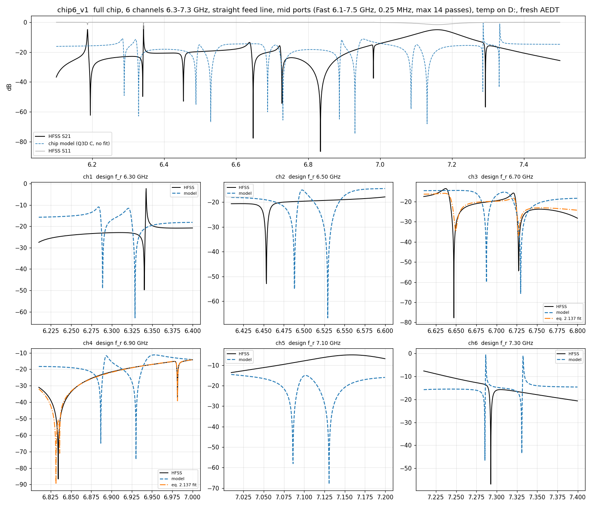

# Design5 run record

Structure, functions of each coupling / capacitor, the 6-channel chip and the know-how: see `README.md`.

Design5 is the Design6 W1 variant: one readout channel with a Purcell filter, using the Wallraff-group parameters of
thesis Table 2.4, Q35 (see `SQL HFSS/note/wallraff reference/`).
Targets: ω_r = 6.700 GHz, ω_p = ω_r + 19 MHz, J ≈ 15 MHz, κ_p ≈ 40 MHz (matched-line definition).

## Layout (`pattern design/design5_layout.py`, default = W1)

| | value |
|---|---|
| C_in | enclosing cap, plate 140 µm, next to n0 (feed_c 20 µm) |
| C_p (hugger) | type C: frame (big ground C) toward the **filter**, plate toward n0; plate 165 µm |
| C_j (hammer) | 25 × 65 µm heads, gap 19 µm, pocket margin 16 µm |
| filter | 3.4542 mm, C_p pin → short; tap 1.200 mm from C_p (L_pf) |
| resonator | 4.4070 mm, open end → short; tap 1.300 mm from the open end (L_rr) |
| files | `gds/design5.gds`, `fig/design5_layout.png` |

`D5_VARIANT=P1` builds the old Design6 c6_P1 geometry. `DLF_EXTRA` / `DLR_EXTRA` (mm) lengthen the filter / resonator.

## Method: what is recorded for every run

Run with `simulation/driven/hfss_chan5.py <tag> [f0 f1 count type]` (one channel) or `simulation/driven/hfss_chip6.py <tag>`
(whole chip). After the HFSS sweep the analysis appends a section to this file with **only** (Jay, 2026-11-09):

1. the capacitances: Q3D and fitted to HFSS, with the difference in %;
2. the HFSS S21 and S11 (raw data `<tag>_S.csv`);
3. one plot: raw HFSS S21 / S11, the theory model with the Q3D C (no fit), and the theory model fitted by C.

**Storage (traceability):** every run goes to `simulation/results/<YYYY-MM-DD>/<HHMM>_<tag>/` (raw S, meta,
convergence, log, the Q3D C and lengths used). Every (re-)analysis is added as `<tag>_compare_<YYYYmmdd_HHMM>.png/.json`;
nothing is overwritten. Q3D runs go to the same dated layout. Re-analyse with `hfss_chip6.py --analyze <tag>`.

Details of the steps:

1. **Capacitances (C)**
   * Series C_in, C_p, C_j come from the Q3D of the **whole channel in one run** (`q3d_full5.py`: all
     capacitors, lines and pads together; the shorted ends are rendered open so no net merges with ground).
   * The π shunts (electrode → ground) come from the single-capacitor runs. In the full run, a net's ground C
     also contains the line capacitance, which the TL model already includes.
   * Check: the full-run ground C minus L·C' (163.5 fF/mm) equals the shunts of the part runs (filter net 132 fF = 119 + 13).
   * `CAP_SOURCE=part` uses only the part runs.
2. **HFSS S21 and S11**
   * Defaults: Fast sweep (Interpolating misses narrow dips), 0.25 MHz step, basis 2, max ΔS 0.003, 6–16 passes.
   * Recorded: dips, plot, number of passes, last ΔS.
3. **Theory with the Q3D C (no fit):** ABCD model `theory5.py` with the capacitances above and ideal lines (Z0 50.9 Ω, v 1.2016e8 m/s).
4. **Theory fit by C**
   * Free parameters, fitted to the complex S21 and 0.3·S11 over the sweep (differential evolution, then least squares):
     * filter and resonator length corrections;
     * scales of the series C_in, C_p, C_j;
     * scale of v.
   * Soft priors pull the capacitance scales toward 1 (Q3D).
   * Output: fitted C and lengths.
   * Whole chip (`hfss_chip6.py`): the chip model (`chip6_theory.chip_s21`, one feed line, 6 channels, drawn lengths)
     with per-channel ΔL filter / ΔL resonator (each channel first alone in its window, differential evolution)
     and shared scales of C_in, C_p, C_j and v, then all together by least squares.

Pipeline test on synthetic data (theory5 with known errors and noise): the single-channel fit by C recovered all six
parameters (dL to 0.2 µm, C scales to 0.1 %).

(Until 2026-11-09 the record also had ω_p, ω_r, J, κ_p tables and a direct eq. 2.137 fit; dropped on Jay's request.)

## Capacitance record

### Q3D, whole channel in one run — q3d5_full (2026-11-09, 5.8 min)

| | part runs (each capacitor alone) | whole channel together |
|---|---|---|
| C_in (P1 feed ↔ node) | 40.57 fF | **41.14 fF** |
| C_p (node ↔ filter) | 45.41 fF | **45.91 fF** |
| C_j (filter ↔ resonator) | 2.59 fF | **3.43 fF** |
| P1 feed ↔ filter | — | 1.04 fF |
| node ↔ resonator | — | 0.03 fF |
| P1 feed ↔ resonator | — | 0.02 fF |

* C_j rises from 2.59 to 3.43 fF (+0.84 fF): the filter and resonator lines add coupling (parallel section, T junctions, stubs).
  That is 32 % more than the hammer alone, but **far too small** to explain the 410 MHz splitting of Design6 c6_P1.
* Ground C beyond the line C (C' = 163.5 fF/mm):
  * filter net 132 fF (part runs: C_p frame 119 + C_j 13);
  * resonator net 21 fF (C_j 13, plus the open end and bends);
  * node net 122 fF;
  * P1 net 207 fF (launch pad).
* Model with these values, at the current lengths:

  | C source | C_j | J | ω_r | ω_p | κ_p in channel | κ_p matched |
  |---|---|---|---|---|---|---|
  | part runs | 2.59 fF | 14.1 MHz | 6.6999 GHz | 6.7297 GHz | 63.6 MHz | 36.6 MHz |
  | whole channel | 3.43 fF | **18.7 MHz** | 6.6930 GHz | 6.7227 GHz | 64.7 MHz | 37.2 MHz |

# Runs

## chip6_v1 — full chip, 6 channels  (2026-11-09 11:34)

full chip, 6 channels 6.3-7.3 GHz, straight feed line, mid ports (Fast 6.1-7.5 GHz, 0.25 MHz, max 14 passes), temp on D:, fresh AEDT

HFSS: sweep 6.1-7.5 GHz, 5601 pts, Fast, freq_ghz 6.8, max_delta_s 0.003, max_passes 14, min_passes 6, min_converged 2, pct_refinement 30, basis_order 2, passes 14, last_dS 0.65953, minutes 216.4, temp_dir D:/HFSS_temp

Capacitances (fF, `full`): C_in 41.14, C_p 45.91, C_j 3.43; rms |ΔS21| HFSS vs chip model 0.2527

| ch | design f_r | dips HFSS (GHz) | dips model (GHz) | model ω_p / ω_r (GHz) | model J / κ_p matched (MHz) | fit ω_p / ω_r (GHz) | fit J / κ_p (MHz) |
|---|---|---|---|---|---|---|---|
| 1 | 6.30 | 6.3403 | 6.2888, 6.3288 | 6.3190 / 6.3000 | 17.9 / 31.3 | — / — | — / — |
| 2 | 6.50 | 6.4535 | 6.4882, 6.5293 | 6.5190 / 6.5000 | 18.6 / 34.2 | — / — | — / — |
| 3 | 6.70 | 6.6472, 6.7272 | 6.6875, 6.7298 | 6.7190 / 6.7000 | 19.3 / 37.3 | 6.6707 / 6.6978 | 37.6 / 19.2 |
| 4 | 6.90 | 6.8342, 6.9815 | 6.8868, 6.9303 | 6.9190 / 6.9000 | 19.9 / 40.6 | 6.9057 / 6.9111 | 72.7 / 5.1 |
| 5 | 7.10 |  | 7.0862, 7.1307 | 7.1190 / 7.1000 | 20.5 / 44.0 | — / — | — / — |
| 6 | 7.30 | 7.2927 | 7.2855, 7.331 | 7.3190 / 7.3000 | 21.1 / 47.6 | — / — | — / — |

The fit κ_p is the in-chip value (C_in, standing waves); the model κ_p is the matched-line value.

