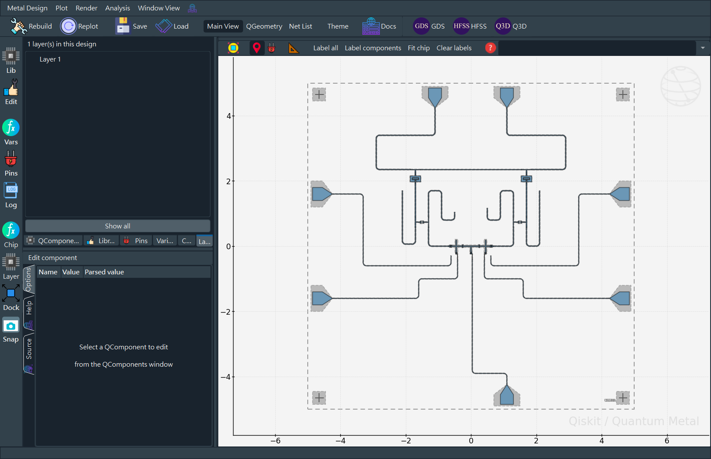
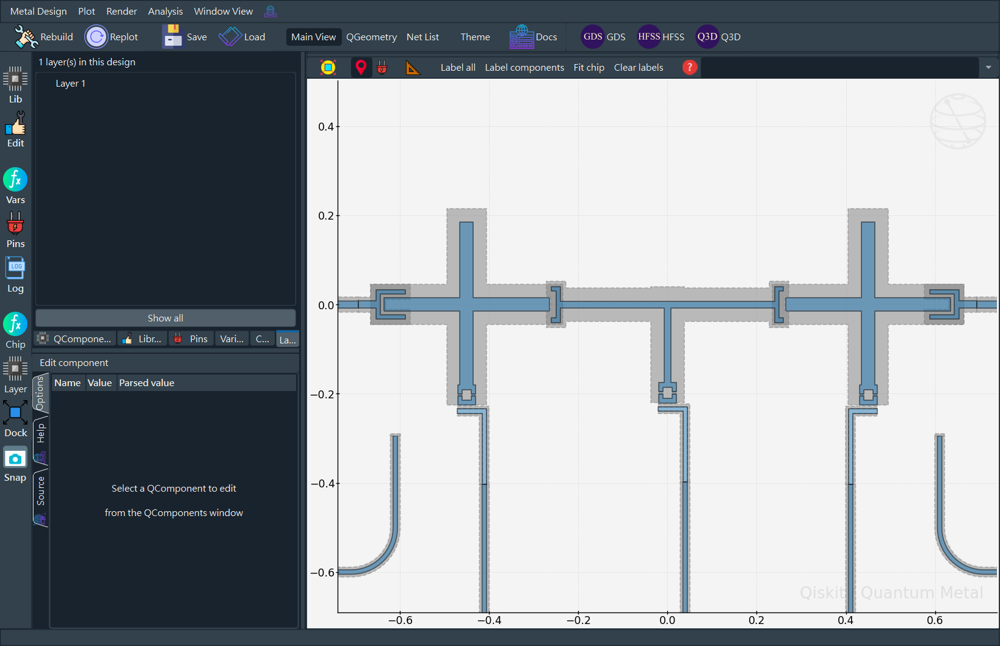

# Design6：可調 Xmon–coupler–Xmon 晶片


> **目錄整理（2026-11-15）**：[版圖程式](layout/) · [模擬入口分類](simulation/README.md) · [結果索引](results/README.md) · [採用版本](design.json)。本次未重跑求解器；歷史數值不因搬移自動成為最後確認值。新執行應另建 run，commit／push 前確認最終參數。


## 1. 設計目的與目前狀態

10 × 10 mm 晶片，兩個 asymmetric-SQUID Xmon qubit（Q1、Q2），中間為可調 SQUID transmon coupler（TC），各 qubit 有 Purcell-filtered readout。

使用者已於 2026-11-15 指定 **B2 為最終候選**。目前版圖為 **2026-11-15 B2 flux line + 更新的 launch pad**。B2 候選選擇已確認；完整參數快照尚待 commit／push 前確認。**只有部分模組有對應檢查；2026-11-14 的 core／readout／CZ 結果仍是歷史 A 版模型結果，不能視為整片 B2 已驗證。**

[設計索引](design.json) · [參數來源表](parameters/provenance.json) · [完整歷史報告](notes/report_2026-11-15.md)

## 2. 版圖與產物




- [Simulation GDS](gds/Design6_2026-11-15_sim.gds)：simulation electrodes，junction 標記在 layer 50。
- [Fab GDS](gds/Design6_2026-11-15_fab.gds)：製程接點、圓角與 ground perforation；須與 simulation 幾何分開。
- [組裝入口](layout/design6_layout.py)，專用元件為同目錄的 xmon.py、claw_coupler.py。

圖與 GDS 依既有檔名索引，本次未重新產生；原始匯出時的 source hash 尚未補證。

## 3. 最終候選 B2 的參數

| 項目 | B2 設定 | 來源／狀態 |
|---|---|---|
| flux line | L 型，sep 9 µm、bar 45 µm、fbl_x 12 µm | 既有 B2 報告；候選已由使用者確認 |
| EJ／EL、EC、coupling | 完整最終參數組待確認 | 不沿用 A 版結果作為 B2 正式值 |

B2 候選確認不代表自動採用歷史 retarget EJ。EJ／EL 仍需依使用者約束或量子模型設定；HFSS 不直接提供 EJ／EL。歷史數值集中於 [舊報告](notes/report_2026-11-15.md) 與 [歷史來源索引](parameters/provenance.json)。

## 4. B2 結果狀態

- 局部 flux：既有報告記錄 B2 結果，原始 run 對應仍待補齊，尚未納入正式數值表。
- Launch pad：有局部 [pad_s11 資料](results/general/2026-11-15/pad_s11)，完整參數與 B2 對應待最終核對。
- Core／readout／CZ：目前保存的 A 版結果只作歷史參考；B2 正式結果待驗證，不填入舊數值。

## 5. 重現入口與環境

以下從專案根目錄開始。這些是既有腳本入口，不保證重現歷史 A 幾何；缺少程式快照時需先完成版本對應。執行前換成新的日期／tag，檢查輸出是否已存在。

版圖匯出（qmetal，更新指定日期 GDS／fig，GUI 需要桌面；替換 YYYY-MM-DD）：

```powershell
conda run -n qmetal python "Design6/layout/design6_layout.py" --date YYYY-MM-DD --test-junctions no
```

B2 的量子重算命令需等最終 EJ／EL 約束、參數檔與對應 EM run 確定後填入。歷史命令保留在 [舊報告 §8](notes/report_2026-11-15.md)，不作為 B2 的正式重現指令。

## 6. 待完成與目錄相容

- 補齊 B2 flux 的 raw run 與執行快照。
- 確認 launch pad／B2 幾何對 core、readout 與 CZ 的影響。
- 分開記錄 drawn Lj、量子 retarget Lj 與製程採用值。
- 補齊收斂與截斷檢查證據後，再標 validated。

本次整理了程式與結果路徑，未重跑求解器。版圖入口在 layout/，量子分析在 simulation/qubit/，結果按 general／qubit／resonator／flux 分類。design.json 與 provenance.json 仍為來源與採用版本索引，尚未接管舊程式的全部參數載入。
