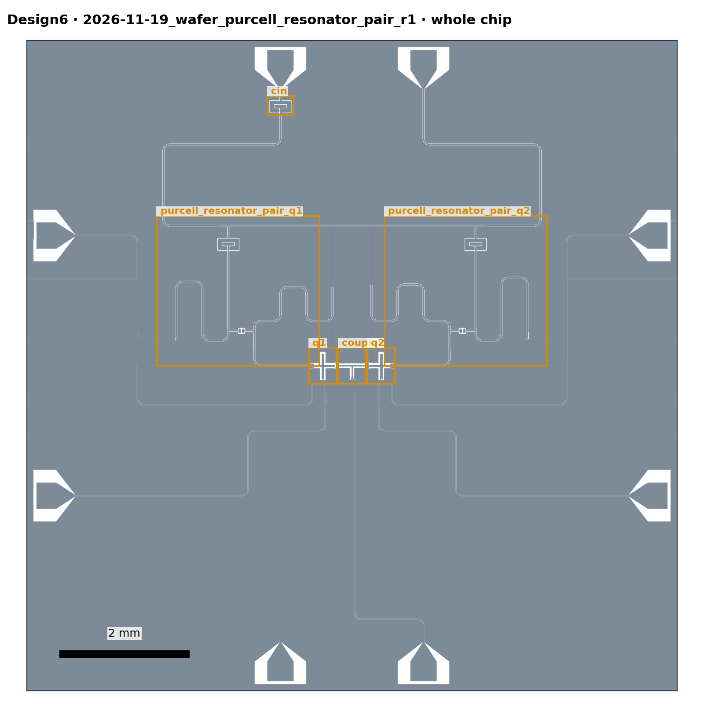
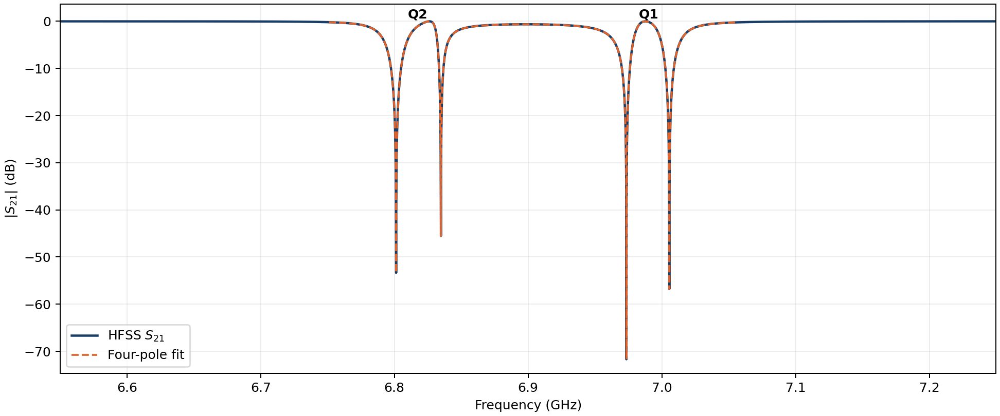
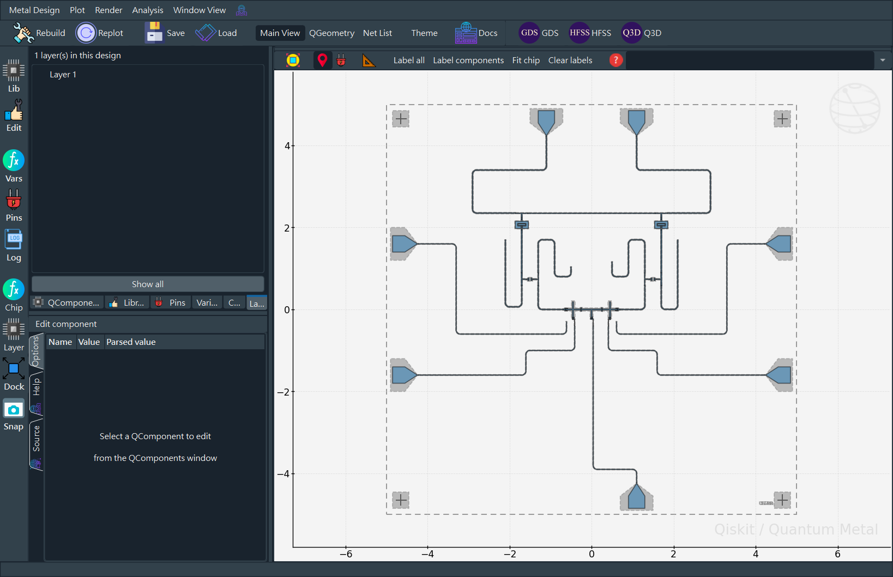
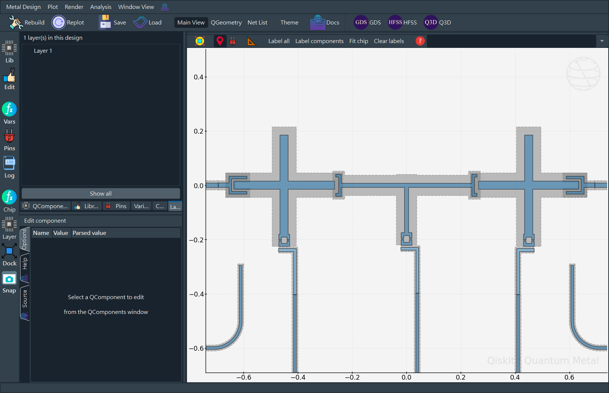

# Design6_TXT: tunable Xmon–coupler–Xmon chip

**Figures:** [fig/](fig/README.md) holds the whole chip ([`chip.png`](fig/chip.png)) and one close-up per part, rendered from the current GDS by `code/general/plot_design_figs.py`.



**40 µm cheese fab mask (2026-11-23, no EM rerun).** Fab GDS (`gds/Design6_2026-11-23_wafer_purcell_resonator_pair_r1_txt02_fab.gds`) is the parent mask (`gds/Design6_2026-11-19_wafer_purcell_resonator_pair_r1_txt02_fab.gds`) with the ground perforation rebuilt on a 40 µm lattice (5 × 5 µm holes, was 20 µm). The 7.36 mm² ground enclosed by the readout CPW loop (x ±1883 µm, y −33…2133.5 µm) is now cheesed too; the earlier cheese step perforated only the largest connected ground. The KLayout comparison shows only moved holes; simulation geometry is unchanged. Used by the `Fabrication output/20261123` NTHU wafer. Record: `design.json` → `purcell_resonator_pair_candidate.fabrication_gds_cheese40`.


**r13 metal-width candidate (2026-11-18, pending confirmation, no EM rerun).** Full rebuild with the 4 µm minimum-metal rule; same electrical geometry as r12, design ID `TXT01` 150 µm. Fab GDS (`gds/Design6_2026-11-18_wafer_r13_txt01_fab.gds`) · Companion GDS (`gds/Design6_2026-11-18_wafer_r13_sim.gds`) · Before / after (`Design6_2026-11-18_wafer_r13_txt01_compare.png`, removed 2026-11-19; in git history) · Design ID check (`Design6_2026-11-18_wafer_r13_txt01_fab_design_id.png`, removed 2026-11-19; in git history). Record: `metal_width_candidate` in [design.json](design.json).

The **r12 SQUID ground-tail candidate** sets the loop-floor-to-pocket-edge thickness to 7 µm at Q1, TC and Q2. It builds on r11 TXT01. The rounded lower pocket corners use the revised edge. Mutual inductance and other electrical results require revalidation for r12. No EM solver was rerun for this change.

r12 TXT01 fabrication GDS (`Design6_2026-11-18_wafer_r12_txt01_fab.gds`, removed 2026-11-18; in git history) · r12 simulation GDS (`Design6_2026-11-18_wafer_r12_sim.gds`, removed 2026-11-18; in git history) · TC detail (`Design6_2026-11-18_wafer_r12_txt01_fab_tc_tail_check.png`, removed 2026-11-18; in git history)

The **r11 flux-ground candidate** increases the SQUID-to-flux-metal separation to 10.5 µm for Q1, Q2 and TC, with 6 µm CPW slots. The minimum ground strip is 4.500 µm on each transmon in both GDS variants. The candidate uses the r10 TXT01 fabrication parent. The user confirmed the candidate geometry before the 18 November push. The local HFSS flux fixture gives mutual-inductance magnitudes of 1.176, 1.244 and 1.171 pH for Q1, TC and Q2 at 10 MHz. All exceed 1 pH. Full-device electrical validation and pass-count stability remain pending. [Mutual-inductance check](notes/mutual_ground_20261118.md)

r11 TXT01 fabrication GDS (`Design6_2026-11-18_wafer_r11_txt01_fab.gds`, removed 2026-11-18; in git history) · r11 simulation GDS (`Design6_2026-11-18_wafer_r11_sim.gds`, removed 2026-11-18; in git history) · Q1 detail (`Design6_2026-11-18_wafer_r11_txt01_fab_q1_flux_ground_check.png`, removed 2026-11-18; in git history) · Q2 detail (`Design6_2026-11-18_wafer_r11_txt01_fab_q2_flux_ground_check.png`, removed 2026-11-18; in git history) · TC detail (`Design6_2026-11-18_wafer_r11_txt01_fab_tc_flux_ground_check.png`, removed 2026-11-18; in git history) · Reproduction: `export_wafer_test_junctions.py --design Design6_TXT --flux-ground-review --output <new>.gds` (add `--reference-only` for the companion)

**Current wafer layout 2026-11-17_wafer_r10, fabrication ID `TXT01`.** The mask uses the four tail lengths from the trimmed loaded HFSS run. The readout CPW pairs have 200 µm centre spacing and 166 µm etched inner-edge spacing. The die includes four T test junctions and the ±2.00 mm side launches. Full-chip electrical validation is pending.

TXT01 fab GDS (`gds/Design6_2026-11-17_wafer_r10_txt01_fab.gds`) · r10 simulation geometry GDS (`gds/Design6_2026-11-17_wafer_r10_sim.gds`) · Fab mask preview (`Design6_2026-11-17_wafer_r10_txt01_fab_check.png`, removed 2026-11-19; in git history) · [Parameter workbook](parameters/Design6_2026-11-17_wafer_r10_txt01_parameters.xlsx) · Wafer assembly: the 20261117 delivery folder was deleted on 2026-11-19 (never tracked); see `wafer_assembly_note` in [design.json](design.json)

The TXT01 fab mask has 160,422 ground openings. T coupons sit at all four corners, the old corner crosses are replaced by one ground polygon per corner, and the spare P3 is grounded at its neck. The r10 tail update passed the KLayout comparison outside its four tail windows. No HFSS or Q3D solve was run for the fabrication keep-out repair, the r10 GDS export or the die-ID update. The 2026-11-17 wafer assembly carried this r10 / `TXT01` geometry. The 2026-11-16 assembly (local folder `20261116`) carried the r9 parent (`Design6_2026-11-16_wafer_r9_fab.gds`, removed 2026-11-18; in git history). Reproduce from the repository root with the qmetal Python: `python -B code/general/export_wafer_test_junctions.py --design Design6_TXT --output <new path>.gds`, plus `--reference-only` and a separate output path for the companion. [10 mm die standard](../skill/gds_export.md#10-mm-wafer-die-standard).

## Loaded readout S21



The blue trace covers 6.55–7.25 GHz and includes both Xmons and readout claws. The orange dashed four-pole fit spans the 6.751–7.056 GHz fine sweep. The GDS uses the lengths from this HFSS run.

| Channel | Filter / resonator length (mm) | Bare f_p / f_r (GHz) | f_r − f_p (MHz) | J (MHz) | κ_p/2π (MHz) |
|---|---:|---:|---:|---:|---:|
| Q1 | 3.880590 / 4.053848 | 6.99175 / 6.98892 | −2.83 | 15.96 | 36.15 |
| Q2 | 3.993377 / 4.137843 | 6.80975 / 6.82477 | +15.02 | 15.25 | 31.66 |

The HFSS fixture reached ΔS = 0.070565 after three adaptive passes, above its 0.01 stop target. The two hybrid linewidths are 16.15/20.00 MHz (Q1) and 23.48/8.17 MHz (Q2), in ascending frequency order. The GDS export used the existing simulation evidence. [Raw S21](results/resonator/20261117_193641_readout_loaded_r9_trim_98139f87/raw/S_fine.csv) · [Fit table](results/resonator/20261117_201559_compare_loaded_trim_r9_5460120e/fit_comparison.csv) · [Before-and-after comparison](notes/readout_s21_20261117.md#loaded-hfss-tail-trim-candidate)

The etched die ID `TXT01` is 50 µm inside the top and left die edges. The 5 × 5 µm ground perforations use a 20 µm centre pitch and a 547.5 µm four-edge keep-out. No EM solver was rerun for the die-ID update. [Wafer cheese rule](../skill/gds_export.md#3-checks-after-an-export)


> **Directory reorganization (2026-11-15)**: [Layout code](layout/) · [Simulation entry points](simulation/README.md) · [Results index](results/README.md) · [Adopted version](design.json). Solvers were not rerun. Moving historical values does not make them final confirmed values. Create a new run for new executions and confirm final parameters before commit/push.


## 1. Design purpose and current status

A 10 × 10 mm chip with two asymmetric-SQUID Xmon qubits (Q1, Q2), a central tunable SQUID transmon coupler (TC), and Purcell-filtered readout for each qubit.

The wafer revision retains the **B2 flux-line geometry** selected on 2026-11-15. The complete parameter snapshot awaits confirmation before commit/push. The 2026-11-14 core, readout and CZ records are historical revision-A results.

[Design index](design.json) · [Parameter provenance](parameters/provenance.json) · [Full historical report](notes/report_2026-11-15.md) · [Parameter overview (all current values with status, 2026-11-17)](notes/parameters_overview_20261117.md)

## 2. Earlier B2 layout and artifacts




- Simulation GDS (`gds/previous/Design6_2026-11-15_sim.gds`): simulation electrodes, with junction markers on layer 50.
- Fab GDS (`gds/previous/Design6_2026-11-15_fab.gds`): fabrication contacts, fillets, and ground perforation; distinguish this from simulation geometry.
- [Assembly entry point](layout/design6_layout.py); dedicated components are xmon.py and claw_coupler.py in the same directory.

The images in this section document the November 15 B2 layout. The current wafer files and mask preview are linked above.

## 3. Final candidate B2 parameters

| Item | B2 setting | Source/status |
|---|---|---|
| Flux line | L shape, sep 9 µm, bar 45 µm, fbl_x 12 µm | Existing B2 report; candidate confirmed by the user |
| EJ/EL, EC, coupling | Complete final parameter set awaits confirmation | Do not reuse revision-A results as official B2 values |

Confirming the B2 candidate does not automatically adopt historical retargeted EJ values. EJ/EL must still follow user constraints or quantum-model settings; HFSS does not directly provide EJ/EL. Historical values are in the [earlier report](notes/report_2026-11-15.md) and [historical provenance index](parameters/provenance.json).

## 4. B2 result status

- Local flux: the existing report records B2 results; raw-run mapping remains incomplete, so these are not included in the official numerical table.
- Launch pads: local [pad_s11 data](results/general/2026-11-15/pad_s11) exist; complete parameters and correspondence to B2 require final verification.
- Core Q3D on r9: the user adopted pass 20 as the current design input. AEDT reported Δ = 0.27546% against its 0.1% target. [r9 and historical v8 comparison](notes/parameters_overview_20261117.md#core-q3d-on-r9)
- Readout and XY: [r10 loaded readout](#loaded-readout-s21) · [earlier readout-only and Q3D model comparisons](notes/readout_s21_20261117.md) · [local XY fixture](notes/parameters_overview_20261117.md#xy-termination-candidates).
- CZ: [r9 coherent comparison using the adopted Q3D core](notes/cz_coupler_flux_20261117.md#r9-hamiltonian). Entry points (`scqenv`): `simulation/qubit/cz_scqubits.py` (Hamiltonian & evolution), `simulation/qubit/cz_coupler_flux.py` (coupler-only `idle_point` / `cz_at`), and `simulation/qubit/cz_r9.py` (run-recorded wrapper). The r9 HFSS core fit and full-device validation remain pending.

## 5. Reproduction entry points and environments

Start from the project root. These existing script entry points do not guarantee reproduction of historical revision-A geometry; establish version correspondence when code snapshots are missing. Use a new date/tag and check for existing output before execution.

Wafer GDS reproduction uses the current `wafer_candidate` in [design.json](design.json) and reads back the selected regions with KLayout. Choose unused output filenames.

```powershell
conda run -n qmetal python -B "code/general/export_wafer_test_junctions.py" --design Design6_TXT --output Design6_r10_review_fab.gds
conda run -n qmetal python -B "code/general/export_wafer_test_junctions.py" --design Design6_TXT --reference-only --output Design6_r10_review_sim.gds
```

Core Q3D for r9 (qmetal, AEDT 2021 R2):

```powershell
conda run -n qmetal python -X utf8 "Design6_TXT/simulation/qubit/q3d_core_r9.py" --dry-run
conda run -n qmetal python -X utf8 "Design6_TXT/simulation/qubit/q3d_core_r9.py"
```

Add B2 quantum-analysis commands after final EJ/EL constraints, parameter files, and corresponding EM runs are established. See the [earlier report §8](notes/report_2026-11-15.md) for historical commands.

## 6. Outstanding work and directory compatibility

- Complete B2 flux raw-run mapping and execution snapshots.
- Check the effects of launch-pad/B2 geometry on core, readout, and CZ results.
- Record drawn Lj, quantum-retargeted Lj, and fabrication values separately.
- Mark results validated only after recording convergence and truncation evidence.
- Coupler-flux-only CZ exploration (2026-11-17, scqubits, hypothetical targets, not adopted): [note](notes/cz_coupler_flux_20261117.md). The current targets have no ZZ-off point (Δ12 > |α|); a straddling set (Δ12 ≈ 150 MHz, g_qc ≈ 61 MHz, g12 ≈ 4 MHz, coupler f_max 6.8 GHz) gives idle ZZ +5 kHz and a 160 ns CZ with coherent F 0.9995.

This update reorganized code and result paths without rerunning solvers. Layout entry points are in layout/, quantum analysis in simulation/qubit/, and results are classified as general/qubit/resonator/flux. design.json and provenance.json remain provenance/adoption indexes; they do not yet control all parameter loading in legacy scripts.

## Appendix A. Input capacitor and readout margin

The series input capacitor \(C_\mathrm{in}\) reflects part of the incident signal at P7 and redirects readout emission toward P8. The model uses a lossless capacitor and matched 49.9 Ω feedline arms. The input insertion loss is evaluated at 6.9 GHz and comes from reflection. The P8 share is the minimum across the four r10 hybrid-mode frequencies, with the capacitor position optimized separately for each value. [Heinsoo et al., Appendix C](https://arxiv.org/pdf/1801.07904#page=8)

| \(C_\mathrm{in}\) (fF) | Input insertion loss at 6.9 GHz (dB) | Minimum share of feedline emission at P8 |
|---:|---:|---:|
| 23 | 20.1 | 99.1% |
| **73** | **10.4** | **92.2%** |
| 140 | 5.7 | 78.5% |

The preferred 73 fF candidate exceeds the 75% output target in the model at an electrical distance of about 2.42 mm from the Q2 tee toward P7. The estimate omits capacitor parasitics and changes to the mode frequencies and linewidths. The preliminary HFSS trial and fit use a lumped sheet on the adjacent straight segment at 2.49 mm. [Simulation-only S21 comparison and performance estimates](notes/readout_s21_20261117.md#r10-series-input-capacitor-candidate)

In the r10 loaded HFSS baseline, the bare filter and resonator frequencies differ by 2.83 MHz for Q1 and 15.02 MHz for Q2. The Q2 detuning is comparable to its fitted \(J\) of 15.25 MHz. A scqubits calculation using the adopted r9 core Q3D parameters and fixed layout \(L_J\) estimates the full \(|0\rangle\)-to-\(|1\rangle\) separation of the hybrid modes. The calculation applies equal and opposite dispersive shifts about the fitted linear resonator frequency. [Core Q3D inputs](results/qubit/20261117_161936_q3d_core_r9_3b00f1f5/summary_out.json) · [Dispersive calculation](simulation/qubit/readout_performance_cin.py) · [Loaded fit summary](results/resonator/20261117_201559_compare_loaded_trim_r9_5460120e/summary.json)

| Channel | Hybrid mode with larger shift | Full state separation (MHz) | Fitted FWHM (MHz) | Separation / FWHM |
|---|---|---:|---:|---:|
| Q1 | Lower frequency | 1.16 | 16.15 | 0.072 |
| Q2 | Higher frequency | 1.22 | 8.17 | 0.149 |

The estimated shifts support further readout validation. Q1 has less spectral contrast because its preferred mode is broader. Assessing 99% single-shot assignment fidelity requires the state-dependent output IQ separation at the intended readout power and integration time, along with the measurement-chain efficiency and qubit relaxation. [Hybrid-mode readout analysis](https://doi.org/10.1103/PRXQuantum.5.040326) · [Readout-system characterization](https://arxiv.org/abs/2402.00413)
