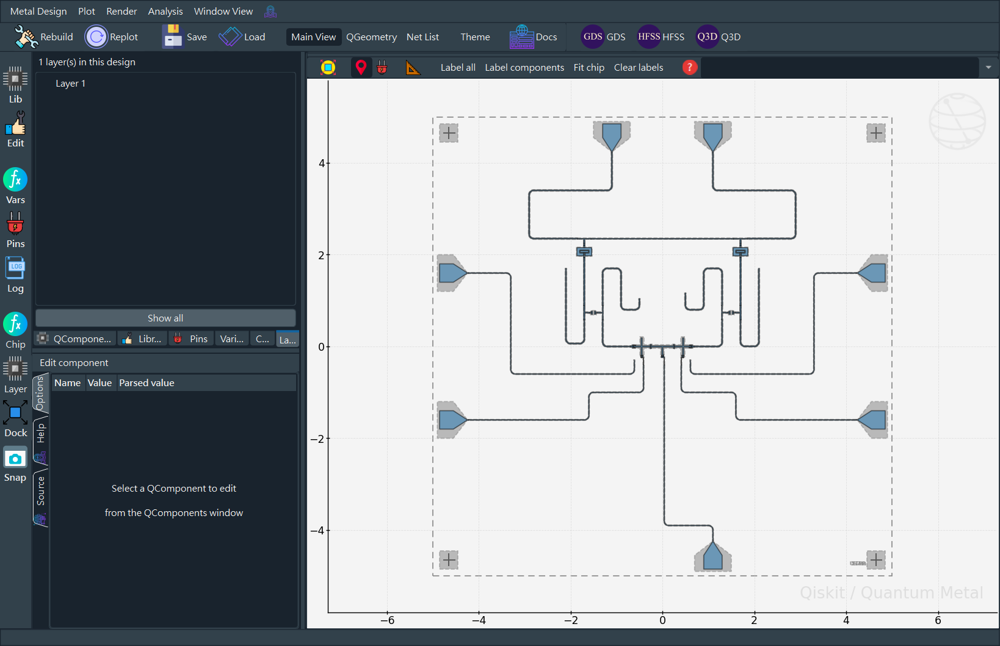
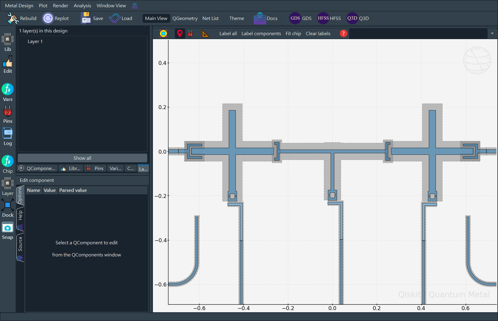
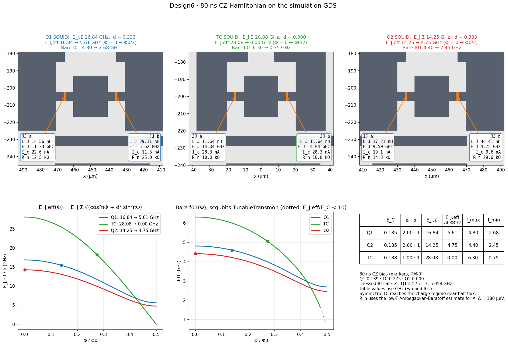
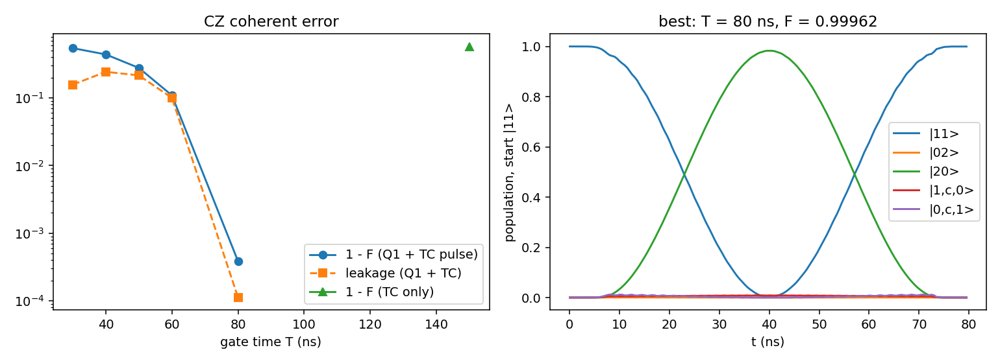
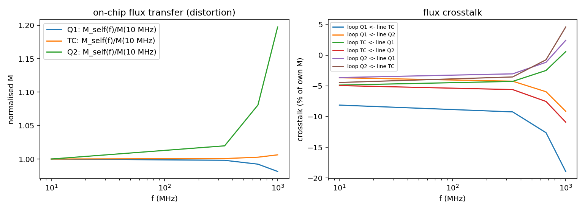

> Historical report: preserves content and values from the workspace before reorganization. "Current" refers to the original writing date; consult the [Design6_TXT README](../README.md) for official status. This report does not claim that the entire B2 chip has been validated.

# Design6_TXT — three flux-tunable transmons for a CZ gate (Q1 – tunable coupler – Q2), Purcell-filtered readout

Launch pad geometry is defined by the [shared Design6_TXT standard](../../skill/launch_pad.md).

Two flux-tunable Xmon qubits (asymmetric SQUID) coupled through a grounded, flux-tunable SQUID transmon coupler,
each qubit read out through its own Purcell filter (the Design4_Single_purcell-res / Cai 2024 channel), on a 10 × 10 mm chip with the
Design1_FTF_v1–3 PCB port positions. Layout → Q3D (capacitances) → HFSS (eigenmode, driven) → scqubits CZ simulation.




**2026-11-15: flux lines switched to variant B, then shortened (B2, current layout):** L type, fbl_sep 9 um (3 um ground strip), bar 45 um, fbl_x 12 um for Q1 / Q2 (mirrored) / TC: shorted end at the SQUID outer edge (−20.5 um), feed leg just outside the other edge (34.5–44.5 um). Simulated 2026-11-15 (§7.3, `run_flux_B2.sh`): M 1.26 / 1.34 / 1.26 pH, crosstalk max / rms 5.9 / 4.0 %. Zoom: [Q1](fig/Design6_2026-11-15_q1_squid_fluxB2.png), [TC](fig/Design6_2026-11-15_tc_squid_fluxB2.png), [Q2](fig/Design6_2026-11-15_q2_squid_fluxB2.png). Q3D / HFSS core / readout / CZ were run with variant A; the flux line only changes the metal right under the SQUIDs.

Final numbers: `parameters/Design6_2026-11-14.json`; this README is the report.

## Results summary (2026-11-14)

| | value | source |
|---|---|---|
| **CZ** (Q1 + coupler flux pulse together, \|11⟩↔\|20⟩) | **80 ns: F = 0.99962, leakage 1.1e-4, φ = 180.06°** (60 ns: F 0.891, coupler-bound limited) | scqubits, HFSS Hamiltonian (§5) |
| static ZZ at idle (all three at their sweet spots) | **−5.0 kHz** | scqubits, HFSS Hamiltonian |
| E_C Q1 / TC / Q2 | 0.185 / 0.188 / 0.185 GHz (Q3D: 0.197 / 0.209 / 0.196) | HFSS core fit (§4) |
| g_qc (charge units, exchange at idle) | 47.3 MHz (≈ 90 MHz exchange) | HFSS core fit |
| readout Q1 / Q2: f_r, κ_eff | 6.890 / 6.697 GHz, 1.64 / 1.70 MHz | HFSS + EPR (§6) |
| dispersive shift 2χ Q1 / Q2 | 1.50 / 1.14 MHz (drawn Lj) | pyEPR |
| Purcell filter κ_p, J | 55 / 56 MHz, 12.8 / 12.4 MHz | HFSS 2-mode inversion |
| XY line: T1 limit, crosstalk to the other qubit | 290 / 350 µs, 7.5 % (direct C) | Q3D v8 (§3) |
| flux lines (layout B2: L, sep 9 um, bar 45 um): M_self, I_Φ0, crosstalk | 1.26 / 1.34 / 1.26 pH, 1.64 / 1.54 / 1.64 mA, 2.9–5.9 % (rms 4.0 %) | HFSS driven 6-port (§7.3; §7–7.2 are variant A) |
| flux-pulse distortion (on-chip) | ring-up error ≤ 0.016 % (Q1, TC) within 30 ns; CZ F 0.999615 vs 0.999616 ideal; uncompensated crosstalk → F 0.42, DC-matrix compensated → 0.999613; off-chip tails ≲ 0.3 % (τ 30 ns) | HFSS H(f) + scqubits (§7.1–7.2) |
| flux crosstalk matrix (transmon-model fit) | diagonal 5.58 / 6.58 / 5.56 Φ0/V at chip, off-diagonal −3.7 … −8.1 % | §7.2 |

<!-- RESULTS -->

## 0. Junction part = Design3_FTF_NTHU structure (all three SQUIDs)

Q1, Q2 (`xmon.py`) and the coupler (`claw_coupler.py`, `my_tmon.py` block) use the Design3_FTF_NTHU / Design3_2 TC junction part:

| | Design6_TXT (Q1, Q2, TC) | Design3_2 TC |
|---|---|---|
| SQUID block / loop | 40 um wide, rectangular loop 20 × 24 um, block height (jj_gap) 40 um | same |
| junctions | two parallel Dolan JJs across a 5 um cut, jj_width 7 um, all in the same direction | same |
| landing electrodes in the mask | kept (island + ground electrode), only the JJs are left to the fab | kept (`include_tc_landing_pads`) |
| electrode overlap / shift (mask) | 3 um onto the base metal, shifted 2 um toward the arm / stem (1 um left on the ground side) | 3 um / 2 um |
| fab GDS contact notches | 2 um wide, 4 um deep at each JJ, ground-side notch offset +2 um in x | same (`MyTmonCouplerFab`) |
| rounding | final positive metal R = 5 um (`Design3_2/layout/components/round_mask.py`) | same |

Simulations use flush electrodes (no overlap / shift), as Design3_FTF_NTHU (its simulation data also precede the shift):
Q3D rejects the overlap (`squid_ground overlaps ground_main_plane`). The difference is ±2–3 um at the SQUID and is
below the precision of the Q3D / HFSS numbers here.

Both GDS files use the B2 local flux lines.

| File | Geometry |
|---|---|
| [Simulation GDS](../gds/previous/Design6_2026-11-15_sim.gds) | HFSS electrode geometry on layer 1, with all six junction locations and widths marked on layer 50/0. Solid ground, flush SQUID landings. The HFSS builder supplies the inductances. |
| [Fab GDS](../gds/previous/Design6_2026-11-15_fab.gds) | Positive base metal on layer 1/0, 5 µm target fillets, ground perforations and 12 Dolan hooks. Each hook is 2 µm wide and 4 µm deep. The two ground-side hooks of each SQUID are offset +2 µm in local x. Open junction gaps, no test structures. |

Fab die ID `TXT00` is at the lower right.
**GDS export bug (fixed 2026-11-15):** qiskit's renderer subtracted all
etch shapes from the ground in one gdstk boolean; overlapping shapes of opposite winding could cancel, so a whole etch
region stayed metal. Which region failed depended on unrelated geometry (die-ID text: D6Q00 fine, TCZ00 / TXT00 / ABC00
dropped the coupler pad etch, TC flux line, fl_TC route and P4 pocket). `code/general/gds_tools.py` now unions the
etch shapes first (`_union_subtract_first`), independent of the die ID; checked by probing the GDS on the fl_TC route.

**Launch pads (2026-11-15, `../layout/bondpad.py` BondPad):** 400 um wide × 300 um long (room for 3–4 parallel
bonds; was the Design3_2 200 × 200 um pad), side gap 200 um, 300 um linear taper to the 10/6 or 16/9 um CPW, back gap 50 um.
Pads moved 0.25 mm inward from the PCB positions (`LP_INSET`) so the etch still ends 100 um from the chip edge; pad
centre lines unchanged. Impedance (conformal mapping, 500 um Si): 50 Ω without back metal, ~40 Ω on a metal holder
(400 um pads cannot reach 50 Ω there; 500 um pads not at all). The pad + taper is ≤ 0.6 mm ≪ λ_eff ≈ 17 mm at 7 GHz,
so this mismatch is ≲ −25 dB; the bond inductance (~1 nH per 1 mm bond ≈ 44 Ω at 7 GHz) dominates, hence the wide pad
for parallel bonds. Zoom: [P1 pad](fig/Design6_2026-11-15_pad_P1.png).

*HFSS S11 (2026-11-15, `simulation/qubit/hfss_pad.py --b2b`, results/2026-11-15/pad_s11/):* pad → 1 mm CPW → pad,
lumped ports on the bond planes; per-pad π-model at 2 GHz (CPW subtracted), then one launch PCB → bonds → pad → CPW.

| pad | excess C | series L | ≈ Z_pad | S11 at 4 / 7 GHz, 2 bonds (0.55 nH) | S11 at 7 GHz, 1 bond (1 nH) |
|---|---|---|---|---|---|
| old 200 × 200 um | 0.18 pF | 0.08 nH | 22 Ω | −24.8 / −18.1 dB | −10.2 dB |
| new 400 × 300 um | 0.29 pF | 0.21 nH | 27 Ω | −26.0 / −16.6 dB | −10.0 dB |

* Both pads are capacitive (low-Z) in HFSS, more than the conformal-mapping estimate (pad end fringe / back gap and
  the port sheet are included); the bond inductance compensates it: best L_b ≈ C Z0² = 0.44 nH (old), 0.72 nH (new).
* Both pads bonded with 2 wires (0.55 nH): new pad −16.6 dB vs old −18.1 dB at 7 GHz (better below ~5 GHz), i.e. the
  400 um pad costs ~1.5 dB at the top of the band, both below −15 dB over 4–7 GHz. On the 400 um pad the 2 bonds can
  be spread wider (less mutual L, ≈ 0.5 nH); a 3rd/4th bond (0.30 nH → −18.0 dB) remains possible.
  A single bond (~1 nH) gives ≈ −10 dB on either pad.
* Bond inductances are assumed (1 mm, 25 um Al, ~100 um pitch), not simulated. The single-launch run (port 2 at the
  CPW end) is not used: that lumped port's own mismatch (~ −13 dB at 7 GHz) masks the pad.

## 1. Architecture and ports

```
          P8 ──┐                         ┌── P7         feed line (16/9 um CPW), no C_in (matched)
               └──n0_Q1 ───────── n0_Q2──┘
                   │ C_p                │ C_p          T-type enclosing cap (Design4_Single_purcell-res: plate 182 um, ~40 fF)
              Purcell filter       Purcell filter      lambda/4, tap 1.2 mm from C_p
                   │ C_j hammer         │ C_j hammer   25 x 65 um plates, gap 45 um (~0.6 fF)
              readout res.         readout res.        lambda/4, tap 1.3 mm from the open end
                   │ (open end = claw)  │
   P1 XY ──>  Q1 (Xmon+SQUID) ═claw═ TC (grounded SQUID) ═claw═ Q2 (Xmon+SQUID)  <── P6 XY
   P2 flux ─> Q1 SQUID                TC SQUID <── P4 flux       Q2 SQUID <── P5 flux
```

| port | use |
|---|---|
| P8 → P7 | readout feed line (two Purcell channels) |
| P1 / P6 | XY (charge) line of Q1 / Q2 |
| P2 / P5 | flux line of Q1 / Q2 |
| P4 | flux line of the coupler |
| P3 | free (no pad). The coupler has **no charge line**: in v4 its stub drove Q1 3.3× more strongly than the coupler; the coupler is characterised through its flux line / the qubits' dispersive shift |

Design decisions (all tuned on the simulations below):

* **Xmon qubits, not pockets.** A grounded single-island qubit gives one clean charge mode per element and couples
  directly to the grounded coupler; the four arms carry readout claw (outer arm), coupler claw (inner arm),
  SQUID + flux line (south arm) and leave the outer-south quadrant for the XY line.
* **Readout claw on the outer arm**, so the resonator open run keeps the Design4_Single_purcell-res 1.3 mm tap distance and the
  qubit spacing stays small (coupler bar 0.52 mm).
* **Tight claws** (`xmon.py`, `claw_coupler.py`): U claws 8–15 um from the arm tip. The qiskit TransmonCross claw sits
  ~44 um away and only reached g ≈ 30 MHz (Q3D v1).
* **All three elements flux-tunable** (request 2026-11-14). In the fixed-frequency version the static ZZ could not be
  cancelled: the in-line layout has almost no direct Q1–Q2 capacitance (0.06 fF), so ZZ at the coupler sweet spot
  was 47–465 kHz, and a coupler-only CZ needs > 200 ns. With tunable qubits both idle at their upper sweet spots
  400 MHz apart (small ZZ), and the CZ pulses Q1 and the coupler together to the |11⟩↔|02⟩ condition.
* **Asymmetric qubit SQUIDs** (E_Ja : E_Jb = 2 : 1, d = 1/3): first-order flux-insensitive at the idle point, tunable
  down to ~0.55 f_max (enough for the ~0.6 GHz CZ excursion), less flux-noise sensitive than a symmetric SQUID.
* **Purcell channel = Design4_Single_purcell-res unchanged** (C_p, hammer, 1.2 / 1.3 mm taps, wide serpentines, every CPW pair ≥ 400 um,
  wire bonds + straps), hammer gap 45 um for J ≈ 5 MHz (κ_r ≈ 2χ target, Design4_Single_purcell-res notes).

## 2. Hamiltonian targets

| | Q1 | Q2 | TC |
|---|---|---|---|
| f_max (idle, sweet spot) | 4.80 GHz | 4.40 GHz | 6.3 GHz |
| E_C | 0.20 GHz | 0.20 GHz | 0.21 GHz |
| junctions (L_a / L_b) | 15.89 / 31.77 nH | 18.78 / 37.56 nH | 2 × 12.85 nH |
| readout f_r = f_p | 7.00 GHz | 6.80 GHz | — |
| readout g / χ | ~130 MHz / ~0.7 MHz | ~120 MHz / ~0.7 MHz | — |

Readout resonators sit ≥ 0.5 GHz above the coupler f_max. CZ: Q1 → f_Q2 + α_2 ≈ 4.10 GHz while the coupler is pulsed
down (stays ≥ 0.4 GHz above Q1).

## 3. Q3D tuning of the core (`simulation/qubit/q3d_core.py`, 8 passes, ~1 min each)

Rendered: Q1, TC, Q2 with claws, XY lines; flux lines drawn as ground; readout claw / XY ends open.
`results/2026-11-14/q3d_<tag>/` (matrix + summary).

| run | change | Ec Q / TC (GHz) | g_qc(n) (MHz) | readout g (MHz, exch.) | XY T1 limit | note |
|---|---|---|---|---|---|---|
| base | first layout, qiskit claw | 0.210 / 0.150 | 136 | 30 | 4 µs | claws too strong / readout too weak |
| v2 | tight readout claw, readout 6.55/6.75 | 0.192 / 0.219 | 91 | 120 | 84 µs | |
| v4 | coupler claw sep 15 um, stem 180 um | 0.203 / 0.208 | 57 | 129 | 1.5 ms | fixed-frequency design point |
| v5–v6 | direct Q1–Q2 link fingers (for ZZ) | 0.133–0.147 / – | – | – | – | dropped: +35–50 fF on the qubits |
| v7 | **SQUID qubits + flux lines**, readout 7.0/6.8 | 0.197 / 0.209 | 55 | 130 / 119 | 44 µs | XY ends 100 um below |
| v7_xy0.20 / 0.30 | XY end distance | | | | 163 / 480 µs | crosstalk to the other qubit 5.7 / 9.9 % |
| **v8** | XY end 250 um below the arm etch | **0.197 / 0.209** | **55** | **129 / 119** | **290 / 350 µs** | **design point**, XY crosstalk 7.5 % (other qubit), 19 % (coupler, ≥ 1.5 GHz detuned) |

XY crosstalk is a geometric trade-off (closer = more selective but stronger); 0.25 mm is the middle of the scanned
range. Drive crosstalk to the other qubit can be cancelled with a compensation tone; to the coupler it is off resonant.

## 4. HFSS eigenmode of the core → Hamiltonian (`eigenmode/hfss_core.py`)

Q1, TC, Q2 with all junctions as lumped L (qubits: both SQUID junctions), 3 modes from 3 GHz, 6 passes, 10 um mesh,
coupler junction swept Lj_TC = 10 … 27 nH (one HFSS design, five variations). `results/2026-11-14/hfss_core_v8/`.

| Lj_TC (nH) | modes (GHz, linear) |
|---|---|
| 10.00 | 4.390, 4.771, 6.990 |
| 12.85 (drawn) | 4.391, 4.769, 6.189 |
| 17.00 | 4.387, 4.765, 5.400 |
| 22.00 | 4.380, 4.689, 4.844 (coupler anticrossing Q1) |
| 27.00 | 4.240, 4.429, 4.790 (coupler below the qubits) |

Linear 3-node fit ω² = eig(C⁻¹ L⁻¹), 6 parameters (C⁻¹), Q3D v8 as a weak prior (±10 % diagonal, ±30 % off-diagonal):
the direct Q1–Q2 term is not determined by the frequencies alone (qubits 380 MHz apart; the unconstrained fit gave an
unphysical 32 MHz). rms 8.2 MHz (≈ the eigenmode mesh error at 6 passes).

| | HFSS fit | Q3D v8 |
|---|---|---|
| Ec Q1 / TC / Q2 (GHz) | 0.185 / 0.188 / 0.185 | 0.197 / 0.209 / 0.196 |
| g_n Q1–TC / Q2–TC (MHz) | 47.5 / 47.2 | 55.1 / 55.1 |
| g_n Q1–Q2 (MHz) | 2.7 (prior) | 2.7 |

HFSS sees ~6 % more qubit capacitance than Q3D. With the drawn junctions the HFSS qubits come out at 4.59 / 4.21 GHz,
so the junctions are **re-targeted from the HFSS Ec** (fab parameter, geometry unchanged):

| junction | drawn (Q3D Ec) | **HFSS-retargeted** |
|---|---|---|
| Q1 a / b | 15.89 / 31.77 nH | **14.56 / 29.11 nH** (f_max 4.80 GHz) |
| Q2 a / b | 18.78 / 37.56 nH | **17.21 / 34.41 nH** (f_max 4.40 GHz) |
| TC (each) | 12.85 nH | **11.64 nH** (f_max 6.30 GHz) |

**Junction table for fabrication** (HFSS-retargeted; EJ = (Φ0/2π)²/L_J, I_c = Φ0/(2π L_J),
R_n from Ambegaokar–Baratoff I_c R_n = πΔ/2e with Al Δ = 180 µeV → 283 µV; f from `scqubits.TunableTransmon`, HFSS Ec):

| junction | L_J (nH) | E_J/h (GHz) | I_c (nA) | R_n (kΩ) |
|---|---|---|---|---|
| Q1 a (large) | 14.56 | 11.23 | 22.6 | 12.5 |
| Q1 b (small) | 29.11 | 5.62 | 11.3 | 25.0 |
| Q2 a (large) | 17.21 | 9.50 | 19.1 | 14.8 |
| Q2 b (small) | 34.41 | 4.75 | 9.6 | 29.6 |
| TC a = TC b | 11.64 each | 14.04 each | 28.3 each | 10.0 each |

| SQUID | E_C/h (GHz) | E_J,Σ (GHz) | E_Ja : E_Jb | d | f_max (Φ = 0) | f_min (Φ = Φ0/2) | E_J/E_C max / min |
|---|---|---|---|---|---|---|---|
| Q1 | 0.185 | 16.84 | 2 : 1 | 0.333 | **4.80 GHz** | **2.68 GHz** (E_J 5.61 GHz) | 91 / 30 |
| Q2 | 0.185 | 14.25 | 2 : 1 | 0.333 | **4.40 GHz** | **2.45 GHz** (E_J 4.75 GHz) | 77 / 26 |
| TC | 0.188 | 28.08 | 1 : 1 (design) | 0 | **6.30 GHz** | **0.751 GHz** (charge spectrum at $n_g=0$) | 150 / 0 |

The symmetric TC has zero effective Josephson energy at half flux. The bare charge spectrum at $n_g=0$ gives $f_{01}=4E_C/h=0.751$ GHz at that point. With junction asymmetry d = 2 / 5 / 10 %, the half-flux frequency rises to 0.89 / 1.28 / 1.85 GHz (f_max unchanged 6.30 GHz). The CZ uses the coupler only down to
≈ 5.0 GHz (Φ ≈ 0.28 Φ0), far from this region. R_n is the low-temperature normal-state value; the room-temperature
probe-station resistance differs from it by ~10–20 % depending on the process (use the lab's R_RT ↔ I_c calibration).


The figure uses the [saved 80 ns CZ Hamiltonian](../results/qubit/2026-11-14/cz_hfss_v8/cz_summary.json).
The plotting script checks the junction table against those inputs and marks each device’s CZ flux bias on the bare curves.
The dressed frequencies from the same CZ run appear beside the curves.

## 5. CZ gate with scqubits (`cz/cz_scqubits.py`, HFSS Hamiltonian, retargeted junctions)

Model: Q1, Q2 = `scqubits.TunableTransmon` (asymmetric SQUID, d = 1/3), TC = symmetric SQUID, charge couplings
g_ij n_i n_j from the HFSS fit; 4 × 5 × 4 levels; time evolution with exact piecewise exponentials (dt = 0.05 ns).

Idle (all at their sweet spots): **f1 4.794, f2 4.396, f_c 6.307 GHz, α −202 / −205 MHz, ZZ −5.0 kHz**.
ZZ stays < 100 kHz for coupler flux < 0.2 Φ0 ([zz_vs_flux.png](../results/qubit/2026-11-14/cz_hfss_v8/zz_vs_flux.png)).

Gate: Q1 and the coupler are pulsed together (same flat-top envelope, 8 ns cosine ramps): Q1 to the \|11⟩↔\|20⟩
condition f1 = f2 − α1 ≈ 4.60 GHz (0.2 GHz excursion, stays above Q2), coupler down to turn the effective coupling
on, bounded to stay ≥ 0.4 GHz above Q1. The two amplitudes are optimised (Nelder–Mead on 1 − F) per gate time;
single-qubit Z phases are virtual.

| T (ns) | Q1 at gate | coupler at gate | cond. phase | leakage | F (coherent) |
|---|---|---|---|---|---|
| 60 | 4.573 GHz | 5.014 GHz (bound) | 175.6° | 1.0e-1 | 0.891 |
| **80** | **4.575 GHz** | **5.058 GHz** | **180.06°** | **1.1e-4** | **0.99962** |



* Below 80 ns the gate is limited by the coupler bound (coupling not strong enough for a full \|11⟩→\|20⟩→\|11⟩
  cycle). The Q3D Hamiltonian (g_n 55 MHz) reaches F 0.998 at 60 ns: shorter gates need a larger C_qc
  (shorter coupler claw separation) or the coupler allowed closer to Q1.
* Pulsing Q1 down to the \|11⟩↔\|02⟩ condition instead (4.19 GHz) crosses Q2 during the ramps; F capped at 0.996.
* Coupler-only CZ (qubits parked): not reachable (ZZ only −0.46 MHz with the coupler ≥ 0.8 GHz above Q1): this is why
  the qubits need flux control.
* Coherent errors only; T1/T2 not included.

## 6. Readout channels: HFSS eigenmode + pyEPR (`eigenmode/hfss_readout.py`, `epr_readout.py`)

Qubit (SQUID as two lumped L, drawn junctions) + full Purcell channel + feed line with two 50 Ω ports; 57 PEC ground
straps per channel (Design4_Single_purcell-res hammer-stub and tee straps + every straight CPW piece ≤ 350 um), 20 um mesh, 4 passes
(coarse on purpose). `results/2026-11-14/hfss_readout_Q*_v8s/`.

| | Q1 | Q2 |
|---|---|---|
| qubit f01 (EPR, drawn Lj) / α | 4.440 GHz / −183 MHz | 4.021 GHz / −180 MHz |
| resonator-like mode, κ_eff | 6.8895 GHz, **1.64 MHz** | 6.6974 GHz, **1.70 MHz** |
| filter-like mode, κ | 6.9598 GHz, 53.4 MHz | 6.7643 GHz, 54.6 MHz |
| 2-mode inversion: f_p / f_r / κ_p / J | 6.958 / 6.892 GHz / 55.0 / 12.8 MHz | 6.762 / 6.699 GHz / 56.3 / 12.4 MHz |
| **2χ (qubit–resonator)** | **1.50 MHz** | **1.14 MHz** |
| 2χ (qubit–filter) | 0.046 MHz | 0.036 MHz |
| qubit mode κ (Purcell) | below eigenmode resolution (T1 ≫ 1 ms) | same |

* Without the hammer / tee straps the same run gave J = 53.5 MHz (Design4_Single_purcell-res lesson: the etched stub + hammer pocket cut
  the ground). With straps J = 12.4–12.8 MHz, ~2.5× the Design4_Single_purcell-res capacitor calibration.
* The resonator sits ~65 MHz below its filter (claw loading underestimated by `CLAW_DL`). At this detuning
  κ_eff ≈ 1.6–1.7 MHz ≈ 2χ, close to the SNR optimum, so the drawn lengths are kept. Aligning f_r = f_p
  (resonator −38 um) would give κ_eff ≈ 4J²/κ_p ≈ 12 MHz unless the hammer gap is opened as well.
* With the HFSS-retargeted junctions the qubits move up to 4.80 / 4.40 GHz: Δ_qr shrinks by ~0.35 GHz and 2χ grows
  by roughly 1.4×.

## 7. Flux lines: crosstalk and on-chip distortion (`driven/hfss_flux.py`)

Local model (Jay 2026-11-14: the long routed CPWs are not needed): Q1, TC, Q2 with their SQUIDs and local L-shaped
flux lines; ports 1–3 on the three flux-line pins (50 Ω), ports 4–6 on one junction of each SQUID (port only, I = 0:
the port voltage is the loop EMF, M_ij = Im Z_ji / ω). 4 um seed mesh on SQUIDs and local lines, 6 passes, discrete
sweep 10 MHz – 1 GHz (4 points). `results/2026-11-14/flux_loc_fl10/` (V0), `flux_loc_fl5/` (V1).

| | **V0: fbl_sep 10 um, bar 100 um (layout)** | V1: fbl_sep 5 um, bar 60 um |
|---|---|---|
| M_self Q1 / TC / Q2 | **1.15 / 1.36 / 1.15 pH** (Design3_2 same SQUID: 1.07 pH) | 2.98 / 2.68 / 2.98 pH |
| I_Φ0 = Φ0 / M | **1.79 / 1.52 / 1.80 mA** | 0.69 / 0.77 / 0.69 mA |
| crosstalk Q1 ↔ Q2 (M_ij / M_jj) | 3.7 % | 3.9 % |
| qubit lines → coupler loop | 4.9 / 5.0 % | 6.9 / 7.0 % |
| coupler line → Q1 / Q2 loop | 8.1 / 4.5 % | 8.1 / 7.4 % |
| M_self(f) / M(10 MHz), 10–340 MHz | ≤ 2 % (Q1 0.2 %, TC 0.1 %, Q2 2 %) | ±12 % |



* **Choice: V0.** V1 needs 2.6× less current but couples more to the coupler, sits 5 um from the SQUID electrode
  (fab-sensitive), and its frequency response is less clean. 1.5–1.8 mA per Φ0 is a normal bias range.
* **Distortion:** the on-chip flux transfer is flat to ≤ 2 % up to 340 MHz, which covers the spectrum of the 80 ns CZ
  pulse (8 ns ramps: content < ~100 MHz). Above 340 MHz Q1 and Q2 (mirror images) deviate in opposite directions:
  numerical (6 passes, 4-point sweep), not physics. Pulse distortion therefore comes from the off-chip wiring and is
  pre-compensated as usual.
* **Crosstalk:** 4–8 % flux crosstalk (mostly through the shared ground return near the shorted ends) is calibrated
  with the inverse crosstalk matrix. Further reduction, not simulated here: air bridges across the flux line next to the
  short, and more qubit–coupler distance (at the cost of g).
* The first attempts with the routed lines to the launch pads (`--routed`) needed > 1 h for the frequency sweep and,
  at 5 passes without seed mesh, gave unresolved M (0.1–0.3 pH): not used.

### 7.1 Pulse distortion: 100 ns pulse through the HFSS flux network, and its effect on the CZ (`driven/flux_pulse.py`)

A simulated Cryoscope (cf. Rol et al., APL 116, 054001 (2020)). The V0 design was re-swept densely on its mesh
(Interpolating, 1 MHz – 3 GHz, 600 points, `flux_resweep.py --dense`, 19 min). Each line is driven from a 50 Ω source
through a matched line, so the routed CPW is a pure delay. The 6-port Z matrix then gives the transfer
H_nm(f) = Φ_n / V_m from every line to every SQUID loop. Pulses are filtered through H by FFT. Output in
`results/2026-11-14/flux_pulse/`.

**100 ns pulse (8 ns cosine ramps, 0.1 Φ0) on one line at a time** ([step_response.png](../results/flux/2026-11-14/flux_pulse/step_response.png)):

| line | max error vs ideal | flat-top error | left after the pulse | crosstalk flux (per 0.1 Φ0) |
|---|---|---|---|---|
| Q1 | 0.050 % (only during the ramps) | 0.004 % | 0.002 % | TC −0.0049, Q2 +0.0037 Φ0 |
| TC | 0.048 % | 0.001 % | 0.001 % | Q1 −0.0082, Q2 +0.0045 Φ0 |
| Q2 | 0.15 % (high-frequency ripple) | 0.14 % | 0.10 % | Q1 +0.0037, TC +0.0050 Φ0 |

The local flux line distorts nothing measurable. Q1 and TC show only a ps-scale lag on the ramps and no settling tail.
Q2, the mirror image of Q1, shows a ~3 GHz ripple from the H(f) extrapolation, a numerical effect. Crosstalk
appears as scaled copies of the pulse (frequency-flat).

**The 80 ns CZ pulses (Q1 + coupler) through the same network** ([cz_pulses.png](../results/flux/2026-11-14/flux_pulse/cz_pulses.png)):

| case | cond. phase | leakage | F |
|---|---|---|---|
| a. ideal flux | 180.06° | 1.1e-4 | 0.999616 |
| b. on-chip H(f), crosstalk removed | 180.06° | 1.1e-4 | 0.999615 |
| c. on-chip H(f) with crosstalk, uncompensated | 22.2° | 1.0e-3 | **0.42** |
| d. drives pre-multiplied by the inverse DC crosstalk matrix | 180.06° | 1.2e-4 | **0.999613** |
| e. (d) + off-chip tail (2 %, τ 30 ns), DC amplitude calibrated, not pre-distorted | 151.8° | 9.0e-3 | 0.956 |

* **On-chip distortion is negligible** (b vs a: 1e-6).
* **On-chip flux crosstalk must be compensated.** The coupler pulse (0.275 Φ0) leaks 8 % into Q1, about 0.022 Φ0. That
  shifts Q1 by tens of MHz off the \|11⟩↔\|20⟩ condition. Because the crosstalk is frequency-flat, a static inverse
  matrix (measured at DC, as usual) restores the gate completely (d).
* **The real distortion budget is off-chip.** Uncorrected tails vs CZ fidelity, with the DC amplitude calibrated
  (step response 1 − A e^(−t/τ); `flux_tail_scan.py`, `tail_scan.json`):

| τ \ A | 0.1 % | 0.3 % | 1 % | 2 % |
|---|---|---|---|---|
| 10 ns | 0.99961 | 0.99954 | 0.99879 | 0.99637 |
| 30 ns | 0.99950 | 0.99857 | 0.98809 | 0.95563 |
| 100 ns | 0.99917 | 0.99557 | 0.95627 | 0.84704 |

  To keep the CZ error below ~1e-3 after predistortion: residual tails ≲ 1 % for τ ≈ 10 ns, ≲ 0.3 % for τ ≈ 30 ns,
  ≲ 0.1 % for τ ≈ 100 ns. (An earlier tail model without DC calibration overstated the sensitivity.)

### 7.2 Acceptance metrics of the flux line (variant A = layout): M, ring-up in the first 30 ns, DC crosstalk

Scripts `driven/flux_metrics.py`, `driven/flux_square_spectro.py`, `driven/flux_xtalk_matrix.py`; results in
`results/2026-11-14/flux_loc_fl10/{metrics,xtalk_matrix}.json` and `results/2026-11-14/flux_pulse/square_spectro_*`.
The HFSS transfer is used up to 2 GHz: above ~2.5 GHz it shows the fixture resonance (one SQUID junction replaced by
the open EMF port: the other junction and the qubit capacitance resonate at ~2.6–2.9 GHz), which is not part of the
flux-line response. Flux pulses live below ~1 GHz.

**Mutual inductance (requirement > 1 pH):** Q1 1.153, TC 1.360, Q2 1.150 pH (I_Φ0 1.79 / 1.52 / 1.80 mA): met.

**Ring-up, first 30 ns** (2 ns raised-cosine step through the on-chip H): 10–90 % rise 1.18 ns (= the input edge),
overshoot ≤ 0.012 % (Q1, TC), max error after the edge 0.016 % / 0.005 % (Q1 / TC); Q2 0.14 % on the edge only
(numerical; Q2 is the mirror image of Q1). Simulated flux-pulse spectroscopy (50 ns square pulse, 1 ns edges,
Q1 4.79 → 4.17 GHz; [square_spectro_Q1.png](../results/flux/2026-11-14/flux_pulse/square_spectro_Q1.png)):

| Q1 frequency error after the rising edge | 2 ns | 5 ns | 10 ns | 20 ns | 30 ns |
|---|---|---|---|---|---|
| on-chip only (HFSS) | 0.003 MHz | 0 | 0 | 0 | 0 |
| + assumed off-chip tail 2 %, τ 10 ns | 19.3 MHz | 14.3 | 8.7 | 3.2 | 1.2 |

The on-chip line does not produce the slow approach seen in flux-pulse spectroscopy; that comes from the wiring.

**Flux crosstalk matrix from transmon-model spectroscopy** (qubit i parked at 0.25 Φ0, DC sweep of line j, fit with the
transmon f(Φ); [xtalk_matrix.png](../results/flux/2026-11-14/flux_loc_fl10/xtalk_matrix.png)). Units: Φ0 per volt
incident at the chip end of the line (× 0.1 for an assumed 20 dB of attenuation to the AWG):

| loop \ line | Q1 | TC | Q2 |
|---|---|---|---|
| Q1 | **5.576** | −0.535 (−8.1 %) | −0.205 (−3.7 %) |
| TC | −0.281 (−5.0 %) | **6.577** | −0.278 (−5.0 %) |
| Q2 | −0.204 (−3.7 %) | −0.294 (−4.5 %) | **5.563** |

The spectroscopy fit agrees with the HFSS DC transfer to < 3 % (the residual is dressing by the other elements, as in
a measurement). All off-diagonal terms are negative: the neighbour's return current gives opposite flux.
What a DC change of a neighbour does (line moves its own loop by 0.1 Φ0):

| changed line | at idle (all at sweet spots) | Q1 parked at 0.134 Φ0 |
|---|---|---|
| Q1 | TC −0.82 MHz, Q2 −0.14 MHz | TC −1.47 MHz |
| TC | Q1 −1.17 MHz, Q2 −0.43 MHz | **Q1 +22.8 MHz** |
| Q2 | Q1 −0.15 MHz, TC −0.65 MHz | **Q1 +10.6 MHz** |

At the sweet spots the effect is second order (≤ 1.2 MHz); away from them it is first order (10–23 MHz per 0.1 Φ0), so
DC biases are set through the inverse crosstalk matrix.

### 7.3 Flux-line variants A–D (local HFSS model, same metrics) — 2026-11-14

`../layout/fluxline.py` (shared L / T / U), runs `results/2026-11-14/flux_loc_{fl10,Lshort,T,U}/`, comparison
`driven/compare_flux_variants.py` → [flux_variants_compare.png](../results/flux/2026-11-14/flux_variants_compare.png).
Reference: Dai et al., PRX Quantum 2, 040313 (2021): gate-based chips typically show a few % relative crosstalk; mismatch
with simulation comes from ground return currents, mitigated by moving the line's ground connection away from other loops.

| variant | M Q1 / TC / Q2 (pH) | I_Φ0 (mA) | crosstalk max / rms | Q1←TC | Q1↔Q2 | ring-up (after 5 ns) |
|---|---|---|---|---|---|---|
| A: L, sep 10 um, bar 100 um (layout until 2026-11-14) | 1.15 / 1.36 / 1.15 | 1.79 / 1.52 / 1.80 | 8.1 / 5.2 % | −8.1 % | 3.7 % | ≈ 0 |
| **B: L short, sep 9 um, bar 60 um (layout 2026-11-15, then shortened to B2)** | **1.16 / 1.66 / 1.16** | 1.78 / 1.24 / 1.79 | **6.0 / 4.1 %** | **−6.0 %** | **3.0 %** | ≈ 0 |
| C: T, sep 9 um, arms 2 × 50 um | 0.50 / 0.48 / 0.50 ✗ | 4.1 / 4.3 / 4.1 | 7.8 / 5.1 % | −7.8 % | 1.8 % | ≈ 0 |
| D: U hairpin, legs 40 um, drop 120 um | 1.18 / 1.25 / 1.19 | 1.75 / 1.66 / 1.74 | 6.7 / 5.7 % | −6.4 % | 4.0 % | ≈ 0 |
| **B2: L, sep 9 um, bar 45 um, fbl_x 12 um (layout since 2026-11-15)** | **1.26 / 1.34 / 1.26** | 1.64 / 1.54 / 1.64 | **5.9 / 4.0 %** | **−5.9 %** | **2.9 %** | ≈ 0 |

* **B is the best compromise and is now the layout** (2026-11-15; GDS etches probed: line + both gaps present for Q1 / TC / Q2): lowest crosstalk (max 8.1 → 6.0 %, rms 5.2 → 4.1 %), M > 1 pH everywhere (TC 1.66 pH).
  The shorter bar under the SQUID couples the same flux to its own loop with less line length next to the neighbours.
  Cost: 3 um ground strip between the SQUID ground electrode and the flux-line gap (fab tolerance).
* **B2** (the drawn shape: shorted end at the SQUID outer edge, feed leg just outside the other edge): same crosstalk as B
  (max 5.9 %, rms 4.0 %), qubit M up 1.16 → 1.26 pH (the bar now runs under the whole SQUID), TC M 1.34 pH (B 1.66: its
  bar was offset); diagonal 6.09 / 6.49 / 6.08 Φ0/V at chip; square pulse on Q1: < 0.014 MHz error 2 ns after the edge,
  neighbours TC / Q2 move 1.6 / 0.55 MHz. All three lines now have the same geometry.
* C (T) halves the current under the SQUID: M ≈ 0.5 pH fails the 1 pH requirement; only Q1↔Q2 improves.
* D (U) makes the coupler's crosstalk symmetric (Q1←TC 8.1 → 6.4 %) but the qubit lines couple more to the coupler.
* Ring-up: all variants settle within ~2–5 ns after a 2 ns edge; the edge-time deviations (up to ~1–2 % in Q2 of B)
  start before the step (non-causal), i.e. they come from truncating H(f) at 2 GHz, not from the line.
* Crosstalk floor of ~3–6 %: set mainly by the 0.45 mm SQUID spacing of the in-line layout; going lower needs more
  distance or ground straps / air bridges next to the flux-line shorts.

## 8. Files

```
Design6_TXT/
├─ layout/
│  ├─ design6_layout.py     build_design(), lengths (tune_lengths), GDS export, GUI screenshots, CPW spacing check
│  ├─ xmon.py               Xmon (TransmonCross) + asymmetric SQUID + L flux line + tight readout claw
│  ├─ claw_coupler.py       grounded SQUID coupler (my_tmon.MyTmonCoupler) with claw ends
├─ simulation/
│  ├─ q3d/q3d_core.py       Q3D of Q1/TC/Q2 + claws + XY lines: Ec, g, readout g, XY T1 and crosstalk
│  ├─ eigenmode/hfss_core.py      HFSS eigenmode, coupler-Lj sweep -> fitted C^-1 (HFSS Hamiltonian)
│  ├─ eigenmode/hfss_readout.py   HFSS eigenmode + pyEPR of each readout channel with its qubit
│  ├─ driven/hfss_flux.py   HFSS driven 6-port: flux-line mutual-inductance matrix, crosstalk, M(f) flatness
│  ├─ driven/flux_resweep.py      re-sweep a solved flux design (--dense: 1 MHz - 3 GHz for flux_pulse.py)
│  ├─ driven/flux_pulse.py        pulses through the HFSS flux network: distortion, crosstalk, CZ impact
│  ├─ driven/flux_tail_scan.py    CZ tolerance to uncorrected off-chip tails
│  ├─ eigenmode/epr_readout.py    pyEPR on a solved readout design / saved EPR data
│  ├─ cz/cz_scqubits.py     scqubits: ZZ vs flux, CZ pulse optimisation (Q1 + coupler), fidelity / leakage
│  ├─ run_queue.sh          the HFSS job queue used for this report
│  └─ results/2026-11-14/   q3d_v*/, hfss_core_v8/, hfss_readout_Q*_v8/, flux_v8_*/, cz_*/
├─ gds/  Design6_2026-11-15_sim.gds, Design6_2026-11-15_fab.gds
├─ fig/  layout / core / channel screenshots (Qiskit Metal GUI)
└─ parameters/Design6_2026-11-14.json
```

Run (conda env `qmetal`; CZ in `scqenv`):

```
cd "Design6_TXT/layout"; python design6_layout.py --date 2026-11-15 --test-junctions no
cd ../simulation
python q3d/q3d_core.py v8
python eigenmode/hfss_core.py --lj 10,12.85,17,22,27 --tag v8
python eigenmode/hfss_readout.py Q1 --tag v8s     # and Q2; EPR: eigenmode/epr_readout.py Q1 --tag v8s --npz <file>
python driven/hfss_flux.py --tag loc_fl10
python driven/flux_resweep.py --tag loc_fl10 --dense
python driven/flux_pulse.py --T 100 --cz-T 80        # scqenv
python driven/flux_tail_scan.py                       # scqenv
python cz/cz_scqubits.py --params results/2026-11-14/hfss_core_v8/fit.json --tag hfss_v8 --retarget 4.80,4.40,6.30 --times 60,80   # scqenv
```
