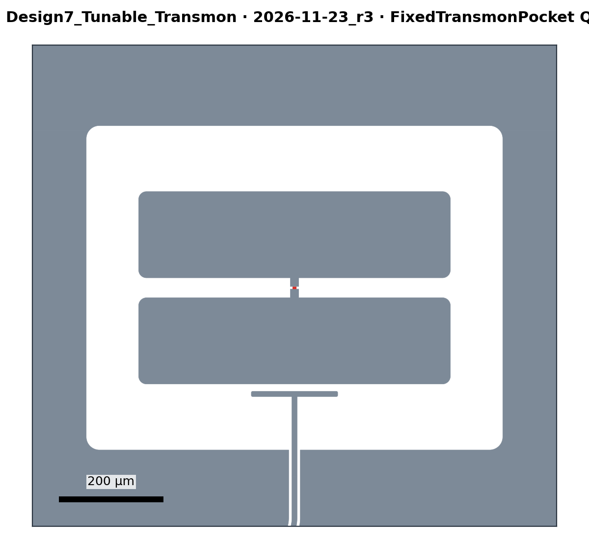
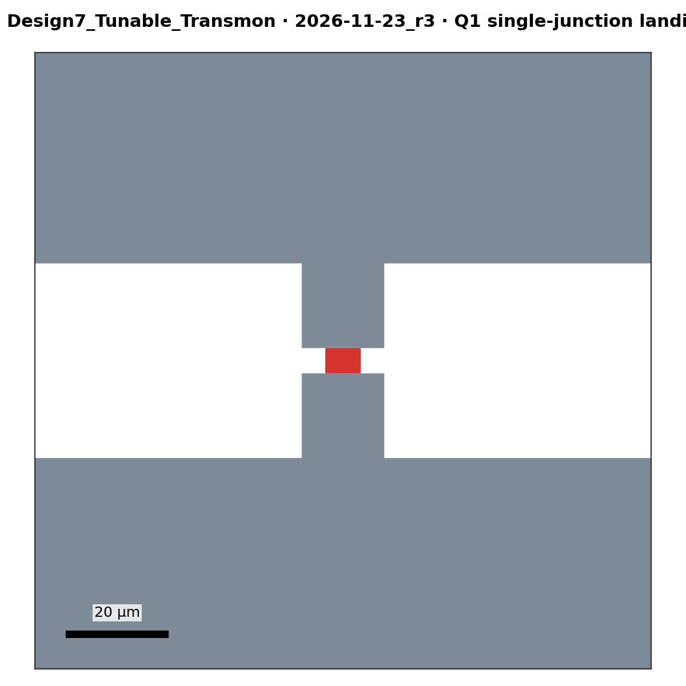

# Design7_Tunable_Transmon: 8-port half-resonator / half-fixed-frequency-transmon chip

> **Status (2026-11-23_r3): Stage 1 draft, awaiting layout review.** The four tunable SQUID transmons of r2 are replaced by single-junction fixed-frequency transmons (`FixedTransmonPocketDolan`) at 3.5 / 3.8 / 4.1 / 4.4 GHz. This chip and [Design6_TXT](../Design6_TXT/README.md) are the transmon-only candidates for the NCKU e-beam run. **No EM solver was rerun for r3**: the user accepted the r2 Q3D Ec / β for r3 (2026-11-23), since the single-leg change is expected to shift C_Σ by < 1 %. The folder name is kept for path stability.

**Figures:** [fig/](fig/README.md) holds the whole chip ([`chip.png`](fig/chip.png)) and part close-ups ([`bare_resonator.png`](fig/bare_resonator.png), [`q1.png`](fig/q1.png), [`q1_pocket.png`](fig/q1_pocket.png), [`q1_junction.png`](fig/q1_junction.png)), rendered from the r3 simulation GDS by `code/general/plot_design_figs.py`.


| `FixedTransmonPocketDolan` Q1 close-up | Q1 single-junction landing legs |
|---|---|
|  |  |

## 1. Design purpose and topology

A 10 × 10 mm 8-port chip (`wafer_pcb_ports`, side ports at `y = ±2.0 mm`) split into two independent straight feedlines with alternating (`+1, -1, +1, -1`) channel placement so bare resonators and qubits are interleaved horizontally in the central ground region:

- **Top half (`P1 ↔ P6`, `y = +2.0 mm`) — Resonator-only:** 4 bare λ/4 hanger resonators (`R1`–`R4`, targets `6.30, 6.70, 6.50, 6.90 GHz`, `10 / 6 µm` CPW, `300 µm` coupling length, `4 µm` ground strip to feedline). Unchanged from r2.
- **Bottom half (`P2 ↔ P5`, `y = -2.0 mm`) — Fixed-frequency transmons (no charge lines, no flux lines):** 4 `FixedTransmonPocketDolan` qubits (`Q1`–`Q4`, one junction each, `orientation='0'`) multiplexed on 4 λ/4 readout hanger resonators (`RR1`–`RR4`, targets `6.30, 6.70, 6.50, 6.90 GHz`). Drive and readout go through the feedline.
- **Spare ports (`P3`, `P4`, `P7`, `P8`):** standard wire-bond launch pads grounded at their neck.

### r3 change (2026-11-23)

- **Pattern:** the two 16 µm SQUID legs (46 µm outer, 14 µm loop) are replaced by one centred 16 µm landing-leg pair with the same `5 µm` `jj_cut`, ready for a single-JJ `TransmonJunctionDolan` (`squid=False`) in Stage 3. Pads, pocket and readout T-bar are unchanged.
- **Frequencies:** user target range 3.5–4.5 GHz with four qubits, set to ~300 MHz steps. Pairing is a layout choice: the lowest qubit reads out through the lowest resonator, so the qubit–resonator detuning stays at 2.5–2.8 GHz and neighbours on the feedline differ by ≥ 300 MHz.

## 2. r3 qubit targets and inputs (Stage 1, r2 Q3D accepted)

Ec = 199.68 MHz and β = 0.07069 come from the r2 SQUID-pocket Q3D run, accepted for r3 without a rerun (user decision, 2026-11-23). EJ is a quantum-model design input (exact charge-basis diagonalisation), `Lj` the matching HFSS lumped input, and the junction width an uncalibrated estimate from `code/qubit/jj_resistance_model.py` (80 nm finger, $R_A = 625\,\Omega\cdot\mu\text{m}^2$).

| Qubit | Readout (GHz) | $f_{01}$ target (GHz) | $E_J/h$ (GHz) | $L_J$ (nH) | $E_J/E_C$ | $\alpha/2\pi$ (MHz) | $g/2\pi$ (MHz) | $2\chi/2\pi$ (MHz) | $R_n$ (kΩ) | Cross width (nm) |
|---|---|---:|---:|---:|---:|---:|---:|---:|---:|---:|
| `Q1` | `RR1` 6.30 | 3.50 | 8.627 | 18.948 | 43.2 | −232.9 | 82.8 | −0.376 | 16.28 | 279 |
| `Q3` | `RR3` 6.50 | 3.80 | 10.072 | 16.229 | 50.4 | −229.3 | 89.0 | −0.459 | 13.94 | 338 |
| `Q2` | `RR2` 6.70 | 4.10 | 11.630 | 14.055 | 58.2 | −226.5 | 95.3 | −0.560 | 12.08 | 401 |
| `Q4` | `RR4` 6.90 | 4.40 | 13.301 | 12.290 | 66.6 | −224.3 | 101.7 | −0.681 | 10.56 | 468 |

- Roles: $f_{01}$ target = user input; $E_J$, $L_J$ = design inputs; $\alpha$, $g$, $2\chi$, $R_n$, widths = derived ([quantum.json](parameters/quantum.json)).
- With the unchanged `300 µm / 4 µm` hanger ($\kappa/2\pi \approx 0.53$ MHz), $2\chi/\kappa$ spans 0.71–1.29. Per-channel readout-pad or coupling-length tuning can equalise it in Stage 2.
- Removing one SQUID leg slightly lowers the pad-gap capacitance; the expected Ec change (< 1 %) was judged negligible, so no r3 Q3D rerun is planned.

## 3. Historical r2 parameters (tunable SQUID, `2026-11-22_r2`)

Qubit Ec / β from this run are accepted for r3 without a rerun; g and 2χ in §2 are recomputed for the r3 frequencies. The hanger resonator geometry is unchanged.

### Qubit & dispersive readout (Q3D + exact transmon diagonalization)

Source: single-qubit Q3D run [`20261122_201149_q3d_ec200_v2_34009f36`](results/qubit/20261122_201149_q3d_ec200_v2_34009f36/summaries/summary.json) (8 passes, 0.5% target, Medium order, `Q1` + open-terminated readout pad). `EJ` and `Lj` are quantum-model design inputs (not HFSS-extracted quantities); e-beam mask widths are estimates from `code/qubit/jj_resistance_model.py` (80 nm finger, $R_A = 625\,\Omega\cdot\mu\text{m}^2$).

| Parameter | Target | Adopted value | Unit | Role / status |
|---|---:|---:|---|---|
| Charging energy $E_C / h$ | 200 | **199.68** | MHz | Result (Q3D, $C_\Sigma = 97.00\text{ fF}$) |
| Qubit frequency $f_{01}$ ($\Phi = 0$) | ~4.00 | **4.000** | GHz | Derived from Q3D $E_C$ + input $E_J$ |
| Anharmonicity $\alpha / 2\pi$ | — | **−227.4** | MHz | Derived (exact charge-basis diag.) |
| Symmetric SQUID $E_{J,\mathrm{sum}} / h$ | — | **11.098** | GHz | Input ($E_{J1} = E_{J2} = 5.549\text{ GHz}$) |
| Branch inductance $L_{J1} = L_{J2}$ | — | **29.46** | nH | Input (HFSS lumped branch value) |
| Predicted branch $R_n$ ($T \to 0$) | — | **25.31** | kΩ | Derived (`jj_resistance_model.py`) |
| `TransmonJunctionDolan` widths (finger / cross) | — | **80 / 155** | nm | Derived (symmetric: `jj1 = jj2 = 155 nm`) |
| Readout voltage-division ratio $\beta$ | — | **0.07069** | — | Result (Q3D, $C_{\mathrm{ro,top}} = 15.69\text{ fF}$) |
| Readout pad self-capacitance $C_{\mathrm{ro,self}}$ | — | **35.98** | fF | Result (Q3D → `0.220 mm` length shortening) |
| Coupling $g / 2\pi$ (`6.3–6.9 GHz`, $\lambda/4$) | — | **88.5–96.9** | MHz | Derived from Q3D $\beta$ and $\lambda/4$ $V_{\mathrm{zpf}}$ |
| Dispersive shift $|2\chi| / 2\pi$ (`6.3–6.9 GHz`) | 0.50 | **0.471–0.613** | MHz | Derived (`0.556` at 6.5 GHz, `0.510` at 6.7 GHz) |

| Channel | $f_{r,\mathrm{target}}$ (GHz) | $L_{\mathrm{res}}$ (mm) | $g / 2\pi$ (MHz) | $2\chi / 2\pi$ (MHz) |
|---|---:|---:|---:|---:|
| `Q1 / RR1` | 6.30 | 4.4379 | 88.49 | −0.613 |
| `Q3 / RR3` | 6.50 | 4.2946 | 91.30 | −0.556 |
| `Q2 / RR2` | 6.70 | 4.1599 | 94.11 | −0.510 |
| `Q4 / RR4` | 6.90 | 4.0329 | 96.92 | −0.471 |

### Hanger resonators (HFSS driven S21)

Source: single-channel HFSS driven S21 run [`20261122_205320_hanger_c300_s4_verify_35cbb6d1`](results/resonator/20261122_205320_hanger_c300_s4_verify_35cbb6d1/summaries/summary.json) (4 adaptive passes, $\Delta S = 0.01$ setup, explicit `10 µm` length-based mesh on `trace_feedline` and `trace_R_test`).

| Parameter | Target | Simulated value | Unit | Role / status |
|---|---:|---:|---|---|
| Bare calibration $f_r$ (`L = 4.5146 mm`) | 6.500 | **6.49836** | GHz | Result (HFSS driven S21, −1.64 MHz) |
| Calibrated phase velocity $v_{\mathrm{eff}}$ | — | **1.1738 × 10⁸** | m/s | Derived from HFSS $f_r$ |
| External quality factor $Q_c$ (`300 µm / 4 µm`) | 13,000 | **12,346** | — | Result (HFSS complex notch fit, $Q_l = 12,346$) |
| Linewidth $\kappa / 2\pi$ at 6.50 GHz | 0.50 | **0.526** | MHz | Result (HFSS driven S21) |

| Bare channel | $x$ (mm) | Side | $f_{\mathrm{target}}$ (GHz) | Filleted $L$ (mm) |
|---|---:|---:|---:|---:|
| `R1` | −2.55 | +1 (up) | 6.30 | 4.6579 |
| `R2` | −0.85 | −1 (down) | 6.70 | 4.3799 |
| `R3` | +0.85 | +1 (up) | 6.50 | 4.5146 |
| `R4` | +2.55 | −1 (down) | 6.90 | 4.2529 |

### Geometry knobs (`parameters/geometry.json`, r3)

- **FixedTransmonPocketDolan:** `pad_width = 595 µm`, `pad_height = 165 µm`, `pad_gap = 38 µm`, `pad_corner_radius = 15 µm`, `pocket_width = 795 µm`, `pocket_height = 620 µm`, `pocket_corner_radius = 25 µm`.
- **Junction landing legs (r3):** one centred `16 µm` leg pair, `5 µm` `jj_cut`. Dolan contact hooks and the `TransmonJunctionDolan` layers are not drawn yet (Stage 3). r2 used `squid_width = 46 µm`, `squid_loop_width = 14 µm`.
- **Readout coupling pad:** `165 × 10 µm` T-bar, `14 µm` gap to transmon pad, `50 µm` CPW extension.
- **Hanger resonator:** `10 / 6 µm` CPW, `300 µm` coupling length, `4 µm` coupling ground strip, `300 µm` meander pitch (`278 µm` trench gap), `70 µm` fillet.

## 4. Artifacts, DRC, and solver overrides

- Simulation companion GDS (r3): `gds/Design7_2026-11-23_r3_sim.gds` (lumped junction sheets on layer `50/0`). The r2 sim and e-beam preview GDS are historical.
- **r3 Stage 1 DRC:** all 8 resonator filleted lengths match target to `< 0.001 µm`; all straight segments `≥ 150 µm > 2 × 70 µm` fillet; all 4 qubit `readout` pins point outward; windowed 4 µm minimum metal-width check (`code/general/check_metal_width.py`): `0` violations on the simulation GDS. Fab-mask checks are Stage 3.
- **Design-specific solver overrides:**
  - AEDT project filename is shortened to `simulation/aedt/D7.aedt` so `.aedtresults` paths remain below the Windows 260-character `MAX_PATH` limit.
  - Auto wirebonds (`wb_size = 2`) are disabled on the single-channel hanger coupling fixture (`hfss_hanger.py`) because `wb_size = 2` bridges across the `4 µm` coupling ground strip and shorts the feedline to the resonator.
- **Pending:** `simulation/qubit/q3d_qubit.py` still builds the r2 SQUID pocket (port it to `FixedTransmonPocketDolan` only if r3 Q3D is wanted later); full-chip loaded readout resonator HFSS check (to confirm exact `0.220 mm` capacitive-load shortening on `RR1`–`RR4`), Q3D pass-count convergence check beyond 8 passes, and Stage 3 fab GDS checklist confirmation.

## 5. Parameter files and reproduction

- [design.json](design.json) · [geometry.json](parameters/geometry.json) · [quantum.json](parameters/quantum.json) · [solver.json](parameters/solver.json) · [provenance.json](parameters/provenance.json)

Reproduce from the repository root (`qmetal` environment):

```powershell
# Layout, GDS, and figures
python -X utf8 -B Design7_Tunable_Transmon/layout/build.py
python -X utf8 -B code/general/plot_design_figs.py Design7_Tunable_Transmon

# Single-qubit Q3D (AEDT running; still the r2 SQUID pocket, port to FixedTransmonPocketDolan before use)
python -X utf8 -B Design7_Tunable_Transmon/simulation/qubit/q3d_qubit.py --tag q3d_ec200_v2

# Single-channel HFSS driven S21 (AEDT running)
python -X utf8 -B Design7_Tunable_Transmon/simulation/resonator/hfss_hanger.py --tag hanger_c300_s4_verify --f-target 6.5 --coup-len 300 --coup-strip 4 --v-ph 1.1738e8
```
