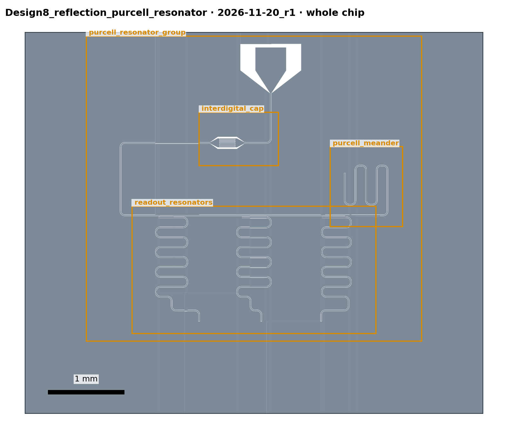
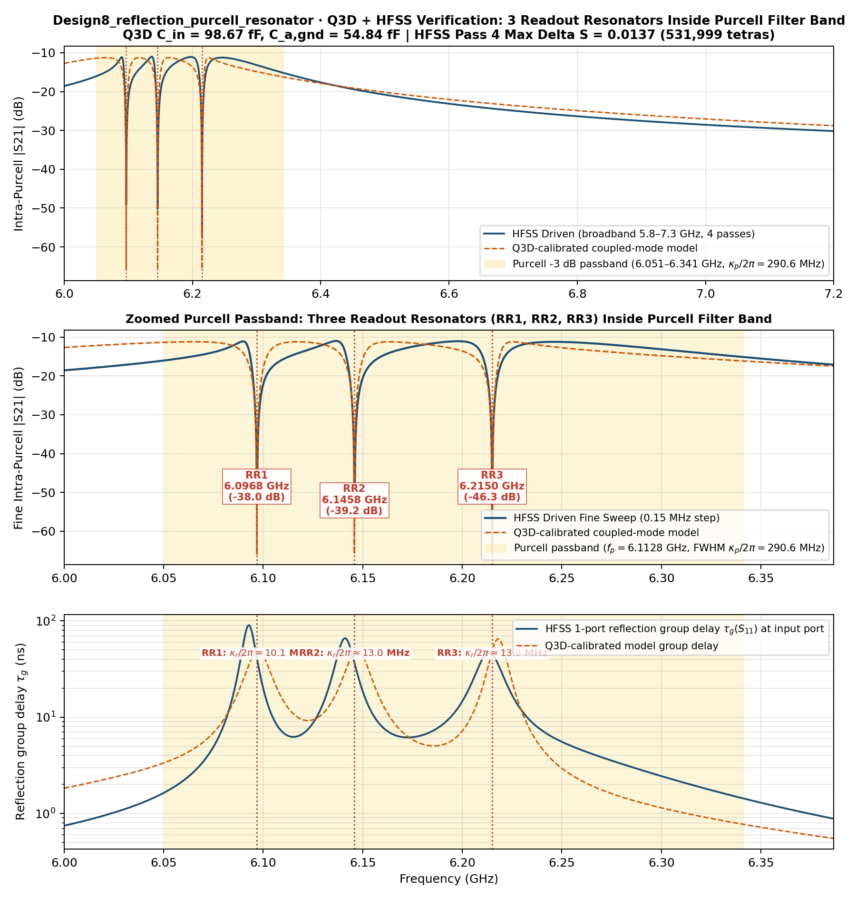

# Design8_reflection_purcell_resonator: single-port reflection $\lambda/2$ Purcell filter + 3 $\lambda/4$ readout resonators

**Figures:** [fig/](fig/README.md) holds the whole chip ([`chip.png`](fig/chip.png)) and part close-ups, rendered from the current GDS by `code/general/plot_design_figs.py`.



## 1. Design purpose and current status

Single-port reflection readout module on a $6.0 \times 5.0\text{ mm}$ silicon chip ($10/6\text{ }\mu\text{m}$ CPW, $55\text{ }\mu\text{m}$ fillets):
1. **Top wire-bond launch pad (`LP_IN`)** oriented downward (`270°`) at $(+0.22, +1.95)\text{ mm}$, routed via an elbow CPW (`feed_in`) into the right pin (`b`) of the input coupling capacitor.
2. **Hexagon-tapered interdigital capacitor (`IDC_in`)** ([`layout/components/interdigital_cap.py`](layout/components/interdigital_cap.py)) with $N=10$ interleaved fingers ($6\text{ }\mu\text{m}$ finger width and gap, $200\text{ }\mu\text{m}$ overlap, $20\text{ }\mu\text{m}$ bus bars, $100\text{ }\mu\text{m}$ hexagonal linear taper, $24\text{ }\mu\text{m}$ conformal ground pocket).
3. **Open-ended $\lambda/2$ reflection Purcell filter (`PF1`):** leaves `IDC_in` pin `a` toward $-x$, drops vertically at $x = -1.75\text{ mm}$ to the horizontal coupling bus at $y = +0.10\text{ mm}$, runs across to $x = +1.75\text{ mm}$, and folds upward into a 5-column vertical serpentine on the right side terminating in `PF1_open` (`OpenToGround`).
4. **Three downward-meandering $\lambda/4$ readout resonators (`RR1`, `RR2`, `RR3`):** each starts with a $380\text{ }\mu\text{m}$ horizontal coupling section (`ShortToGround` at the left tip, $6\text{ }\mu\text{m}$ ground strip below the Purcell bus), meanders downward through 8 horizontal bars ($130\text{ }\mu\text{m}$ pitch), and exits at the bottom via an inward dogleg tail terminating in `RRi_open` (`OpenToGround`, resonator-only layout without qubits).

- **Status:** `validated_em`, geometry revision `2026-11-20_r1` ([`design.json`](design.json)).
- **EM validation:** Q3D capacitance extraction (`8 passes`) and HFSS Driven verification (`10 µm` explicit length mesh, `Max Mag. Delta S = 0.0137 <= 0.02` solver convergence target reached at Pass 3 with `531,999` tetrahedra) confirm all three $\lambda/4$ readout resonators sit squarely inside the reflection $\lambda/2$ Purcell filter passband.

## 2. Layout and artifacts

- **Custom component:** [`layout/components/interdigital_cap.py`](layout/components/interdigital_cap.py) (`InterdigitalCap`, `alley_cap_fF`, `overlap_for_cap_fF`)
- **Layout builder:** [`layout/build.py`](layout/build.py)
- **Simulation companion GDS (no cheese):** `gds/Design8_reflection_purcell_resonator_2026-11-20_r1_sim.gds`
- **Standard layout figures:** [`fig/README.md`](fig/README.md)
  - Whole chip: [`fig/chip.png`](fig/chip.png)
  - Active Purcell + 3-resonator region: [`fig/purcell_resonator_group.png`](fig/purcell_resonator_group.png)
  - Hexagon-tapered interdigital capacitor: [`fig/interdigital_cap.png`](fig/interdigital_cap.png)
  - Purcell right-side vertical meander: [`fig/purcell_meander.png`](fig/purcell_meander.png)
  - Three coupled $\lambda/4$ readout resonators: [`fig/readout_resonators.png`](fig/readout_resonators.png)
- **Q3D + HFSS spectrum figure (3 readout resonators inside Purcell band):** [`notes/fig/purcell_band_resonators.png`](notes/fig/purcell_band_resonators.png)

## 3. Parameter summary and EM simulation results

### 3.1 Q3D capacitance extraction ([`20261120_231033_q3d_purcell_idc_3b7c138a`](results/resonator/20261120_231033_q3d_purcell_idc_3b7c138a/summary.json), 8 passes)

| Coupon | Quantity | Q3D value | Analytic / Model comparison | Unit | Notes |
|---|---|---:|---:|---|---|
| `IDC_in` ($N=10$, $200\text{ }\mu\text{m}$ overlap) | Series coupling $C_{\text{in}}$ | **98.67** | 105.17 (Alley, ratio 0.938) | $\text{fF}$ | 8 passes, last-pass $\Delta C = 0.96\%$ |
| `IDC_in` | Comb + hexagonal taper ground $C_{a,\text{gnd}}$ (raw / de-embedded) | **62.19 / 54.84** | — | $\text{fF}$ | De-embedded of $45\text{ }\mu\text{m}$ CPW lead ($7.35\text{ fF}$) |
| `IDC_in` | Comb + hexagonal taper ground $C_{b,\text{gnd}}$ (raw / de-embedded) | **62.19 / 54.83** | — | $\text{fF}$ | Symmetric left/right combs |
| `IDC_in` + $50\text{ }\Omega$ port | Bare single-mode Purcell linewidth $\kappa_p / 2\pi$ | **164.8 – 178.6** | $Q_p \approx 37.2$ | $\text{MHz}$ | $\pi$-network input admittance at pin `a` |
| Coupled CPW section ($380\text{ }\mu\text{m}$, $6\text{ }\mu\text{m}$ ground strip) | Mutual capacitance $C_m$ ($c'_m$) | **4.92** (**12.94**) | $k_c = 0.0785$ | $\text{fF}$ ($\text{fF/mm}$) | 8 passes, last-pass $\Delta C = 1.57\%$ |
| Coupled CPW section | Self capacitances $C_{\text{bus,11}}, C_{\text{res,22}}$ | **62.47, 62.82** | $J / 2\pi \approx 30.95\text{ MHz}$ | $\text{fF}$ | Distributed $\lambda/2 \leftrightarrow \lambda/4$ coupling |

### 3.2 Drawn lengths and HFSS Driven results ([`20261121_074625_hfss_driven_purcell_triad_86722d13`](results/resonator/20261121_074625_hfss_driven_purcell_triad_86722d13/run.json) / [`20261121_102707_s21_purcell_band_analysis_a7a5a467`](results/resonator/20261121_102707_s21_purcell_band_analysis_a7a5a467/summary.json))

- **Mesh & convergence:** Explicit `10 µm` length mesh on all 7 signal metal objects + 27 geometry-verified PEC ground wirebonds (`6` wide dual-CPW straps of span $76\text{ }\mu\text{m}$ across the parallel coupling sections + `21` single-CPW straps of span $46\text{ }\mu\text{m}$ on clear straight segments, every foot verified $\ge 8\text{ }\mu\text{m}$ clear of signal metal). Solver converged at Pass 3 (`531,999` tetrahedra) with `Max Mag. Delta S = 0.013716 <= 0.02`.

| Element | Drawn filleted length (mm) | Meander dimension ($\mu\text{m}$) | HFSS resonance / dip frequency (GHz) | Intra-Purcell notch depth (dB) | 1-Port reflection group delay peak $\tau_g$ (ns) | Purcell-filtered linewidth $\kappa_r / 2\pi$ (MHz) | Position relative to Purcell passband ($6.051\text{–}6.341\text{ GHz}$) |
|---|---:|---:|---:|---:|---:|---:|---|
| `PF1` ($\lambda/2$ open Purcell filter) | $8.4809$ | $H = 512.3$ | **6.1128** (passband $6.0506\text{–}6.3412$) | — (passband peak) | $\sim 6\text{–}10$ (pedestal) | $\kappa_p / 2\pi \approx 178.6\text{ MHz}$ (bare) / $290.6\text{ MHz}$ (3-mode hybridized FWHM) | Passband envelope |
| `RR1` ($\lambda/4$ readout resonator 1) | $4.7292$ | $W = 410.4$ | **6.0968** | **−38.05** | **62.89** | **10.12** | **Inside passband** |
| `RR2` ($\lambda/4$ readout resonator 2) | $4.6936$ | $W = 441.0$ | **6.1458** | **−39.16** | **48.91** | **13.02** | **Inside passband (center)** |
| `RR3` ($\lambda/4$ readout resonator 3) | $4.6586$ | $W = 379.6$ | **6.2150** | **−46.27** | **47.04** | **13.53** | **Inside passband** |



[Geometry inputs](parameters/geometry.json) · [Quantum inputs](parameters/quantum.json) · [Solver settings](parameters/solver.json) · [Provenance](parameters/provenance.json)

## 4. Reproduction entry points

From the repository root in the `qmetal` environment (`C:\Users\QEL\miniforge-pypy3\envs\qmetal\python.exe`):

```powershell
python -X utf8 -B Design8_reflection_purcell_resonator/layout/build.py
python -X utf8 -B code/general/plot_design_figs.py Design8_reflection_purcell_resonator
python -X utf8 -I -B Design8_reflection_purcell_resonator/simulation/resonator/q3d_purcell_idc.py
python -X utf8 -I -B Design8_reflection_purcell_resonator/simulation/resonator/hfss_purcell_triad.py --q3d Design8_reflection_purcell_resonator/results/resonator/20261120_231033_q3d_purcell_idc_3b7c138a
```
