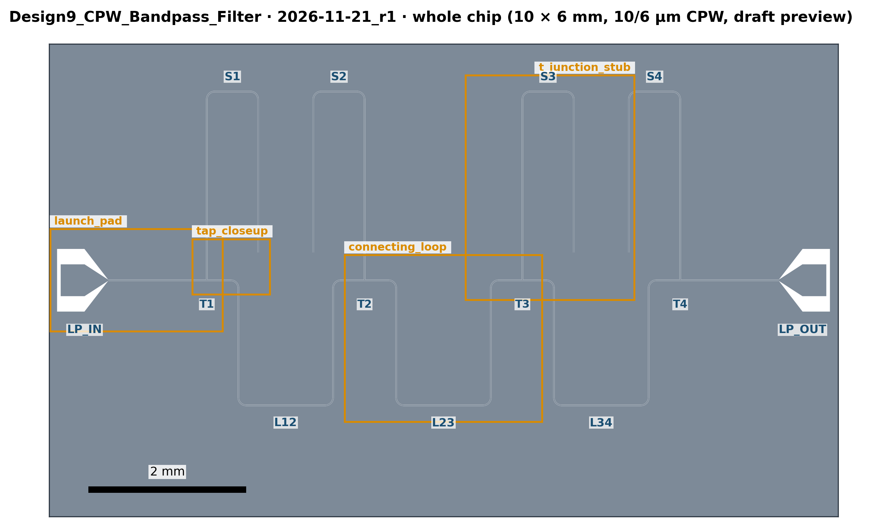
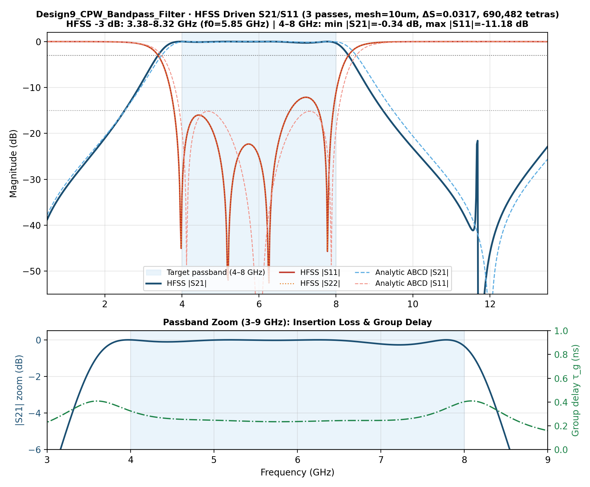

# Design9_CPW_Bandpass_Filter: 4–8 GHz 4-Stub Quarter-Wave CPW Bandpass Filter

**Figures:** [fig/](fig/README.md) holds the whole chip ([`chip.png`](fig/chip.png)) and part close-ups, rendered from the current GDS by `code/general/plot_design_figs.py`.



## 1. Design purpose and current status

Simple, single-layer planar **4–8 GHz wideband CPW bandpass filter** ($f_0 = 6.0\text{ GHz}$, $\text{FBW} = 66.7\%$) built with **uniform $10/6\text{ }\mu\text{m}$ CPW** ($W = 10\text{ }\mu\text{m}$, $S = 6\text{ }\mu\text{m}$, $R = 99\text{ }\mu\text{m}$ fillets) on a **$10.0 \times 6.0\text{ mm}$** silicon chip:

1. **Topology:** 4-stub quarter-wave short-circuited shunt-stub bandpass filter (`T1`–`T4` `TapJunction` nodes along $y = 0\text{ mm}$ at $x = -3, -1, +1, +3\text{ mm}$), connected by 3 identical $\lambda/4$ CPW connecting sections (`L12`, `L23`, `L34`) and 4 identical $\lambda/4$ short-circuited shunt stubs (`S1`–`S4`).
2. **Why this topology:** At 1-octave fractional bandwidth ($4\text{–}8\text{ GHz}$, $\text{FBW} = 66.7\%$), an optimum distributed 4-stub shunt-stub filter requires stub and connecting-line impedances all near $50\text{ }\Omega$. Every trace and stub therefore stays strictly **$10/6\text{ }\mu\text{m}$ CPW** — no interdigital capacitors, no sub-4 µm coupling gaps, no impedance tapers (except the two standard wire-bond launch pads), and no vias (shorts terminate directly into the coplanar ground plane via `ShortToGround`).
3. **Layout geometry:**
   - **Ports:** Two standard inline `BondPad`s (`LP_IN` at $x = -4.5\text{ mm}$, `LP_OUT` at $x = +4.5\text{ mm}$, $y = 0\text{ mm}$), connected via straight $1.12\text{ mm}$ feeds (`feed_in`, `feed_out`).
   - **Stubs (`S1`–`S4`):** Branch upward ($+y$) from `T1`–`T4`, each making one left-right mirror-symmetric U-fold ($650\text{ }\mu\text{m}$ pitch, top at $y = +2.396\text{ mm}$) and terminating in `ShortToGround` at $y = +0.350\text{ mm}$ (total node-to-short filleted length $= 5.0067\text{ mm}$).
   - **Connecting sections (`L12`, `L23`, `L34`):** Loop downward ($-y$) in single wide U-loops ($1.20\text{ mm}$ width, bottom at $y = -1.588\text{ mm}$; total node-to-node filleted length $= 5.0067\text{ mm}$).

- **Status:** `validated_em` (Stage 2 HFSS Driven $S_{21}/S_{11}$ complete on geometry revision `2026-11-21_r1`; [`design.json`](design.json)).
- **GDS status:** **No GDS file generated yet** (per user instruction, awaiting final confirmation).

## 2. Layout and artifacts

- **Layout builder:** [`layout/build.py`](layout/build.py)
- **HFSS Driven script:** [`simulation/resonator/hfss_s21.py`](simulation/resonator/hfss_s21.py)
- **Layout figures (rendered directly from QGeometry, no GDS):** [`fig/README.md`](fig/README.md)
  - Whole chip: [`fig/chip.png`](fig/chip.png)
  - Input launch pad + `feed_in` + `T1`: [`fig/launch_pad.png`](fig/launch_pad.png)
  - TapJunction `T3` + folded $\lambda/4$ stub `S3`: [`fig/t_junction_stub.png`](fig/t_junction_stub.png)
  - Connecting $\lambda/4$ U-loop `L23`: [`fig/connecting_loop.png`](fig/connecting_loop.png)
  - `T1` & `S1_short` close-up: [`fig/tap_closeup.png`](fig/tap_closeup.png)
- **HFSS Driven $S_{21}/S_{11}$ plot:** [`notes/fig/hfss_s21.png`](notes/fig/hfss_s21.png)
- **Pre-EM analytic ABCD reference plot:** [`notes/fig/analytic_s_params.png`](notes/fig/analytic_s_params.png)

## 3. Parameter summary and HFSS Driven results

Adopted HFSS run: [`20261121_105143_hfss_driven_s21_49164b56`](results/resonator/20261121_105143_hfss_driven_s21_49164b56/summary.json) (geometry revision `2026-11-21_r1`, AEDT 2021.2.0, `silicon_eps11p45`, `feed_in.start` / `feed_out.end` $50\text{ }\Omega$ lumped ports, 62 geometry-verified PEC ground wirebonds, explicit `10 µm` mesh on all 13 signal metal objects).

| Parameter | Target / Input | Analytic ABCD (pre-EM) | HFSS Driven (`2026-11-21_r1`) | Unit | Role / status |
|---|---|---|---|---|---|
| Passband center $f_0$ ($-3\text{ dB}$ midpoint) | $6.00$ | $6.00$ | **$5.85$** ($-2.5\%$) | $\text{GHz}$ | target / HFSS result |
| $-3\text{ dB}$ passband | $4.0\text{–}8.0$ inside | $3.48\text{–}8.52$ | **$3.38\text{–}8.32$** ($\text{BW} = 4.94$) | $\text{GHz}$ | HFSS result |
| $-1\text{ dB}$ passband | $4.0\text{–}8.0$ inside | $3.71\text{–}8.29$ | **$3.60\text{–}8.12$** | $\text{GHz}$ | HFSS result |
| In-band min $|S_{21}|$ ($4.0\text{–}8.0\text{ GHz}$) | $\ge -0.5$ | $-0.13$ | **$-0.345$** (`@4G: 0.00`, `@6G: -0.01`, `@8G: -0.34`) | $\text{dB}$ | HFSS result |
| In-band max $|S_{11}|$ / $|S_{22}|$ ($4.0\text{–}8.0\text{ GHz}$) | $\le -12$ | $-15.18$ | **$-11.18$ / $-11.18$** (symmetric; $\le -12.1$ up to $7.95\text{ GHz}$) | $\text{dB}$ | HFSS result |
| Stopband $|S_{21}|$ ($2, 3, 9, 10\text{ GHz}$) | — | $-20.6, -9.0, -9.0, -20.6$ | **$-21.0, -8.3, -12.3, -23.2$** | $\text{dB}$ | HFSS result |
| Upper transmission zero ($2 f_0$) | $\approx 12.0$ | $12.00$ | **$11.72\text{ GHz}$ (`-114.4 dB`)** | $\text{GHz}$ | HFSS result |
| Effective phase velocity $v_{\text{ph,eff}}$ | $1.2016 \times 10^8$ (baseline) | $1.2016 \times 10^8$ | **$1.1716 \times 10^8$** (calibrated from $f_0$) | $\text{m/s}$ | derived from HFSS |
| Adaptive convergence (Pass 3 / 3) | target $\Delta S \le 0.02$ | — | **$\Delta S = 0.0317$**, `690,482` tets | — | broadband $\le 0.05$ met; user 3-pass cap |



[Geometry inputs](parameters/geometry.json) · [Quantum inputs](parameters/quantum.json) · [Solver settings](parameters/solver.json) · [Provenance](parameters/provenance.json)

## 4. Design-specific solver overrides and limitations

- **Solver override (user-specified):** `max_passes = 3` (instead of the repository default of `4` passes in `skill/em_simulation.md`) after applying explicit `10 µm` length-based mesh on all 13 signal metal objects. Final Pass 3 `Max Mag. Delta S = 0.031727` (`690,482` tetrahedra) met the broadband acceptance guideline ($\le 0.05$) though not the internal `0.02` stop threshold due to the 3-pass cap.
- **Ports & substrate:** Simulated with $50\text{ }\Omega$ lumped ports directly at `feed_in.start` / `feed_out.end` (excluding `LP_IN`/`LP_OUT` wire-bond launch pads) on lossless `silicon_eps11p45` ($\varepsilon_r = 11.45$, cold-Si convention in `save_aedt`) and PEC conductors.
- **Optional center-frequency recentering:** Because $f_0 = 5.85\text{ GHz}$ ($-2.5\%$ below $6.00\text{ GHz}$), scaling the $\lambda/4$ stub and connecting-line lengths by $5.85 / 6.00 = 0.975$ (from $5.0067\text{ mm}$ to $4.8815\text{ mm}$) would center the passband directly on $6.00\text{ GHz}$ and improve $|S_{11}|$ near $8.0\text{ GHz}$.

## 5. Reproduction entry points

From the repository root in the `qmetal` environment (`C:\Users\QEL\miniforge-pypy3\envs\qmetal\python.exe`):

```powershell
# Stage 1: build layout, run DRC checks, and render layout figures (NO GDS written)
python -X utf8 -B Design9_CPW_Bandpass_Filter/layout/build.py

# Stage 2: run HFSS Driven S21/S11 (3 passes, 10 um explicit mesh, 0.5-13.5 GHz)
python -X utf8 -I -B Design9_CPW_Bandpass_Filter/simulation/resonator/hfss_s21.py
```
