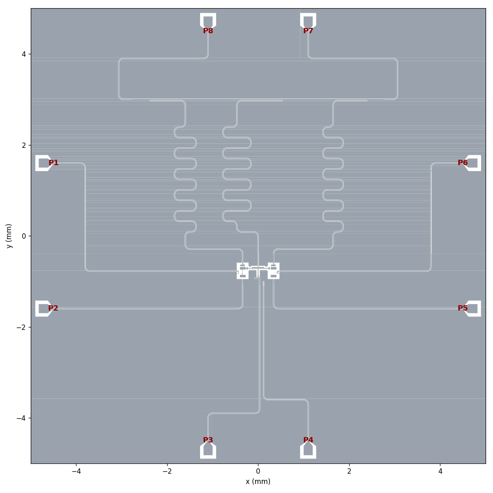

# Metal-agnet: one FTF set (fluxonium – tunable transmon coupler – fluxonium)

A Qiskit Metal layout of two fluxoniums coupled through a grounded tunable-transmon
coupler, on a 10 × 10 mm chip. It includes readout resonators, charge and flux lines,
and launch pads at fixed PCB port positions. Ec, couplings, readout g and κ are
tuned with Ansys Q3D, and the resonator frequencies are checked with HFSS eigenmode.



## Repository layout

| folder | contents |
|---|---|
| `pattern design/` | Components and the chip layout. `ftf_layout.py` (build, GDS export, plots), `my_fluxonium.py`, `fluxonium_forprocess.py` (simulation version: JJ + array → one lumped inductor), `my_tmon.py` (grounded tunable coupler), `pcbport.py` (PCB port positions) |
| `simulation/` | Ansys Q3D / HFSS scripts. Main ones: `q3d_ftf.py` (Ec / J / g / charge lines), `q3d_kappa.py` (κ), `q3d_tee.py` (tee coupling), `hfss_eigen_res.py` (f_r). Sweeps are in `tuning/`. Runs: `results/final/` (behind the quoted numbers), `results/history/<stage>/`, new runs in `results/runs/`. See **`simulation/README.md`** |
| `note/` | `design_parameters.txt` (all final numbers), `capacitance_method.md` (method + full tuning log), `cap_matrix.py` (matrix → Ec / J / g / κ / charge-line code), `gds_export_settings.md` (fab / cheesing GDS settings) |
| `gds/` | `ftf_layout_fab.gds` (fabrication, cheesed ground), `ftf_layout.gds` (no cheesing), `ftf_layout_forprocess.gds` (simulation geometry) |
| `fig/` | Layout plots made from the exported GDS |
| `skill/` | Design and coding rules for this workflow (Qiskit Metal components, Q3D/LOM, physical design guidelines) |
| `Agend.md` | Entry point and agenda for design sessions: status, workflow, open items |

## Final design (v4)

From `note/design_parameters.txt`:

| | value | target |
|---|---|---|
| Ec FX1 / FX2 | 1.308 / 1.313 GHz | 1.3 GHz |
| Ec coupler | 0.202 GHz | 0.2 GHz |
| J f–t (FX1–TC / FX2–TC) | 137.6 / 139.3 MHz | – |
| J f–f (FX1–FX2, direct) | 12.2 MHz | – |
| g f–r (per n) | 150.1 / 148.9 MHz | 150 MHz |
| g t–r (transmon convention, EJ/Ec = 50) | 148.6 MHz | 150 MHz |
| resonators f_r | 6.3 / 6.0 / 6.5 GHz (FX1 / TC / FX2; HFSS ±10 MHz) | 6.3 / 6.0 / 6.5 GHz |
| κ/2π | 2.08 / 3.05 / 2.08 MHz | 2 / 3 / 2 MHz |
| FX charge line | 0.45 fF, T1 limit ~2 ms | – |

Port use: P7 / P8 readout feedline, P1 / P6 FX flux, P2 / P5 FX charge, P3 TC flux,
P4 TC charge.

The exported GDS leaves every junction site empty. The fluxonium JJ, its 50 µm
junction array and the coupler's SQUID junctions are added separately.

## Running

Environment: the `qmetal` conda env (quantum-metal 0.7.4, PySide6, pyEPR, gdspy),
Ansys Electronics Desktop 2021 R2 for Q3D / HFSS.

```
cd "pattern design"
python ftf_layout.py                 # build the chip, write gds/*.gds and fig/*.png

cd ../simulation
python q3d_ftf.py                    # Q3D: Ec, J, g (start AEDT first)
python q3d_kappa.py                  # Q3D of feedline + resonators: kappa
python hfss_eigen_res.py             # HFSS eigenmode: resonator frequencies (~10 min each)
```

In Python: `from ftf_layout import build_design; design = build_design()`. Use
`build_design(for_process=True)` for the simulation geometry, and
`export_gds(design, file, fab=True)` for the cheesed fabrication GDS.

Placing junction cells (`export_gds(..., include_junctions=True)`) needs the lab's
junction GDS library at `JJ_LIBRARY`. It is not part of this repo.
