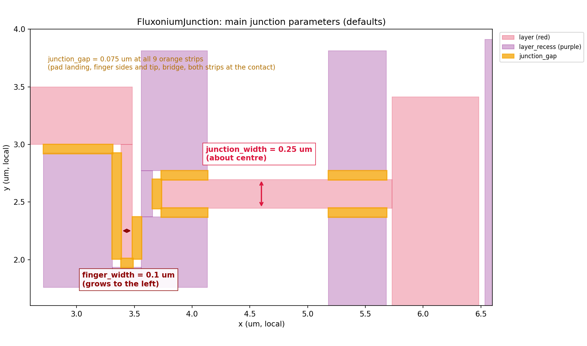

# Fluxonium junction mask component

> **Archived 2026-11-20, not recommended.** Superseded by the NCKU-style `FluxoniumJunction` in [ebeam_junction](../ebeam_junction/README.md). The module is kept byte-unchanged (renamed to `fluxonium_junction_layout3.py`) so the Design3 r11 and DesignTestJunction r3 scripts still run; old option names (`junction_gap`, `junction_width`, `finger_width`, mirrored SQUID) apply only here.

`FluxoniumJunction` in [fluxonium_junction_layout3.py](fluxonium_junction_layout3.py) is a
standalone QComponent for the multilayer junction/array drawing requested on
2026-11-18. It does not modify any existing chip assembly or adopted result.
This is a draft geometry candidate; full parameter and fabrication confirmation
are pending. No HFSS, Q3D, quantum-model or fabrication validation has been run.

## Source and intentional changes

The geometry is based on the left fluxonium in `layout3 ftf.gds`.
Source mask coordinates are included directly in the Python component.

The source has 43 rectangular cells per arm, at approximately 1.2 um pitch,
with 2 um transverse width. Their longitudinal widths range from 0.998 to
1.000 um. The new component deliberately uses one fixed 0.998 um width for
every cell, matching the user's marked example. This uniformization is not an
exact reproduction of the source's nanometre variations. The source's main
junction has unequal clearances (including about 0.050, 0.074, 0.075 and
0.076 um). All nine red/purple clearances of the main junction (top landing,
both finger sides and tip, three sides of the bridge, both strips beside the
bar at the right contact) are instead controlled by one `junction_gap`; its 0.075 um default is a proposed
input based on the source, not a separately confirmed fabrication rule.
The red main-junction polygons are retained exactly at the default
`junction_width` and `finger_width`; the adjacent purple polygons are adjusted.



The figure (default options) marks all nine `junction_gap` clearances in
orange. It is regenerated by
[plot_junction_parameters.py](../../code/general/plot_junction_parameters.py).

`junction_width` (default 0.25 um, the source value) sets the y width of the
right-hand horizontal red junction bar, resized symmetrically about its source
centre line y = 2.571 um; its x extent (3.732-5.73 um) is fixed. The bridge
recesses and the two recess strips beside the bar near the right contact
follow its edges with `junction_gap`.
This width enters the junction overlap area, but the actual area depends on the
evaporation process, which is not modelled here. Its default is a proposed
input from the source, not a confirmed fabrication target.

`finger_width` (default 0.1 um, the source value) sets the x width of the
vertical red junction finger. Its right edge stays flush with the end of the
top red bar at x = 3.484 um and its y extent (2.009-3.0 um) is fixed, so the
finger grows leftwards and the 0.248 um span to the junction bar is unchanged.
Recesses 0 and 1 keep `junction_gap` to its left side and below its tip. The geometric limit is
about 0.696 um at the default gap (recess 0 vanishes); this is not a process
rule. Like `junction_width`, it enters the overlap area only through the
unmodelled evaporation process.

All rebuilt boxes are checked for strictly positive size, so an infeasible
`junction_gap`/`junction_width`/`finger_width` raises `ValueError` rather
than silently producing inverted shapes (the former `junction_gap < 0.25 um`
check allowed
gaps above ~0.124 um that inverted the recess between finger and bar).
Geometric feasibility is not a process rule. Original layers 1, 2, 3, 4 are
preserved by default.

Option names were changed on 2026-11-18: `num_cells`, `cell_length`,
`cell_width` and `cell_gap` are now `num_array`, `array_length`,
`array_width` and `array_gap`; array polygons
are named `top_array_NNNN`/`bottom_array_NNNN`. Earlier export records in
test_array keep the old names.

Both e-beam junction components (`FluxoniumJunction`, `TransmonJunction`)
live in `pattern design/ebeam_junction/` since 2026-11-19 (moved from
`pattern design/fluxonium/` and `pattern design/transmon/`). On the same
date the finger-tip clearance (and, for FluxoniumJunction, the two contact
strips) changed from a fixed 0.075 um to `junction_gap`; default geometry is
unchanged because the source value there is 0.075 um.

## Usage

Add this directory to `sys.path` in the consuming layout script, then:

```python
from qiskit_metal import designs
from fluxonium_junction import FluxoniumJunction

design = designs.DesignPlanar()
device = FluxoniumJunction(design, 'FJ', options=dict(
    num_array=43,             # PER ARM: 86 rectangles total
    array_length='0.998um',   # along the array, x
    array_width='2um',        # transverse, y
    array_gap='0.202um',      # pitch = array_length + array_gap
    junction_gap='0.075um',   # shared clearances indicated by the user
    junction_width='0.25um',  # y width of the right-hand junction bar
    finger_width='0.1um',         # vertical junction finger x width
    pos_x='0um', pos_y='0um', orientation=0,
))
```

For quantity changes, edit only `num_array`. Cells are never stretched to fit
a fixed total length. The right contacts and main junction stay fixed; the
left return moves by the change in array length. Array bar lengths change to
cover the cells; the bar transverse excess remains 0.05 um on each side.
The return retains a 0.202 um clearance from the last cell. The origin is the
source device's contact center, not the changing overall bounding-box center.
Pins `top` and `bottom` are at local (0, +/-16) um and face outwards.

`contact_extension` (default `0um`, nonnegative) extends both contacts and
their four flanking recess strips outwards. Pins move to
`(0, +/-(16 + contact_extension))` um. The array and main junction stay fixed.
`mirror` (default `False`) reflects local x before rotation and translation:
the array runs towards +x while the main junction stays on the top arm.
This also reverses the bridge direction along x; the evaporation direction
must be checked for each placement. Neither option changes the defaults.

Optional layer mapping: `layer`, `layer_recess`, `layer_array`,
`layer_array_bar`. These are original mask drawing layers; their overlap must
not be interpreted as galvanic connection without process information. The
component adds positive polygons without a ground plane or etched pocket.
It contains no lumped-junction sheets, inductance, EJ or EL model. Do not use
it as a replacement for `FluxoniumArrayJJ` in an HFSS calculation.
`num_array` counts drawn cells, not an independently established number of
electrical junctions. `jj_metal=False` omits the entire junction component,
consistent with the repository's default junction-free chip masks. Keeping
this junction drawing in a fabrication export requires an explicit Design
choice, plus validation of the process and layer mapping.

## Tapered hook contacts (in development, 2026-11-19)

`hook_contact=True` replaces the straight end contacts by tapered contacts
that fill the Dolan hooks of the base metal (default `False` keeps the source
geometry). Each contact keeps the source 1.002 um contact as a neck from the
arm to |y| = 5 + `neck_length` (1um), tapers to `hook_width + 2*hook_margin`
(2 + 2*1 = 4 um) at `taper_inset` (1um) inside the hook mouth at |y| =
`hook_mouth` (15um), and ends `hook_overlap` (1um) past the hook bottom
(`hook_depth` 4um), i.e. at |y| = 20 um, where the pins sit (width 4 um).
Recess strips 5-8 (0.504 um, `layer_recess`) follow the new outline from the
source start points (y = 3.6 um right, 5.1 um left). `layer_contact`
(`''` = `layer_array`) can put the contacts on their own layer.
`contact_extension` is ignored in this mode. The hook geometry defaults are
the Design3 r11 FX hooks (stem end 15 um, 2 um x 4 um hooks); they are draft
inputs, not validated fabrication rules. No checker covers this mode yet.

Aliases `fluxonium_junction` and `fluxonium_juncion` are also available.
