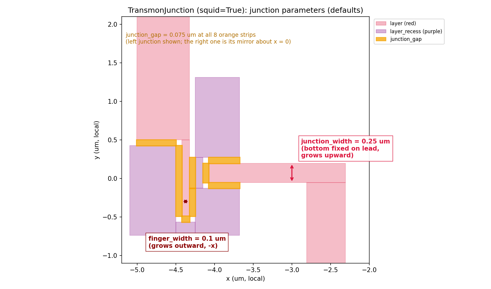

# Transmon junction mask component

> **Archived 2026-11-20, not recommended.** Superseded by the NCKU-style `TransmonJunction` in [ebeam_junction](../ebeam_junction/README.md). The module is kept byte-unchanged (renamed to `transmon_junction_layout3.py`) so the Design3 r11 and DesignTestJunction r3 scripts still run; old option names (`junction_gap`, `junction_width`, `finger_width`, mirrored SQUID) apply only here.

`TransmonJunction` in [transmon_junction_layout3.py](transmon_junction_layout3.py) is a
standalone QComponent for the transmon Dolan-bridge junction drawing, built
the same way as
[FluxoniumJunction](fluxonium_junction_layout3.md) and using the same
option names. It was requested on 2026-11-18. It is a draft geometry candidate
and does not modify any chip assembly or adopted result. No HFSS, Q3D,
quantum-model or fabrication validation has been run.

## Source

The geometry is based on the symmetric transmon SQUID in `layout3 ftf.gds`.
Source mask coordinates are included directly in the Python component.

## Parameters



The figure (default options, left junction) marks every `junction_gap`
clearance in orange. It is
regenerated by
[plot_junction_parameters.py](../../code/general/plot_junction_parameters.py).

| Option | Default | Meaning |
| --- | --- | --- |
| `junction_gap` | 0.075um | Shared recess clearance: pad landing, both finger sides and tip, and the three sides of the bridge between finger and bar (8 per junction). |
| `junction_width` | 0.25um | y width of the horizontal junction bar. The bottom edge (y = -0.054 um) stays on top of the lower lead, so the bar grows upwards and stays joined to the lead. |
| `finger_width` | 0.1um | Vertical junction finger x width. The inner edge stays flush with the top pad edge (x = -4.325 um), so the finger grows outwards (away from x = 0). |
| `squid` | True | True draws the mirrored pair as in the source; False draws only the left junction. |
| `contact_extension` | 0um | Nonnegative extension of the top pad upwards and the lower lead downwards. Pins move with the outer ends; junction body and recesses stay fixed. |
| `layer`, `layer_recess` | 1, 2 | Source mask layers (red, purple). |
| `jj_metal` | True | False omits the component, matching junction-free chip masks. |

Differences from FluxoniumJunction: `junction_width` grows from a fixed bottom
edge (the fluxonium bar is joined at its end and resizes about its centre),
and the lower lead and pad stay fixed. Both SQUID junctions share the same widths;
an asymmetric SQUID would need separate options.

Default deviations from the source: red polygons are identical. Purple
recesses are within 2 nm of the source, except the pad landing recess: the
source clearance there is 0.050 um, which `junction_gap` sets to 0.075 um,
the same uniformization as FluxoniumJunction. These defaults are proposed
inputs from the source, not confirmed fabrication targets. The actual junction
area depends on the evaporation process, which is not modelled.

Infeasible `junction_gap`/`junction_width`/`finger_width` combinations raise
`ValueError`. Approximate geometric limits at the default gap: `finger_width`
< 0.69 um and `junction_width` < 1.29 um. These are not process rules.

Both e-beam junction components (`FluxoniumJunction`, `TransmonJunction`)
live in `pattern design/ebeam_junction/` since 2026-11-19 (moved from
`pattern design/fluxonium/` and `pattern design/transmon/`). On the same
date the finger-tip clearance (and, for FluxoniumJunction, the two contact
strips) changed from a fixed 0.075 um to `junction_gap`; default geometry is
unchanged because the source value there is 0.075 um.

## Tapered hook contacts (in development, 2026-11-19)

`hook_contact=True` replaces the straight pad and lead ends by tapered
contacts that fill the two Dolan hooks (default `False` keeps the source
geometry):

| Option | Default | Meaning |
| --- | --- | --- |
| `hook_gap` | 5um | y distance between the two hook mouths (metal edges), centred on y = -0.0915 um. |
| `hook_width`, `hook_depth` | 2um, 4um | Hook notch size in the base metal. |
| `hook_offset` | 2um | x offset of the bottom hook from the top hook; the top hook is centred on the pad (x = -4.6665 um). |
| `hook_margin` | 1um | Contact extends this far past each hook wall (contact width 4 um). |
| `hook_overlap` | 1um | Contact ends this far past the hook bottom. |
| `taper_inset` | 1um | Full contact width is reached this far inside the hook mouth, so the taper hugs the hook. |
| `neck_length` | 0.9um | Straight neck kept next to the junction (pad from y = 0.5 um, lead from y = -0.054 um); keeps the taper clear of the recesses. |
| `tip_width` | 0.5um | Neck width; narrows the 0.683 um pad (finger-side edge fixed). The 0.501 um lead is left as is unless `tip_width` is below it. |
| `layer_contact` | '' | '' = `layer`; otherwise the tapered part goes on its own layer and the neck stays on `layer`. |

`contact_extension` is ignored in this mode; pins move to the contact ends
(width 4 um). The hook defaults follow the Design3 r11 TC hooks (5 um mouth
gap, bottom hook +2 um in x). The bottom contact is centred on its hook, so it
is skewed by 0.108 um relative to the lead. Draft inputs only; no checker or
fabrication validation covers this mode yet.

## Usage

```python
from qiskit_metal import designs
from transmon_junction import TransmonJunction   # add this directory to sys.path

design = designs.DesignPlanar()
tj = TransmonJunction(design, 'TJ', options=dict(
    junction_gap='0.075um', junction_width='0.25um', finger_width='0.1um',
    squid=True, pos_x='0um', pos_y='0um', orientation=0,
))
```

The origin is the SQUID centre. Pins `top_L`/`top_R` are at the pad ends
(x = -/+4.6665 um, y = 3.0 um, width 0.683 um, facing +y) and
`bottom_L`/`bottom_R` at the lead ends (x = -/+2.5585 um, y = -3.183 um,
width 0.501 um, facing -y); `squid=False` has only the `_L` pins. The pins are
geometric connection points; how they join a transmon pad is unvalidated. The
component contains no lumped junction, inductance or EJ model.

With `contact_extension=e` um, the local top and bottom pin y coordinates
are `3.0 + e` and `-3.183 - e` um, respectively. Rotation and translation
are applied afterwards. Chip placement and evaporation alignment require
separate process validation.
