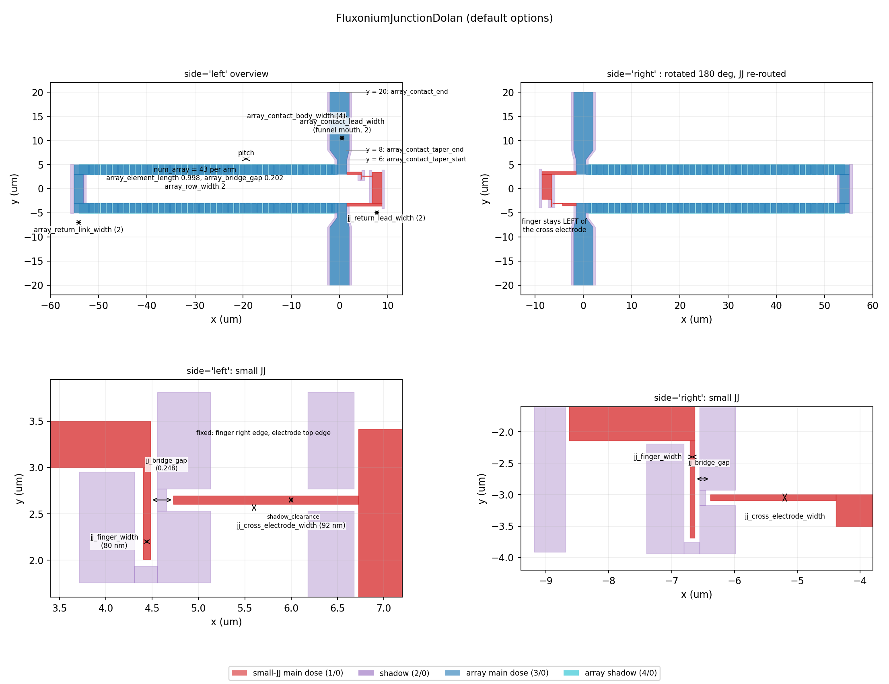

# FluxoniumJunctionDolan

[`fluxonium_junction_dolan.py`](fluxonium_junction_dolan.py) draws the fluxonium e-beam mask: the small Dolan JJ, the JJ array and the
funnel contacts. The rules, the EJ → area → width model and the workflow are in
[skill/ebeam_junction.md](../../skill/ebeam_junction.md). The previous layout3 version is
`archive/fluxonium_junction_layout3.py`.



Generate the figure with
[`plot_ebeam_junction_parameters.py`](../../code/general/plot_ebeam_junction_parameters.py).

## Options

Units are µm unless noted.

| Option | Default | Meaning |
|---|---|---|
| `num_array` | 43 | Cells per arm (86 rectangles). These are drawn cells, not an established number of electrical junctions |
| `array_element_length` | 0.998 | Cell length along x (not the pitch) |
| `array_row_width` | 2 | Cell height along y (≤ 2 for the 8 µm arm spacing) |
| `array_bridge_gap` | 0.202 | Gap between cells; also the gap from the last cell to the return block |
| `array_return_link_width` | 2 | x width of the link joining the arms; its array-side edge is fixed |
| `array_contact_lead_width` | 2 | Funnel mouth width. The array-facing edge (x = −0.501) is fixed |
| `array_contact_body_width` | 4 | Contact body, centred on x = 0: 4 for a 2 µm hook, 7.6 for a 5.6 µm rounded bay |
| `array_contact_taper_start`, `array_contact_taper_end`, `array_contact_end` | 6, 8, 20 | y of the mouth end, the start of the full body width, and the body end (pins) |
| `array_contact_shadow_width` | 0.504 | Width of the shadow strips beside the body (0.958 was used with the 7.6 µm body) |
| `jj_finger_width` | 80 nm | x width of the vertical finger. It grows to the left; the right edge is fixed |
| `jj_cross_electrode_width` | 92 nm | y width of the horizontal electrode, with the top edge fixed. **This sets the junction area** |
| `jj_bridge_gap` | 0.248 | Finger to electrode end face |
| `jj_return_lead_width` | 2 | Return lead from the electrode to the lower contact |
| `shadow_clearance` | 0.075 | Shadow openings keep this distance from the cross electrode |
| `side` | `'left'` | `'left'`: array towards −x, JJ on the upper arm. `'right'`: array towards +x, JJ on the lower arm (below) |
| `layer_jj`, `layer_jj_shadow`, `layer_array`, `layer_array_shadow` | 1, 2, 3, 4 | Small-JJ main, shadow, array main, array shadow |
| `jj_metal` | True | False draws nothing (junction-free masks) |

## Geometry

**Frame**:

- The origin is the contact centre, and the array rows are centred at y = ±4.
- Pins `top` / `bottom` sit at (0, ±`array_contact_end`) with width `array_contact_body_width`, facing outwards.
- The body should end 1 µm past the hook bottom. For a 15 µm mouth with a 4 µm hook, use `array_contact_end` = 20.

**Small JJ (`side='left'`)**:

- The JJ sits on the upper arm, to the right of the funnel mouth, and moves with the mouth's right edge.
- Parts:
  - top bar
  - finger hanging from the top bar
  - cross electrode joining the return lead
  - bottom bar back to the lower contact
- The small-JJ main dose touches the array main dose only at the mouth edge.

**Small JJ (`side='right'`)**:

- The array and contacts are rotated by 180°, and the shape names follow the new positions.
- The JJ is re-routed so the finger stays on the left:
  - The finger hangs from the return lead (finger tip −3.687, lead bottom −2.142).
  - The cross electrode joins the mouth bar directly.
- It is not a mirror image of `left`. A mirror image would reverse the evaporation direction.

**Shadows**:

- The finger-side openings keep fixed offsets from the finger's right edge. The landing opening keeps at least
  `shadow_clearance` from a wider finger.
- The electrode-side openings follow the electrode with `shadow_clearance`.
- The strips flank the contacts and the return lead.

## Usage

```python
from qiskit_metal import designs
from fluxonium_junction_dolan import FluxoniumJunctionDolan   # project_paths.configure() puts ebeam_junction on sys.path
import jj_resistance_model as jjm                  # code/qubit

design = designs.DesignPlanar()
FluxoniumJunctionDolan(design, 'FX1', options=dict(side='left', pos_x='-340um', pos_y='-800um',
                                              **jjm.size_from_ej(4.0).options()))           # 80 / 92 nm
FluxoniumJunctionDolan(design, 'FX2', options=dict(side='right', pos_x='340um', pos_y='-800um',
                                              array_contact_body_width='7.6um',
                                              array_contact_shadow_width='0.958um'))       # rounded bay
```

This drawing contains no lumped junction, inductance or EJ / EL model. Do not use it in place of `FluxoniumArrayJJDolan` in
HFSS. Keeping it in a fabrication export is an explicit Design choice.
