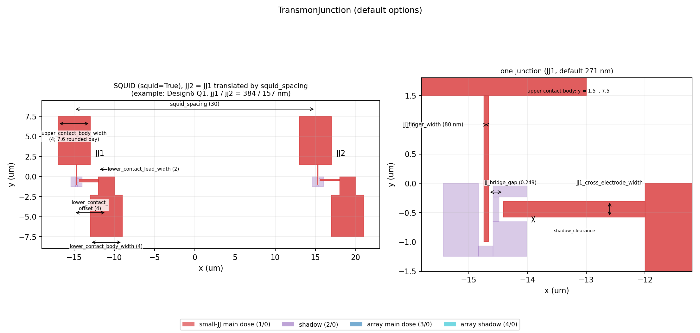

# TransmonJunction

[`transmon_junction.py`](transmon_junction.py) draws a transmon or tunable-coupler Dolan SQUID, or a single JJ. The rules,
the EJ → area → width model and the workflow are in [skill/ebeam_junction.md](../../skill/ebeam_junction.md). The previous
mirrored-pair version is `archive/transmon_junction_layout3.py`.



## Options

Units are µm unless noted.

| Option | Default | Meaning |
|---|---|---|
| `jj_finger_width` | 80 nm | x width of the vertical finger. The right edge is fixed; both branches share it |
| `jj1_cross_electrode_width`, `jj2_cross_electrode_width` | 271 nm, 271 nm | y width of each branch's horizontal electrode, with the top edge fixed. **This sets the junction area** |
| `jj_bridge_gap` | 0.249 | Finger to electrode end face |
| `shadow_clearance` | 0.075 | Shadow openings keep this distance from the cross electrode |
| `squid` | True | False draws only JJ1 (single / test junction) |
| `squid_spacing` | 30 | JJ2 = JJ1 translated by this along +x; never mirrored |
| `upper_contact_body_width` | 4 | Upper rectangular patch: 4 for a 2 µm bay, 7.6 for a 5.6 µm rounded bay |
| `upper_contact_body_length` | 6 | Patch height, y = 1.5 … 7.5 |
| `upper_contact_offset` | 0 | Patch x offset (test bay: 3). When the patch leaves the finger, a 0.5 µm ledge joins them |
| `lower_contact_lead_width` | 2 | Lower stem, y = 0 … −2.3 |
| `lower_contact_body_width` | 4 | Lower body, y = −2.3 … −7.5 |
| `lower_contact_offset` | 4 | x of the lower body centre (the ground-hook centre) from the upper patch centre |
| `lower_contact_lead_offset` | 0 | x of the stem centre relative to the body centre. The electrode runs to the stem, so this and `lower_contact_offset` set the electrode length |
| `layer_jj`, `layer_jj_shadow` | 1, 2 | Main dose and shadow |
| `jj_metal` | True | False draws nothing |

## Geometry

**Frame**:

- The origin is the SQUID centre: x is midway between the two upper patch centres (each at ∓`squid_spacing`/2), and
  y = 0 is the top of the lower stem.
- With `squid=False`, JJ1's upper patch is centred at x = 0.
- Pins `top_jjN` and `bottom_jjN` sit at the patch ends, facing outwards.

**Hooks**:

- The island-hook mouth is expected at y = +2.5, and the upper patch extends 1 µm past it.
- The ground-hook mouth is expected at y = −2.5. With a 4 µm hook, the lower body ends 1 µm past the hook bottom.
- For a ground hook offset below about 3 µm (for example +2 µm), use `lower_contact_offset='2um'` with
  `lower_contact_lead_offset='1um'`. A centred stem would sit 14 nm from the shadow openings, and the component refuses
  it.

**Junction** (relative to the upper patch centre):

- The finger spans x = 0.338 − `jj_finger_width` … 0.338, y = −0.991 … 1.5.
- The electrode runs from 0.338 + `jj_bridge_gap` to the stem, with its top edge at y = −0.304.
- There are five shadow openings: landing, tip, below the electrode, bridge, and above the electrode.

## Usage

```python
from transmon_junction import TransmonJunction
import jj_resistance_model as jjm                     # code/qubit

TransmonJunction(design, 'TC', options=dict(pos_x='0um', pos_y='-1061um', lower_contact_offset='2um',
                                            lower_contact_lead_offset='1um',
                                            **jjm.squid_options(11.528)))                   # 396 / 396 nm
TransmonJunction(design, 'Q1', options=dict(pos_x='-450um', pos_y='-203um', upper_contact_body_width='7.6um',
                                            **jjm.squid_sizes(16.844, 0.333)['options']))   # from EJ_sum and d
TransmonJunction(design, 'KEY', options=dict(squid=False, upper_contact_offset='3um',
                                             jj1_cross_electrode_width='271nm'))            # single test junction
```

Pass the individual branch energies (or EJ_sum and the asymmetry d). An idle or CZ effective EJ is the wrong input.
The component contains no lumped junction or EJ model, and its pins are geometric points only.
